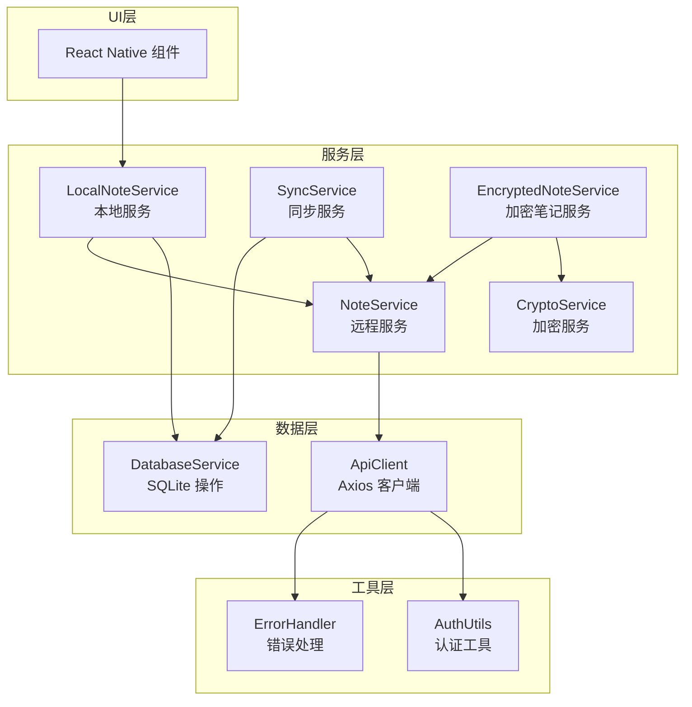
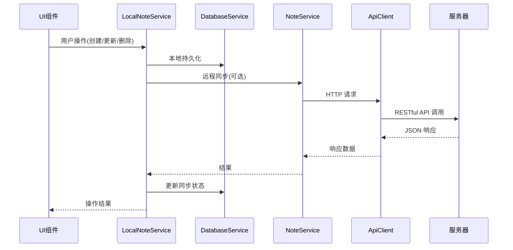
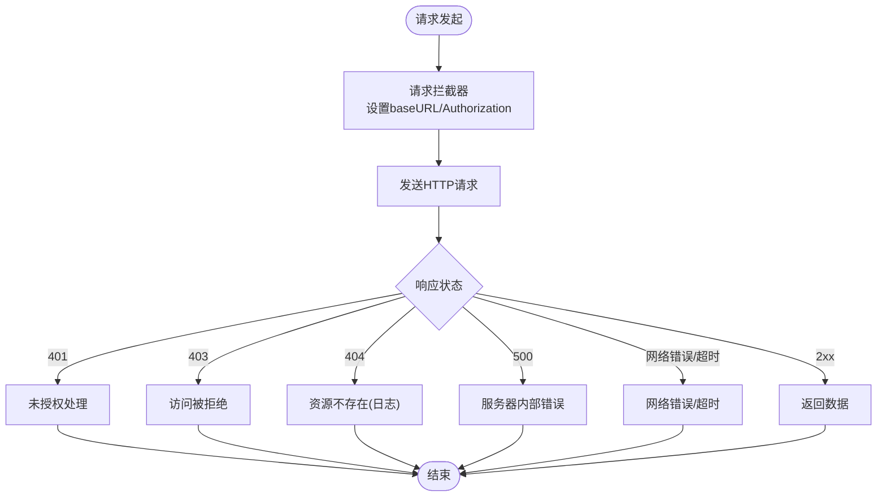
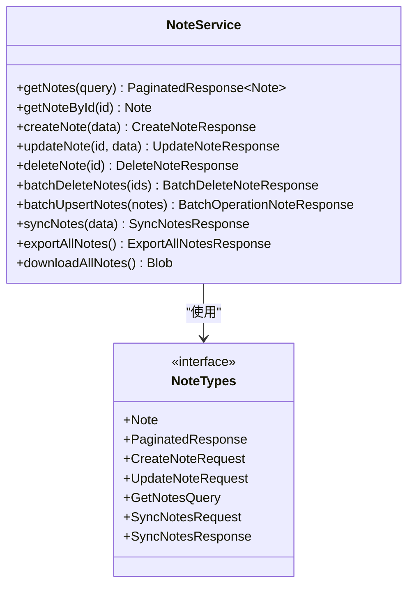
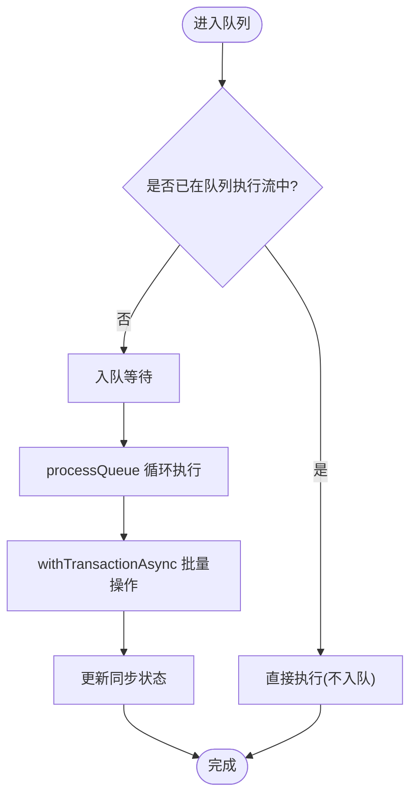
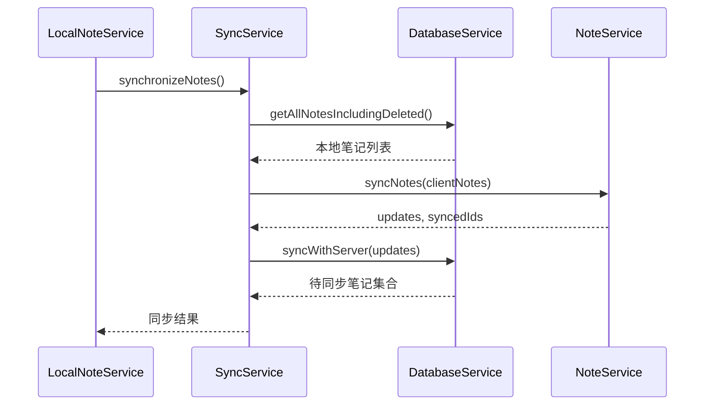
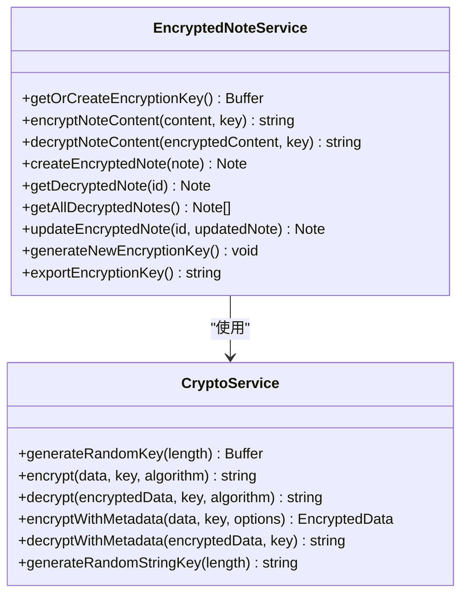
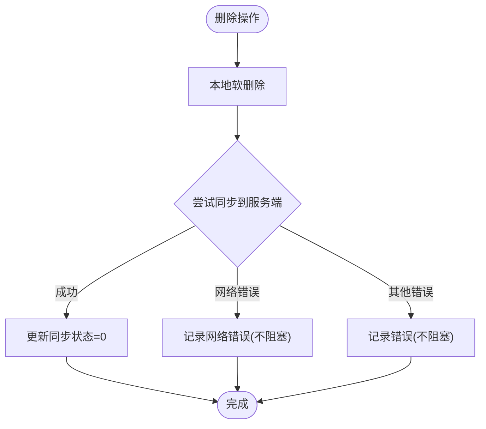

# API接口文档

<cite>
**本文档引用的文件**
- [ApiClient.ts](file://services/api/ApiClient.ts)
- [NoteService.ts](file://services/notes/NoteService.ts)
- [SyncService.ts](file://services/notes/SyncService.ts)
- [DatabaseService.ts](file://services/database/DatabaseService.ts)
- [LocalNoteService.ts](file://services/local/LocalNoteService.ts)
- [CryptoService.ts](file://services/crypto/CryptoService.ts)
- [EncryptedNoteService.ts](file://services/crypto/EncryptedNoteService.ts)
- [NoteTypes.ts](file://types/notes/NoteTypes.ts)
- [CryptoTypes.ts](file://types/crypto/CryptoTypes.ts)
- [AuthUtils.ts](file://utils/auth/AuthUtils.ts)
- [ErrorHandler.ts](file://utils/ErrorHandler.ts)
- [AppInitializationService.ts](file://services/AppInitializationService.ts)
- [api-doc.md](file://api-doc.md)
- [开发文档.md](file://docs/开发文档.md)
- [package.json](file://package.json)
</cite>

## 目录

1. [简介](#简介)
2. [项目结构](#项目结构)
3. [核心组件](#核心组件)
4. [架构总览](#架构总览)
5. [详细组件分析](#详细组件分析)
6. [依赖关系分析](#依赖关系分析)
7. [性能考虑](#性能考虑)
8. [故障排除指南](#故障排除指南)
9. [结论](#结论)
10. [附录](#附录)

## 简介

本文件为 Notes 应用的全面 API 接口文档，涵盖 RESTful API、本地数据库、加密服务、同步机制以及错误处理策略。文档基于仓库中的实际实现，提供接口定义、数据模型、认证方式、错误处理、性能优化建议及客户端实现指南。

## 项目结构

Notes 应用采用分层架构，包含服务层、数据层、加密层和工具层：



**图表来源**

- [LocalNoteService.ts](file://services/local/LocalNoteService.ts#L1-L601)
- [NoteService.ts](file://services/notes/NoteService.ts#L1-L84)
- [SyncService.ts](file://services/notes/SyncService.ts#L1-L58)
- [DatabaseService.ts](file://services/database/DatabaseService.ts#L1-L513)
- [ApiClient.ts](file://services/api/ApiClient.ts#L1-L92)
- [AuthUtils.ts](file://utils/auth/AuthUtils.ts#L1-L65)
- [ErrorHandler.ts](file://utils/ErrorHandler.ts#L1-L48)

**章节来源**

- [开发文档.md](file://docs/开发文档.md#L50-L114)

## 核心组件

- **RESTful API 客户端**：基于 Axios 的 HTTP 客户端，支持动态 baseURL、Bearer Token 认证、请求/响应拦截器和统一错误处理。
- **笔记服务**：提供笔记的增删改查、批量操作、同步、导出等功能。
- **本地数据库服务**：基于 SQLite 的本地存储，提供事务、批处理、同步状态管理等能力。
- **加密服务**：基于 react-native-quick-crypto 的 AES 加密，支持密钥生成、加密/解密、元数据格式。
- **同步服务**：协调本地与服务器的数据同步，采用时间戳冲突解决策略。
- **认证与错误处理**：API Key 管理、URL 校验、网络错误识别与统一处理。

**章节来源**

- [ApiClient.ts](file://services/api/ApiClient.ts#L1-L92)
- [NoteService.ts](file://services/notes/NoteService.ts#L1-L84)
- [DatabaseService.ts](file://services/database/DatabaseService.ts#L1-L513)
- [CryptoService.ts](file://services/crypto/CryptoService.ts#L1-L205)
- [EncryptedNoteService.ts](file://services/crypto/EncryptedNoteService.ts#L1-L186)
- [AuthUtils.ts](file://utils/auth/AuthUtils.ts#L1-L65)
- [ErrorHandler.ts](file://utils/ErrorHandler.ts#L1-L48)

## 架构总览

Notes 应用采用“本地优先 + 云端同步”的架构模式，UI 通过 LocalNoteService 统一接口访问本地与远程资源；DatabaseService 负责 SQLite 持久化；NoteService 通过 ApiClient 与远程 API 交互；EncryptedNoteService 提供端到端加密能力。



**图表来源**

- [LocalNoteService.ts](file://services/local/LocalNoteService.ts#L119-L152)
- [NoteService.ts](file://services/notes/NoteService.ts#L48-L70)
- [DatabaseService.ts](file://services/database/DatabaseService.ts#L434-L444)
- [ApiClient.ts](file://services/api/ApiClient.ts#L16-L41)

**章节来源**

- [开发文档.md](file://docs/开发文档.md#L187-L207)

## 详细组件分析

### RESTful API 客户端（Axios）

- **认证方式**：通过 Authorization 请求头传递 Bearer Token。
- **动态 baseURL**：运行时从安全存储获取 API URL，自动去除末尾斜杠。
- **请求拦截器**：设置 Content-Type、动态 baseURL、注入 Authorization 头。
- **响应拦截器**：统一处理网络错误、超时、401/403/404/500 等状态码，特殊处理删除操作的错误。
- **错误处理策略**：区分网络错误与服务器错误，删除操作在网络错误时采用静默处理。



**图表来源**

- [ApiClient.ts](file://services/api/ApiClient.ts#L16-L41)
- [ApiClient.ts](file://services/api/ApiClient.ts#L51-L89)
- [ErrorHandler.ts](file://utils/ErrorHandler.ts#L18-L42)

**章节来源**

- [ApiClient.ts](file://services/api/ApiClient.ts#L1-L92)
- [AuthUtils.ts](file://utils/auth/AuthUtils.ts#L26-L30)
- [ErrorHandler.ts](file://utils/ErrorHandler.ts#L1-L48)

### 笔记服务（NoteService）

- **接口概览**：
  - 获取笔记列表：GET /notes（支持分页、搜索）
  - 获取笔记详情：GET /notes/:id
  - 创建笔记：POST /notes
  - 更新笔记：PATCH /notes/:id
  - 删除笔记：DELETE /notes/:id
  - 批量删除：DELETE /notes/batch
  - 批量创建/更新：POST /notes/batch
  - 笔记同步：POST /notes/sync
  - 导出所有笔记：GET /notes/export/all
- **数据模型**：Note、PaginatedResponse、批量操作请求/响应等。
- **响应格式**：JSON；部分操作返回 Blob（下载导出）。



**图表来源**

- [NoteService.ts](file://services/notes/NoteService.ts#L22-L84)
- [NoteTypes.ts](file://types/notes/NoteTypes.ts#L1-L109)

**章节来源**

- [NoteService.ts](file://services/notes/NoteService.ts#L1-L84)
- [NoteTypes.ts](file://types/notes/NoteTypes.ts#L1-L109)
- [api-doc.md](file://api-doc.md#L40-L449)

### 本地数据库服务（DatabaseService）

- **核心能力**：
  - 数据库连接管理与初始化
  - 任务队列与并发控制（重入锁、防死锁）
  - 事务批处理（创建、更新、删除）
  - 同步状态管理（0=已同步，1=待同步）
  - 冲突解决（时间戳比较）
- **性能优化**：
  - 使用 Map 进行内存对比，减少重复查询
  - 事务包裹批量操作，保证原子性
  - 动态获取数据库实例，避免空指针



**图表来源**

- [DatabaseService.ts](file://services/database/DatabaseService.ts#L62-L115)
- [DatabaseService.ts](file://services/database/DatabaseService.ts#L160-L205)
- [DatabaseService.ts](file://services/database/DatabaseService.ts#L211-L260)

**章节来源**

- [DatabaseService.ts](file://services/database/DatabaseService.ts#L1-L513)

### 同步服务（SyncService）

- **同步流程**：
  - 获取本地所有笔记（包含软删除）
  - 发送至服务器进行合并
  - 若有更新，写入本地数据库
- **冲突解决**：以更新时间戳较新的版本为准
- **异常处理**：捕获错误并抛出，供上层处理



**图表来源**

- [SyncService.ts](file://services/notes/SyncService.ts#L13-L36)
- [DatabaseService.ts](file://services/database/DatabaseService.ts#L211-L260)
- [NoteService.ts](file://services/notes/NoteService.ts#L69-L70)

**章节来源**

- [SyncService.ts](file://services/notes/SyncService.ts#L1-L58)
- [DatabaseService.ts](file://services/database/DatabaseService.ts#L211-L260)

### 加密服务（CryptoService 与 EncryptedNoteService）

- **加密能力**：
  - 随机密钥生成（32字节，默认 aes-256-cbc）
  - 加密/解密（含 IV 拼接格式）
  - 元数据格式（包含算法、时间戳）
  - 字符串密钥处理（自动哈希）
- **加密笔记服务**：
  - 自动获取/创建加密密钥
  - 创建/更新/获取笔记时自动加解密
  - 导出密钥（Base64）



**图表来源**

- [CryptoService.ts](file://services/crypto/CryptoService.ts#L10-L205)
- [EncryptedNoteService.ts](file://services/crypto/EncryptedNoteService.ts#L11-L186)
- [CryptoTypes.ts](file://types/crypto/CryptoTypes.ts#L1-L44)

**章节来源**

- [CryptoService.ts](file://services/crypto/CryptoService.ts#L1-L205)
- [EncryptedNoteService.ts](file://services/crypto/EncryptedNoteService.ts#L1-L186)
- [CryptoTypes.ts](file://types/crypto/CryptoTypes.ts#L1-L44)

### 本地笔记服务（LocalNoteService）

- **核心职责**：统一本地优先的操作接口，协调本地数据库与远程 API。
- **关键操作**：
  - CRUD 操作（本地持久化）
  - 批量创建/更新/删除
  - 安全删除（先检查服务端状态）
  - 同步（上传本地笔记并应用服务器更新）
  - 导出/下载（JSON 格式）
- **错误处理策略**：删除操作在网络错误时不阻塞本地删除，保持待同步状态。



**图表来源**

- [LocalNoteService.ts](file://services/local/LocalNoteService.ts#L119-L152)

**章节来源**

- [LocalNoteService.ts](file://services/local/LocalNoteService.ts#L1-L601)

### 认证与安全

- **API Key 管理**：支持环境变量与安全存储双重来源，正则校验格式。
- **API URL 校验**：开发环境允许 http/https，生产环境强制 https。
- **加密存储**：API Key 与加密密钥使用安全存储（Expo Secure Store）。

**章节来源**

- [AuthUtils.ts](file://utils/auth/AuthUtils.ts#L1-L65)

### 错误处理与监控

- **统一错误处理**：区分网络错误、服务器错误、删除操作静默处理。
- **日志策略**：404 视为正常情况记录日志；网络错误/超时输出简要信息；其他错误输出详细信息。
- **监控建议**：结合应用内日志与服务端日志进行问题定位。

**章节来源**

- [ErrorHandler.ts](file://utils/ErrorHandler.ts#L1-L48)
- [ApiClient.ts](file://services/api/ApiClient.ts#L51-L89)

## 依赖关系分析

```mermaid
graph TB
PN[package.json 依赖] --> AX[Axios]
PN --> ESQ[expo-sqlite]
PN --> RNC[react-native-quick-crypto]
PN --> ASS[@react-native-async-storage]
PN --> ESS[expo-secure-store]
AX --> AU[AuthUtils]
AX --> EH[ErrorHandler]
LNS[LocalNoteService] --> DB[DatabaseService]
LNS --> NS[NoteService]
NS --> AX
SS[SyncService] --> NS
SS --> DB
ENCS[EncryptedNoteService] --> CS[CryptoService]
ENCS --> NS
```

**图表来源**

- [package.json](file://package.json#L14-L41)
- [ApiClient.ts](file://services/api/ApiClient.ts#L1-L11)
- [LocalNoteService.ts](file://services/local/LocalNoteService.ts#L1-L17)
- [DatabaseService.ts](file://services/database/DatabaseService.ts#L1-L5)
- [NoteService.ts](file://services/notes/NoteService.ts#L1-L18)
- [SyncService.ts](file://services/notes/SyncService.ts#L1-L4)
- [EncryptedNoteService.ts](file://services/crypto/EncryptedNoteService.ts#L1-L5)
- [CryptoService.ts](file://services/crypto/CryptoService.ts#L1-L4)

**章节来源**

- [package.json](file://package.json#L1-L69)

## 性能考虑

- **数据库批处理**：使用事务包裹批量创建/更新/删除，提升吞吐量并保证一致性。
- **内存对比**：同步时一次性加载本地索引，使用 Map 进行内存对比，避免重复查询。
- **队列与并发控制**：任务队列+重入锁防止嵌套调用死锁，提升高并发稳定性。
- **网络超时与重试**：Axios 超时配置（30 秒），配合删除操作的静默处理降低用户体验影响。
- **索引优化**：建议在服务端为标题字段建立索引以提升搜索性能。

[本节为通用性能建议，无需具体文件分析]

## 故障排除指南

- **认证失败（401）**：检查 API Key 格式与来源，确认环境变量与安全存储配置。
- **网络错误/超时**：检查网络连通性与代理设置，适当调整超时时间。
- **删除操作失败**：若为网络错误，本地仍保持待同步状态；可稍后重试同步。
- **同步冲突**：以更新时间戳较新的版本为准，检查客户端时间同步。
- **加密异常**：确认密钥格式与长度，必要时重新生成密钥并备份。

**章节来源**

- [AuthUtils.ts](file://utils/auth/AuthUtils.ts#L22-L30)
- [ApiClient.ts](file://services/api/ApiClient.ts#L62-L84)
- [LocalNoteService.ts](file://services/local/LocalNoteService.ts#L119-L152)
- [DatabaseService.ts](file://services/database/DatabaseService.ts#L211-L260)
- [EncryptedNoteService.ts](file://services/crypto/EncryptedNoteService.ts#L169-L182)

## 结论

Notes 应用通过清晰的服务分层、完善的本地数据库与加密机制、稳健的同步策略以及统一的错误处理，提供了可靠的笔记管理能力。RESTful API 设计简洁明确，配合本地优先与云端同步的混合架构，能够在弱网环境下保持良好体验。

[本节为总结性内容，无需具体文件分析]

## 附录

### RESTful API 接口定义

- **基础信息**
  - 基础 URL：/api/notes
  - 认证方式：Bearer Token（Authorization 头）
  - 请求头：Content-Type: application/json
  - 响应格式：JSON
- **端点概览**
  - GET /api/notes（分页、搜索）
  - GET /api/notes/:id
  - POST /api/notes
  - PATCH /api/notes/:id
  - DELETE /api/notes/:id
  - DELETE /api/notes/batch
  - POST /api/notes/batch
  - POST /api/notes/sync
  - GET /api/notes/export/all

**章节来源**

- [api-doc.md](file://api-doc.md#L7-L13)
- [api-doc.md](file://api-doc.md#L40-L449)

### 数据模型

- **Note 对象**：id、title、content、is_encrypted、sync_status、is_deleted、created_at、updated_at
- **分页响应**：total、data、page、limit
- **加密数据**：encrypted、iv、algorithm、timestamp

**章节来源**

- [NoteTypes.ts](file://types/notes/NoteTypes.ts#L2-L11)
- [NoteTypes.ts](file://types/notes/NoteTypes.ts#L14-L19)
- [CryptoTypes.ts](file://types/crypto/CryptoTypes.ts#L16-L25)

### 安全与合规

- **传输安全**：生产环境强制 HTTPS；开发环境允许 HTTP/HTTPS。
- **密钥管理**：API Key 与加密密钥使用安全存储，避免明文存储。
- **错误信息**：避免在错误响应中泄露敏感信息。

**章节来源**

- [AuthUtils.ts](file://utils/auth/AuthUtils.ts#L42-L53)
- [AuthUtils.ts](file://utils/auth/AuthUtils.ts#L10-L20)

### 客户端实现指南

- **初始化**：先初始化本地数据库，再启动定时同步任务。
- **操作流程**：优先本地持久化，异步同步至服务器；删除操作在网络错误时保持本地状态。
- **加密使用**：创建/更新笔记时自动加解密；导出时注意密钥备份。

**章节来源**

- [LocalNoteService.ts](file://services/local/LocalNoteService.ts#L20-L28)
- [AppInitializationService.ts](file://services/AppInitializationService.ts#L16-L37)
- [EncryptedNoteService.ts](file://services/crypto/EncryptedNoteService.ts#L74-L89)

### 版本信息与迁移

- **当前版本**：1.0.0（发布于 2026-01-23）
- **迁移建议**：新增字段时保持向后兼容；变更 API 时提供过渡期并在客户端做降级处理。

**章节来源**

- [开发文档.md](file://docs/开发文档.md#L460-L465)
