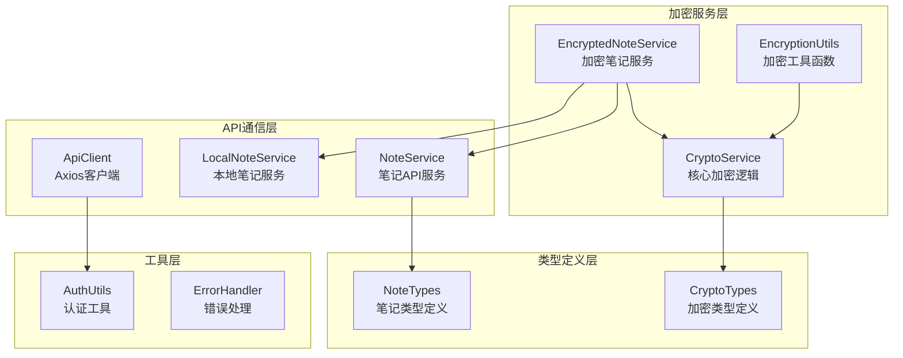
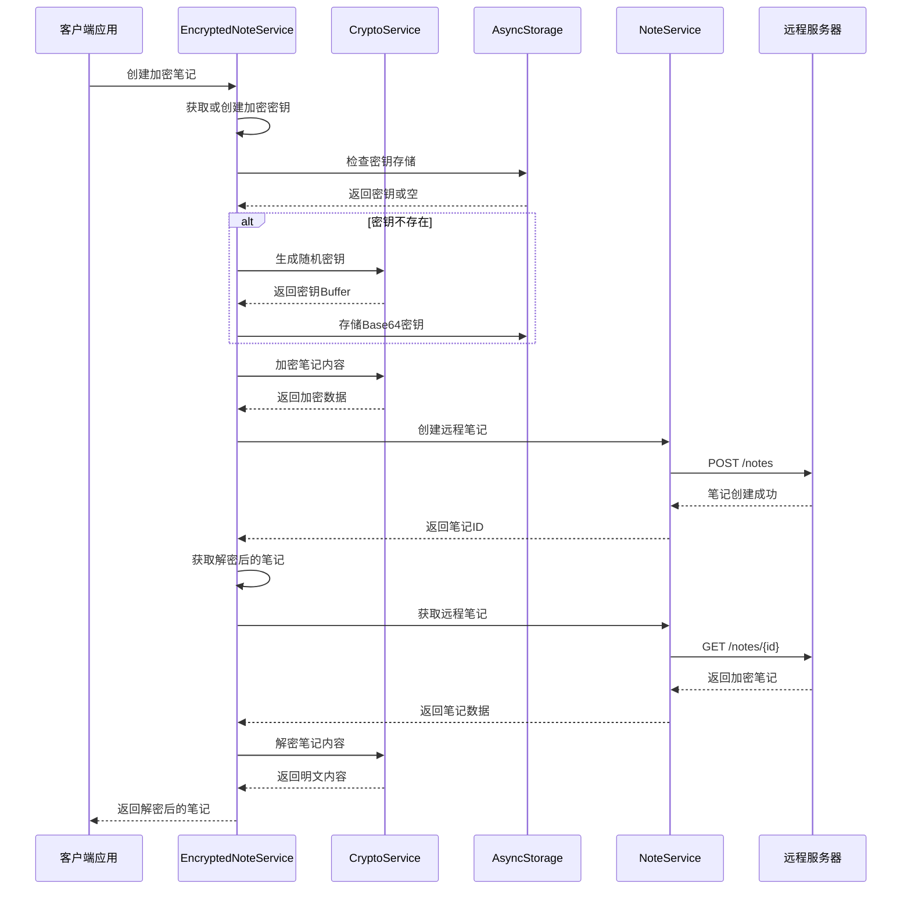
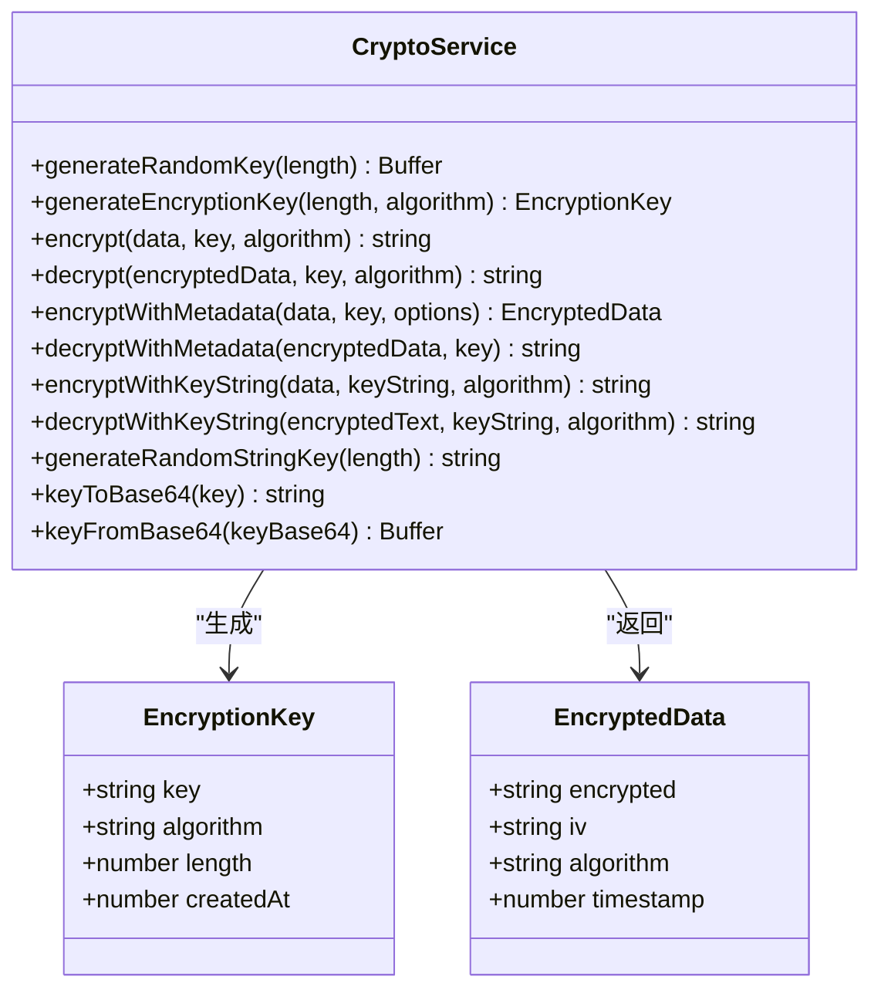
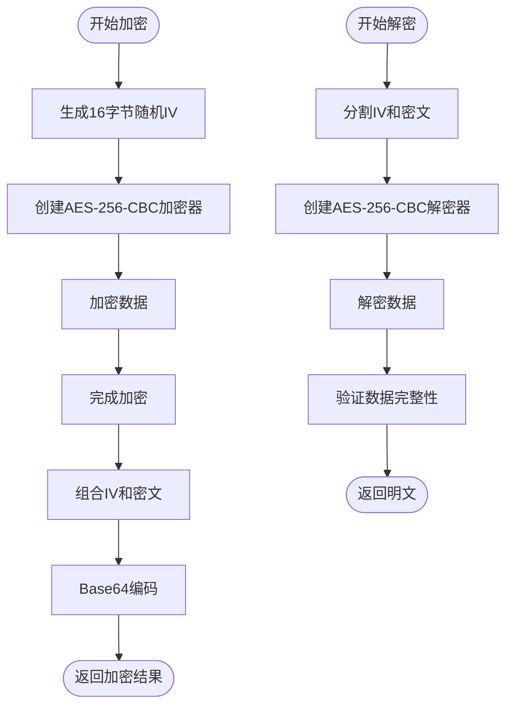
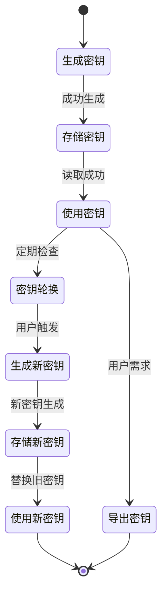
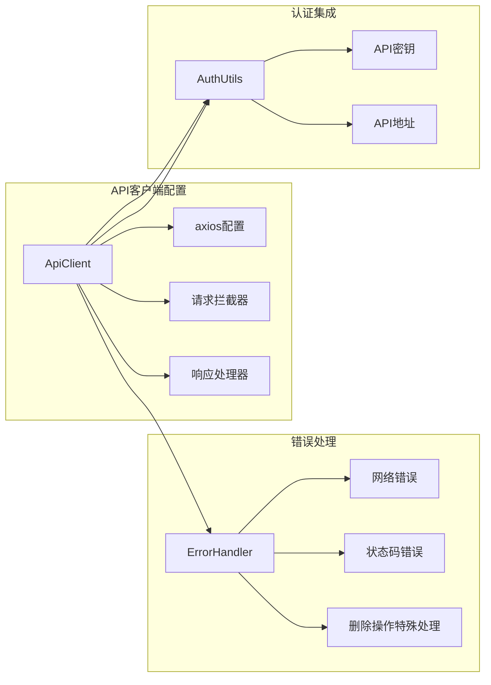
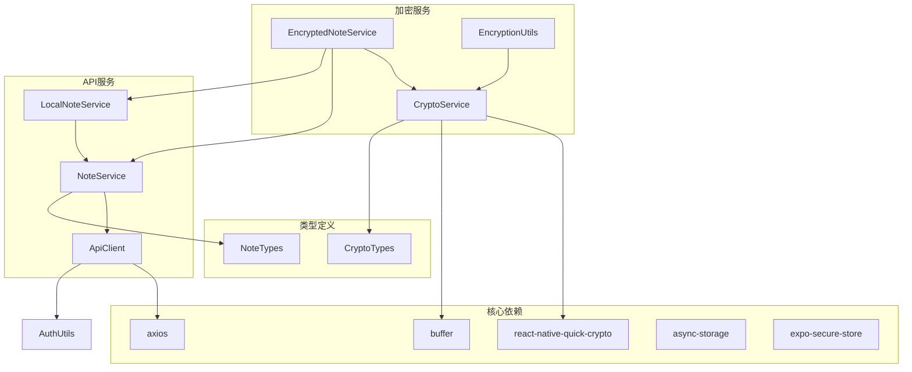

# 加密API接口

<cite>
**本文档引用的文件**
- [CryptoService.ts](file://services/crypto/CryptoService.ts)
- [EncryptedNoteService.ts](file://services/crypto/EncryptedNoteService.ts)
- [CryptoTypes.ts](file://types/crypto/CryptoTypes.ts)
- [EncryptionUtils.ts](file://utils/crypto/EncryptionUtils.ts)
- [ApiClient.ts](file://services/api/ApiClient.ts)
- [AuthUtils.ts](file://utils/auth/AuthUtils.ts)
- [NoteService.ts](file://services/notes/NoteService.ts)
- [LocalNoteService.ts](file://services/local/LocalNoteService.ts)
- [NoteTypes.ts](file://types/notes/NoteTypes.ts)
- [EncryptionExample.tsx](file://components/EncryptionExample.tsx)
- [package.json](file://package.json)
- [ErrorHandler.ts](file://utils/ErrorHandler.ts)
</cite>

## 目录

1. [简介](#简介)
2. [项目结构](#项目结构)
3. [核心组件](#核心组件)
4. [架构概览](#架构概览)
5. [详细组件分析](#详细组件分析)
6. [依赖关系分析](#依赖关系分析)
7. [性能考虑](#性能考虑)
8. [故障排除指南](#故障排除指南)
9. [结论](#结论)

## 简介

本项目实现了一个完整的加密API接口系统，专注于数据加密、密钥管理和安全存储。系统基于AES-256-CBC加密算法，提供了从密钥生成、数据加密/解密到密钥轮换的完整解决方案。该系统采用React Native技术栈，结合Expo框架，实现了跨平台的加密功能。

加密API接口的核心目标是为笔记应用提供安全的数据存储解决方案，确保用户敏感信息在传输和存储过程中的安全性。系统支持多种密钥格式和加密模式，包括Base64密钥、字符串密钥以及带元数据的加密格式。

## 项目结构

项目采用模块化架构设计，主要分为以下几个核心模块：



**图表来源**

- [CryptoService.ts](file://services/crypto/CryptoService.ts#L1-L205)
- [EncryptedNoteService.ts](file://services/crypto/EncryptedNoteService.ts#L1-L186)
- [EncryptionUtils.ts](file://utils/crypto/EncryptionUtils.ts#L1-L112)

**章节来源**

- [package.json](file://package.json#L14-L41)

## 核心组件

### CryptoService - 核心加密服务

CryptoService是整个加密系统的核心，提供了AES-256-CBC加密的所有基础功能：

- **密钥生成**: 支持随机密钥生成和带元数据的密钥生成
- **数据加密/解密**: 提供多种加密模式，包括标准加密和带元数据加密
- **密钥格式转换**: 支持Base64和Buffer格式之间的转换
- **字符串密钥处理**: 自动处理字符串密钥的长度和哈希转换

### EncryptedNoteService - 加密笔记服务

EncryptedNoteService专门处理笔记内容的加密存储，集成了完整的密钥管理和数据流：

- **密钥生命周期管理**: 自动创建、存储和轮换加密密钥
- **笔记加密存储**: 将笔记内容加密后存储到远程服务器
- **透明解密**: 在获取笔记时自动解密内容
- **密钥导入导出**: 支持密钥的备份和恢复

### EncryptionUtils - 加密工具函数

EncryptionUtils提供了便捷的加密操作接口，简化了加密服务的使用：

- **统一的加密接口**: 为不同加密场景提供标准化的函数
- **类型安全**: 基于TypeScript类型定义，确保编译时类型安全
- **错误处理**: 内置基本的错误处理机制

**章节来源**

- [CryptoService.ts](file://services/crypto/CryptoService.ts#L10-L205)
- [EncryptedNoteService.ts](file://services/crypto/EncryptedNoteService.ts#L11-L186)
- [EncryptionUtils.ts](file://utils/crypto/EncryptionUtils.ts#L1-L112)

## 架构概览

系统采用分层架构设计，确保职责分离和代码可维护性：



**图表来源**

- [EncryptedNoteService.ts](file://services/crypto/EncryptedNoteService.ts#L74-L89)
- [NoteService.ts](file://services/notes/NoteService.ts#L48-L52)

**章节来源**

- [EncryptedNoteService.ts](file://services/crypto/EncryptedNoteService.ts#L1-L186)
- [NoteService.ts](file://services/notes/NoteService.ts#L1-L84)

## 详细组件分析

### CryptoService 类分析

CryptoService实现了完整的AES-256-CBC加密功能，包含以下核心方法：



**图表来源**

- [CryptoService.ts](file://services/crypto/CryptoService.ts#L16-L204)
- [CryptoTypes.ts](file://types/crypto/CryptoTypes.ts#L5-L25)

#### AES-256-CBC 加密流程

系统使用AES-256-CBC算法进行加密，具体流程如下：



**图表来源**

- [CryptoService.ts](file://services/crypto/CryptoService.ts#L65-L101)

#### 密钥管理机制

系统实现了完整的密钥生命周期管理：



**图表来源**

- [EncryptedNoteService.ts](file://services/crypto/EncryptedNoteService.ts#L18-L37)
- [EncryptedNoteService.ts](file://services/crypto/EncryptedNoteService.ts#L169-L173)

**章节来源**

- [CryptoService.ts](file://services/crypto/CryptoService.ts#L1-L205)
- [CryptoTypes.ts](file://types/crypto/CryptoTypes.ts#L1-L44)

### EncryptedNoteService 类分析

EncryptedNoteService专门处理笔记的加密存储，提供了完整的端到端加密解决方案：

```mermaid
sequenceDiagram
participant Client as 客户端
participant ENS as EncryptedNoteService
participant CS as CryptoService
participant Storage as AsyncStorage
participant API as NoteService
Note : 创建加密笔记流程
Client->>ENS : createEncryptedNote(note)
ENS->>ENS : getOrCreateEncryptionKey()
ENS->>Storage : getItem("ENCRYPTED_NOTES_KEY")
Storage-->>ENS : 密钥或null
alt 密钥不存在
ENS->>CS : generateRandomKey()
CS-->>ENS : 新密钥Buffer
ENS->>CS : keyToBase64()
CS-->>ENS : Base64密钥
ENS->>Storage : setItem(Base64密钥)
end
ENS->>CS : encryptNoteContent(content, key)
CS-->>ENS : 加密内容
ENS->>API : createNote(noteWithEncryptedContent)
API-->>ENS : 返回笔记ID
ENS->>ENS : getDecryptedNote(id)
API->>ENS : getNoteById(id)
ENS->>CS : decryptNoteContent(encryptedContent, key)
CS-->>ENS : 明文内容
ENS-->>Client : 返回解密后的笔记
```

**图表来源**

- [EncryptedNoteService.ts](file://services/crypto/EncryptedNoteService.ts#L74-L111)

#### 数据完整性验证

系统通过以下机制确保数据完整性：

1. **IV向量处理**: 每次加密都生成随机IV，确保相同明文产生不同密文
2. **格式规范**: 加密数据采用"IV:密文"的格式，便于解密时分离
3. **错误检测**: 解密过程中捕获格式错误和解密失败异常

**章节来源**

- [EncryptedNoteService.ts](file://services/crypto/EncryptedNoteService.ts#L1-L186)

### API客户端集成

系统通过ApiClient实现与后端服务的通信，集成了完整的错误处理机制：



**图表来源**

- [ApiClient.ts](file://services/api/ApiClient.ts#L6-L92)
- [AuthUtils.ts](file://utils/auth/AuthUtils.ts#L27-L30)

**章节来源**

- [ApiClient.ts](file://services/api/ApiClient.ts#L1-L92)
- [AuthUtils.ts](file://utils/auth/AuthUtils.ts#L1-L65)

## 依赖关系分析

系统依赖关系清晰，各模块职责明确：



**图表来源**

- [package.json](file://package.json#L14-L41)
- [CryptoService.ts](file://services/crypto/CryptoService.ts#L1-L5)

**章节来源**

- [package.json](file://package.json#L14-L41)

## 性能考虑

### 加密性能优化

1. **异步操作**: 所有加密操作都是异步的，避免阻塞主线程
2. **内存管理**: 及时释放Buffer对象，避免内存泄漏
3. **批量处理**: 支持批量加密和解密操作，提高效率

### 缓存策略

1. **密钥缓存**: 加密密钥在内存中缓存，避免重复生成
2. **连接复用**: Axios客户端复用HTTP连接
3. **本地存储**: 使用AsyncStorage减少网络请求

### 错误处理优化

1. **渐进式错误处理**: 网络错误时提供降级方案
2. **重试机制**: 对临时性错误提供重试机会
3. **用户反馈**: 及时向用户反馈操作状态

## 故障排除指南

### 常见加密错误

| 错误类型     | 可能原因                   | 解决方案                     |
| ------------ | -------------------------- | ---------------------------- |
| 密钥格式错误 | Base64密钥损坏或格式不正确 | 重新生成密钥或检查密钥格式   |
| 解密失败     | IV向量不匹配或密钥错误     | 验证密钥完整性，重新生成密钥 |
| 网络超时     | 服务器响应慢或网络不稳定   | 检查网络连接，增加超时时间   |
| 存储失败     | AsyncStroage不可用         | 检查设备存储权限             |

### 调试建议

1. **启用详细日志**: 在开发环境中启用详细的加密日志
2. **测试密钥轮换**: 定期测试密钥轮换功能
3. **监控性能指标**: 监控加密操作的性能表现

**章节来源**

- [ErrorHandler.ts](file://utils/ErrorHandler.ts#L1-L48)
- [ApiClient.ts](file://services/api/ApiClient.ts#L51-L89)

## 结论

本加密API接口系统提供了完整的数据加密解决方案，具有以下特点：

1. **安全性**: 基于AES-256-CBC算法，确保数据传输和存储安全
2. **易用性**: 提供简洁的API接口，支持多种密钥格式
3. **可靠性**: 实现了完整的错误处理和降级机制
4. **可扩展性**: 模块化设计，易于添加新的加密功能

系统特别适合需要保护用户敏感信息的应用场景，如笔记应用、密码管理器等。通过合理的密钥管理和数据流设计，确保了用户数据的安全性和隐私保护。

未来可以考虑的功能增强：

- 支持更多的加密算法
- 实现密钥派生函数
- 添加数据完整性校验
- 支持硬件安全模块(HSM)
