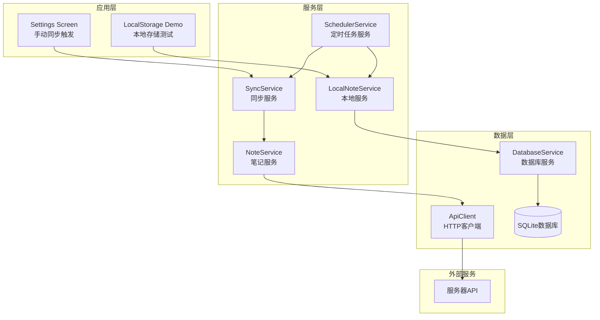
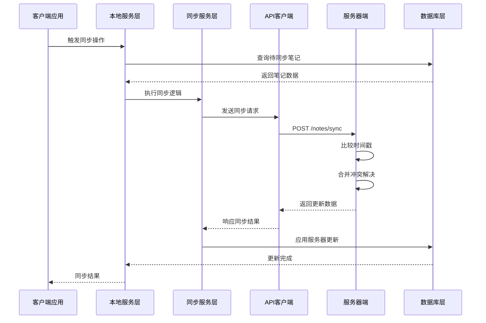
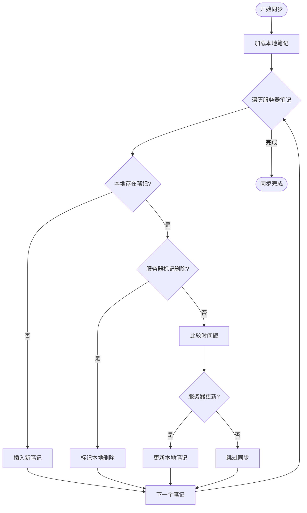
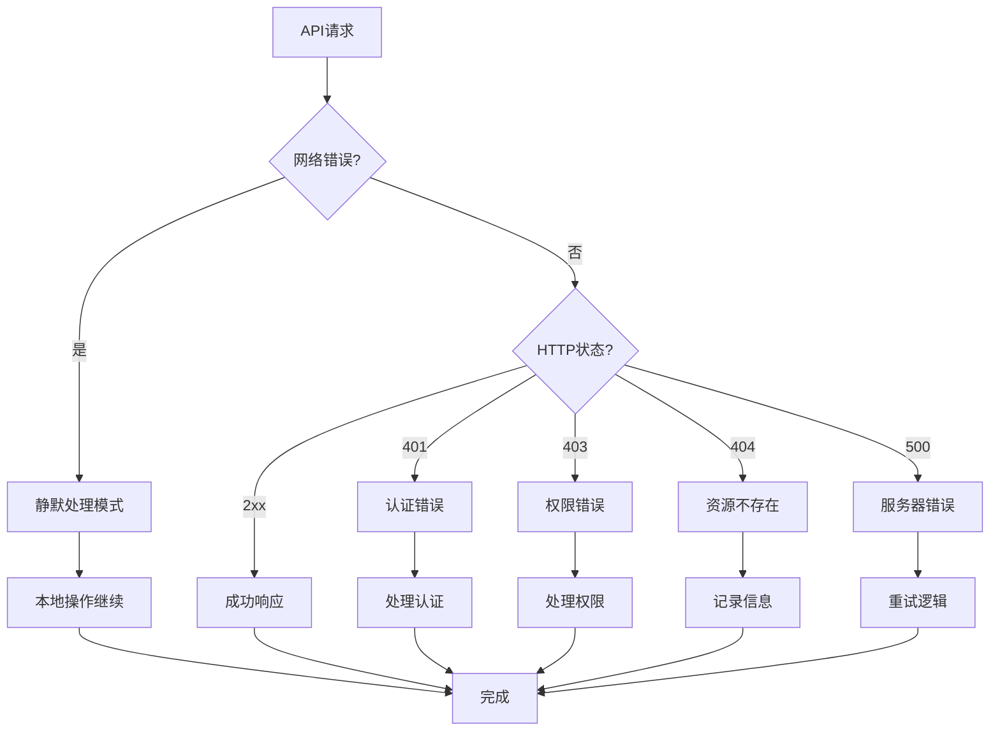
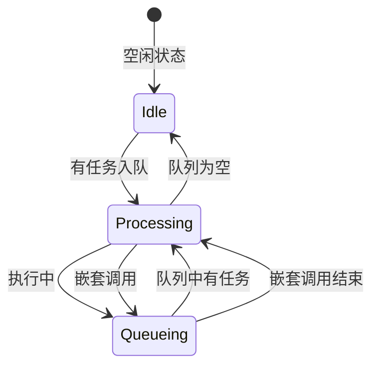
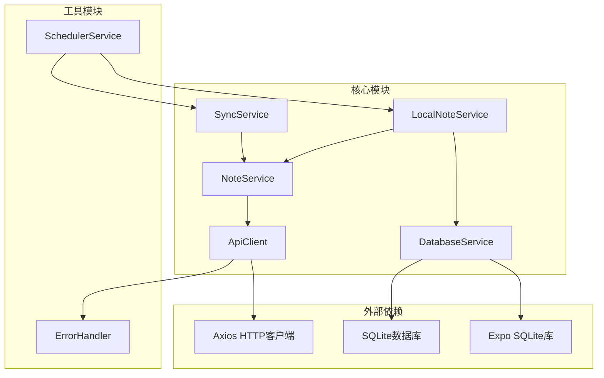

# 同步API接口

<cite>
**本文档引用的文件**
- [SyncService.ts](file://services/notes/SyncService.ts)
- [NoteService.ts](file://services/notes/NoteService.ts)
- [ApiClient.ts](file://services/api/ApiClient.ts)
- [NoteTypes.ts](file://types/notes/NoteTypes.ts)
- [LocalNoteService.ts](file://services/local/LocalNoteService.ts)
- [DatabaseService.ts](file://services/database/DatabaseService.ts)
- [SchedulerService.ts](file://services/scheduler/SchedulerService.ts)
- [ErrorHandler.ts](file://utils/ErrorHandler.ts)
- [settings.tsx](file://app/settings.tsx)
- [开发文档.md](file://docs/开发文档.md)
</cite>

## 目录

1. [简介](#简介)
2. [项目结构](#项目结构)
3. [核心组件](#核心组件)
4. [架构概览](#架构概览)
5. [详细组件分析](#详细组件分析)
6. [依赖关系分析](#依赖关系分析)
7. [性能考虑](#性能考虑)
8. [故障排除指南](#故障排除指南)
9. [结论](#结论)

## 简介

本文件为同步API接口的全面技术文档，详细记录了笔记同步相关的API端点、工作机制、冲突解决策略和数据一致性保证。系统采用基于时间戳的冲突解决策略，通过本地SQLite数据库和服务器端的双向同步机制，确保数据的一致性和可靠性。

## 项目结构

同步功能涉及多个层次的服务模块，形成了清晰的分层架构：



**图表来源**

- [settings.tsx](file://app/settings.tsx#L15-L24)
- [SyncService.ts](file://services/notes/SyncService.ts#L13-L36)
- [NoteService.ts](file://services/notes/NoteService.ts#L69-L70)
- [DatabaseService.ts](file://services/database/DatabaseService.ts#L147-L155)

**章节来源**

- [settings.tsx](file://app/settings.tsx#L1-L119)
- [SyncService.ts](file://services/notes/SyncService.ts#L1-L58)
- [NoteService.ts](file://services/notes/NoteService.ts#L1-L84)

## 核心组件

### 同步服务模块

同步服务提供核心的同步功能，包括完整的双向同步和增量同步两种模式：

- **完整同步**：获取所有本地笔记（包括软删除的）并发送到服务器
- **增量同步**：仅同步标记为待同步的笔记
- **冲突解决**：基于时间戳比较的自动冲突解决机制

### 笔记服务模块

提供REST API接口封装，支持以下同步相关的操作：

- `/notes/sync`：手动同步端点
- `/notes/export/all`：数据导出端点
- `/notes`：笔记列表查询
- `/notes/:id`：单个笔记操作

### 数据库服务模块

实现本地SQLite数据库的完整CRUD操作，包含：

- 事务性批量操作
- 同步状态管理
- 冲突解决算法
- 任务队列机制

**章节来源**

- [SyncService.ts](file://services/notes/SyncService.ts#L10-L36)
- [NoteService.ts](file://services/notes/NoteService.ts#L69-L70)
- [DatabaseService.ts](file://services/database/DatabaseService.ts#L211-L260)

## 架构概览

同步系统采用分层架构设计，确保高可用性和数据一致性：



**图表来源**

- [SyncService.ts](file://services/notes/SyncService.ts#L13-L36)
- [NoteService.ts](file://services/notes/NoteService.ts#L69-L70)
- [DatabaseService.ts](file://services/database/DatabaseService.ts#L211-L260)

## 详细组件分析

### 同步机制工作原理

#### 时间戳比较逻辑

系统采用基于`updated_at`字段的时间戳比较机制：



**图表来源**

- [DatabaseService.ts](file://services/database/DatabaseService.ts#L217-L256)

#### 冲突解决策略

系统实现基于时间戳的冲突解决策略：

1. **服务器优先**：当服务器笔记更新时间戳较新时，覆盖本地数据
2. **本地优先**：当本地笔记更新时间戳较新时，保持本地数据
3. **删除同步**：服务器标记删除的笔记会在本地同步删除状态
4. **新增处理**：本地不存在但服务器存在的笔记会被插入

#### 同步状态管理

同步状态通过`sync_status`字段管理：

- **0**：已同步（sync_status = 0）
- **1**：待同步（sync_status = 1）

状态转换规则：

- 新创建/更新的笔记：sync_status = 1（待同步）
- 同步成功后的笔记：sync_status = 0（已同步）
- 删除标记的笔记：is_deleted = 1，sync_status = 1（待同步）

**章节来源**

- [DatabaseService.ts](file://services/database/DatabaseService.ts#L211-L260)
- [DatabaseService.ts](file://services/database/DatabaseService.ts#L434-L444)

### API端点详细说明

#### POST /notes/sync（手动同步）

**请求格式**：

```typescript
interface SyncNotesRequest {
  clientNotes: Note[];
}

interface Note {
  id: string;
  title: string;
  content: string;
  is_encrypted: number;
  sync_status: number;
  is_deleted: number;
  created_at: string;
  updated_at: string;
}
```

**响应格式**：

```typescript
interface SyncNotesResponse {
  success: boolean;
  updates: Note[];
  syncedIds: string[];
}
```

**请求流程**：

1. 获取所有本地笔记（包括软删除的）
2. 发送至服务器进行冲突解决
3. 接收服务器返回的更新数据
4. 应用更新到本地数据库

**章节来源**

- [NoteService.ts](file://services/notes/NoteService.ts#L69-L70)
- [NoteTypes.ts](file://types/notes/NoteTypes.ts#L98-L109)

#### GET /notes/sync/status（同步状态查询）

**注意**：根据当前代码实现，系统并未提供专门的同步状态查询端点。同步状态主要通过以下方式获取：

- 本地数据库查询：`getNotesToSync()`获取待同步笔记
- 同步结果：通过同步响应中的`updates`和`syncedIds`字段

**章节来源**

- [DatabaseService.ts](file://services/database/DatabaseService.ts#L392-L398)

#### POST /notes/export/all（数据导出）

**请求格式**：

- 方法：GET
- 路径：/notes/export/all
- 响应类型：Blob（二进制数据）

**响应格式**：

```typescript
interface ExportAllNotesResponse {
  success: boolean;
  timestamp: string;
  count: number;
  data: Note[];
}
```

**功能特性**：

- 导出所有未删除的笔记
- 包含完整的笔记元数据
- 支持JSON格式下载

**章节来源**

- [NoteService.ts](file://services/notes/NoteService.ts#L22-L30)
- [NoteTypes.ts](file://types/notes/NoteTypes.ts#L21-L27)

### 错误处理和重试机制

#### 网络异常处理

系统实现了多层次的网络错误处理：



**图表来源**

- [ApiClient.ts](file://services/api/ApiClient.ts#L51-L89)
- [ErrorHandler.ts](file://utils/ErrorHandler.ts#L18-L47)

#### 重试机制

系统采用渐进式重试策略：

1. **删除操作的静默重试**：网络错误时不中断本地删除操作
2. **批量操作的容错处理**：批量删除失败时逐个重试
3. **定时任务的自动重试**：SchedulerService定期执行同步任务

**章节来源**

- [LocalNoteService.ts](file://services/local/LocalNoteService.ts#L119-L152)
- [SchedulerService.ts](file://services/scheduler/SchedulerService.ts#L123-L176)

### 数据一致性保证

#### 事务性操作

所有数据库操作都在事务上下文中执行，确保操作的原子性：

- 批量创建：使用`withTransactionAsync`确保创建完整性
- 批量更新：事务内按顺序执行更新操作
- 批量删除：软删除标记和状态更新在同一事务中完成

#### 任务队列机制

系统实现了一个智能的任务队列，避免并发冲突：



**图表来源**

- [DatabaseService.ts](file://services/database/DatabaseService.ts#L62-L115)

**章节来源**

- [DatabaseService.ts](file://services/database/DatabaseService.ts#L169-L205)
- [DatabaseService.ts](file://services/database/DatabaseService.ts#L62-L115)

## 依赖关系分析

同步系统的依赖关系呈现清晰的分层结构：



**图表来源**

- [SyncService.ts](file://services/notes/SyncService.ts#L1-L3)
- [NoteService.ts](file://services/notes/NoteService.ts#L18)
- [DatabaseService.ts](file://services/database/DatabaseService.ts#L1-L2)

**章节来源**

- [SyncService.ts](file://services/notes/SyncService.ts#L1-L3)
- [NoteService.ts](file://services/notes/NoteService.ts#L1-L18)
- [DatabaseService.ts](file://services/database/DatabaseService.ts#L1-L5)

## 性能考虑

### 数据库优化

1. **内存映射对比**：同步时一次性加载所有本地笔记到内存Map，避免重复数据库查询
2. **批量操作**：使用事务包装批量操作，减少数据库往返次数
3. **索引优化**：基于`updated_at`和`id`字段建立查询优化

### 网络优化

1. **连接复用**：Axios实例复用HTTP连接
2. **超时配置**：30秒超时设置平衡响应时间和稳定性
3. **请求拦截器**：统一处理认证和基础URL设置

### 内存管理

1. **任务队列**：避免高频操作导致的内存峰值
2. **异步处理**：所有数据库操作都是异步的，不阻塞主线程
3. **连接池**：SQLite连接的智能管理和重置机制

## 故障排除指南

### 常见问题诊断

#### 同步失败排查

1. **检查网络连接**：确认设备能够访问服务器
2. **验证API密钥**：检查认证头是否正确设置
3. **查看数据库状态**：确认SQLite数据库连接正常
4. **检查同步队列**：确认没有任务阻塞

#### 数据不一致问题

1. **检查时间戳**：确认`updated_at`字段正确更新
2. **验证同步状态**：检查`sync_status`字段值
3. **查看冲突解决**：确认时间戳比较逻辑正确执行

#### 错误处理

系统提供了详细的错误分类和处理机制：

- **网络错误**：记录警告信息，不中断本地操作
- **认证错误**：401状态码处理，提示重新登录
- **权限错误**：403状态码处理，提示权限不足
- **服务器错误**：500状态码处理，建议稍后重试

**章节来源**

- [ApiClient.ts](file://services/api/ApiClient.ts#L44-L89)
- [ErrorHandler.ts](file://utils/ErrorHandler.ts#L18-L47)

### 最佳实践指南

#### 同步策略

1. **定期同步**：使用SchedulerService设置合适的同步间隔
2. **增量同步**：优先同步标记为待同步的笔记
3. **批量操作**：合并多个操作到单个同步请求中

#### 错误处理

1. **网络异常**：删除操作在网络异常时保持静默处理
2. **重试机制**：实现指数退避的重试策略
3. **用户反馈**：提供清晰的同步状态指示

#### 性能优化

1. **批量操作**：使用批量API减少网络请求
2. **缓存策略**：合理使用内存缓存提高查询性能
3. **数据库优化**：定期清理不需要的数据

## 结论

本同步API接口系统通过精心设计的架构和完善的错误处理机制，实现了可靠的双向数据同步。系统采用基于时间戳的冲突解决策略，确保在多设备环境下数据的一致性。通过事务性操作、任务队列机制和智能重试策略，系统能够在各种网络条件下保持稳定运行。

关键特性包括：

- 基于时间戳的智能冲突解决
- 多层次的错误处理和重试机制
- 事务性批量操作保证数据完整性
- 完善的同步状态管理和监控
- 用户友好的同步状态反馈

这些设计使得系统既满足了功能需求，又具备了良好的可维护性和扩展性。
