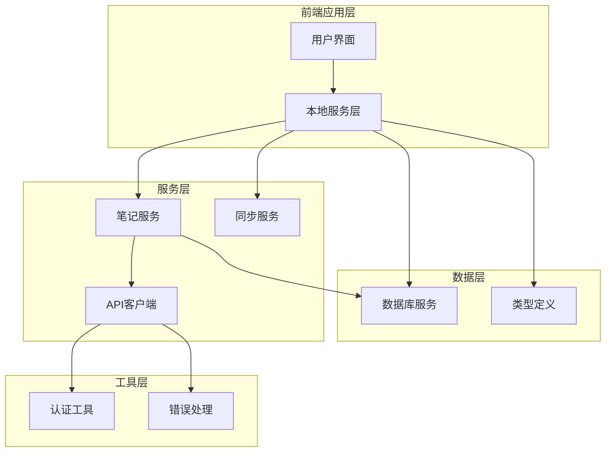
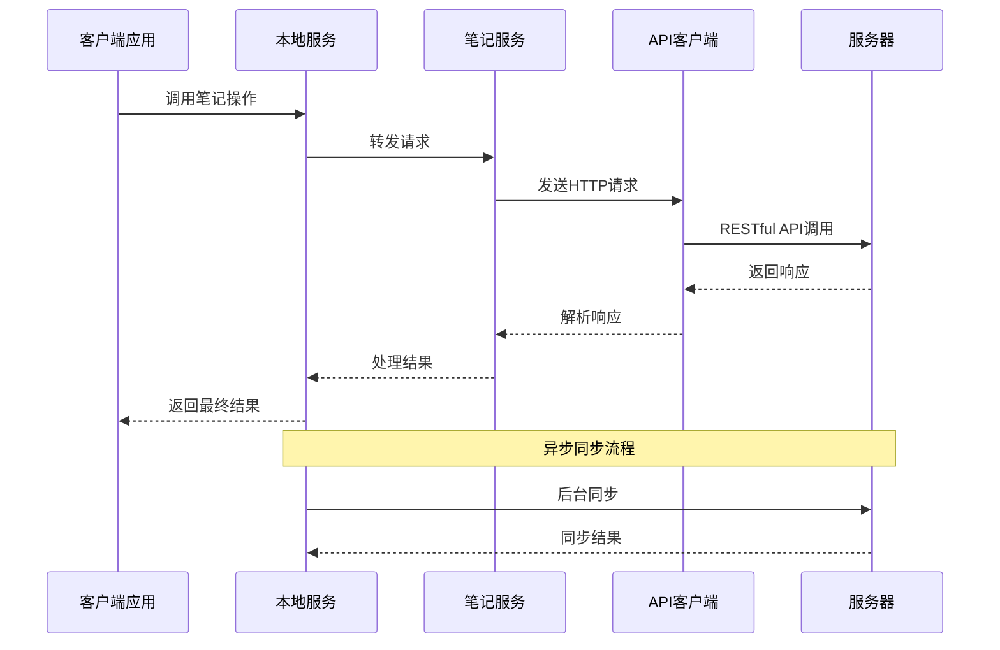
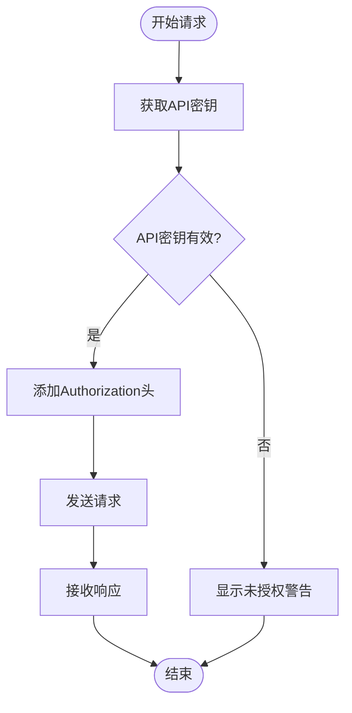
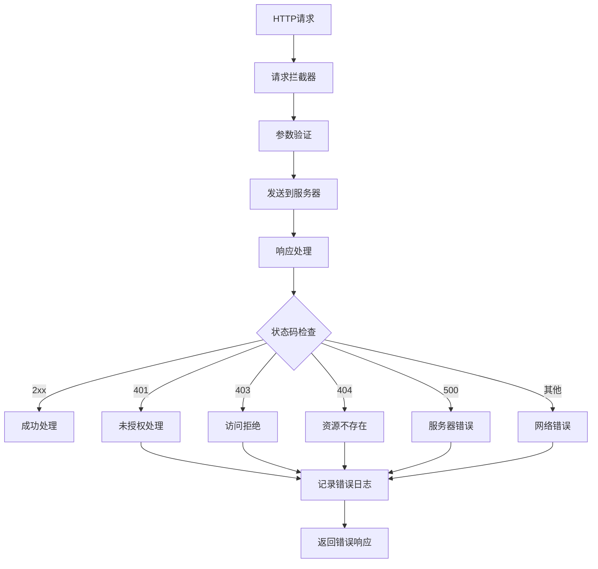
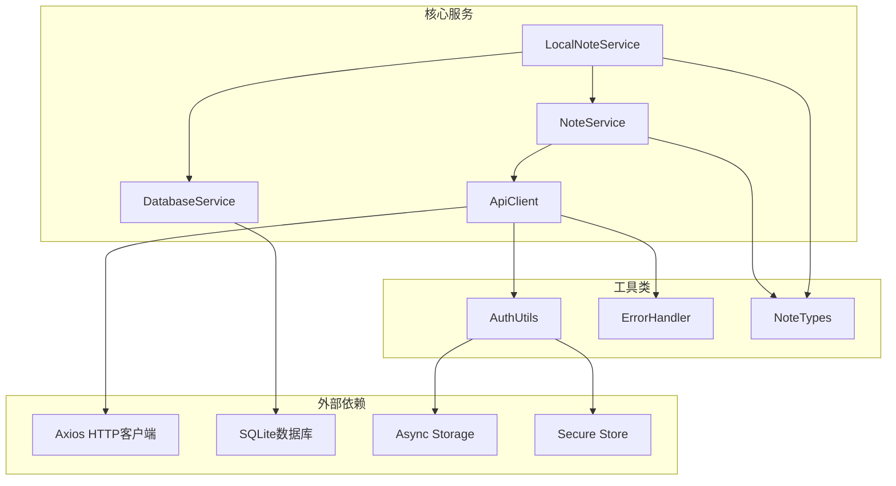

# 笔记API接口

<cite>
**本文档引用的文件**
- [NoteService.ts](file://services/notes/NoteService.ts)
- [NoteTypes.ts](file://types/notes/NoteTypes.ts)
- [ApiClient.ts](file://services/api/ApiClient.ts)
- [AuthUtils.ts](file://utils/auth/AuthUtils.ts)
- [ErrorHandler.ts](file://utils/ErrorHandler.ts)
- [LocalNoteService.ts](file://services/local/LocalNoteService.ts)
- [DatabaseService.ts](file://services/database/DatabaseService.ts)
- [SyncService.ts](file://services/notes/SyncService.ts)
- [api-doc.md](file://api-doc.md)
</cite>

## 目录

1. [简介](#简介)
2. [项目结构](#项目结构)
3. [核心组件](#核心组件)
4. [架构概览](#架构概览)
5. [详细组件分析](#详细组件分析)
6. [依赖关系分析](#依赖关系分析)
7. [性能考虑](#性能考虑)
8. [故障排除指南](#故障排除指南)
9. [结论](#结论)

## 简介

本文件为笔记API接口的详细技术文档，涵盖所有RESTful API端点的完整规范。该系统基于Hono框架构建，提供完整的笔记生命周期管理功能，包括创建、读取、更新、删除和同步操作。系统采用BFF（Backend for Frontend）架构模式，通过NoteService统一管理与后端服务的交互。

## 项目结构

该项目采用模块化架构设计，主要分为以下几个层次：

**图表来源**

- [NoteService.ts](file://services/notes/NoteService.ts#L1-L84)
- [LocalNoteService.ts](file://services/local/LocalNoteService.ts#L1-L601)
- [ApiClient.ts](file://services/api/ApiClient.ts#L1-L92)

**章节来源**

- [NoteService.ts](file://services/notes/NoteService.ts#L1-L84)
- [LocalNoteService.ts](file://services/local/LocalNoteService.ts#L1-L601)
- [DatabaseService.ts](file://services/database/DatabaseService.ts#L1-L513)

## 核心组件

### 笔记服务 (NoteService)

NoteService是整个笔记API的核心服务，负责与后端API进行通信，提供以下主要功能：

- **笔记CRUD操作**：创建、读取、更新、删除笔记
- **批量操作**：批量删除和批量插入/更新
- **同步功能**：与服务器进行笔记同步
- **导出功能**：导出所有笔记数据

### API客户端 (ApiClient)

API客户端基于Axios构建，提供以下特性：

- **动态基础URL**：支持运行时配置API基础URL
- **自动认证**：自动添加Bearer Token认证头
- **错误处理**：统一的错误处理和状态码处理
- **请求拦截**：支持请求预处理和响应后处理

### 数据类型定义 (NoteTypes)

定义了完整的笔记数据结构和API响应格式：

- **Note实体**：包含id、title、content、加密状态等字段
- **分页响应**：支持分页查询的通用响应格式
- **批量操作**：批量删除和批量插入/更新的请求/响应格式

**章节来源**

- [NoteService.ts](file://services/notes/NoteService.ts#L22-L83)
- [ApiClient.ts](file://services/api/ApiClient.ts#L6-L92)
- [NoteTypes.ts](file://types/notes/NoteTypes.ts#L1-L109)

## 架构概览

系统采用分层架构设计，确保关注点分离和代码可维护性：

**图表来源**

- [LocalNoteService.ts](file://services/local/LocalNoteService.ts#L119-L152)
- [NoteService.ts](file://services/notes/NoteService.ts#L48-L70)
- [ApiClient.ts](file://services/api/ApiClient.ts#L16-L41)

## 详细组件分析

### 笔记实体数据结构

#### Note实体定义

| 字段名       | 类型   | 必填 | 描述                            | 默认值   |
| ------------ | ------ | ---- | ------------------------------- | -------- |
| id           | string | 是   | 笔记唯一标识符 (UUID格式)       | -        |
| title        | string | 是   | 笔记标题                        | -        |
| content      | string | 是   | 笔记内容                        | -        |
| is_encrypted | number | 否   | 是否加密 (0: 未加密, 1: 已加密) | 0        |
| sync_status  | number | 否   | 同步状态 (0: 已同步, 1: 待同步) | 0        |
| is_deleted   | number | 否   | 是否删除 (0: 未删除, 1: 已删除) | 0        |
| created_at   | string | 是   | 创建时间 (ISO 8601格式)         | 当前时间 |
| updated_at   | string | 是   | 更新时间 (ISO 8601格式)         | 当前时间 |

#### 分页响应结构

| 字段名 | 类型   | 描述         |
| ------ | ------ | ------------ |
| total  | number | 总记录数     |
| data   | Note[] | 笔记数据数组 |
| page   | number | 当前页码     |
| limit  | number | 每页记录数   |

**章节来源**

- [NoteTypes.ts](file://types/notes/NoteTypes.ts#L2-L11)
- [NoteTypes.ts](file://types/notes/NoteTypes.ts#L14-L19)

### 认证机制

系统采用Bearer Token认证机制，通过Authorization请求头传递API密钥：

**图表来源**

- [ApiClient.ts](file://services/api/ApiClient.ts#L17-L41)
- [AuthUtils.ts](file://utils/auth/AuthUtils.ts#L27-L30)

**章节来源**

- [ApiClient.ts](file://services/api/ApiClient.ts#L26-L33)
- [AuthUtils.ts](file://utils/auth/AuthUtils.ts#L27-L30)

### API端点详细说明

#### 1. 获取笔记列表

**HTTP方法**: GET  
**URL模式**: `/api/notes`  
**功能**: 获取笔记列表，支持分页和搜索

**请求参数**:

| 参数名 | 类型   | 必填 | 描述                          | 默认值 |
| ------ | ------ | ---- | ----------------------------- | ------ |
| page   | number | 否   | 页码，默认为1                 | 1      |
| limit  | number | 否   | 每页数量，默认为20，最大为100 | 20     |
| search | string | 否   | 按标题搜索笔记                | -      |

**响应格式**: 分页响应结构

**状态码**:

- 200: 成功获取笔记列表
- 401: 未授权访问
- 403: 访问被拒绝
- 500: 服务器内部错误

**章节来源**

- [NoteService.ts](file://services/notes/NoteService.ts#L32-L44)
- [api-doc.md](file://api-doc.md#L42-L79)

#### 2. 获取单个笔记

**HTTP方法**: GET  
**URL模式**: `/api/notes/:id`  
**功能**: 根据ID获取单个笔记的详细信息

**路径参数**:

| 参数名 | 类型   | 必填 | 描述                  |
| ------ | ------ | ---- | --------------------- |
| id     | string | 是   | 笔记唯一ID (UUID格式) |

**响应格式**: Note实体结构

**状态码**:

- 200: 成功获取笔记
- 404: 笔记不存在
- 401: 未授权访问
- 500: 服务器内部错误

**章节来源**

- [NoteService.ts](file://services/notes/NoteService.ts#L46-L46)
- [api-doc.md](file://api-doc.md#L81-L110)

#### 3. 创建笔记

**HTTP方法**: POST  
**URL模式**: `/api/notes`  
**功能**: 创建新的笔记

**请求体**: CreateNoteRequest结构

**CreateNoteRequest字段**:

| 字段名       | 类型   | 必填 | 描述                            |
| ------------ | ------ | ---- | ------------------------------- |
| title        | string | 是   | 笔记标题                        |
| content      | string | 是   | 笔记内容                        |
| is_encrypted | number | 否   | 是否加密 (0: 未加密, 1: 已加密) |
| created_at   | string | 是   | 创建时间 (ISO 8601格式)         |
| updated_at   | string | 是   | 更新时间 (ISO 8601格式)         |

**响应格式**: CreateNoteResponse结构

**状态码**:

- 200: 成功创建笔记
- 400: 请求参数无效
- 401: 未授权访问
- 500: 服务器内部错误

**章节来源**

- [NoteService.ts](file://services/notes/NoteService.ts#L48-L49)
- [NoteTypes.ts](file://types/notes/NoteTypes.ts#L75-L81)
- [api-doc.md](file://api-doc.md#L112-L148)

#### 4. 更新笔记

**HTTP方法**: PATCH  
**URL模式**: `/api/notes/:id`  
**功能**: 更新现有笔记

**路径参数**:

| 参数名 | 类型   | 必填 | 描述                  |
| ------ | ------ | ---- | --------------------- |
| id     | string | 是   | 笔记唯一ID (UUID格式) |

**请求体**: UpdateNoteRequest结构

**UpdateNoteRequest字段**:

| 字段名       | 类型   | 必填 | 描述                    |
| ------------ | ------ | ---- | ----------------------- |
| title        | string | 否   | 更新后的标题            |
| content      | string | 否   | 更新后的内容            |
| is_encrypted | number | 是   | 更新后的加密状态        |
| updated_at   | string | 是   | 更新时间 (ISO 8601格式) |

**响应格式**: UpdateNoteResponse结构

**状态码**:

- 200: 成功更新笔记
- 404: 笔记不存在
- 400: 请求参数无效
- 401: 未授权访问
- 500: 服务器内部错误

**章节来源**

- [NoteService.ts](file://services/notes/NoteService.ts#L51-L52)
- [NoteTypes.ts](file://types/notes/NoteTypes.ts#L84-L89)
- [api-doc.md](file://api-doc.md#L150-L189)

#### 5. 删除笔记

**HTTP方法**: DELETE  
**URL模式**: `/api/notes/:id`  
**功能**: 删除指定笔记

**路径参数**:

| 参数名 | 类型   | 必填 | 描述                  |
| ------ | ------ | ---- | --------------------- |
| id     | string | 是   | 笔记唯一ID (UUID格式) |

**响应格式**: DeleteNoteResponse结构

**状态码**:

- 200: 成功删除笔记
- 404: 笔记不存在
- 401: 未授权访问
- 500: 服务器内部错误

**章节来源**

- [NoteService.ts](file://services/notes/NoteService.ts#L54-L55)
- [NoteTypes.ts](file://types/notes/NoteTypes.ts#L41-L43)
- [api-doc.md](file://api-doc.md#L191-L215)

#### 6. 批量删除笔记

**HTTP方法**: DELETE  
**URL模式**: `/api/notes/batch`  
**功能**: 批量删除多个笔记

**请求体**: BatchDeleteNoteRequest结构

**BatchDeleteNoteRequest字段**:

| 字段名 | 类型     | 必填 | 描述       |
| ------ | -------- | ---- | ---------- |
| ids    | string[] | 是   | 笔记ID数组 |

**响应格式**: BatchDeleteNoteResponse结构

**状态码**:

- 200: 成功批量删除
- 400: 请求参数无效
- 401: 未授权访问
- 500: 服务器内部错误

**章节来源**

- [NoteService.ts](file://services/notes/NoteService.ts#L57-L61)
- [NoteTypes.ts](file://types/notes/NoteTypes.ts#L69-L72)
- [api-doc.md](file://api-doc.md#L217-L251)

#### 7. 笔记同步

**HTTP方法**: POST  
**URL模式**: `/api/notes/sync`  
**功能**: 同步本地笔记与服务器

**请求体**: SyncNotesRequest结构

**SyncNotesRequest字段**:

| 字段名      | 类型   | 必填 | 描述         |
| ----------- | ------ | ---- | ------------ |
| clientNotes | Note[] | 是   | 本地笔记数组 |

**响应格式**: SyncNotesResponse结构

**状态码**:

- 200: 同步成功
- 400: 请求参数无效
- 401: 未授权访问
- 500: 服务器内部错误

**章节来源**

- [NoteService.ts](file://services/notes/NoteService.ts#L69-L70)
- [NoteTypes.ts](file://types/notes/NoteTypes.ts#L99-L108)
- [api-doc.md](file://api-doc.md#L253-L312)

#### 8. 导出所有笔记

**HTTP方法**: GET  
**URL模式**: `/api/notes/export/all`  
**功能**: 导出所有笔记数据

**响应格式**: ExportAllNotesResponse结构

**状态码**:

- 200: 成功导出
- 401: 未授权访问
- 500: 服务器内部错误

**章节来源**

- [NoteService.ts](file://services/notes/NoteService.ts#L22-L23)
- [NoteTypes.ts](file://types/notes/NoteTypes.ts#L22-L27)
- [api-doc.md](file://api-doc.md#L314-L344)

#### 9. 批量插入或更新笔记

**HTTP方法**: POST  
**URL模式**: `/api/notes/batch`  
**功能**: 批量插入或更新笔记

**请求体**: BatchOperationNoteRequest结构

**BatchOperationNoteRequest字段**:

| 字段名 | 类型   | 必填 | 描述     |
| ------ | ------ | ---- | -------- |
| notes  | Note[] | 是   | 笔记数组 |

**响应格式**: BatchOperationNoteResponse结构

**状态码**:

- 200: 成功批量操作
- 400: 请求参数无效
- 401: 未授权访问
- 500: 服务器内部错误

**章节来源**

- [NoteService.ts](file://services/notes/NoteService.ts#L63-L67)
- [NoteTypes.ts](file://types/notes/NoteTypes.ts#L58-L67)
- [api-doc.md](file://api-doc.md#L346-L411)

### 错误处理机制

系统实现了完善的错误处理机制：

**图表来源**

- [ApiClient.ts](file://services/api/ApiClient.ts#L44-L89)
- [ErrorHandler.ts](file://utils/ErrorHandler.ts#L18-L42)

**章节来源**

- [ApiClient.ts](file://services/api/ApiClient.ts#L44-L89)
- [ErrorHandler.ts](file://utils/ErrorHandler.ts#L1-L48)

## 依赖关系分析

### 组件依赖图

**图表来源**

- [NoteService.ts](file://services/notes/NoteService.ts#L1-L18)
- [LocalNoteService.ts](file://services/local/LocalNoteService.ts#L1-L17)
- [DatabaseService.ts](file://services/database/DatabaseService.ts#L1-L5)
- [ApiClient.ts](file://services/api/ApiClient.ts#L1-L3)

### 关键依赖关系

1. **NoteService依赖关系**:
   - 依赖ApiClient进行HTTP通信
   - 依赖NoteTypes进行类型定义
   - 为上层服务提供统一的API接口

2. **LocalNoteService依赖关系**:
   - 依赖NoteService进行远程操作
   - 依赖DatabaseService进行本地持久化
   - 为UI层提供完整的业务逻辑

3. **DatabaseService依赖关系**:
   - 依赖SQLite进行数据存储
   - 提供事务处理和并发控制
   - 实现数据一致性保证

**章节来源**

- [NoteService.ts](file://services/notes/NoteService.ts#L1-L18)
- [LocalNoteService.ts](file://services/local/LocalNoteService.ts#L1-L17)
- [DatabaseService.ts](file://services/database/DatabaseService.ts#L1-L5)

## 性能考虑

### 数据库优化策略

1. **连接池管理**: 使用单例模式管理数据库连接，避免频繁创建销毁连接
2. **事务处理**: 对批量操作使用事务，确保数据一致性和性能
3. **索引优化**: 为常用查询字段建立索引，提高查询性能
4. **缓存策略**: 在内存中缓存热点数据，减少数据库访问

### 网络优化策略

1. **请求队列**: 实现请求队列，避免并发请求导致的性能问题
2. **超时控制**: 设置合理的请求超时时间，避免长时间阻塞
3. **重试机制**: 对网络错误实现智能重试，提高成功率
4. **连接复用**: 复用HTTP连接，减少连接开销

### 内存管理

1. **垃圾回收**: 及时释放不需要的对象引用
2. **分页加载**: 对大量数据采用分页加载策略
3. **懒加载**: 实现数据的懒加载，减少初始内存占用

## 故障排除指南

### 常见问题及解决方案

#### 1. 认证失败

**症状**: 返回401状态码
**原因**: API密钥无效或缺失
**解决方案**:

- 检查API密钥格式是否正确
- 验证API密钥是否过期
- 确认网络连接正常

#### 2. 网络连接问题

**症状**: 请求超时或网络错误
**原因**: 网络不稳定或服务器不可达
**解决方案**:

- 检查网络连接状态
- 验证API URL配置
- 实现重试机制

#### 3. 数据库操作失败

**症状**: 数据库操作异常
**原因**: 数据库连接问题或事务冲突
**解决方案**:

- 检查数据库连接状态
- 实现连接重试机制
- 优化事务处理逻辑

#### 4. 同步冲突

**症状**: 同步过程中出现数据不一致
**原因**: 并发修改导致的数据冲突
**解决方案**:

- 实现乐观锁机制
- 采用最后写入者获胜策略
- 提供手动冲突解决选项

**章节来源**

- [ApiClient.ts](file://services/api/ApiClient.ts#L51-L89)
- [ErrorHandler.ts](file://utils/ErrorHandler.ts#L18-L42)
- [DatabaseService.ts](file://services/database/DatabaseService.ts#L62-L115)

## 结论

本笔记API接口文档提供了完整的RESTful API规范，涵盖了从基础CRUD操作到高级同步功能的所有核心功能。系统采用现代化的架构设计，具有良好的可扩展性和可维护性。

### 主要特点

1. **完整的API覆盖**: 包含所有必要的笔记管理操作
2. **强大的错误处理**: 提供完善的错误处理和恢复机制
3. **高性能设计**: 采用多种优化策略确保系统性能
4. **安全可靠**: 实现了多层安全防护和数据保护
5. **易于集成**: 提供清晰的接口规范和类型定义

### 技术优势

- **模块化设计**: 各组件职责明确，便于维护和扩展
- **异步处理**: 采用异步模式提高系统响应性
- **数据一致性**: 实现事务处理和并发控制
- **错误恢复**: 提供自动重试和降级策略

该API接口为移动应用和Web应用提供了稳定可靠的笔记管理能力，支持离线操作和实时同步，满足现代应用对数据管理的各种需求。
