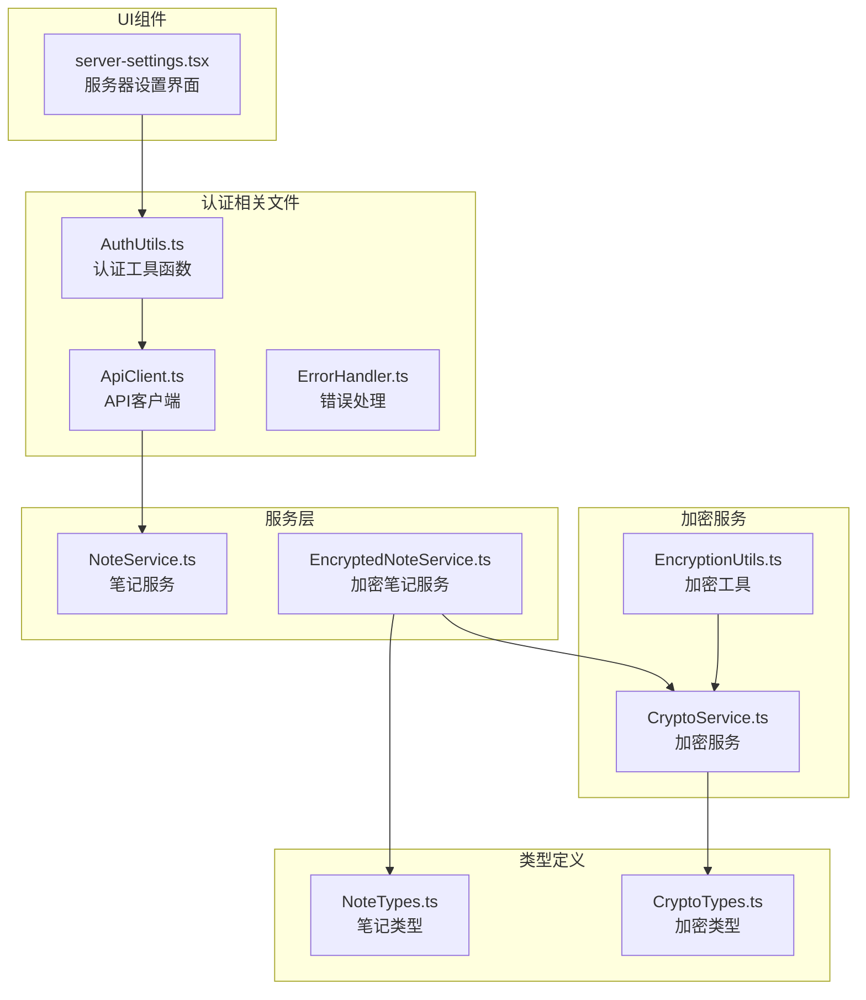
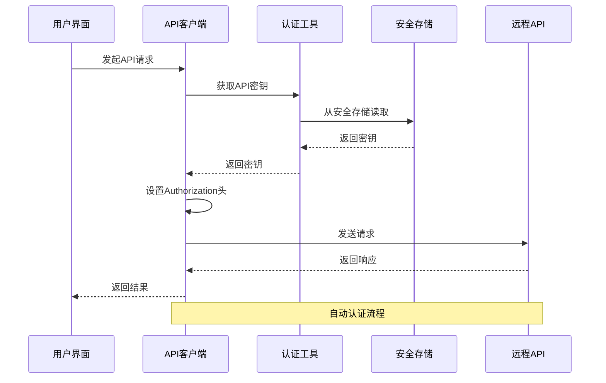
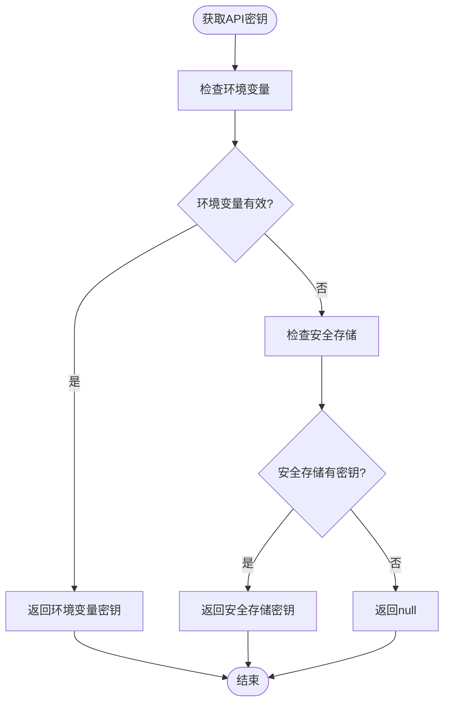
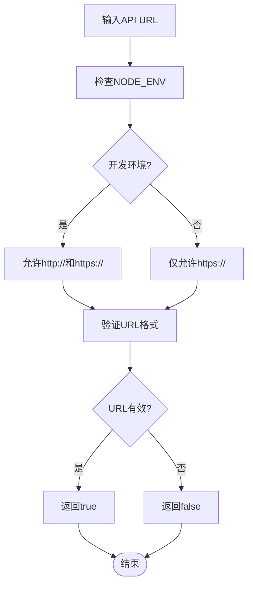
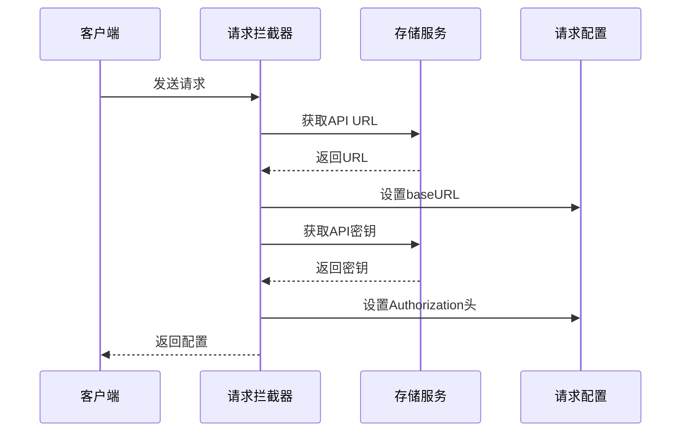
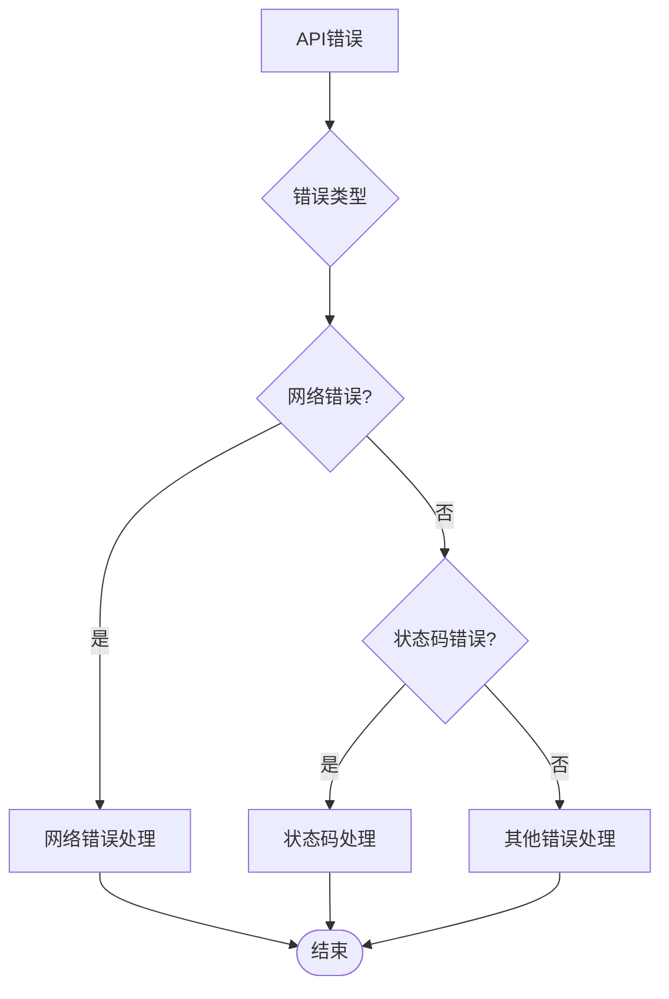
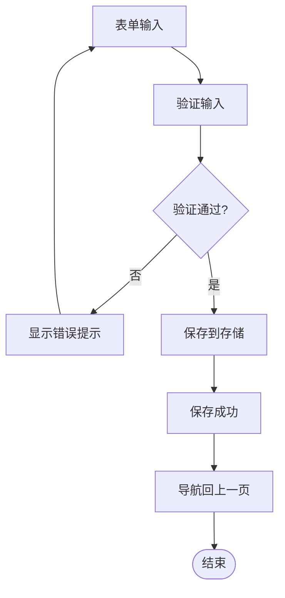
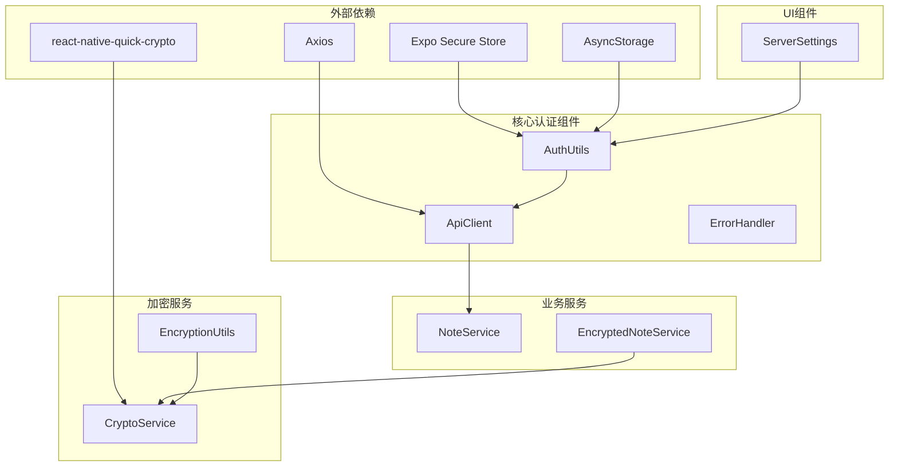

# 认证API接口

<cite>
**本文档引用的文件**
- [AuthUtils.ts](file://utils/auth/AuthUtils.ts)
- [ApiClient.ts](file://services/api/ApiClient.ts)
- [ErrorHandler.ts](file://utils/ErrorHandler.ts)
- [server-settings.tsx](file://app/server-settings.tsx)
- [NoteService.ts](file://services/notes/NoteService.ts)
- [CryptoService.ts](file://services/crypto/CryptoService.ts)
- [EncryptionUtils.ts](file://utils/crypto/EncryptionUtils.ts)
- [EncryptedNoteService.ts](file://services/crypto/EncryptedNoteService.ts)
- [NoteTypes.ts](file://types/notes/NoteTypes.ts)
- [CryptoTypes.ts](file://types/crypto/CryptoTypes.ts)
</cite>

## 目录

1. [简介](#简介)
2. [项目结构](#项目结构)
3. [核心组件](#核心组件)
4. [架构概览](#架构概览)
5. [详细组件分析](#详细组件分析)
6. [依赖关系分析](#依赖关系分析)
7. [性能考虑](#性能考虑)
8. [故障排除指南](#故障排除指南)
9. [结论](#结论)

## 简介

本文件详细记录了应用中的认证API接口系统，包括API密钥管理、Bearer Token认证流程、认证状态验证和会话管理机制。该系统采用Axios拦截器实现自动认证，结合安全存储机制保障密钥安全，并提供了完善的错误处理和日志记录功能。

## 项目结构

认证系统主要分布在以下目录和文件中：

**图表来源**

- [AuthUtils.ts](file://utils/auth/AuthUtils.ts#L1-L65)
- [ApiClient.ts](file://services/api/ApiClient.ts#L1-L92)
- [server-settings.tsx](file://app/server-settings.tsx#L1-L239)

**章节来源**

- [AuthUtils.ts](file://utils/auth/AuthUtils.ts#L1-L65)
- [ApiClient.ts](file://services/api/ApiClient.ts#L1-L92)
- [server-settings.tsx](file://app/server-settings.tsx#L1-L239)

## 核心组件

### 认证工具函数 (AuthUtils)

AuthUtils模块提供了完整的API密钥管理和安全存储功能：

- **API密钥管理**：支持从环境变量和安全存储中获取API密钥
- **安全存储**：使用Expo Secure Store保护敏感信息
- **URL验证**：支持开发和生产环境的不同协议要求
- **加密密钥管理**：提供本地加密密钥的存储和检索

### API客户端 (ApiClient)

基于Axios构建的API客户端，实现了自动认证拦截器：

- **请求拦截器**：动态设置baseURL和Authorization头
- **响应拦截器**：统一处理各种HTTP状态码和网络错误
- **错误处理**：针对不同类型的错误提供相应的处理策略

### 错误处理 (ErrorHandler)

提供统一的错误处理机制：

- **网络错误识别**：区分网络错误、超时和连接中断
- **删除操作特殊处理**：对删除操作提供静默处理选项
- **分类错误处理**：根据错误类型输出相应的日志信息

**章节来源**

- [AuthUtils.ts](file://utils/auth/AuthUtils.ts#L1-L65)
- [ApiClient.ts](file://services/api/ApiClient.ts#L1-L92)
- [ErrorHandler.ts](file://utils/ErrorHandler.ts#L1-L48)

## 架构概览

认证系统的整体架构采用分层设计，确保安全性、可维护性和可扩展性：

**图表来源**

- [ApiClient.ts](file://services/api/ApiClient.ts#L16-L41)
- [AuthUtils.ts](file://utils/auth/AuthUtils.ts#L26-L30)

## 详细组件分析

### 认证工具函数详解

#### API密钥管理机制

**图表来源**

- [AuthUtils.ts](file://utils/auth/AuthUtils.ts#L26-L30)

#### 安全存储策略

系统采用双重存储策略：

- **API密钥**：存储在Expo Secure Store中，提供最高级别的安全保护
- **API URL**：存储在AsyncStorage中，便于用户修改
- **加密密钥**：存储在Expo Secure Store中，用于本地数据加密

#### URL验证机制

**图表来源**

- [AuthUtils.ts](file://utils/auth/AuthUtils.ts#L42-L53)

**章节来源**

- [AuthUtils.ts](file://utils/auth/AuthUtils.ts#L1-L65)

### API客户端拦截器分析

#### 请求拦截器工作原理

**图表来源**

- [ApiClient.ts](file://services/api/ApiClient.ts#L17-L36)

#### 响应拦截器错误处理

响应拦截器实现了多层次的错误处理：

- **状态码处理**：针对401、403、404、500等状态码提供特定处理
- **网络错误检测**：识别超时、连接中断等网络问题
- **删除操作特殊处理**：对删除操作提供静默处理选项

**章节来源**

- [ApiClient.ts](file://services/api/ApiClient.ts#L1-L92)

### 错误处理机制

#### 错误分类处理

**图表来源**

- [ErrorHandler.ts](file://utils/ErrorHandler.ts#L18-L42)

#### 删除操作错误处理

删除操作采用了特殊的静默处理机制：

- **网络错误静默**：对于删除操作的网络错误，仅输出警告而非错误
- **条件判断**：仅对符合删除操作模式的请求应用静默处理
- **用户体验优化**：避免用户看到不必要的错误提示

**章节来源**

- [ErrorHandler.ts](file://utils/ErrorHandler.ts#L1-L48)

### UI集成组件

#### 服务器设置界面

服务器设置界面提供了完整的认证配置功能：

- **API URL配置**：支持用户自定义API服务器地址
- **API密钥管理**：提供密钥输入和验证功能
- **加密密钥管理**：支持本地数据加密密钥的生成和管理
- **实时验证**：输入时即时验证格式有效性

#### 配置保存流程

**图表来源**

- [server-settings.tsx](file://app/server-settings.tsx#L124-L194)

**章节来源**

- [server-settings.tsx](file://app/server-settings.tsx#L1-L239)

## 依赖关系分析

### 组件依赖图

**图表来源**

- [ApiClient.ts](file://services/api/ApiClient.ts#L1-L3)
- [AuthUtils.ts](file://utils/auth/AuthUtils.ts#L1-L2)
- [CryptoService.ts](file://services/crypto/CryptoService.ts#L1-L4)

### 数据流分析

认证系统的核心数据流如下：

1. **配置阶段**：用户通过UI界面输入API密钥和URL
2. **存储阶段**：配置信息存储到相应的安全存储中
3. **请求阶段**：每次API请求时自动读取配置并添加认证头
4. **响应阶段**：统一处理响应结果和错误信息

**章节来源**

- [NoteService.ts](file://services/notes/NoteService.ts#L1-L84)
- [EncryptedNoteService.ts](file://services/crypto/EncryptedNoteService.ts#L1-L186)

## 性能考虑

### 认证性能优化

1. **异步存储访问**：所有存储操作都是异步的，避免阻塞主线程
2. **缓存策略**：API密钥在内存中有临时缓存，减少重复读取
3. **连接复用**：Axios实例复用，避免频繁创建连接
4. **超时控制**：设置合理的超时时间，平衡响应速度和稳定性

### 内存管理

- **密钥生命周期**：API密钥仅在需要时读取，避免长期驻留内存
- **错误对象清理**：错误处理后及时释放相关资源
- **事件监听器**：组件卸载时清理相关监听器

## 故障排除指南

### 常见认证问题

#### API密钥无效

**症状**：出现"未授权访问"警告

**解决方案**：

1. 检查API密钥格式是否正确
2. 验证API密钥是否过期
3. 确认API密钥权限是否足够
4. 重新输入并保存API密钥

#### 网络连接问题

**症状**：出现网络错误或超时

**解决方案**：

1. 检查网络连接状态
2. 验证API URL是否正确
3. 确认防火墙设置
4. 尝试重启应用

#### 安全存储访问失败

**症状**：无法读取或保存认证信息

**解决方案**：

1. 检查设备的安全设置
2. 确认应用具有必要的权限
3. 重新安装应用清理存储
4. 联系技术支持

### 调试技巧

1. **启用详细日志**：观察控制台输出的详细错误信息
2. **检查存储状态**：验证认证信息是否正确保存
3. **网络监控**：使用开发者工具监控网络请求
4. **状态检查**：确认应用初始化状态正常

**章节来源**

- [ApiClient.ts](file://services/api/ApiClient.ts#L44-L89)
- [ErrorHandler.ts](file://utils/ErrorHandler.ts#L1-L48)

## 结论

该认证API接口系统采用现代化的设计理念，结合了安全性、可维护性和用户体验的平衡。通过Axios拦截器实现自动认证，配合安全存储机制保障敏感信息的安全，同时提供了完善的错误处理和日志记录功能。

系统的主要优势包括：

- **安全性**：使用Expo Secure Store保护API密钥
- **易用性**：自动认证，无需手动处理认证头
- **可靠性**：完善的错误处理和重试机制
- **可扩展性**：模块化设计，易于添加新的认证方式

建议的后续改进方向：

- 添加认证状态持久化
- 实现多用户支持
- 增加认证令牌刷新机制
- 提供更详细的认证日志
