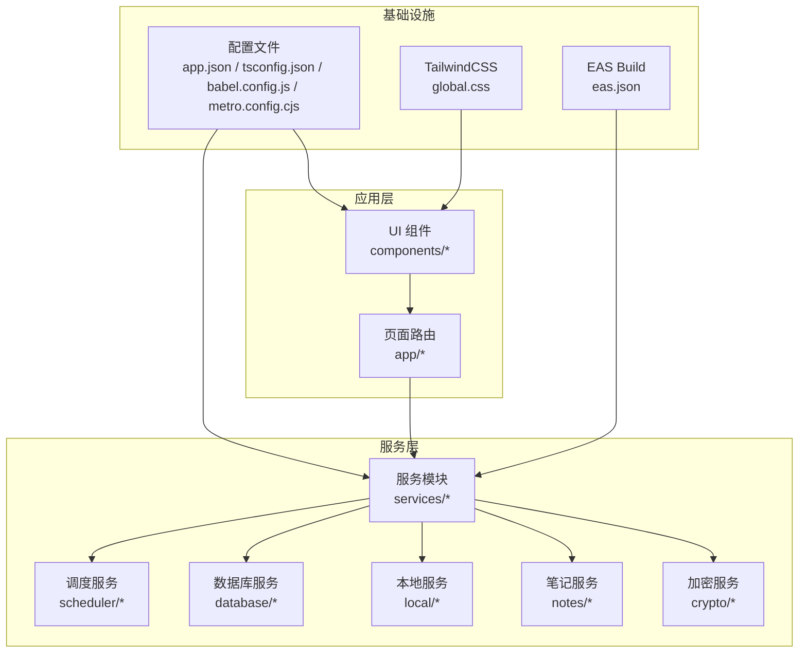
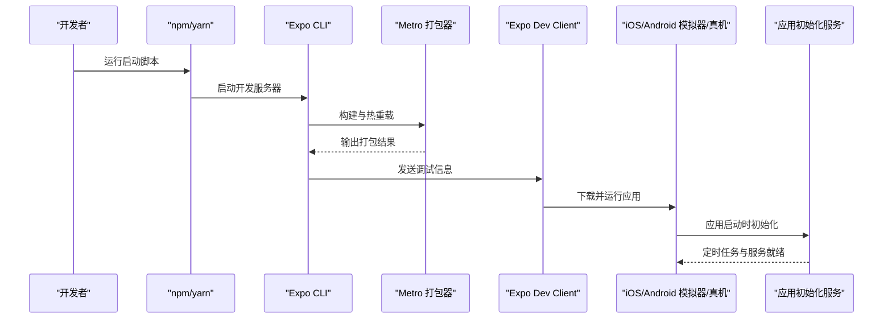

# 快速开始

<cite>
**本文引用的文件**
- [package.json](file://package.json)
- [app.json](file://app.json)
- [babel.config.js](file://babel.config.js)
- [tsconfig.json](file://tsconfig.json)
- [metro.config.cjs](file://metro.config.cjs)
- [eas.json](file://eas.json)
- [global.css](file://global.css)
- [eslint.config.mjs](file://eslint.config.mjs)
- [.prettierrc](file://.prettierrc)
- [docs/开发文档.md](file://docs/开发文档.md)
- [services/AppInitializationService.ts](file://services/AppInitializationService.ts)
- [docs/NativeWind迁移指南.md](file://docs/NativeWind迁移指南.md)
</cite>

## 更新摘要

**所做更改**

- 移除了 NativeWind 相关的配置说明和初始配置
- 更新了开发工具配置章节，移除了 NativeWind 特定的配置细节
- 更新了项目结构图，移除了 NativeWind 相关的基础设施说明
- 更新了故障排除指南，移除了与 NativeWind 相关的问题解决方案
- 保持了原有的环境要求、安装步骤和启动命令说明

## 目录

1. [简介](#简介)
2. [项目结构](#项目结构)
3. [核心组件](#核心组件)
4. [架构总览](#架构总览)
5. [详细组件分析](#详细组件分析)
6. [依赖分析](#依赖分析)
7. [性能考虑](#性能考虑)
8. [故障排除指南](#故障排除指南)
9. [结论](#结论)
10. [附录](#附录)

## 简介

本指南面向首次接触 Notes 应用的新开发者，帮助你在 Windows、macOS、Linux 上快速搭建开发环境并成功运行应用。内容涵盖环境要求、安装步骤、开发工具配置、启动命令以及常见问题排查，确保你能以最短时间完成从零到运行的全流程。

## 项目结构

Notes 是一个基于 Expo + React Native 的跨平台应用，采用文件系统路由（Expo Router），结合 TypeScript、TailwindCSS（通过 NativeWind）、Metro 打包器与 EAS Build 进行构建与分发。项目还集成了 SQLite、加密服务、定时任务等核心能力。

**更新** 移除了 NativeWind 相关的初始配置说明，项目现已采用简化的样式配置方案。

**图表来源**

- [package.json](file://package.json#L1-L67)
- [app.json](file://app.json#L1-L40)
- [babel.config.js](file://babel.config.js#L1-L7)
- [tsconfig.json](file://tsconfig.json#L1-L11)
- [metro.config.cjs](file://metro.config.cjs#L1-L10)
- [global.css](file://global.css#L1-L3)
- [eas.json](file://eas.json#L1-L31)

**章节来源**

- [package.json](file://package.json#L1-L67)
- [app.json](file://app.json#L1-L40)
- [babel.config.js](file://babel.config.js#L1-L7)
- [tsconfig.json](file://tsconfig.json#L1-L11)
- [metro.config.cjs](file://metro.config.cjs#L1-L10)
- [global.css](file://global.css#L1-L3)
- [eas.json](file://eas.json#L1-L31)

## 核心组件

- 路由系统：Expo Router 提供文件系统路由，页面位于 app/ 目录，自动注册。
- 数据层：本地 SQLite（expo-sqlite）+ 远程 API（Axios），统一通过服务层协调。
- 加密：react-native-quick-crypto 提供 AES-256-CBC 加密能力。
- UI 框架：React Native + TailwindCSS（通过 NativeWind）。
- 构建与分发：Metro 打包器 + EAS Build，支持开发客户端与内部分发。

**更新** 移除了 NativeWind 特定的配置说明，项目现已采用简化的样式配置方案。

## 架构总览

下图展示了应用启动与开发流程的关键节点，包括 Metro 打包、Expo Dev Client、模拟器/真机以及服务初始化。

**图表来源**

- [package.json](file://package.json#L5-L12)
- [metro.config.cjs](file://metro.config.cjs#L1-L10)
- [services/AppInitializationService.ts](file://services/AppInitializationService.ts#L16-L37)

## 详细组件分析

### 环境要求与前置条件

- Node.js：建议使用 Node.js 18 或更高版本（详见开发文档中的环境要求）。
- 包管理器：npm 或 yarn。
- Expo CLI：用于启动开发服务器与连接模拟器/真机。
- 平台模拟器或真机：iOS 模拟器（Xcode）或 Android 模拟器（Android Studio）。
- Git：用于版本控制与仓库克隆。

**章节来源**

- [docs/开发文档.md](file://docs/开发文档.md#L362-L367)

### 安装步骤（从克隆到运行）

- 克隆仓库后，进入项目根目录。
- 安装依赖：执行安装命令。
- 启动开发服务器：运行启动脚本。
- 选择目标平台：启动 Android 或 iOS。
- 如需内部分发，可使用 EAS Build。

**章节来源**

- [docs/开发文档.md](file://docs/开发文档.md#L369-L386)
- [package.json](file://package.json#L5-L12)

### 开发工具配置

- TypeScript 配置
  - 继承 Expo 官方基础配置，启用严格模式与路径别名。
- Babel 配置
  - 使用 babel-preset-expo，无额外插件配置。
- Metro 配置
  - 默认禁用 Web 平台，仅保留 ios/android。
- TailwindCSS
  - 全局样式通过 global.css 引入三段式指令。
- ESLint/Prettier
  - ESLint 使用 Flat Config，继承 Expo 规则，集成 Prettier 插件。
  - Prettier 规则集中于 .prettierrc。
- EAS Build
  - CLI 版本要求与构建配置（开发、预览、生产）已在 eas.json 中定义。

**更新** 移除了 NativeWind 特定的配置说明，包括 babel 插件、tsconfig 类型插件和 tailwind.config.js 配置。

**章节来源**

- [tsconfig.json](file://tsconfig.json#L1-L11)
- [babel.config.js](file://babel.config.js#L1-L7)
- [metro.config.cjs](file://metro.config.cjs#L1-L10)
- [global.css](file://global.css#L1-L3)
- [eslint.config.mjs](file://eslint.config.mjs#L1-L40)
- [.prettierrc](file://.prettierrc#L1-L7)
- [eas.json](file://eas.json#L1-L31)

### 启动开发服务器与运行模拟器

- 启动开发服务器：运行启动脚本。
- 启动 Android：运行 Android 启动脚本。
- 启动 iOS：运行 iOS 启动脚本。
- 也可直接使用 Expo CLI 命令进行启动与设备连接。

**章节来源**

- [package.json](file://package.json#L5-L12)
- [docs/开发文档.md](file://docs/开发文档.md#L375-L386)

### 应用初始化与服务启动

应用启动时会调用初始化服务，启动定时任务（如同步与清理），并在完成后标记初始化完成。该流程确保应用在运行前具备必要的后台任务能力。

**图表来源**

- [services/AppInitializationService.ts](file://services/AppInitializationService.ts#L16-L37)

## 依赖分析

- 运行时与框架
  - Expo、React Native、Expo Router、React Navigation、Async Storage、SQLite、Secure Store、Font、Status Bar、Splash Screen 等。
- UI 与样式
  - React、React DOM、TailwindCSS、Safe Area、Screens、Reanimated、Worklets。
- 工具与网络
  - Axios、Day.js、Buffer、Quick Crypto、随机数生成。
- 开发工具
  - TypeScript、ESLint、Prettier、Husky、lint-staged。

**更新** 移除了 NativeWind 相关的依赖项说明。

**章节来源**

- [package.json](file://package.json#L14-L57)

## 性能考虑

- 仅启用 ios/android 平台，避免 Web 平台带来的额外开销。
- 使用 Metro 默认配置与 Expo Router 的按需加载，减少首屏体积。
- 通过 EAS Build 的生产构建优化，提升发布包性能与稳定性。

**更新** 移除了 NativeWind 性能相关的考虑事项。

**章节来源**

- [metro.config.cjs](file://metro.config.cjs#L6-L8)

## 故障排除指南

- Node.js 版本不兼容
  - 症状：安装或启动时报错。
  - 处理：升级至 Node.js 18 或更高版本。
- 无法连接模拟器/真机
  - 症状：Expo 开发服务器无法识别设备。
  - 处理：确保模拟器/真机已启动；使用正确的启动脚本；检查网络连通性。
- Metro 打包错误
  - 症状：构建失败或热重载异常。
  - 处理：清理缓存、重新安装依赖；检查 Metro 配置是否被修改。
- TypeScript 类型错误
  - 症状：编辑器报错或编译失败。
  - 处理：启用严格模式下的类型检查。
- ESLint/Prettier 格式化冲突
  - 症状：保存时格式化失败或规则冲突。
  - 处理：执行格式化脚本；检查 ESLint Flat Config 与 Prettier 配置一致性。
- EAS Build 失败
  - 症状：构建阶段报错。
  - 处理：确认 CLI 版本满足要求；检查 eas.json 中的构建配置；确保签名与权限正确。

**更新** 移除了与 NativeWind 相关的问题解决方案，包括 Babel 配置错误、样式类名无效等问题。

**章节来源**

- [docs/开发文档.md](file://docs/开发文档.md#L362-L367)
- [eslint.config.mjs](file://eslint.config.mjs#L16-L39)
- [.prettierrc](file://.prettierrc#L1-L7)
- [eas.json](file://eas.json#L2-L5)

## 结论

通过本快速开始指南，你可以在 Windows、macOS、Linux 上完成 Notes 应用的环境搭建与运行。建议先验证 Node.js 与 Expo CLI 的版本，再按步骤安装依赖、启动开发服务器并连接模拟器/真机。遇到问题时，优先参考"故障排除指南"中的常见场景与解决方案。

## 附录

### 不同操作系统安装要点

- Windows
  - 安装 Node.js 18+ 与包管理器。
  - 安装 Android Studio 与模拟器，或使用 Windows 上的 Android 模拟器。
  - 安装 Expo CLI 并运行启动脚本。
- macOS
  - 安装 Xcode 与 iOS 模拟器，或安装 Android Studio 与模拟器。
  - 使用 Homebrew 安装 Node.js 与包管理器。
  - 运行启动脚本后可通过 QR 码或 USB 连接真机。
- Linux
  - 安装 Node.js 18+ 与包管理器。
  - 安装 Android Studio 与模拟器。
  - 如需 iOS 开发，可在虚拟机中安装 macOS 并配合 Xcode。

**章节来源**

- [docs/开发文档.md](file://docs/开发文档.md#L362-L367)
