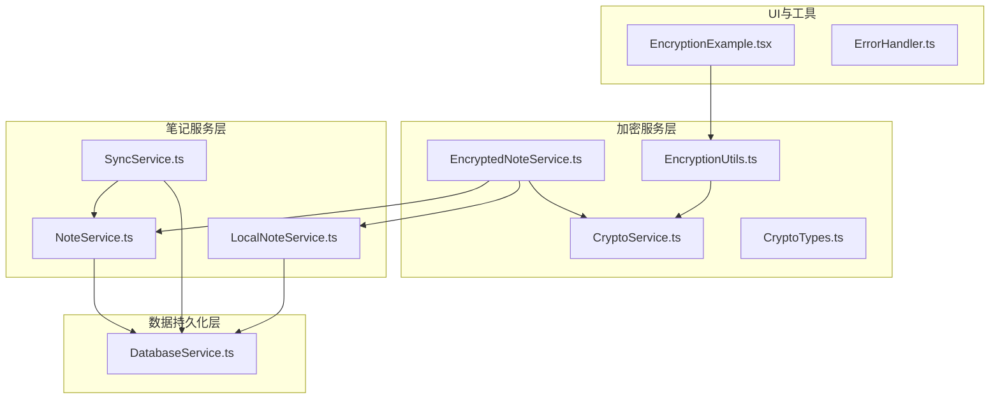
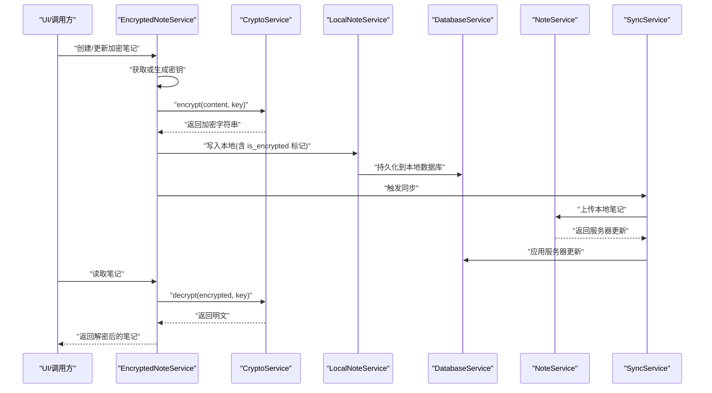
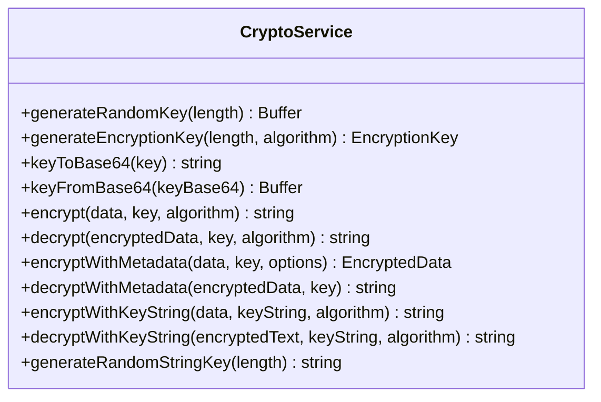
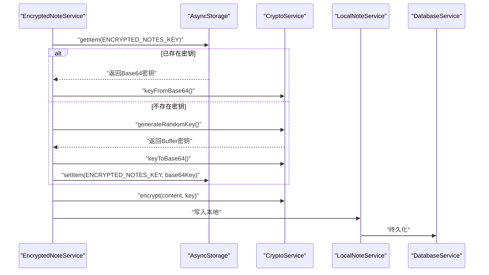
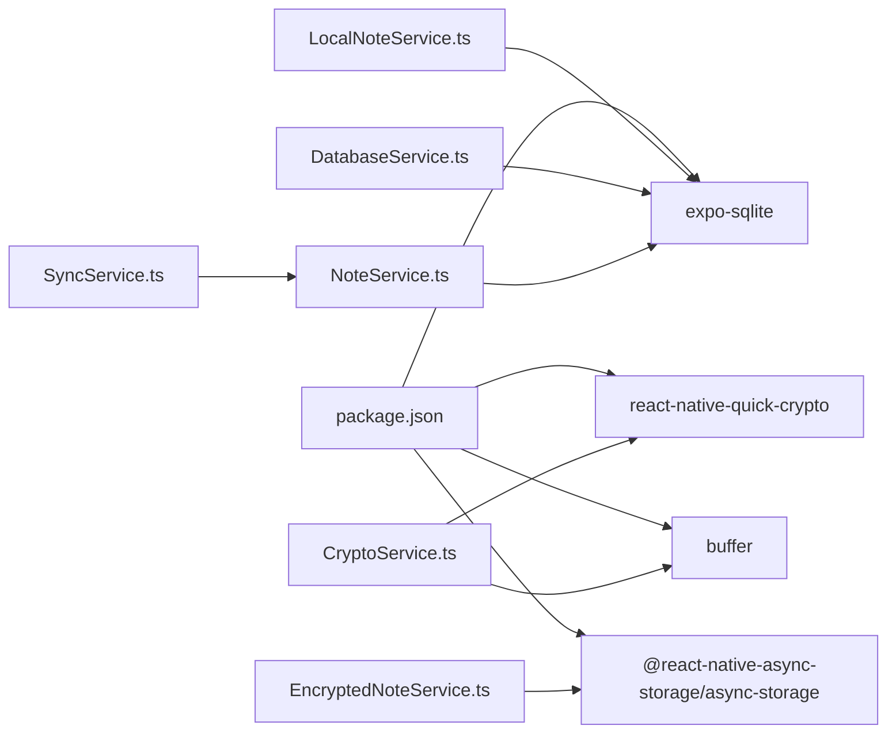

# 加密问题

<cite>
**本文引用的文件**
- [CryptoService.ts](file://services/crypto/CryptoService.ts)
- [EncryptedNoteService.ts](file://services/crypto/EncryptedNoteService.ts)
- [EncryptionUtils.ts](file://utils/crypto/EncryptionUtils.ts)
- [CryptoTypes.ts](file://types/crypto/CryptoTypes.ts)
- [EncryptionExample.tsx](file://components/EncryptionExample.tsx)
- [DatabaseService.ts](file://services/database/DatabaseService.ts)
- [LocalNoteService.ts](file://services/local/LocalNoteService.ts)
- [NoteService.ts](file://services/notes/NoteService.ts)
- [SyncService.ts](file://services/notes/SyncService.ts)
- [ErrorHandler.ts](file://utils/ErrorHandler.ts)
- [package.json](file://package.json)
</cite>

## 目录

1. [简介](#简介)
2. [项目结构](#项目结构)
3. [核心组件](#核心组件)
4. [架构总览](#架构总览)
5. [详细组件分析](#详细组件分析)
6. [依赖关系分析](#依赖关系分析)
7. [性能考量](#性能考量)
8. [故障排查指南](#故障排查指南)
9. [结论](#结论)
10. [附录](#附录)

## 简介

本指南聚焦 Notes 应用中的加密子系统，覆盖以下主题：

- 加密失败、解密错误、密钥管理异常、数据完整性校验失败的诊断与解决
- 加密算法兼容性检查与密钥生成问题排查
- AES-256-CBC 加密异常、IV 向量错误、填充模式问题等具体场景处理
- 加密性能问题与内存使用优化
- 加密数据备份与恢复操作指南

## 项目结构

加密相关代码主要分布在以下模块：

- 服务层：加密服务、加密笔记服务、数据库服务、本地笔记服务、笔记服务、同步服务
- 工具层：加密工具函数
- 类型层：加密相关类型定义
- 示例组件：加密示例界面

图表来源

- [CryptoService.ts](file://services/crypto/CryptoService.ts#L1-L205)
- [EncryptedNoteService.ts](file://services/crypto/EncryptedNoteService.ts#L1-L186)
- [EncryptionUtils.ts](file://utils/crypto/EncryptionUtils.ts#L1-L112)
- [CryptoTypes.ts](file://types/crypto/CryptoTypes.ts#L1-L44)
- [EncryptionExample.tsx](file://components/EncryptionExample.tsx#L1-L233)
- [DatabaseService.ts](file://services/database/DatabaseService.ts#L1-L513)
- [LocalNoteService.ts](file://services/local/LocalNoteService.ts#L1-L601)
- [NoteService.ts](file://services/notes/NoteService.ts#L1-L84)
- [SyncService.ts](file://services/notes/SyncService.ts#L1-L58)
- [ErrorHandler.ts](file://utils/ErrorHandler.ts#L1-L48)

章节来源

- [CryptoService.ts](file://services/crypto/CryptoService.ts#L1-L205)
- [EncryptedNoteService.ts](file://services/crypto/EncryptedNoteService.ts#L1-L186)
- [EncryptionUtils.ts](file://utils/crypto/EncryptionUtils.ts#L1-L112)
- [CryptoTypes.ts](file://types/crypto/CryptoTypes.ts#L1-L44)
- [EncryptionExample.tsx](file://components/EncryptionExample.tsx#L1-L233)
- [DatabaseService.ts](file://services/database/DatabaseService.ts#L1-L513)
- [LocalNoteService.ts](file://services/local/LocalNoteService.ts#L1-L601)
- [NoteService.ts](file://services/notes/NoteService.ts#L1-L84)
- [SyncService.ts](file://services/notes/SyncService.ts#L1-L58)
- [ErrorHandler.ts](file://utils/ErrorHandler.ts#L1-L48)

## 核心组件

- CryptoService：提供密钥生成、AES 加密/解密、字符串密钥处理、元数据封装等能力
- EncryptedNoteService：负责笔记内容的加密存储与解密检索，管理加密密钥的持久化
- EncryptionUtils：面向上层的便捷加密工具函数，封装 CryptoService 的调用
- CryptoTypes：定义加密密钥、加密数据、加密配置、加密选项等类型
- DatabaseService：提供数据库连接、事务、队列化操作、同步逻辑等
- LocalNoteService：本地笔记的 CRUD、批量操作、导出、同步等
- NoteService/SyncService：与服务端交互的笔记服务与同步服务
- EncryptionExample：演示加密/解密流程的示例组件
- ErrorHandler：统一错误处理与网络错误识别

章节来源

- [CryptoService.ts](file://services/crypto/CryptoService.ts#L10-L205)
- [EncryptedNoteService.ts](file://services/crypto/EncryptedNoteService.ts#L11-L186)
- [EncryptionUtils.ts](file://utils/crypto/EncryptionUtils.ts#L1-L112)
- [CryptoTypes.ts](file://types/crypto/CryptoTypes.ts#L5-L44)
- [DatabaseService.ts](file://services/database/DatabaseService.ts#L1-L513)
- [LocalNoteService.ts](file://services/local/LocalNoteService.ts#L1-L601)
- [NoteService.ts](file://services/notes/NoteService.ts#L1-L84)
- [SyncService.ts](file://services/notes/SyncService.ts#L1-L58)
- [EncryptionExample.tsx](file://components/EncryptionExample.tsx#L1-L233)
- [ErrorHandler.ts](file://utils/ErrorHandler.ts#L1-L48)

## 架构总览

加密流程的关键路径如下：

- 密钥管理：EncryptedNoteService 从本地存储获取或生成密钥，CryptoService 提供密钥生成与序列化
- 数据加密：EncryptedNoteService 调用 CryptoService.encrypt 或 encryptWithMetadata
- 数据解密：EncryptedNoteService 调用 CryptoService.decrypt 或 decryptWithMetadata
- 存储与同步：LocalNoteService 与 DatabaseService 负责本地持久化；NoteService/SyncService 负责云端同步

图表来源

- [EncryptedNoteService.ts](file://services/crypto/EncryptedNoteService.ts#L74-L111)
- [CryptoService.ts](file://services/crypto/CryptoService.ts#L65-L101)
- [LocalNoteService.ts](file://services/local/LocalNoteService.ts#L85-L114)
- [DatabaseService.ts](file://services/database/DatabaseService.ts#L264-L301)
- [NoteService.ts](file://services/notes/NoteService.ts#L48-L55)
- [SyncService.ts](file://services/notes/SyncService.ts#L13-L36)

## 详细组件分析

### CryptoService 分析

- 密钥生成：generateRandomKey 生成随机密钥；generateEncryptionKey 生成带元数据的密钥对象
- 加密/解密：encrypt/decrypt 使用 AES-256-CBC，自动处理 IV 与填充；encryptWithMetadata/decryptWithMetadata 支持元数据封装
- 字符串密钥：encryptWithKeyString/decryptWithKeyString 自动处理字符串密钥长度与哈希
- 关键点：IV 由随机源生成并随密文一起保存；解密时严格按“IV:密文”格式解析；自动填充开启

图表来源

- [CryptoService.ts](file://services/crypto/CryptoService.ts#L10-L205)

章节来源

- [CryptoService.ts](file://services/crypto/CryptoService.ts#L10-L205)

### EncryptedNoteService 分析

- 密钥生命周期：getOrCreateEncryptionKey 从本地存储读取或生成并缓存；exportEncryptionKey 导出密钥；generateNewEncryptionKey 生成新密钥
- 笔记加解密：createEncryptedNote/encryptNoteContent/decryptNoteContent
- 批量处理：getAllDecryptedNotes 并行解密多个笔记
- 注意事项：更换密钥会导致旧数据不可解密，必须提前备份

图表来源

- [EncryptedNoteService.ts](file://services/crypto/EncryptedNoteService.ts#L18-L37)
- [CryptoService.ts](file://services/crypto/CryptoService.ts#L16-L38)

章节来源

- [EncryptedNoteService.ts](file://services/crypto/EncryptedNoteService.ts#L11-L186)

### EncryptionUtils 分析

- 提供高层封装：generateEncryptionKey、encryptText、decryptText、encryptTextWithMetadata、decryptTextWithMetadata、encryptTextWithStringKey、decryptTextWithStringKey、generateRandomStringKey
- 作用：简化调用方对 CryptoService 的使用，统一参数与返回值格式

章节来源

- [EncryptionUtils.ts](file://utils/crypto/EncryptionUtils.ts#L1-L112)

### 类型与配置

- EncryptionKey：包含密钥、算法、长度、创建时间
- EncryptedData：包含加密数据、IV、算法、时间戳
- CryptoConfig/EncryptionOptions：默认算法、密钥长度、是否启用密钥轮换、轮换间隔、算法选择、是否包含元数据

章节来源

- [CryptoTypes.ts](file://types/crypto/CryptoTypes.ts#L5-L44)

### 示例组件 EncryptionExample

- 展示如何生成密钥、使用 Base64 密钥与字符串密钥进行加解密
- 提供用户交互界面，便于验证加密流程

章节来源

- [EncryptionExample.tsx](file://components/EncryptionExample.tsx#L1-L233)

## 依赖关系分析

- 运行时依赖：react-native-quick-crypto、buffer、@react-native-async-storage/async-storage、expo-sqlite
- 本地加密：CryptoService 使用 react-native-quick-crypto 生成随机 IV 与执行 AES-256-CBC
- 本地存储：EncryptedNoteService 使用 AsyncStorage 存储密钥；DatabaseService 使用 SQLite
- 网络与同步：NoteService/SyncService 负责与服务端交互；LocalNoteService 提供本地操作与导出

图表来源

- [package.json](file://package.json#L14-L40)
- [CryptoService.ts](file://services/crypto/CryptoService.ts#L1-L4)
- [EncryptedNoteService.ts](file://services/crypto/EncryptedNoteService.ts#L1-L6)
- [LocalNoteService.ts](file://services/local/LocalNoteService.ts#L1-L17)
- [DatabaseService.ts](file://services/database/DatabaseService.ts#L1-L6)
- [NoteService.ts](file://services/notes/NoteService.ts#L1-L18)
- [SyncService.ts](file://services/notes/SyncService.ts#L1-L4)

章节来源

- [package.json](file://package.json#L14-L40)

## 性能考量

- 队列化与事务：DatabaseService 使用任务队列与事务，降低并发冲突与死锁风险，提升批量操作吞吐
- 内存与缓冲：加密/解密涉及 Buffer 与字符串转换，建议避免在热路径频繁创建大对象；可复用密钥与 Buffer
- 异步与批处理：EncryptedNoteService 的批量解密使用 Promise.all 并行处理，提高效率
- 网络容错：LocalNoteService 的删除与同步采用静默处理策略，减少网络错误对用户体验的影响

章节来源

- [DatabaseService.ts](file://services/database/DatabaseService.ts#L62-L115)
- [LocalNoteService.ts](file://services/local/LocalNoteService.ts#L157-L211)
- [EncryptedNoteService.ts](file://services/crypto/EncryptedNoteService.ts#L122-L131)

## 故障排查指南

### 通用排查清单

- 确认密钥来源与格式：密钥应为 Base64 编码或 Buffer；字符串密钥会自动哈希处理
- 确认加密格式：加密字符串格式为 “IV:密文”，解密前需按冒号分割
- 确认算法一致性：加密与解密使用相同算法（默认 aes-256-cbc）
- 确认填充模式：解密时自动启用填充，无需手动处理
- 确认 IV 正确：IV 必须与加密时一致，且长度为 16 字节
- 确认密钥长度：AES-256-CBC 要求密钥长度为 32 字节；字符串密钥不足时会进行哈希处理

章节来源

- [CryptoService.ts](file://services/crypto/CryptoService.ts#L65-L101)
- [CryptoService.ts](file://services/crypto/CryptoService.ts#L158-L193)

### 加密失败

- 可能原因
  - 密钥格式错误或损坏
  - 算法不匹配或不被支持
  - 输入数据为空或格式异常
- 排查步骤
  - 校验密钥来源：确认来自 EncryptedNoteService.getOrCreateEncryptionKey 或正确的导出/导入流程
  - 校验算法：确保加密与解密使用同一算法
  - 校验输入：确认明文非空且符合预期格式
  - 查看日志：捕获并记录异常堆栈，定位具体失败点

章节来源

- [EncryptedNoteService.ts](file://services/crypto/EncryptedNoteService.ts#L45-L52)
- [CryptoService.ts](file://services/crypto/CryptoService.ts#L65-L74)

### 解密错误

- 可能原因
  - IV 与密文不匹配或格式错误
  - 密钥错误或被篡改
  - 数据损坏或截断
- 排查步骤
  - 检查加密字符串格式：必须为 “IV:密文”
  - 校验 IV：确认 Base64 解码后长度为 16 字节
  - 校验密钥：确保与加密时一致
  - 重新生成密钥：如密钥丢失，需重新生成并备份

章节来源

- [CryptoService.ts](file://services/crypto/CryptoService.ts#L83-L101)

### 密钥管理异常

- 可能原因
  - AsyncStorage 读写失败
  - 密钥未正确导出/导入
  - 更换密钥导致旧数据不可解密
- 排查步骤
  - 检查密钥存储键名：确保使用 ENCRYPTED_NOTES_KEY
  - 导出密钥：通过 EncryptedNoteService.exportEncryptionKey 获取 Base64 密钥
  - 备份密钥：在更换密钥前导出并妥善保存
  - 重新生成密钥：使用 generateNewEncryptionKey 生成新密钥并替换旧密钥

章节来源

- [EncryptedNoteService.ts](file://services/crypto/EncryptedNoteService.ts#L18-L37)
- [EncryptedNoteService.ts](file://services/crypto/EncryptedNoteService.ts#L179-L182)
- [EncryptedNoteService.ts](file://services/crypto/EncryptedNoteService.ts#L169-L173)

### 数据完整性校验失败

- 可能原因
  - 传输过程中数据被篡改
  - 本地存储损坏
- 排查步骤
  - 云端同步：通过 SyncService.synchronizeNotes 检查服务器端数据一致性
  - 本地导出：使用 LocalNoteService.exportAllNotes 导出本地数据进行比对
  - 重建索引：必要时重建数据库表结构并重新导入

章节来源

- [SyncService.ts](file://services/notes/SyncService.ts#L13-L36)
- [LocalNoteService.ts](file://services/local/LocalNoteService.ts#L381-L394)
- [DatabaseService.ts](file://services/database/DatabaseService.ts#L35-L46)

### AES-256-CBC 加密异常

- 可能原因
  - IV 长度或格式不正确
  - 填充模式设置错误
  - 密钥长度不符合要求
- 排查步骤
  - 确认 IV 长度为 16 字节且 Base64 编码正确
  - 确认算法为 aes-256-cbc
  - 确认密钥长度为 32 字节；字符串密钥不足时会自动哈希

章节来源

- [CryptoService.ts](file://services/crypto/CryptoService.ts#L116-L120)
- [CryptoService.ts](file://services/crypto/CryptoService.ts#L165-L170)

### IV 向量错误

- 可能原因
  - IV 未随密文一起保存
  - IV 被截断或修改
- 排查步骤
  - 检查加密输出格式：确保包含 IV 前缀
  - 重新生成 IV：使用随机源生成新的 16 字节 IV
  - 重新加密：使用新的 IV 重新加密

章节来源

- [CryptoService.ts](file://services/crypto/CryptoService.ts#L67-L74)
- [CryptoService.ts](file://services/crypto/CryptoService.ts#L116-L117)

### 填充模式问题

- 可能原因
  - 自动填充未启用或被禁用
- 排查步骤
  - 确认解密时启用自动填充（默认已启用）
  - 如自定义解密流程，请确保设置自动填充

章节来源

- [CryptoService.ts](file://services/crypto/CryptoService.ts#L94-L94)
- [CryptoService.ts](file://services/crypto/CryptoService.ts#L142-L142)

### 加密算法兼容性检查

- 算法支持：当前默认使用 aes-256-cbc
- 兼容性建议：若需更换算法，需保证客户端与服务端一致；同时更新密钥长度与 IV 规范

章节来源

- [CryptoService.ts](file://services/crypto/CryptoService.ts#L29-L30)
- [CryptoService.ts](file://services/crypto/CryptoService.ts#L115-L116)
- [CryptoService.ts](file://services/crypto/CryptoService.ts#L138-L138)

### 密钥生成问题

- 可能原因
  - 随机源不可用
  - Buffer 创建失败
- 排查步骤
  - 检查 react-native-quick-crypto 与 buffer 依赖
  - 重试生成密钥；如持续失败，检查设备/平台兼容性

章节来源

- [CryptoService.ts](file://services/crypto/CryptoService.ts#L16-L18)
- [package.json](file://package.json#L34-L35)

### 加密性能问题与内存使用异常

- 优化建议
  - 批量解密：使用 Promise.all 并行处理
  - 队列化数据库操作：避免高并发导致的资源争用
  - 控制 Buffer 大小：避免一次性处理超大数据块
  - 事务化写入：减少磁盘 IO 次数

章节来源

- [EncryptedNoteService.ts](file://services/crypto/EncryptedNoteService.ts#L122-L131)
- [DatabaseService.ts](file://services/database/DatabaseService.ts#L62-L115)

### 加密数据备份与恢复

- 备份步骤
  - 导出密钥：EncryptedNoteService.exportEncryptionKey 获取 Base64 密钥
  - 导出笔记：LocalNoteService.exportAllNotes 导出本地笔记数据
  - 记录算法与时间戳：参考 EncryptedData 结构中的 algorithm 与 timestamp
- 恢复步骤
  - 导入密钥：将备份的 Base64 密钥写入 AsyncStorage（注意密钥存储键名）
  - 导入笔记：将备份的笔记数据导入本地数据库
  - 验证解密：对部分笔记进行解密测试，确保密钥与数据一致

章节来源

- [EncryptedNoteService.ts](file://services/crypto/EncryptedNoteService.ts#L179-L182)
- [LocalNoteService.ts](file://services/local/LocalNoteService.ts#L381-L394)
- [CryptoTypes.ts](file://types/crypto/CryptoTypes.ts#L16-L25)

## 结论

本指南基于代码实现总结了 Notes 应用的加密子系统，涵盖了从密钥管理、数据加解密到性能优化与备份恢复的全流程。遵循本文的排查步骤与最佳实践，可有效定位并解决加密相关问题，保障数据安全与系统稳定性。

## 附录

### 常见错误与处理对照

- 加密字符串格式错误：检查是否为 “IV:密文”
- 算法不匹配：确保加密与解密使用相同算法
- IV 不正确：确认 Base64 解码后长度为 16 字节
- 密钥长度不符：AES-256-CBC 需 32 字节密钥
- 网络错误导致同步失败：使用静默处理策略，确保本地操作不受影响

章节来源

- [CryptoService.ts](file://services/crypto/CryptoService.ts#L85-L88)
- [CryptoService.ts](file://services/crypto/CryptoService.ts#L165-L170)
- [LocalNoteService.ts](file://services/local/LocalNoteService.ts#L120-L152)
- [ErrorHandler.ts](file://utils/ErrorHandler.ts#L18-L42)
