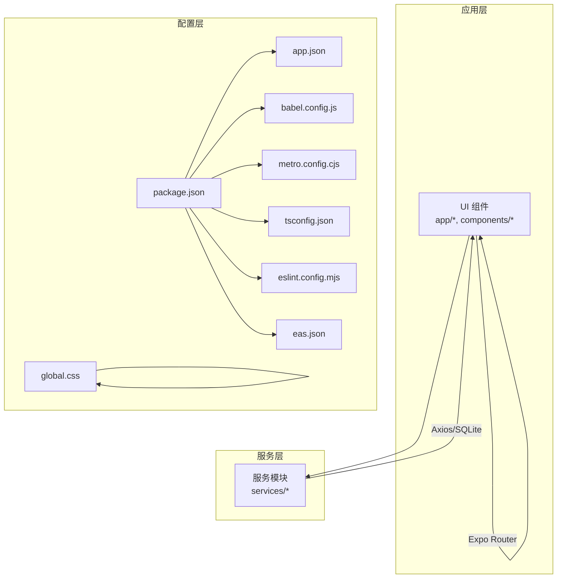
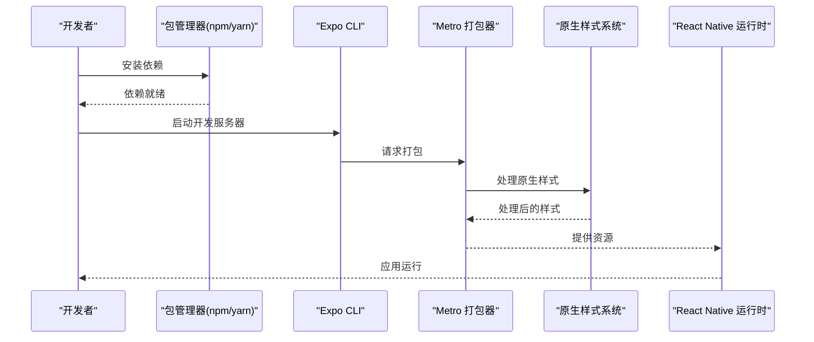
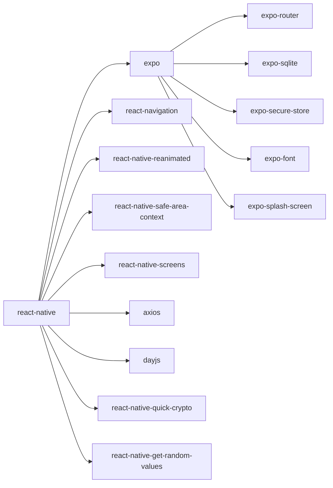

# 安装和环境问题

<cite>
**本文引用的文件**
- [package.json](file://package.json)
- [app.json](file://app.json)
- [babel.config.js](file://babel.config.js)
- [metro.config.cjs](file://metro.config.cjs)
- [tsconfig.json](file://tsconfig.json)
- [global.css](file://global.css)
- [eas.json](file://eas.json)
- [eslint.config.mjs](file://eslint.config.mjs)
- [开发文档.md](file://docs/开发文档.md)
- [app/_layout.tsx](file://app/_layout.tsx)
- [components/Themed.tsx](file://components/Themed.tsx)
- [services/AppInitializationService.ts](file://services/AppInitializationService.ts)
</cite>

## 更新摘要

**所做更改**

- 移除了 NativeWind/Tailwind 集成问题的故障排查指南章节
- 更新了项目结构图，移除了 NativeWind/Tailwind 相关节点
- 更新了架构总览图，移除了 Babel/NativeWind/Tailwind 处理环节
- 更新了详细组件分析中的样式系统部分，移除了 NativeWind/Tailwind 配置说明
- 更新了故障排查指南，移除了与 NativeWind/Tailwind 相关的所有问题

## 目录

1. [简介](#简介)
2. [项目结构](#项目结构)
3. [核心组件](#核心组件)
4. [架构总览](#架构总览)
5. [详细组件分析](#详细组件分析)
6. [依赖关系分析](#依赖关系分析)
7. [性能考虑](#性能考虑)
8. [故障排查指南](#故障排查指南)
9. [结论](#结论)
10. [附录](#附录)

## 简介

本指南面向首次搭建 Notes 应用开发环境的开发者，覆盖 Node.js 版本要求、npm/yarn 安装流程、Expo CLI 配置、Metro 打包与原生样式系统、TypeScript/Babel 配置、EAS 构建以及常见问题排查。文档同时提供 Windows/macOS/Linux 的安装步骤与注意事项，并给出依赖版本冲突、开发工具配置错误、环境变量与权限问题的解决方案。

## 项目结构

Notes 是基于 Expo + React Native 的跨平台应用，采用文件系统路由（Expo Router），结合 SQLite 本地存储、Axios 远程同步与原生样式系统。关键配置集中在 package.json、app.json、babel.config.js、metro.config.cjs、tsconfig.json 与 global.css 等文件中。

**图表来源**

- [package.json](file://package.json#L1-L67)
- [app.json](file://app.json#L1-L40)
- [babel.config.js](file://babel.config.js#L1-L7)
- [metro.config.cjs](file://metro.config.cjs#L1-L10)
- [tsconfig.json](file://tsconfig.json#L1-L11)
- [global.css](file://global.css#L1-L3)
- [eas.json](file://eas.json#L1-L31)
- [eslint.config.mjs](file://eslint.config.mjs#L1-L40)

**章节来源**

- [package.json](file://package.json#L1-L67)
- [开发文档.md](file://docs/开发文档.md#L360-L430)

## 核心组件

- 包管理与脚本：通过 package.json 管理依赖与脚本（启动、iOS/Android、lint/format、husky 准备）。
- Expo 配置：app.json 定义应用元数据、平台能力、插件与实验特性。
- 打包与解析：metro.config.cjs 禁用 Web 平台，仅保留 ios/android。
- 样式系统：原生样式系统，支持主题化组件与条件样式。
- 类型系统：tsconfig.json 继承 expo/tsconfig.base，启用 strict 与路径别名。
- 构建与发布：eas.json 定义 EAS CLI 版本与构建配置（开发/预览/生产）。
- 代码规范：eslint.config.mjs 使用 Flat Config 与 expo 预设，配合 prettier 规则。

**章节来源**

- [package.json](file://package.json#L5-L13)
- [app.json](file://app.json#L2-L38)
- [metro.config.cjs](file://metro.config.cjs#L6-L9)
- [babel.config.js](file://babel.config.js#L1-L7)
- [tsconfig.json](file://tsconfig.json#L2-L11)
- [eas.json](file://eas.json#L2-L26)
- [eslint.config.mjs](file://eslint.config.mjs#L16-L39)

## 架构总览

下图展示从安装到启动的关键流程：Node/npm/yarn → 依赖安装 → Expo CLI 启动 → Metro 打包 → 原生样式处理 → 运行时加载。

**图表来源**

- [开发文档.md](file://docs/开发文档.md#L369-L386)
- [babel.config.js](file://babel.config.js#L1-L7)
- [metro.config.cjs](file://metro.config.cjs#L1-L10)
- [tsconfig.json](file://tsconfig.json#L2-L11)
- [global.css](file://global.css#L1-L3)

## 详细组件分析

### Node.js 与包管理器

- Node.js 版本要求：开发文档明确要求 Node.js >= 18。
- 包管理器：支持 npm 或 yarn；推荐使用与团队一致的工具。
- 安装命令：执行依赖安装脚本。

**章节来源**

- [开发文档.md](file://docs/开发文档.md#L362-L374)
- [package.json](file://package.json#L5-L13)

### Expo CLI 与应用配置

- 启动命令：支持 start、android、ios。
- 应用元数据：名称、版本、图标、scheme、平台能力、插件与实验特性。
- EAS 集成：通过 app.json 的 extra.eas.projectId 关联 EAS。

**章节来源**

- [package.json](file://package.json#L5-L9)
- [app.json](file://app.json#L2-L38)
- [开发文档.md](file://docs/开发文档.md#L369-L386)

### Metro 打包配置

- 默认配置：继承 expo/metro-config。
- 平台限制：显式禁用 Web，仅保留 ios/android。
- 影响：避免不必要的 Web 平台解析与打包开销。

**章节来源**

- [metro.config.cjs](file://metro.config.cjs#L1-L10)

### Babel 配置

- 预设：babel-preset-expo。
- 简化：移除了 NativeWind 相关插件配置，保持基础 Babel 设置。

**章节来源**

- [babel.config.js](file://babel.config.js#L1-L7)

### TypeScript 配置

- 继承：基于 expo/tsconfig.base。
- 严格模式：开启 strict。
- 路径别名：@/\* 指向根目录。

**章节来源**

- [tsconfig.json](file://tsconfig.json#L2-L11)

### EAS 构建配置

- CLI 版本：要求 EAS CLI >= 16.28.0。
- 构建类型：开发/预览/生产三套配置，Android 默认 APK。
- 分发策略：internal 内部分发。

**章节来源**

- [eas.json](file://eas.json#L2-L26)

### ESLint 与代码规范

- Flat Config：使用 @eslint/eslintrc 与 js.configs.recommended。
- 插件：eslint-config-prettier 与 eslint-plugin-prettier。
- 规则：prettier 规则启用，未使用变量警告。

**章节来源**

- [eslint.config.mjs](file://eslint.config.mjs#L16-L39)

### 应用初始化与全局资源

- 根布局：加载字体、缓冲区 polyfill、随机值、reanimated 插件、通知提供者与主题提供者。
- 初始化：应用启动时初始化本地存储与定时任务服务。
- 主题组件：Themed.tsx 支持主题颜色合并。

**章节来源**

- [app/\_layout.tsx](file://app/_layout.tsx#L16-L21)
- [app/\_layout.tsx](file://app/_layout.tsx#L42-L47)
- [services/AppInitializationService.ts](file://services/AppInitializationService.ts#L16-L36)
- [components/Themed.tsx](file://components/Themed.tsx#L19-L46)

## 依赖关系分析

- 运行时与框架：expo、react-native、react、expo-router。
- 平台与存储：expo-sqlite、expo-secure-store、expo-font、expo-splash-screen。
- 网络与日期：axios、dayjs。
- 加密与随机：react-native-quick-crypto、react-native-get-random-values。
- UI 与动画：react-native-reanimated、react-native-safe-area-context、react-native-screens。
- 工具与规范：typescript、eslint、prettier、husky、lint-staged。

**图表来源**

- [package.json](file://package.json#L14-L41)

**章节来源**

- [package.json](file://package.json#L14-L41)

## 性能考虑

- 禁用 Web 平台：减少 Metro 解析与打包负担。
- 严格类型：提升编译期检查，降低运行时错误。
- 原生样式系统：使用 Expo 内置主题与条件样式，运行时性能更优。
- Reanimated 插件顺序：置于末尾，避免与其它插件冲突导致额外转换成本。

**章节来源**

- [metro.config.cjs](file://metro.config.cjs#L6-L9)
- [tsconfig.json](file://tsconfig.json#L5)
- [babel.config.js](file://babel.config.js#L4-L6)

## 故障排查指南

### Node.js 版本兼容性

- 症状：安装或启动时报版本过低。
- 处理：升级 Node.js 至 18+；使用 nvm 或对应版本管理工具切换。
- 参考：开发文档明确要求 Node.js >= 18。

**章节来源**

- [开发文档.md](file://docs/开发文档.md#L362-L367)

### npm/yarn 安装失败

- 症状：依赖安装卡住、超时、权限不足。
- 处理：
  - 清理缓存并重试：npm cache clean --force 或 yarn cache clean。
  - 使用稳定网络与代理（如需要）。
  - Windows 权限：以管理员身份运行终端；避免在受保护路径安装。
  - macOS/Linux 权限：避免使用 sudo；修正用户目录权限。
  - 使用 yarn 替代 npm：若 npm 失败，尝试 yarn install。
- 参考：package.json 中 scripts 与依赖声明。

**章节来源**

- [package.json](file://package.json#L5-L13)

### Expo CLI 配置问题

- 症状：无法启动开发服务器、找不到 CLI。
- 处理：
  - 全局安装：确保已安装 expo-cli 或使用 npx/expo。
  - 清理缓存：expo r（热重载）或重启开发服务器。
  - 平台模拟器：确保 iOS 模拟器或 Android 模拟器可用。
  - app.json 插件：确认 plugins 包含 expo-router、expo-secure-store、expo-sqlite。
- 参考：app.json 与开发文档启动命令。

**章节来源**

- [app.json](file://app.json#L28-L38)
- [开发文档.md](file://docs/开发文档.md#L375-L386)

### Metro 打包错误

- 症状：Metro 无法解析、循环依赖、平台不匹配。
- 处理：
  - 禁用 Web：metro.config.cjs 已设置 resolver.platforms 为 ['ios','android']。
  - 清理缓存：删除 node_modules/.cache 并重新安装。
  - 依赖对齐：确保 react、react-native、expo 版本与 package.json 一致。
- 参考：metro.config.cjs。

**章节来源**

- [metro.config.cjs](file://metro.config.cjs#L6-L9)

### TypeScript 编译错误

- 症状：严格模式下类型不匹配、路径别名解析失败。
- 处理：
  - 启用严格模式：tsconfig.json 已开启 strict。
  - 路径别名：确保 include 包含 .expo/types 与 expo-env.d.ts。
- 参考：tsconfig.json。

**章节来源**

- [tsconfig.json](file://tsconfig.json#L3-L11)

### Babel 配置问题

- 症状：插件顺序或格式错误导致转换失败。
- 处理：
  - 预设：babel-preset-expo。
  - 简化配置：移除了 NativeWind 相关插件，保持基础 Babel 设置。
- 参考：babel.config.js。

**章节来源**

- [babel.config.js](file://babel.config.js#L1-L7)

### EAS 构建失败

- 症状：EAS CLI 版本过低、构建配置错误。
- 处理：
  - CLI 版本：eas.json 要求 EAS CLI >= 16.28.0。
  - 构建类型：确认 development/preview/production 配置正确。
  - 分发策略：internal 分发适用于测试。
- 参考：eas.json。

**章节来源**

- [eas.json](file://eas.json#L2-L26)

### 环境变量与权限问题

- 症状：API Key 未配置、文件写入权限不足、模拟器无法访问网络。
- 处理：
  - 环境变量：在服务端或本地开发环境正确配置 Authorization: Bearer {API_KEY}。
  - 权限：Windows 以管理员运行；macOS/Linux 修正用户目录权限。
  - 网络：确保模拟器网络可达，必要时配置代理。
- 参考：开发文档 API 认证方式。

**章节来源**

- [开发文档.md](file://docs/开发文档.md#L450-L457)

### 依赖版本冲突

- 症状：Metro/Babel/TS 报错、运行时异常。
- 处理：
  - 对齐版本：react、react-native、expo、expo-router、expo-sqlite。
  - 清理锁文件：删除 package-lock.json 或 yarn.lock，重新安装。
  - 使用固定版本：参考 package.json 中各依赖版本。
- 参考：package.json。

**章节来源**

- [package.json](file://package.json#L14-L56)

### 开发工具配置错误

- 症状：ESLint 报错、Prettier 格式化冲突。
- 处理：
  - Flat Config：eslint.config.mjs 已使用 Flat Config 与 expo 预设。
  - 规则：prettier 规则启用，未使用变量警告。
  - 本地格式化：npm run format 或 yarn run format。
- 参考：eslint.config.mjs。

**章节来源**

- [eslint.config.mjs](file://eslint.config.mjs#L16-L39)

## 结论

通过遵循本指南，开发者可在不同操作系统上顺利安装与运行 Notes 应用。关键在于：满足 Node.js 版本要求、正确安装依赖、配置 Expo/Metro/Babel/原生样式系统/TypeScript/EAS，以及在出现问题时按章节来源定位配置文件进行修复。建议在团队内统一包管理器与版本，以减少冲突与维护成本。

## 附录

### 不同操作系统安装步骤与注意事项

- Windows
  - 安装 Node.js 18+；使用 PowerShell 或 WSL。
  - 安装依赖：npm install 或 yarn install。
  - 启动：npm run start；选择 Android/iOS。
  - 权限：以管理员运行终端；避免在 Program Files 下安装。
- macOS
  - 使用 Homebrew 安装 Node.js 18+。
  - 安装依赖：yarn install。
  - 启动：npm run start；确保 Xcode 模拟器可用。
  - 权限：修正用户目录权限，避免 sudo。
- Linux
  - 使用发行版包管理器或 nvm 安装 Node.js 18+。
  - 安装依赖：yarn install。
  - 启动：npm run start；确保 Android Studio AVD 或模拟器可用。
  - 权限：修正用户目录权限，避免 sudo。

**章节来源**

- [开发文档.md](file://docs/开发文档.md#L362-L386)
