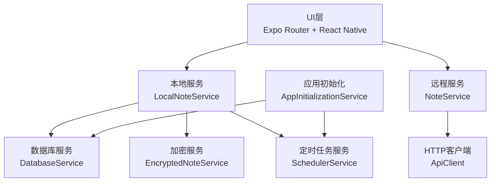
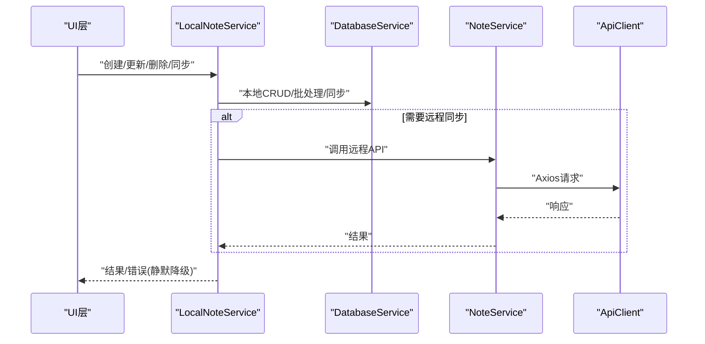
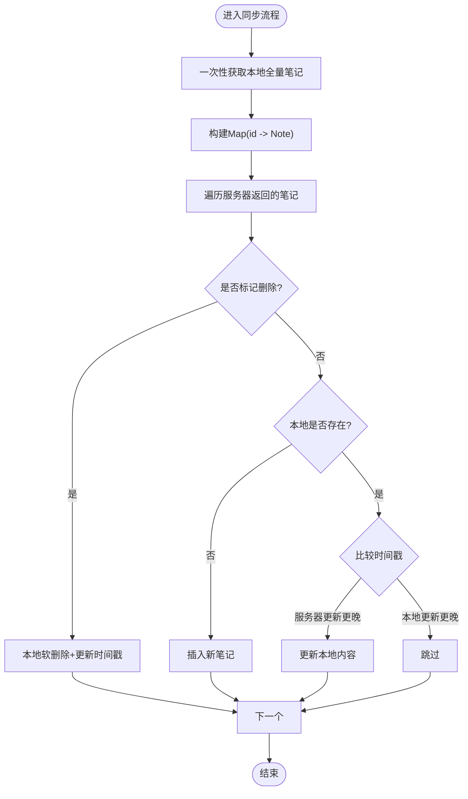
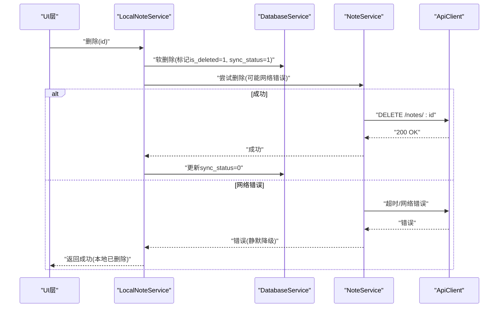
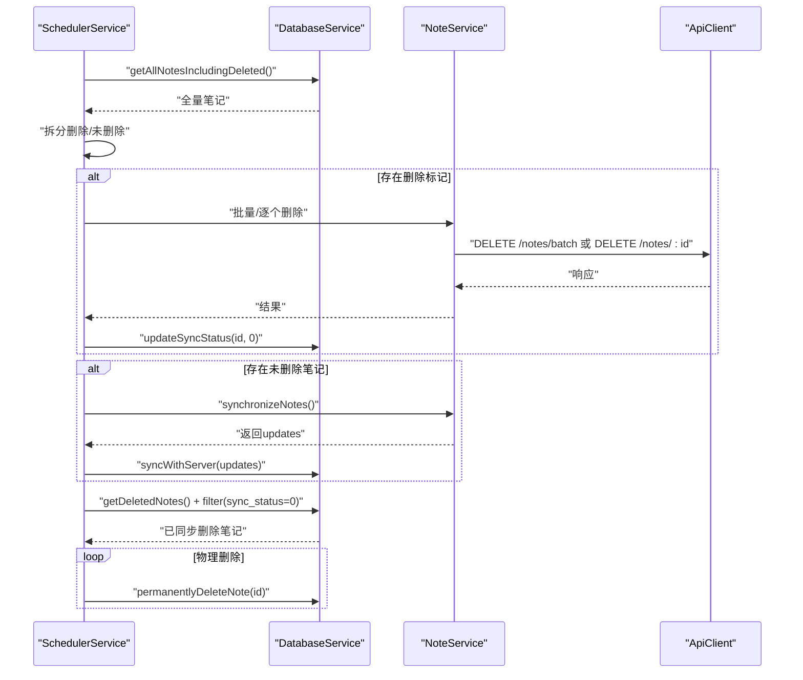
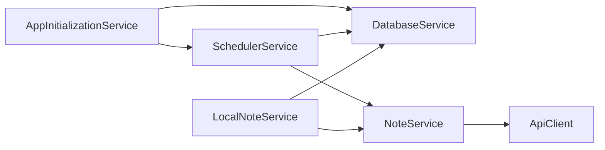

# 性能问题

<cite>
**本文引用的文件**
- [package.json](file://package.json)
- [开发文档.md](file://docs/开发文档.md)
- [AppInitializationService.ts](file://services/AppInitializationService.ts)
- [SchedulerService.ts](file://services/scheduler/SchedulerService.ts)
- [DatabaseService.ts](file://services/database/DatabaseService.ts)
- [LocalNoteService.ts](file://services/local/LocalNoteService.ts)
- [NoteService.ts](file://services/notes/NoteService.ts)
- [SyncService.ts](file://services/notes/SyncService.ts)
- [ApiClient.ts](file://services/api/ApiClient.ts)
- [_layout.tsx](file://app/_layout.tsx)
- [NoteTypes.ts](file://types/notes/NoteTypes.ts)
- [CryptoService.ts](file://services/crypto/CryptoService.ts)
- [EncryptedNoteService.ts](file://services/crypto/EncryptedNoteService.ts)
- [ErrorHandler.ts](file://utils/ErrorHandler.ts)
</cite>

## 目录

1. [简介](#简介)
2. [项目结构](#项目结构)
3. [核心组件](#核心组件)
4. [架构总览](#架构总览)
5. [详细组件分析](#详细组件分析)
6. [依赖关系分析](#依赖关系分析)
7. [性能考量](#性能考量)
8. [故障排查指南](#故障排查指南)
9. [结论](#结论)
10. [附录](#附录)

## 简介

本指南聚焦Notes应用的性能问题诊断与优化，围绕应用启动缓慢、内存占用过高、数据库查询慢、同步过程卡顿等瓶颈展开。结合代码库中的数据库调度、批处理、定时任务、网络请求与加密处理等关键路径，提供可落地的优化方案与最佳实践，帮助在大数据量场景下稳定运行。

## 项目结构

应用采用分层架构：UI层（Expo Router + React Native）、服务层（本地服务、远程服务、数据库服务、加密服务）、工具层（错误处理、认证工具）。核心性能相关模块集中在数据库服务、本地服务、同步服务与定时任务服务中。

**图表来源**

- [开发文档.md](file://docs/开发文档.md#L252-L324)
- [AppInitializationService.ts](file://services/AppInitializationService.ts#L1-L63)
- [SchedulerService.ts](file://services/scheduler/SchedulerService.ts#L1-L233)
- [DatabaseService.ts](file://services/database/DatabaseService.ts#L1-L513)
- [LocalNoteService.ts](file://services/local/LocalNoteService.ts#L1-L601)
- [NoteService.ts](file://services/notes/NoteService.ts#L1-L84)
- [ApiClient.ts](file://services/api/ApiClient.ts#L1-L92)

**章节来源**

- [开发文档.md](file://docs/开发文档.md#L50-L114)

## 核心组件

- 应用初始化服务：负责启动定时任务与清理流程，避免重复初始化。
- 定时任务服务：周期性执行同步与清理，控制同步频率与清理时机。
- 数据库服务：提供统一的SQLite操作封装、任务队列、事务批处理与内存Map对比同步。
- 本地笔记服务：面向UI的统一接口，协调本地与远程操作，处理网络错误的静默降级。
- 远程笔记服务：封装HTTP API调用，统一错误处理与超时控制。
- 加密服务：提供AES-256-CBC加解密能力，涉及CPU开销与内存占用。

**章节来源**

- [AppInitializationService.ts](file://services/AppInitializationService.ts#L1-L63)
- [SchedulerService.ts](file://services/scheduler/SchedulerService.ts#L1-L233)
- [DatabaseService.ts](file://services/database/DatabaseService.ts#L1-L513)
- [LocalNoteService.ts](file://services/local/LocalNoteService.ts#L1-L601)
- [NoteService.ts](file://services/notes/NoteService.ts#L1-L84)
- [CryptoService.ts](file://services/crypto/CryptoService.ts#L1-L205)

## 架构总览

应用采用“本地优先 + 云同步”的离线优先架构。UI层通过本地服务发起操作，本地服务协调数据库与远程服务；数据库服务通过任务队列与事务保证一致性；定时任务服务在后台周期性触发同步与清理；加密服务在需要时对敏感内容进行加解密。

**图表来源**

- [开发文档.md](file://docs/开发文档.md#L252-L324)
- [LocalNoteService.ts](file://services/local/LocalNoteService.ts#L1-L601)
- [DatabaseService.ts](file://services/database/DatabaseService.ts#L1-L513)
- [NoteService.ts](file://services/notes/NoteService.ts#L1-L84)
- [ApiClient.ts](file://services/api/ApiClient.ts#L1-L92)

## 详细组件分析

### 数据库服务（性能关键点）

- 任务队列与重入锁：通过队列与标志位避免并发死锁，提升高并发写入稳定性。
- 事务批处理：批量删除、更新、创建均在事务内执行，减少磁盘写放大。
- 内存Map对比同步：一次性拉取本地全量数据构建Map，避免循环内多次查询，显著降低I/O与CPU消耗。
- 错误恢复：针对特定SQLite错误自动重置连接，保障可用性。
- 查询优化：提供按条件的索引字段（如updated_at、is_deleted），建议在生产环境建立对应索引。

**图表来源**

- [DatabaseService.ts](file://services/database/DatabaseService.ts#L211-L260)

**章节来源**

- [DatabaseService.ts](file://services/database/DatabaseService.ts#L1-L513)

### 本地笔记服务（同步与错误降级）

- 删除与批量删除在网络错误时采用“本地先删 + 后续同步”的策略，避免UI阻塞。
- 安全删除：先检查服务端状态，再决定本地标记与同步行为，兼顾一致性与可用性。
- 批量操作：通过Promise.all并行检查服务端状态，提升吞吐。
- 同步：统一走本地数据库服务的同步逻辑，减少重复实现。

**图表来源**

- [LocalNoteService.ts](file://services/local/LocalNoteService.ts#L119-L152)
- [NoteService.ts](file://services/notes/NoteService.ts#L54-L56)
- [ApiClient.ts](file://services/api/ApiClient.ts#L51-L89)

**章节来源**

- [LocalNoteService.ts](file://services/local/LocalNoteService.ts#L1-L601)
- [NoteService.ts](file://services/notes/NoteService.ts#L1-L84)
- [ApiClient.ts](file://services/api/ApiClient.ts#L1-L92)

### 定时任务服务（同步与清理）

- 启动时立即执行一次同步与清理，随后按配置周期执行。
- 同步任务：分离删除标记与未删除笔记，分别处理，避免不必要的网络往返。
- 清理任务：仅物理删除已同步的软删除笔记，释放空间。
- 错误处理：网络错误时将本地状态更新为“已同步”，避免重复尝试。

**图表来源**

- [SchedulerService.ts](file://services/scheduler/SchedulerService.ts#L73-L229)
- [DatabaseService.ts](file://services/database/DatabaseService.ts#L211-L260)
- [NoteService.ts](file://services/notes/NoteService.ts#L69-L70)
- [ApiClient.ts](file://services/api/ApiClient.ts#L51-L89)

**章节来源**

- [SchedulerService.ts](file://services/scheduler/SchedulerService.ts#L1-L233)

### 应用初始化服务（启动与生命周期）

- 单例初始化，避免重复启动定时任务。
- 提供销毁方法，停止定时器并释放资源。

**章节来源**

- [AppInitializationService.ts](file://services/AppInitializationService.ts#L1-L63)
- [\_layout.tsx](file://app/_layout.tsx#L42-L47)

### 加密服务（CPU与内存开销）

- AES-256-CBC加解密涉及CPU与内存分配，应避免在主线程频繁执行。
- 建议：批量处理、缓存密钥、异步执行、限制加密范围（仅敏感字段）。

**章节来源**

- [CryptoService.ts](file://services/crypto/CryptoService.ts#L1-L205)
- [EncryptedNoteService.ts](file://services/crypto/EncryptedNoteService.ts#L1-L186)

## 依赖关系分析

- 本地服务依赖数据库服务与远程服务，形成“本地优先”策略。
- 定时任务服务依赖数据库服务与远程服务，负责后台维护。
- HTTP客户端统一处理超时、鉴权与错误分类。
- 类型定义集中于types目录，保证跨模块契约清晰。

**图表来源**

- [LocalNoteService.ts](file://services/local/LocalNoteService.ts#L1-L601)
- [DatabaseService.ts](file://services/database/DatabaseService.ts#L1-L513)
- [NoteService.ts](file://services/notes/NoteService.ts#L1-L84)
- [ApiClient.ts](file://services/api/ApiClient.ts#L1-L92)
- [AppInitializationService.ts](file://services/AppInitializationService.ts#L1-L63)
- [SchedulerService.ts](file://services/scheduler/SchedulerService.ts#L1-L233)

**章节来源**

- [package.json](file://package.json#L14-L41)
- [NoteTypes.ts](file://types/notes/NoteTypes.ts#L1-L109)

## 性能考量

### 启动缓慢

- 现状：应用在根布局初始化时执行本地数据库初始化与定时任务初始化。
- 优化建议：
  - 将数据库初始化与定时任务初始化拆分为懒加载，仅在首屏需要时触发。
  - 使用Splash Screen与字体预加载配合，避免阻塞渲染。
  - 将非关键初始化放入后台任务队列，优先保证UI可交互。

**章节来源**

- [\_layout.tsx](file://app/_layout.tsx#L42-L47)
- [AppInitializationService.ts](file://services/AppInitializationService.ts#L16-L37)

### 内存占用过高

- 现状：同步流程一次性拉取本地全量笔记构建Map，大数据量下内存峰值较高。
- 优化建议：
  - 分页拉取本地笔记，分批构建Map并及时释放中间对象。
  - 使用游标或分块策略处理超大数据集，避免一次性加载。
  - 对加密内容解密时，尽量延迟到UI展示阶段，减少驻留内存。

**章节来源**

- [DatabaseService.ts](file://services/database/DatabaseService.ts#L211-L260)
- [EncryptedNoteService.ts](file://services/crypto/EncryptedNoteService.ts#L117-L131)

### 数据库查询慢

- 现状：查询语句包含LIKE与排序，未见显式索引。
- 优化建议：
  - 为updated_at、is_deleted、id等常用查询字段建立索引，加速排序与过滤。
  - 将全文检索改为FTS5（若平台支持），或引入服务端搜索以减轻移动端压力。
  - 对搜索词做预处理（去空格、小写归一化）以提高命中率。

**章节来源**

- [DatabaseService.ts](file://services/database/DatabaseService.ts#L414-L423)

### 同步过程卡顿

- 现状：同步与清理在定时任务中执行，可能与UI操作并发造成抖动。
- 优化建议：
  - 调整定时任务间隔，避免在用户活跃时段执行大批量操作。
  - 将同步拆分为“增量同步 + 后台全量校验”，减少前台阻塞。
  - 对批量删除与更新增加进度反馈与取消机制。

**章节来源**

- [SchedulerService.ts](file://services/scheduler/SchedulerService.ts#L23-L49)
- [LocalNoteService.ts](file://services/local/LocalNoteService.ts#L119-L152)

### 网络请求与超时

- 现状：Axios默认超时30秒，拦截器对网络错误进行统一处理。
- 优化建议：
  - 针对不同操作设置差异化超时（如删除操作更短，同步更长）。
  - 引入指数退避与重试策略，避免雪崩效应。
  - 对批量操作合并请求，减少RTT。

**章节来源**

- [ApiClient.ts](file://services/api/ApiClient.ts#L6-L11)
- [NoteService.ts](file://services/notes/NoteService.ts#L57-L67)

### 加密与性能

- 现状：加密/解密在原生模块中执行，涉及CPU与内存分配。
- 优化建议：
  - 仅对敏感字段加密，避免全文加密。
  - 批量处理加密/解密，复用密钥与IV。
  - 在后台线程或Worklet中执行，避免阻塞UI。

**章节来源**

- [CryptoService.ts](file://services/crypto/CryptoService.ts#L65-L101)
- [EncryptedNoteService.ts](file://services/crypto/EncryptedNoteService.ts#L74-L89)

## 故障排查指南

### 常见性能问题定位

- 启动卡顿：检查初始化顺序与阻塞操作，确认数据库与定时任务是否在主线程执行。
- 内存飙升：关注同步流程中的全量拉取与Map构建，确认是否分页与及时释放。
- 同步卡顿：检查定时任务间隔与批量操作规模，评估是否需要拆分或限速。
- 网络超时：查看Axios拦截器日志，区分网络错误与服务端错误。

**章节来源**

- [\_layout.tsx](file://app/_layout.tsx#L42-L47)
- [DatabaseService.ts](file://services/database/DatabaseService.ts#L211-L260)
- [SchedulerService.ts](file://services/scheduler/SchedulerService.ts#L73-L229)
- [ApiClient.ts](file://services/api/ApiClient.ts#L51-L89)

### 错误处理与降级

- 删除操作在网络错误时采用静默降级，确保本地删除成功，避免UI阻塞。
- 定时任务在批量删除失败时尝试逐个删除，并将本地状态更新为“已同步”。

**章节来源**

- [LocalNoteService.ts](file://services/local/LocalNoteService.ts#L119-L211)
- [SchedulerService.ts](file://services/scheduler/SchedulerService.ts#L104-L176)
- [ErrorHandler.ts](file://utils/ErrorHandler.ts#L1-L48)

## 结论

通过任务队列、事务批处理、内存Map对比与定时任务的协同，应用在大数据量场景下具备较好的稳定性。进一步的优化方向包括：数据库索引建设、分页与流式处理、差异化超时策略、加密性能优化与后台化执行。建议在生产环境中逐步引入这些优化，并结合监控指标持续迭代。

## 附录

### 性能监控与指标

- 启动耗时：测量从应用启动到首屏可交互的时间。
- 数据库操作耗时：统计CRUD、批处理、同步的平均与P95耗时。
- 内存峰值：监控同步期间的内存使用，识别峰值与泄漏点。
- 网络成功率与延迟：统计删除、同步、批量操作的成功率与P95延迟。
- CPU占比：加密与解密操作的CPU占比，评估是否需要后台化。

### 优化清单

- 数据库
  - 为常用查询字段建立索引
  - 使用分页与流式处理替代全量加载
  - 将大查询拆分为多个小查询
- 同步与定时任务
  - 调整定时任务间隔，避开用户活跃时段
  - 将批量操作拆分为增量任务
  - 引入进度与取消机制
- 网络
  - 针对不同操作设置差异化超时
  - 引入指数退避与重试
  - 合并请求，减少RTT
- 加密
  - 仅对敏感字段加密
  - 批量处理与复用密钥
  - 后台线程执行
