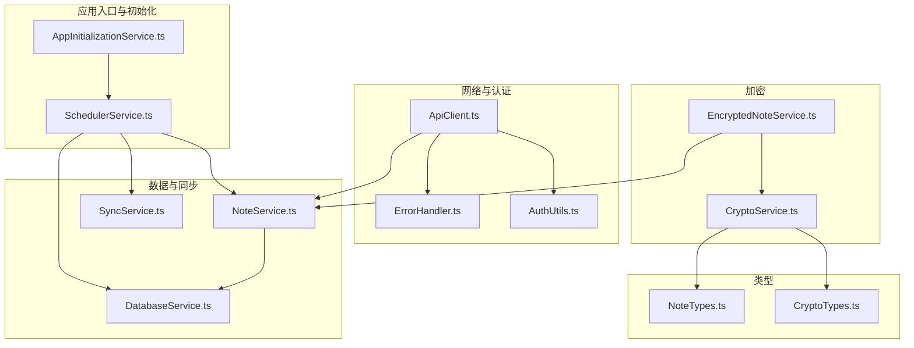
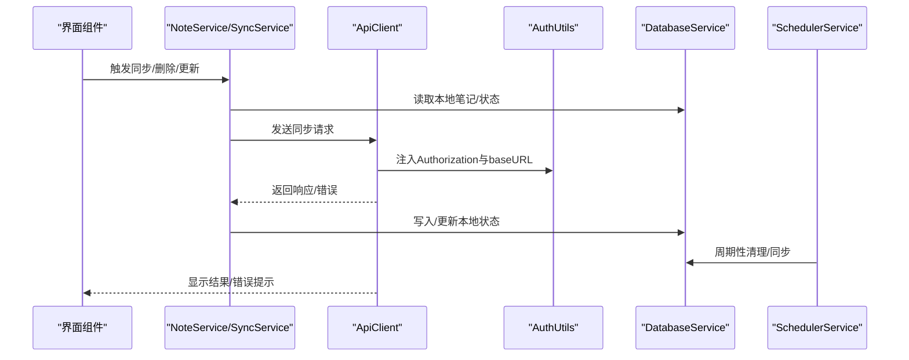
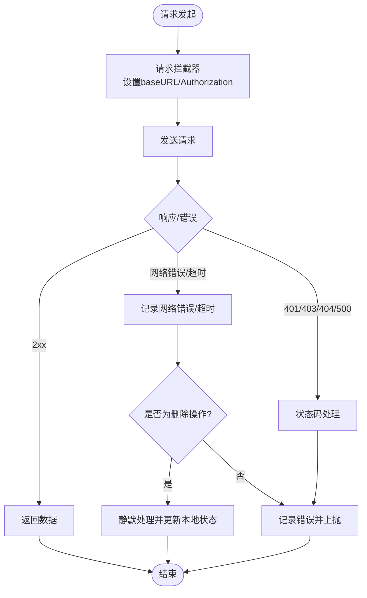
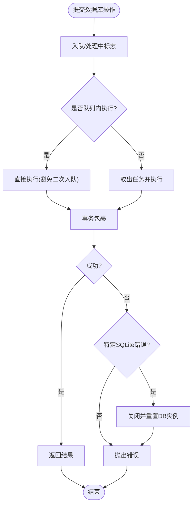
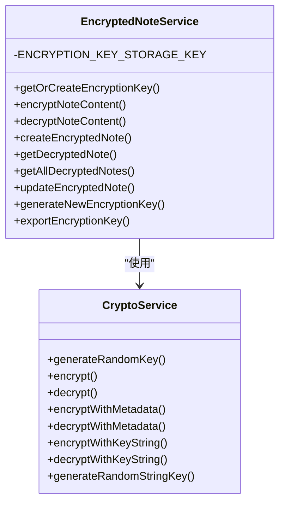
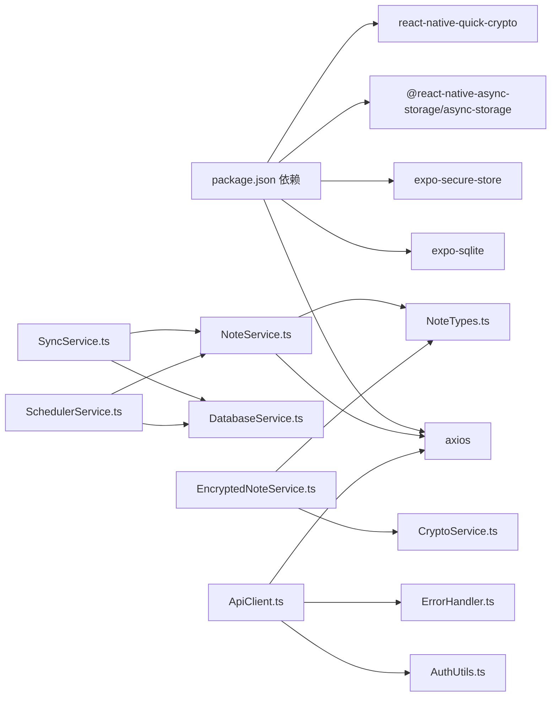
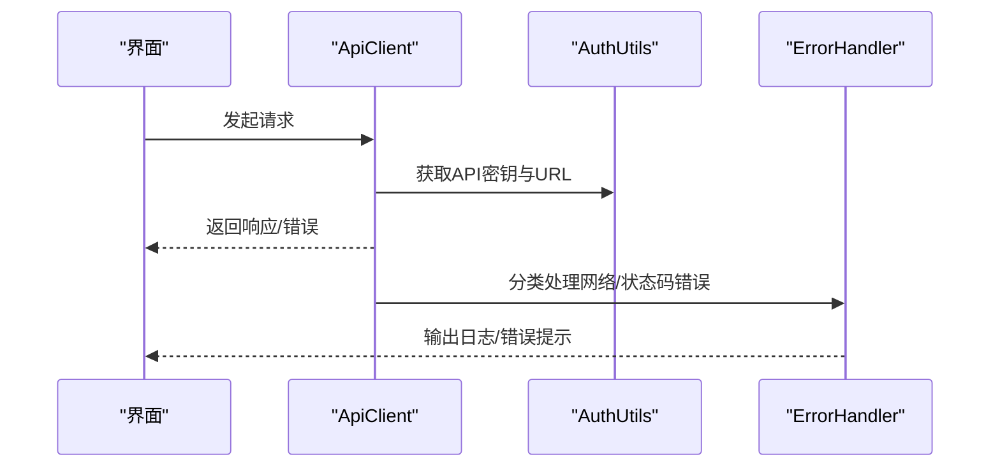

# 故障排除

<cite>
**本文引用的文件**
- [package.json](file://package.json)
- [AppInitializationService.ts](file://services/AppInitializationService.ts)
- [SchedulerService.ts](file://services/scheduler/SchedulerService.ts)
- [DatabaseService.ts](file://services/database/DatabaseService.ts)
- [ApiClient.ts](file://services/api/ApiClient.ts)
- [ErrorHandler.ts](file://utils/ErrorHandler.ts)
- [AuthUtils.ts](file://utils/auth/AuthUtils.ts)
- [CryptoService.ts](file://services/crypto/CryptoService.ts)
- [EncryptedNoteService.ts](file://services/crypto/EncryptedNoteService.ts)
- [SyncService.ts](file://services/notes/SyncService.ts)
- [NoteService.ts](file://services/notes/NoteService.ts)
- [NoteTypes.ts](file://types/notes/NoteTypes.ts)
- [CryptoTypes.ts](file://types/crypto/CryptoTypes.ts)
- [EncryptionExample.tsx](file://components/EncryptionExample.tsx)
- [LocalStorageDemo.tsx](file://components/LocalStorageDemo.tsx)
</cite>

## 更新摘要

**所做更改**

- 移除了 NativeWind 迁移问题的故障排除指南部分
- 更新了项目结构图，移除了 NativeWind 相关文档节点
- 更新了依赖关系分析，移除了 nativewind 和 tailwindcss 的依赖关系
- 更新了故障排除指南中的相关章节，移除了 NativeWind 相关内容

## 目录

1. [简介](#简介)
2. [项目结构](#项目结构)
3. [核心组件](#核心组件)
4. [架构总览](#架构总览)
5. [详细组件分析](#详细组件分析)
6. [依赖关系分析](#依赖关系分析)
7. [性能考虑](#性能考虑)
8. [故障排除指南](#故障排除指南)
9. [结论](#结论)
10. [附录](#附录)

## 简介

本指南面向开发者与技术支持人员，系统化地梳理 Notes 应用在开发与运维过程中的常见问题与排障流程。覆盖范围包括：

- 网络连接与 API 调用问题
- 数据库连接与同步失败
- 加密相关问题（密钥、加解密、密文格式）
- 日志分析与调试技巧
- 性能问题识别与优化策略
- 问题报告标准格式与技术支持渠道

## 项目结构

应用采用按功能域划分的服务层与类型层组织，核心模块包括：

- 初始化与调度：应用初始化、定时任务
- 网络与认证：Axios 客户端、拦截器、错误处理、密钥与 URL 存储
- 数据库：SQLite 封装、批量操作、同步逻辑
- 加密：AES 加密服务、加密笔记服务、密钥存储
- 同步：笔记同步服务、服务端接口封装
- 类型：笔记与加密类型定义
- 示例：加密与本地存储演示组件

**图表来源**

- [AppInitializationService.ts](file://services/AppInitializationService.ts#L1-L63)
- [SchedulerService.ts](file://services/scheduler/SchedulerService.ts#L1-L233)
- [ApiClient.ts](file://services/api/ApiClient.ts#L1-L92)
- [ErrorHandler.ts](file://utils/ErrorHandler.ts#L1-L48)
- [AuthUtils.ts](file://utils/auth/AuthUtils.ts#L1-L65)
- [DatabaseService.ts](file://services/database/DatabaseService.ts#L1-L513)
- [NoteService.ts](file://services/notes/NoteService.ts#L1-L84)
- [SyncService.ts](file://services/notes/SyncService.ts#L1-L58)
- [CryptoService.ts](file://services/crypto/CryptoService.ts#L1-L205)
- [EncryptedNoteService.ts](file://services/crypto/EncryptedNoteService.ts#L1-L186)
- [NoteTypes.ts](file://types/notes/NoteTypes.ts#L1-L109)
- [CryptoTypes.ts](file://types/crypto/CryptoTypes.ts#L1-L44)

**章节来源**

- [package.json](file://package.json#L1-L67)

## 核心组件

- 应用初始化与调度：负责启动定时任务（同步与清理），避免重复初始化与资源泄漏。
- API 客户端与错误处理：统一请求/响应拦截、网络错误识别、状态码处理与删除操作静默处理。
- 数据库服务：数据库连接健壮化、重入锁、队列化执行、事务批处理、同步对比优化。
- 加密服务：AES 加密/解密、密钥生成与存储、元数据格式、字符串密钥处理。
- 同步服务：本地笔记聚合、服务端同步、删除标记同步与清理。
- 认证工具：API 密钥与 URL 的安全存储与校验。

**章节来源**

- [AppInitializationService.ts](file://services/AppInitializationService.ts#L1-L63)
- [SchedulerService.ts](file://services/scheduler/SchedulerService.ts#L1-L233)
- [ApiClient.ts](file://services/api/ApiClient.ts#L1-L92)
- [ErrorHandler.ts](file://utils/ErrorHandler.ts#L1-L48)
- [DatabaseService.ts](file://services/database/DatabaseService.ts#L1-L513)
- [CryptoService.ts](file://services/crypto/CryptoService.ts#L1-L205)
- [EncryptedNoteService.ts](file://services/crypto/EncryptedNoteService.ts#L1-L186)
- [SyncService.ts](file://services/notes/SyncService.ts#L1-L58)
- [AuthUtils.ts](file://utils/auth/AuthUtils.ts#L1-L65)

## 架构总览

下图展示从 UI 到服务、数据库与网络的关键交互路径，以及错误处理与重试策略。

**图表来源**

- [NoteService.ts](file://services/notes/NoteService.ts#L1-L84)
- [SyncService.ts](file://services/notes/SyncService.ts#L1-L58)
- [ApiClient.ts](file://services/api/ApiClient.ts#L1-L92)
- [AuthUtils.ts](file://utils/auth/AuthUtils.ts#L1-L65)
- [DatabaseService.ts](file://services/database/DatabaseService.ts#L1-L513)
- [SchedulerService.ts](file://services/scheduler/SchedulerService.ts#L1-L233)

## 详细组件分析

### 网络与认证组件

- Axios 客户端：统一超时、Content-Type、动态 baseURL 与 Authorization 注入；响应拦截器按状态码与删除操作进行差异化处理。
- 错误处理：区分网络错误、超时、401/403/404/500 等状态码；删除操作在网络错误时静默处理并更新本地状态。
- 认证工具：API 密钥与 URL 的安全存储与校验，支持环境变量回退。

**图表来源**

- [ApiClient.ts](file://services/api/ApiClient.ts#L1-L92)
- [ErrorHandler.ts](file://utils/ErrorHandler.ts#L1-L48)

**章节来源**

- [ApiClient.ts](file://services/api/ApiClient.ts#L1-L92)
- [ErrorHandler.ts](file://utils/ErrorHandler.ts#L1-L48)
- [AuthUtils.ts](file://utils/auth/AuthUtils.ts#L1-L65)

### 数据库与同步组件

- 数据库连接：延迟初始化、竞争条件处理、异常时重置连接实例。
- 队列化执行：重入锁避免嵌套调用死锁，任务队列保障并发安全。
- 批量操作：withTransaction 原子性，减少"删了没建"风险。
- 同步逻辑：内存 Map 对比，避免高频查询与死锁；软删除与状态位协同。

**图表来源**

- [DatabaseService.ts](file://services/database/DatabaseService.ts#L1-L513)

**章节来源**

- [DatabaseService.ts](file://services/database/DatabaseService.ts#L1-L513)
- [SyncService.ts](file://services/notes/SyncService.ts#L1-L58)
- [SchedulerService.ts](file://services/scheduler/SchedulerService.ts#L1-L233)

### 加密组件

- AES 加密服务：随机密钥生成、带元数据加密/解密、字符串密钥处理与哈希补长。
- 加密笔记服务：密钥持久化（AsyncStorage）、加密/解密笔记内容、批量更新与导出密钥。

**图表来源**

- [CryptoService.ts](file://services/crypto/CryptoService.ts#L1-L205)
- [EncryptedNoteService.ts](file://services/crypto/EncryptedNoteService.ts#L1-L186)

**章节来源**

- [CryptoService.ts](file://services/crypto/CryptoService.ts#L1-L205)
- [EncryptedNoteService.ts](file://services/crypto/EncryptedNoteService.ts#L1-L186)
- [CryptoTypes.ts](file://types/crypto/CryptoTypes.ts#L1-L44)

## 依赖关系分析

- 关键外部依赖：Axios（网络）、expo-sqlite（数据库）、expo-secure-store/AsyncStorage（密钥与配置存储）、react-native-quick-crypto（加密）。
- 内部耦合：NoteService 依赖 ApiClient；SyncService 依赖 DatabaseService 与 NoteService；EncryptedNoteService 依赖 CryptoService 与 NoteService；SchedulerService 依赖 DatabaseService 与 NoteService。

**图表来源**

- [package.json](file://package.json#L1-L67)
- [NoteService.ts](file://services/notes/NoteService.ts#L1-L84)
- [SyncService.ts](file://services/notes/SyncService.ts#L1-L58)
- [DatabaseService.ts](file://services/database/DatabaseService.ts#L1-L513)
- [EncryptedNoteService.ts](file://services/crypto/EncryptedNoteService.ts#L1-L186)
- [CryptoService.ts](file://services/crypto/CryptoService.ts#L1-L205)
- [SchedulerService.ts](file://services/scheduler/SchedulerService.ts#L1-L233)
- [ApiClient.ts](file://services/api/ApiClient.ts#L1-L92)
- [AuthUtils.ts](file://utils/auth/AuthUtils.ts#L1-L65)
- [ErrorHandler.ts](file://utils/ErrorHandler.ts#L1-L48)
- [NoteTypes.ts](file://types/notes/NoteTypes.ts#L1-L109)

**章节来源**

- [package.json](file://package.json#L1-L67)

## 性能考虑

- 数据库批处理与事务：使用 withTransaction 包裹批量写入，降低锁竞争与磁盘 IO。
- 内存对比：同步阶段一次性拉取本地索引，避免循环内重复查询。
- 队列化与重入锁：防止高频调用导致的死锁与竞态。
- 网络超时与静默删除：删除网络错误时静默处理并更新本地状态，避免重复重试。

## 故障排除指南

### 通用诊断方法与调试技巧

- 启用详细日志：关注初始化、数据库连接、同步与删除、加密/解密、网络请求与错误处理日志。
- 复现最小化：隔离问题场景，使用本地存储演示组件与加密示例组件快速复现。
- 环境变量与密钥：确认 API 密钥与 URL 的存储与校验逻辑，避免空值或格式错误。
- 依赖版本：核对 package.json 中关键依赖版本，避免与 Babel/Tailwind/NativeWind 的兼容性问题。

**章节来源**

- [LocalStorageDemo.tsx](file://components/LocalStorageDemo.tsx#L1-L320)
- [EncryptionExample.tsx](file://components/EncryptionExample.tsx#L1-L233)
- [AuthUtils.ts](file://utils/auth/AuthUtils.ts#L1-L65)
- [package.json](file://package.json#L1-L67)

### 网络连接问题排查

- 症状：请求超时、网络错误、401/403/500 等状态码。
- 排查步骤：
  - 检查请求拦截器是否注入 Authorization 与 baseURL。
  - 核对 API URL 格式与协议（开发/生产差异）。
  - 观察响应拦截器的状态码分支与网络错误分支。
  - 删除操作在网络错误时的静默处理与本地状态更新。
- 修复建议：
  - 确保 API 密钥有效且符合格式。
  - 调整超时时间与重试策略（若业务允许）。
  - 对 401/403 场景引导用户重新登录或检查权限。

**图表来源**

- [ApiClient.ts](file://services/api/ApiClient.ts#L1-L92)
- [AuthUtils.ts](file://utils/auth/AuthUtils.ts#L1-L65)
- [ErrorHandler.ts](file://utils/ErrorHandler.ts#L1-L48)

**章节来源**

- [ApiClient.ts](file://services/api/ApiClient.ts#L1-L92)
- [AuthUtils.ts](file://utils/auth/AuthUtils.ts#L1-L65)
- [ErrorHandler.ts](file://utils/ErrorHandler.ts#L1-L48)

### 数据库连接与同步失败

- 症状：数据库初始化失败、空指针、并发冲突、死锁、同步不一致。
- 排查步骤：
  - 检查数据库延迟初始化与竞争条件处理。
  - 确认队列化执行与重入锁逻辑。
  - 核对事务包裹的批量操作顺序。
  - 观察特定 SQLite 错误时的连接实例重置。
- 修复建议：
  - 避免在队列执行流中再次入队，减少嵌套调用。
  - 批量操作使用 withTransaction，保证原子性。
  - 同步阶段使用内存 Map 对比，减少查询次数。

**章节来源**

- [DatabaseService.ts](file://services/database/DatabaseService.ts#L1-L513)
- [SyncService.ts](file://services/notes/SyncService.ts#L1-L58)
- [SchedulerService.ts](file://services/scheduler/SchedulerService.ts#L1-L233)

### 加密相关问题

- 症状：密钥生成失败、加解密异常、密文格式错误、密钥长度不匹配。
- 排查步骤：
  - 检查密钥生成与存储（AsyncStorage）。
  - 核对加密/解密输入参数与密钥长度。
  - 验证带元数据的加密/解密格式。
  - 字符串密钥处理：长度不足时的哈希补长逻辑。
- 修复建议：
  - 生成新密钥时注意已有数据不可解密的风险，必要时导出并备份。
  - 统一密钥长度与算法，避免 aes-256-cbc 与 32 字节不匹配。

**章节来源**

- [CryptoService.ts](file://services/crypto/CryptoService.ts#L1-L205)
- [EncryptedNoteService.ts](file://services/crypto/EncryptedNoteService.ts#L1-L186)
- [CryptoTypes.ts](file://types/crypto/CryptoTypes.ts#L1-L44)

### 应用初始化与定时任务

- 症状：重复初始化、定时任务未启动、资源泄漏。
- 排查步骤：
  - 检查初始化标志位与 destroy 逻辑。
  - 确认定时任务启动与停止的时机。
- 修复建议：
  - 在应用生命周期中正确调用初始化与销毁。
  - 启动时立即执行一次同步与清理，随后按间隔执行。

**章节来源**

- [AppInitializationService.ts](file://services/AppInitializationService.ts#L1-L63)
- [SchedulerService.ts](file://services/scheduler/SchedulerService.ts#L1-L233)

### 错误日志分析与解读

- 网络错误：关注"Network Error"、"timeout"、"ECONNABORTED"等关键字，区分删除操作的静默处理。
- 状态码错误：401/403/404/500 分别对应未授权、拒绝、资源不存在、服务器错误。
- 数据库错误：特定 SQLite 错误时自动重置数据库实例，避免后续操作失败。
- 加密错误：密钥格式、长度与算法不匹配会导致解密失败。

**章节来源**

- [ErrorHandler.ts](file://utils/ErrorHandler.ts#L1-L48)
- [ApiClient.ts](file://services/api/ApiClient.ts#L1-L92)
- [DatabaseService.ts](file://services/database/DatabaseService.ts#L1-L513)
- [CryptoService.ts](file://services/crypto/CryptoService.ts#L1-L205)

### 性能问题识别与优化策略

- 识别：高频数据库操作、重复查询、未使用事务的批量写入、未队列化的并发调用。
- 优化：
  - 使用 withTransaction 与内存 Map 对比。
  - 队列化执行与重入锁，避免死锁。
  - 适当增加批量操作粒度，减少往返次数。

**章节来源**

- [DatabaseService.ts](file://services/database/DatabaseService.ts#L1-L513)
- [SyncService.ts](file://services/notes/SyncService.ts#L1-L58)

### 问题报告标准格式

为便于技术支持快速定位问题，请在报告中包含以下信息：

- 应用版本与设备信息（操作系统、设备型号、是否模拟器）
- 复现步骤（最小可复现场景）
- 预期行为与实际行为
- 相关日志片段（网络、数据库、加密）
- 截图（UI 异常、错误弹窗）
- 已尝试的修复措施与结果

### 技术支持渠道

- GitHub Issues：在仓库中提交问题报告，附上标准格式与日志。
- 本地开发环境：使用示例组件快速复现问题并收集日志。

## 结论

通过系统化的组件分析与故障排除流程，可以高效定位并解决 Notes 应用在开发与运维过程中的常见问题。建议在日常开发中：

- 严格遵循错误处理与日志规范
- 使用队列化与事务化策略提升稳定性
- 建立标准化问题报告模板，提高协作效率

## 附录

- 类型定义参考：笔记与加密相关类型，便于排查参数与返回值一致性。
- 示例组件参考：加密示例与本地存储演示，便于快速复现与验证。

**章节来源**

- [NoteTypes.ts](file://types/notes/NoteTypes.ts#L1-L109)
- [CryptoTypes.ts](file://types/crypto/CryptoTypes.ts#L1-L44)
- [EncryptionExample.tsx](file://components/EncryptionExample.tsx#L1-L233)
- [LocalStorageDemo.tsx](file://components/LocalStorageDemo.tsx#L1-L320)
