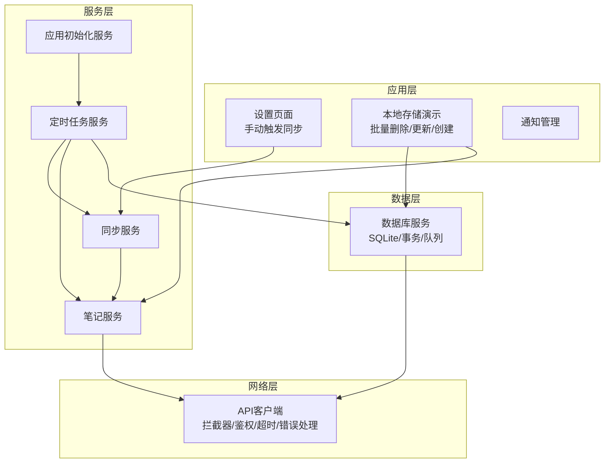
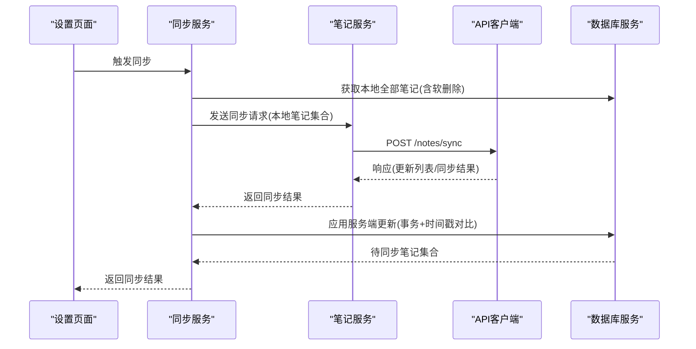
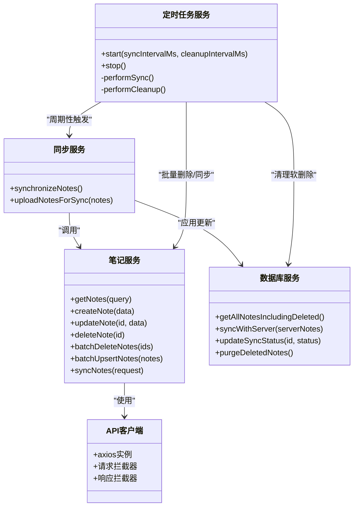
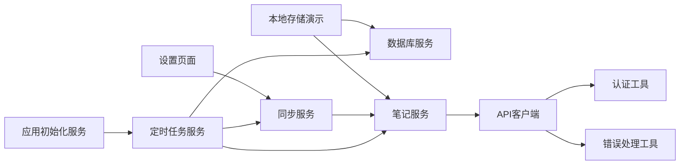

# 数据同步问题

<cite>
**本文引用的文件**
- [SyncService.ts](file://services/notes/SyncService.ts)
- [NoteService.ts](file://services/notes/NoteService.ts)
- [LocalNoteService.ts](file://services/local/LocalNoteService.ts)
- [DatabaseService.ts](file://services/database/DatabaseService.ts)
- [ApiClient.ts](file://services/api/ApiClient.ts)
- [SchedulerService.ts](file://services/scheduler/SchedulerService.ts)
- [AppInitializationService.ts](file://services/AppInitializationService.ts)
- [NoteTypes.ts](file://types/notes/NoteTypes.ts)
- [ErrorHandler.ts](file://utils/ErrorHandler.ts)
- [AuthUtils.ts](file://utils/auth/AuthUtils.ts)
- [settings.tsx](file://app/settings.tsx)
- [LocalStorageDemo.tsx](file://components/LocalStorageDemo.tsx)
- [NotificationManager.tsx](file://components/NotificationManager.tsx)
</cite>

## 目录

1. [简介](#简介)
2. [项目结构](#项目结构)
3. [核心组件](#核心组件)
4. [架构总览](#架构总览)
5. [详细组件分析](#详细组件分析)
6. [依赖关系分析](#依赖关系分析)
7. [性能考量](#性能考量)
8. [故障排查指南](#故障排查指南)
9. [结论](#结论)
10. [附录](#附录)

## 简介

本指南聚焦Notes应用的数据同步问题专项排查，覆盖同步失败、数据不一致、冲突解决异常、离线数据丢失、批量操作失败、时间戳冲突、软删除处理、网络异常与服务器连接问题、数据格式错误、同步状态检查与日志分析、以及同步性能优化与错误重试机制配置。目标是帮助开发者快速定位并修复同步链路中的各类问题，保障本地与服务端数据一致性。

## 项目结构

- 同步入口与服务
  - 同步服务：负责触发同步流程，封装与服务端的同步交互。
  - 笔记服务：封装REST API调用，统一处理请求/响应。
  - 定时任务服务：周期性执行同步与清理，保证离线场景下数据最终一致。
- 数据层
  - 本地数据库服务：基于SQLite封装，提供事务、队列化、并发控制、软删除、同步状态字段等能力。
- 工具与配置
  - API客户端：统一拦截器、超时、鉴权、错误处理。
  - 错误处理工具：识别网络错误、删除操作静默处理。
  - 认证工具：API密钥与URL读取与校验。
- UI与集成
  - 设置页面：手动触发同步。
  - 本地存储演示：验证本地操作与同步状态。
  - 通知管理：统一展示同步结果与错误信息。

图表来源

- [settings.tsx](file://app/settings.tsx#L16-L25)
- [SyncService.ts](file://services/notes/SyncService.ts#L13-L36)
- [NoteService.ts](file://services/notes/NoteService.ts#L69-L70)
- [SchedulerService.ts](file://services/scheduler/SchedulerService.ts#L23-L49)
- [DatabaseService.ts](file://services/database/DatabaseService.ts#L147-L155)
- [ApiClient.ts](file://services/api/ApiClient.ts#L6-L11)

章节来源

- [settings.tsx](file://app/settings.tsx#L1-L122)
- [SyncService.ts](file://services/notes/SyncService.ts#L1-L58)
- [NoteService.ts](file://services/notes/NoteService.ts#L1-L84)
- [SchedulerService.ts](file://services/scheduler/SchedulerService.ts#L1-L233)
- [DatabaseService.ts](file://services/database/DatabaseService.ts#L1-L513)
- [ApiClient.ts](file://services/api/ApiClient.ts#L1-L92)

## 核心组件

- 同步服务：封装“获取本地全部笔记（含软删除）→发送同步请求→应用服务端返回的更新”流程；捕获错误并向上抛出。
- 笔记服务：封装REST API调用，包括分页获取、创建、更新、删除、批量删除、批量插入/更新、同步接口。
- 数据库服务：提供SQLite封装、事务、队列化执行、软删除、同步状态字段、时间戳对比、清理被标记删除的记录。
- API客户端：统一请求/响应拦截器，设置超时、鉴权头、网络错误与状态码处理。
- 定时任务服务：周期性同步待同步笔记与清理已同步的软删除笔记，具备网络错误静默与降级策略。
- 应用初始化服务：启动定时任务，确保应用生命周期内持续进行同步与清理。

章节来源

- [SyncService.ts](file://services/notes/SyncService.ts#L13-L36)
- [NoteService.ts](file://services/notes/NoteService.ts#L69-L70)
- [DatabaseService.ts](file://services/database/DatabaseService.ts#L211-L260)
- [ApiClient.ts](file://services/api/ApiClient.ts#L17-L41)
- [SchedulerService.ts](file://services/scheduler/SchedulerService.ts#L23-L49)
- [AppInitializationService.ts](file://services/AppInitializationService.ts#L16-L37)

## 架构总览

同步链路由“UI触发/定时任务”驱动，经“同步服务→笔记服务→API客户端→服务端”，再由“笔记服务→数据库服务→本地持久化”完成回写与状态更新。数据库层通过事务与队列化避免并发冲突，软删除与同步状态字段确保离线场景下的最终一致性。

图表来源

- [settings.tsx](file://app/settings.tsx#L16-L25)
- [SyncService.ts](file://services/notes/SyncService.ts#L13-L36)
- [NoteService.ts](file://services/notes/NoteService.ts#L69-L70)
- [DatabaseService.ts](file://services/database/DatabaseService.ts#L211-L260)
- [ApiClient.ts](file://services/api/ApiClient.ts#L51-L89)

## 详细组件分析

### 同步服务（SyncService）

- 职责
  - 获取本地全部笔记（含软删除）。
  - 构造同步请求并调用笔记服务的同步接口。
  - 若服务端返回更新，调用数据库服务应用更新。
  - 捕获错误并向上抛出，便于上层统一处理。
- 关键点
  - 本地笔记包含软删除标记，确保服务端能正确识别删除意图。
  - 服务端返回的updates按时间戳与本地记录对比，避免覆盖本地更新。
- 可能的问题
  - 本地笔记数量大导致请求体过大。
  - 服务端返回的updates字段缺失或格式异常。
  - 数据库应用更新失败（事务回滚）。

章节来源

- [SyncService.ts](file://services/notes/SyncService.ts#L13-L36)
- [NoteTypes.ts](file://types/notes/NoteTypes.ts#L98-L108)

### 笔记服务（NoteService）

- 职责
  - 封装REST API调用，包括分页获取、创建、更新、删除、批量删除、批量插入/更新、同步接口。
  - 同步接口调用POST /notes/sync，传入本地笔记集合。
- 关键点
  - 所有API调用通过统一的API客户端，具备超时、鉴权、错误处理。
  - 同步接口返回的updates用于数据库层应用更新。
- 可能的问题
  - 接口地址变更或鉴权失效导致401/403。
  - 网络超时或中断导致ECONNABORTED/Network Error。
  - 服务端返回数据格式不符合预期。

章节来源

- [NoteService.ts](file://services/notes/NoteService.ts#L69-L70)
- [ApiClient.ts](file://services/api/ApiClient.ts#L51-L89)

### 数据库服务（DatabaseService）

- 职责
  - SQLite封装、表结构初始化、事务、队列化执行、软删除、同步状态字段、时间戳对比、清理被标记删除的记录。
- 关键点
  - 采用任务队列与重入锁，避免高频操作导致的并发冲突与死锁。
  - 同步应用阶段使用内存Map进行本地索引，减少重复查询。
  - 时间戳对比决定是否应用服务端更新，避免覆盖本地更新。
- 可能的问题
  - SQLite连接异常或prepareAsync错误导致实例失效。
  - 事务中部分操作失败导致回滚。
  - 大量笔记同步时内存占用与性能问题。

章节来源

- [DatabaseService.ts](file://services/database/DatabaseService.ts#L18-L56)
- [DatabaseService.ts](file://services/database/DatabaseService.ts#L211-L260)
- [DatabaseService.ts](file://services/database/DatabaseService.ts#L314-L337)

### API客户端（ApiClient）

- 职责
  - 统一请求拦截器：动态设置baseURL与Authorization头。
  - 统一响应拦截器：处理网络错误、超时、状态码错误。
- 关键点
  - 超时30秒，避免长时间阻塞。
  - 对删除操作的网络错误进行静默处理，配合上层策略。
  - 404视为正常情况（如删除已不存在资源），降低噪音。
- 可能的问题
  - API密钥缺失或格式不合法。
  - baseURL配置错误或协议不匹配。
  - 网络波动导致频繁超时。

章节来源

- [ApiClient.ts](file://services/api/ApiClient.ts#L6-L11)
- [ApiClient.ts](file://services/api/ApiClient.ts#L17-L41)
- [ApiClient.ts](file://services/api/ApiClient.ts#L51-L89)
- [AuthUtils.ts](file://utils/auth/AuthUtils.ts#L27-L30)

### 定时任务服务（SchedulerService）

- 职责
  - 周期性执行同步与清理：同步待同步笔记、清理已同步的软删除笔记。
  - 对删除操作具备网络错误静默与降级策略。
- 关键点
  - 同步间隔与清理间隔可配置，默认30分钟同步、1小时清理。
  - 删除同步失败时，本地状态也会更新为已同步，避免重复尝试。
- 可能的问题
  - 定时任务未启动或重复启动。
  - 网络错误导致同步/清理失败但不阻塞本地操作。

章节来源

- [SchedulerService.ts](file://services/scheduler/SchedulerService.ts#L23-L49)
- [SchedulerService.ts](file://services/scheduler/SchedulerService.ts#L104-L176)
- [SchedulerService.ts](file://services/scheduler/SchedulerService.ts#L196-L229)

### 应用初始化服务（AppInitializationService）

- 职责
  - 启动定时任务服务，确保应用生命周期内持续进行同步与清理。
- 关键点
  - 防止重复初始化。
  - 提供销毁能力，停止定时任务。
- 可能的问题
  - 初始化失败导致定时任务未启动。
  - 销毁后未正确停止定时器。

章节来源

- [AppInitializationService.ts](file://services/AppInitializationService.ts#L16-L37)
- [AppInitializationService.ts](file://services/AppInitializationService.ts#L42-L52)

### 类图：同步相关服务与数据模型

图表来源

- [SyncService.ts](file://services/notes/SyncService.ts#L13-L52)
- [NoteService.ts](file://services/notes/NoteService.ts#L32-L70)
- [DatabaseService.ts](file://services/database/DatabaseService.ts#L211-L260)
- [ApiClient.ts](file://services/api/ApiClient.ts#L1-L92)
- [SchedulerService.ts](file://services/scheduler/SchedulerService.ts#L13-L230)

## 依赖关系分析

- 同步服务依赖笔记服务与数据库服务。
- 笔记服务依赖API客户端。
- 定时任务服务依赖同步服务、笔记服务与数据库服务。
- 应用初始化服务依赖定时任务服务。
- 错误处理工具与认证工具贯穿API客户端与上层UI。

图表来源

- [settings.tsx](file://app/settings.tsx#L16-L25)
- [SyncService.ts](file://services/notes/SyncService.ts#L13-L36)
- [NoteService.ts](file://services/notes/NoteService.ts#L69-L70)
- [DatabaseService.ts](file://services/database/DatabaseService.ts#L211-L260)
- [SchedulerService.ts](file://services/scheduler/SchedulerService.ts#L23-L49)
- [AppInitializationService.ts](file://services/AppInitializationService.ts#L16-L37)
- [ApiClient.ts](file://services/api/ApiClient.ts#L1-L92)
- [AuthUtils.ts](file://utils/auth/AuthUtils.ts#L27-L30)
- [ErrorHandler.ts](file://utils/ErrorHandler.ts#L18-L47)

章节来源

- [settings.tsx](file://app/settings.tsx#L1-L122)
- [SyncService.ts](file://services/notes/SyncService.ts#L1-L58)
- [NoteService.ts](file://services/notes/NoteService.ts#L1-L84)
- [DatabaseService.ts](file://services/database/DatabaseService.ts#L1-L513)
- [SchedulerService.ts](file://services/scheduler/SchedulerService.ts#L1-L233)
- [AppInitializationService.ts](file://services/AppInitializationService.ts#L1-L63)
- [ApiClient.ts](file://services/api/ApiClient.ts#L1-L92)
- [AuthUtils.ts](file://utils/auth/AuthUtils.ts#L1-L65)
- [ErrorHandler.ts](file://utils/ErrorHandler.ts#L1-L48)

## 性能考量

- 事务与队列化
  - 数据库层使用withTransactionAsync与任务队列，避免并发冲突与死锁，提升批量操作稳定性。
- 内存Map对比
  - 同步应用阶段一次性获取本地索引，使用Map进行O(1)查找，减少重复查询，提升大规模同步性能。
- 软删除与清理
  - 定时任务周期性清理已同步的软删除笔记，避免数据库膨胀。
- 超时与重试
  - API客户端设置30秒超时，响应拦截器对网络错误进行统一处理；上层可结合业务策略进行重试。

章节来源

- [DatabaseService.ts](file://services/database/DatabaseService.ts#L169-L204)
- [DatabaseService.ts](file://services/database/DatabaseService.ts#L211-L260)
- [SchedulerService.ts](file://services/scheduler/SchedulerService.ts#L196-L229)
- [ApiClient.ts](file://services/api/ApiClient.ts#L6-L11)

## 故障排查指南

### 一、同步失败

- 现象
  - 设置页面点击“同步笔记”无响应或报错。
  - 定时任务日志显示同步失败。
- 排查步骤
  - 检查API密钥与URL配置是否有效。
  - 查看API响应拦截器日志，确认是否出现401/403/404/500等状态码。
  - 检查网络超时与中断情况。
  - 确认数据库连接与事务执行是否成功。
- 修复建议
  - 更新正确的API密钥与URL。
  - 在网络不稳定时，适当延长超时或增加重试次数。
  - 检查数据库实例是否因SQLite错误被重置。

章节来源

- [settings.tsx](file://app/settings.tsx#L16-L25)
- [ApiClient.ts](file://services/api/ApiClient.ts#L51-L89)
- [AuthUtils.ts](file://utils/auth/AuthUtils.ts#L27-L30)
- [DatabaseService.ts](file://services/database/DatabaseService.ts#L80-L94)

### 二、数据不一致

- 现象
  - 本地与服务端内容不同步，或服务端覆盖了本地更新。
- 排查步骤
  - 检查同步应用阶段的时间戳对比逻辑。
  - 确认服务端返回的updates字段是否包含最新数据。
  - 核对软删除标记与同步状态字段是否正确。
- 修复建议
  - 确保服务端返回的updated_at严格递增。
  - 本地仅在服务端时间戳更晚时才应用更新。
  - 对软删除与同步状态字段进行一致性校验。

章节来源

- [DatabaseService.ts](file://services/database/DatabaseService.ts#L244-L254)
- [NoteTypes.ts](file://types/notes/NoteTypes.ts#L104-L108)

### 三、冲突解决异常

- 现象
  - 同步过程中出现“本地更新被覆盖”或“服务端更新未生效”。
- 排查步骤
  - 比对本地与服务端updated_at，确认时间戳对比逻辑。
  - 检查批量操作是否在事务中执行，避免部分失败。
- 修复建议
  - 严格遵循“服务端更新时间戳更晚才应用”的规则。
  - 对批量操作使用事务，确保原子性。

章节来源

- [DatabaseService.ts](file://services/database/DatabaseService.ts#L169-L204)
- [DatabaseService.ts](file://services/database/DatabaseService.ts#L244-L254)

### 四、离线数据丢失

- 现象
  - 设备离线期间进行删除/更新，恢复网络后数据未同步。
- 排查步骤
  - 检查软删除标记与同步状态字段是否正确设置。
  - 确认定时任务是否正常运行，周期是否合理。
  - 核对清理任务是否清理了已同步的软删除笔记。
- 修复建议
  - 删除操作本地立即软删除，网络错误时保持待同步状态。
  - 定时任务定期同步待同步笔记，清理已同步的软删除笔记。
  - 调整同步与清理间隔，平衡实时性与性能。

章节来源

- [LocalNoteService.ts](file://services/local/LocalNoteService.ts#L119-L152)
- [LocalNoteService.ts](file://services/local/LocalNoteService.ts#L157-L211)
- [SchedulerService.ts](file://services/scheduler/SchedulerService.ts#L104-L176)
- [SchedulerService.ts](file://services/scheduler/SchedulerService.ts#L196-L229)

### 五、批量操作失败

- 现象
  - 批量删除/更新/创建失败，部分操作未生效。
- 排查步骤
  - 检查批量操作是否在事务中执行。
  - 确认ID有效性与数据格式。
  - 查看API响应拦截器对网络错误的处理。
- 修复建议
  - 使用事务包裹批量操作，确保原子性。
  - 对ID进行有效性校验，避免空值或非法类型。
  - 对网络错误进行降级处理，必要时逐个重试。

章节来源

- [DatabaseService.ts](file://services/database/DatabaseService.ts#L169-L204)
- [DatabaseService.ts](file://services/database/DatabaseService.ts#L314-L337)
- [LocalNoteService.ts](file://services/local/LocalNoteService.ts#L157-L211)
- [ApiClient.ts](file://services/api/ApiClient.ts#L51-L89)

### 六、时间戳冲突

- 现象
  - 服务端与本地时间戳不一致，导致更新被忽略或覆盖。
- 排查步骤
  - 检查本地与服务端时间戳生成逻辑。
  - 确认updated_at字段是否正确传递。
- 修复建议
  - 统一时间戳格式与时区。
  - 服务端严格按updated_at排序与对比。

章节来源

- [DatabaseService.ts](file://services/database/DatabaseService.ts#L244-L254)
- [NoteTypes.ts](file://types/notes/NoteTypes.ts#L84-L89)

### 七、软删除处理

- 现象
  - 删除后本地与服务端状态不一致，或清理任务未清理软删除笔记。
- 排查步骤
  - 检查软删除标记与同步状态字段。
  - 确认删除同步是否成功，失败时是否静默处理。
  - 核对清理任务是否执行。
- 修复建议
  - 删除同步失败时，本地状态也更新为已同步，避免重复尝试。
  - 定时任务定期清理已同步的软删除笔记。

章节来源

- [LocalNoteService.ts](file://services/local/LocalNoteService.ts#L119-L152)
- [LocalNoteService.ts](file://services/local/LocalNoteService.ts#L157-L211)
- [SchedulerService.ts](file://services/scheduler/SchedulerService.ts#L104-L176)
- [SchedulerService.ts](file://services/scheduler/SchedulerService.ts#L196-L229)

### 八、网络异常处理

- 现象
  - 网络波动导致同步中断或超时。
- 排查步骤
  - 查看API响应拦截器对网络错误与超时的处理。
  - 检查删除操作的静默处理策略。
- 修复建议
  - 增加重试机制（指数退避）。
  - 对删除操作在网络错误时保持静默，确保本地操作不受影响。

章节来源

- [ApiClient.ts](file://services/api/ApiClient.ts#L51-L89)
- [ErrorHandler.ts](file://utils/ErrorHandler.ts#L18-L47)
- [LocalNoteService.ts](file://services/local/LocalNoteService.ts#L130-L142)

### 九、服务器连接问题

- 现象
  - 401/403/500等状态码导致同步失败。
- 排查步骤
  - 检查API密钥与URL配置。
  - 查看状态码处理器的日志输出。
- 修复建议
  - 更新API密钥与URL。
  - 对401/403进行鉴权处理，对500进行重试或降级。

章节来源

- [ApiClient.ts](file://services/api/ApiClient.ts#L44-L49)
- [AuthUtils.ts](file://utils/auth/AuthUtils.ts#L27-L30)

### 十、数据格式错误

- 现象
  - 服务端返回数据结构与前端期望不符。
- 排查步骤
  - 检查NoteTypes中定义的请求/响应结构。
  - 确认服务端接口文档与实现一致。
- 修复建议
  - 严格遵循类型定义，确保字段齐全。
  - 对未知字段进行容错处理。

章节来源

- [NoteTypes.ts](file://types/notes/NoteTypes.ts#L1-L109)

### 十一、同步状态检查与日志分析

- 同步状态字段
  - sync_status：0表示已同步，1表示待同步。
  - is_deleted：1表示软删除。
- 日志分析
  - API拦截器会输出网络错误、超时、状态码错误等关键信息。
  - 数据库层会输出创建/更新/删除/清理等操作日志。
  - 定时任务会输出同步与清理过程的关键节点。
- 建议
  - 结合日志与状态字段进行交叉验证。
  - 对异常场景增加更详细的上下文日志。

章节来源

- [DatabaseService.ts](file://services/database/DatabaseService.ts#L434-L444)
- [DatabaseService.ts](file://services/database/DatabaseService.ts#L408-L412)
- [ApiClient.ts](file://services/api/ApiClient.ts#L51-L89)

### 十二、批量操作失败、时间戳冲突、软删除处理的处理策略

- 批量操作
  - 使用事务包裹，确保原子性；对网络错误进行降级处理。
- 时间戳冲突
  - 严格按updated_at对比，服务端更新时间戳更晚才应用。
- 软删除
  - 删除同步失败时本地状态也更新为已同步，避免重复尝试；定时任务定期清理。

章节来源

- [DatabaseService.ts](file://services/database/DatabaseService.ts#L169-L204)
- [DatabaseService.ts](file://services/database/DatabaseService.ts#L244-L254)
- [LocalNoteService.ts](file://services/local/LocalNoteService.ts#L119-L152)
- [SchedulerService.ts](file://services/scheduler/SchedulerService.ts#L104-L176)

### 十三、同步性能优化与错误重试机制配置

- 性能优化
  - 使用事务与队列化，避免并发冲突。
  - 内存Map对比减少重复查询。
  - 定时任务清理软删除笔记，控制数据库规模。
- 错误重试
  - API客户端设置超时与统一错误处理。
  - 上层可结合业务策略实现指数退避重试。
  - 删除操作在网络错误时静默处理，确保本地操作不受影响。

章节来源

- [DatabaseService.ts](file://services/database/DatabaseService.ts#L62-L101)
- [DatabaseService.ts](file://services/database/DatabaseService.ts#L211-L260)
- [SchedulerService.ts](file://services/scheduler/SchedulerService.ts#L104-L176)
- [ApiClient.ts](file://services/api/ApiClient.ts#L6-L11)
- [ErrorHandler.ts](file://utils/ErrorHandler.ts#L18-L47)

## 结论

通过梳理同步服务、笔记服务、数据库服务、API客户端与定时任务服务的职责与交互，可以系统性地定位与修复数据同步问题。建议在日常运维中重点关注API密钥与URL配置、网络错误处理、事务与队列化执行、时间戳对比与软删除策略，并结合日志与状态字段进行交叉验证，以确保本地与服务端数据的一致性与可靠性。

## 附录

- 常用检查清单
  - API密钥与URL是否有效。
  - 网络是否稳定，是否存在超时或中断。
  - 数据库连接是否正常，事务是否成功。
  - 定时任务是否运行，清理任务是否执行。
  - 同步状态字段与软删除标记是否正确。
- 常见错误代码与含义
  - 401/403：鉴权失败，需检查API密钥。
  - 404：资源不存在，通常为正常情况。
  - 500：服务器内部错误，需重试或降级。
  - ECONNABORTED/Network Error：网络错误，需重试或降级。
