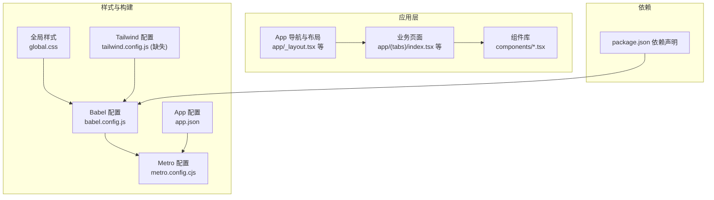
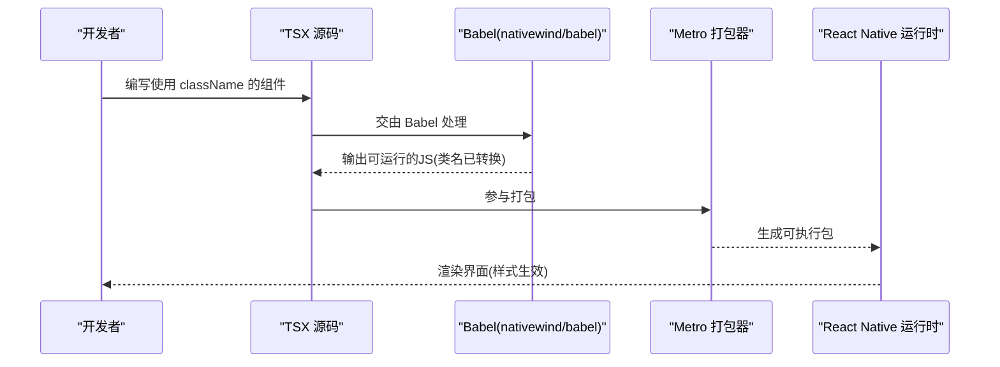
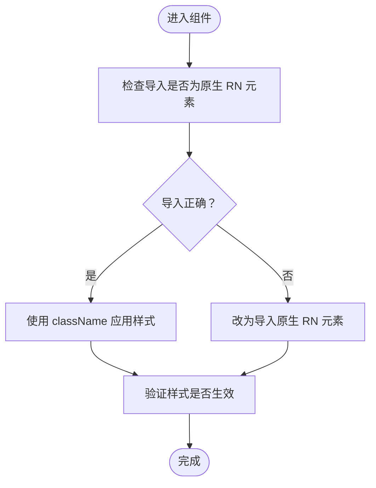
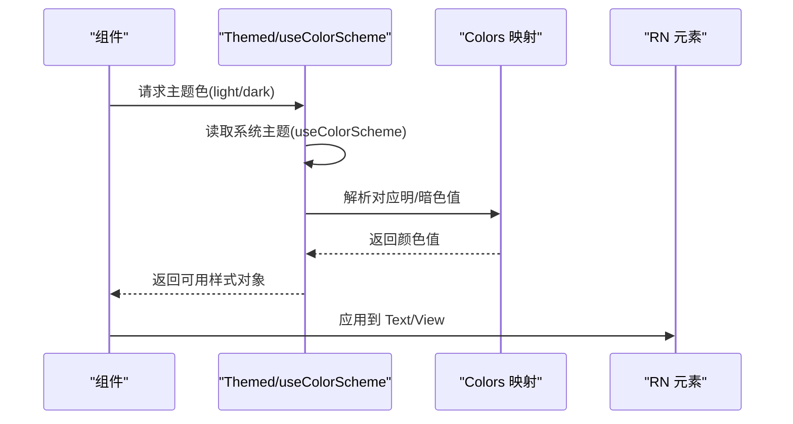
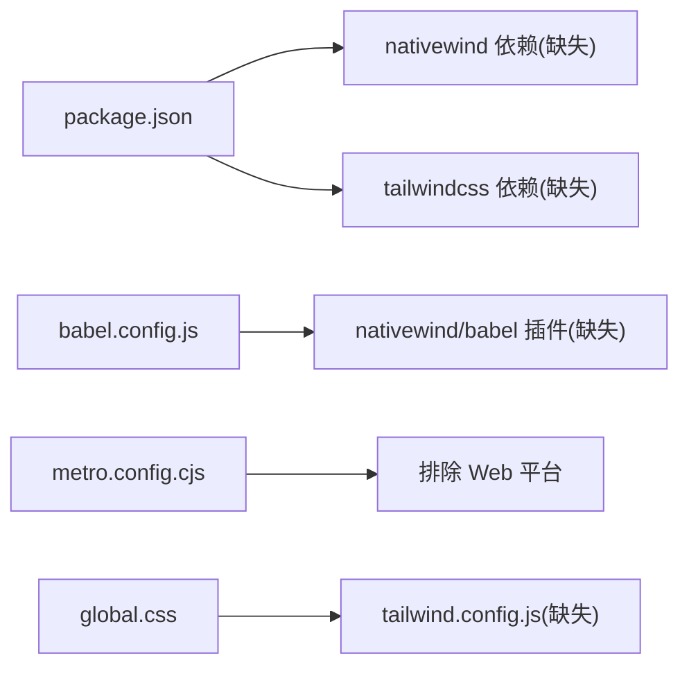

# 迁移问题

<cite>
**本文引用的文件**
- [package.json](file://package.json)
- [babel.config.js](file://babel.config.js)
- [metro.config.cjs](file://metro.config.cjs)
- [app.json](file://app.json)
- [global.css](file://global.css)
- [docs/NativeWind迁移指南.md](file://docs/NativeWind迁移指南.md)
- [components/Themed.tsx](file://components/Themed.tsx)
- [components/NoteListWithSelection.tsx](file://components/NoteListWithSelection.tsx)
</cite>

## 目录

1. [简介](#简介)
2. [项目结构](#项目结构)
3. [核心组件](#核心组件)
4. [架构总览](#架构总览)
5. [详细组件分析](#详细组件分析)
6. [依赖关系分析](#依赖关系分析)
7. [性能考量](#性能考量)
8. [故障排查指南](#故障排查指南)
9. [结论](#结论)
10. [附录](#附录)

## 简介

本指南面向Notes应用从传统Tailwind CSS到NativeWind的迁移专项排查，聚焦迁移过程中样式不生效、主题配置错误、响应式设计失效等常见问题的诊断与修复；同时提供迁移前准备清单、迁移后验证步骤、版本兼容性与依赖冲突的解决策略，以及回滚方案与风险控制措施。

## 项目结构

- 应用基于Expo Router与React Native，采用TypeScript开发，Metro作为打包器，Babel进行转译。
- Tailwind基础样式通过全局CSS引入，但当前仓库未包含tailwind.config.js，存在潜在配置缺失风险。
- 文档目录包含一份完整的NativeWind迁移指南，明确了渐进式迁移策略、配置要点与注意事项。

图表来源

- [global.css](file://global.css#L1-L3)
- [babel.config.js](file://babel.config.js#L1-L7)
- [metro.config.cjs](file://metro.config.cjs#L1-L10)
- [app.json](file://app.json#L1-L40)
- [package.json](file://package.json#L1-L67)

章节来源

- [package.json](file://package.json#L1-L67)
- [babel.config.js](file://babel.config.js#L1-L7)
- [metro.config.cjs](file://metro.config.cjs#L1-L10)
- [app.json](file://app.json#L1-L40)
- [global.css](file://global.css#L1-L3)
- [docs/NativeWind迁移指南.md](file://docs/NativeWind迁移指南.md#L1-L165)

## 核心组件

- 主题与颜色系统：通过Themed组件与useColorScheme实现明暗主题适配，为NativeWind主题兼容提供基础。
- 样式体系：当前仍大量使用StyleSheet.create，部分组件已开始引入NativeWind类名属性，形成双轨并行。
- 构建链路：Babel插件需正确配置以支持NativeWind类名转换；Metro需排除Web平台以避免不必要解析。

章节来源

- [components/Themed.tsx](file://components/Themed.tsx#L1-L46)
- [components/NoteListWithSelection.tsx](file://components/NoteListWithSelection.tsx#L1-L398)
- [babel.config.js](file://babel.config.js#L1-L7)
- [metro.config.cjs](file://metro.config.cjs#L1-L10)

## 架构总览

下图展示从源码到运行时的关键路径：源文件经Babel转换NativeWind类名为RN样式，Metro打包，最终在设备上渲染。

图表来源

- [babel.config.js](file://babel.config.js#L1-L7)
- [metro.config.cjs](file://metro.config.cjs#L1-L10)
- [docs/NativeWind迁移指南.md](file://docs/NativeWind迁移指南.md#L142-L156)

## 详细组件分析

### 组件A：NoteListWithSelection（样式体系现状）

- 当前实现：大量使用StyleSheet.create定义容器、卡片、按钮等样式，体现传统RN样式风格。
- 迁移建议：对新增交互或重构区域，逐步引入NativeWind类名；保留原有样式以保证向后兼容。
- 潜在问题：若混用Themed组件与原生RN元素，需确保导入的是原生元素而非Themed版本，否则className不会生效。

图表来源

- [components/NoteListWithSelection.tsx](file://components/NoteListWithSelection.tsx#L1-L398)
- [docs/NativeWind迁移指南.md](file://docs/NativeWind迁移指南.md#L135-L139)

章节来源

- [components/NoteListWithSelection.tsx](file://components/NoteListWithSelection.tsx#L1-L398)
- [docs/NativeWind迁移指南.md](file://docs/NativeWind迁移指南.md#L51-L91)

### 组件B：Themed（主题与颜色系统）

- 当前实现：通过useColorScheme与useThemeColor在明暗主题间切换颜色，为NativeWind主题兼容提供参考。
- 迁移建议：在NativeWind中可通过useColorScheme手动拼接类名，或封装主题上下文以统一管理。

图表来源

- [components/Themed.tsx](file://components/Themed.tsx#L1-L46)
- [docs/NativeWind迁移指南.md](file://docs/NativeWind迁移指南.md#L33-L49)

章节来源

- [components/Themed.tsx](file://components/Themed.tsx#L1-L46)
- [docs/NativeWind迁移指南.md](file://docs/NativeWind迁移指南.md#L33-L49)

## 依赖关系分析

- 依赖声明：package.json中未包含nativewind与tailwindcss，但迁移指南明确其为必需依赖。
- 构建配置：babel.config.js缺少nativewind/babel插件；metro.config.cjs禁用了Web平台，符合RN环境。
- 样式入口：global.css引入了Tailwind指令，但缺少tailwind.config.js会导致构建警告或样式未生效。

图表来源

- [package.json](file://package.json#L1-L67)
- [babel.config.js](file://babel.config.js#L1-L7)
- [metro.config.cjs](file://metro.config.cjs#L1-L10)
- [global.css](file://global.css#L1-L3)
- [docs/NativeWind迁移指南.md](file://docs/NativeWind迁移指南.md#L9-L18)

章节来源

- [package.json](file://package.json#L1-L67)
- [babel.config.js](file://babel.config.js#L1-L7)
- [metro.config.cjs](file://metro.config.cjs#L1-L10)
- [global.css](file://global.css#L1-L3)
- [docs/NativeWind迁移指南.md](file://docs/NativeWind迁移指南.md#L9-L18)

## 性能考量

- NativeWind在构建期预编译类名，运行时开销低；应避免在运行时动态拼接大量不同类名组合。
- 样式拆分与复用：将常用样式抽取为可复用的类名，减少重复定义。
- 主题切换：尽量使用useColorScheme或上下文缓存主题状态，避免频繁计算。

## 故障排查指南

### 1) 样式不生效

- 症状：使用className但样式未生效。
- 排查清单：
  - 确认导入的是原生RN元素（非Themed版本），否则className无效。
  - 检查Babel配置是否包含nativewind/babel插件且格式正确。
  - 确认global.css已引入Tailwind指令，且tailwind.config.js存在。
  - 验证Metro未解析Web平台导致的类名转换异常。
- 修复建议：
  - 在babel.config.js中添加nativewind/babel插件，并保持单行格式。
  - 补充tailwind.config.js并确保与工程路径一致。
  - 保持metro.config.cjs的平台配置与实际目标一致。

章节来源

- [docs/NativeWind迁移指南.md](file://docs/NativeWind迁移指南.md#L135-L156)
- [babel.config.js](file://babel.config.js#L1-L7)
- [global.css](file://global.css#L1-L3)
- [metro.config.cjs](file://metro.config.cjs#L1-L10)

### 2) 主题配置错误

- 症状：明暗主题切换后颜色不匹配。
- 排查清单：
  - 检查Themed组件的颜色映射是否与NativeWind类名一致。
  - 在NativeWind中通过useColorScheme手动拼接类名，或封装主题上下文。
- 修复建议：
  - 为暗色模式提供对应的类名（如bg-gray-800/text-white），并在组件中根据useColorScheme切换。
  - 统一主题变量来源，避免混用StyleSheet与NativeWind类名。

章节来源

- [components/Themed.tsx](file://components/Themed.tsx#L1-L46)
- [docs/NativeWind迁移指南.md](file://docs/NativeWind迁移指南.md#L33-L49)

### 3) 响应式设计失效

- 症状：在不同屏幕尺寸或方向下布局错乱。
- 排查清单：
  - 检查是否使用了仅适用于Web的响应式特性（如某些Tailwind断点）。
  - 确认移动端断点与RN尺寸适配策略一致。
- 修复建议：
  - 使用RN尺寸检测与条件渲染替代Web响应式断点。
  - 在NativeWind中通过条件类名与useColorScheme实现自适应。

章节来源

- [components/NoteListWithSelection.tsx](file://components/NoteListWithSelection.tsx#L1-L398)
- [docs/NativeWind迁移指南.md](file://docs/NativeWind迁移指南.md#L127-L134)

### 4) 构建与插件配置错误

- 症状：Babel报错“plugins is not a valid Plugin property”。
- 排查清单：
  - 检查babel.config.js中插件格式是否为单行字符串数组。
- 修复建议：
  - 将插件配置改为单行格式，确保与迁移指南一致。

章节来源

- [docs/NativeWind迁移指南.md](file://docs/NativeWind迁移指南.md#L144-L156)
- [babel.config.js](file://babel.config.js#L1-L7)

### 5) 依赖冲突与版本兼容性

- 症状：安装nativewind/tailwindcss后出现版本冲突或构建失败。
- 排查清单：
  - 比对迁移指南中的版本范围，确保与项目依赖兼容。
  - 关注Expo SDK版本与React Native版本对Babel与Metro的影响。
- 修复建议：
  - 优先遵循迁移指南中的版本要求，必要时降级或升级以达成兼容。
  - 清理node_modules与缓存后重新安装。

章节来源

- [docs/NativeWind迁移指南.md](file://docs/NativeWind迁移指南.md#L9-L13)
- [package.json](file://package.json#L1-L67)
- [app.json](file://app.json#L1-L40)

### 6) 回滚方案与风险控制

- 风险点：大规模替换可能导致回归问题。
- 回滚策略：
  - 采用渐进式迁移：保留原有组件不变，仅在新功能或重构区域使用NativeWind。
  - 通过分支策略隔离变更，确保主干稳定。
- 风险控制：
  - 迁移前后进行端到端验证，覆盖主要页面与交互。
  - 对第三方组件不支持className的情况，使用包装容器过渡。

章节来源

- [docs/NativeWind迁移指南.md](file://docs/NativeWind迁移指南.md#L51-L91)
- [docs/NativeWind迁移指南.md](file://docs/NativeWind迁移指南.md#L114-L121)

## 结论

- 本项目已具备NativeWind迁移的基础条件：构建链路与主题系统相对完善。
- 当前主要风险集中在配置缺失（tailwind.config.js、nativewind/tailwindcss依赖、Babel插件）与样式混用。
- 建议按迁移指南执行“渐进式替换”，优先验证核心页面与交互，确保回滚路径清晰。

## 附录

### 迁移前准备清单

- 安装并配置nativewind与tailwindcss依赖
- 在babel.config.js中添加nativewind/babel插件
- 创建tailwind.config.js并引入global.css
- 确认Metro排除Web平台
- 准备主题上下文或useColorScheme方案

章节来源

- [docs/NativeWind迁移指南.md](file://docs/NativeWind迁移指南.md#L9-L18)
- [babel.config.js](file://babel.config.js#L1-L7)
- [global.css](file://global.css#L1-L3)
- [metro.config.cjs](file://metro.config.cjs#L1-L10)

### 迁移后验证步骤

- 基础样式类名生效性测试
- 明暗主题切换一致性验证
- 第三方组件className兼容性检查
- 页面布局与交互稳定性回归测试

章节来源

- [docs/NativeWind迁移指南.md](file://docs/NativeWind迁移指南.md#L158-L165)
