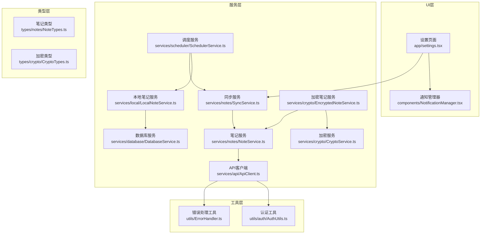
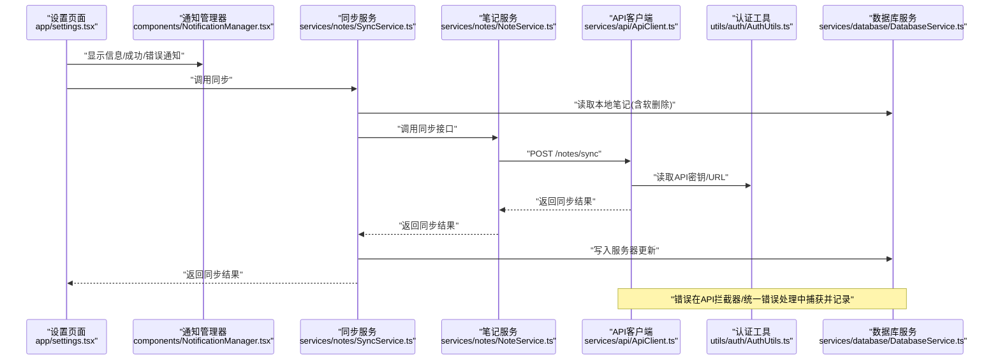
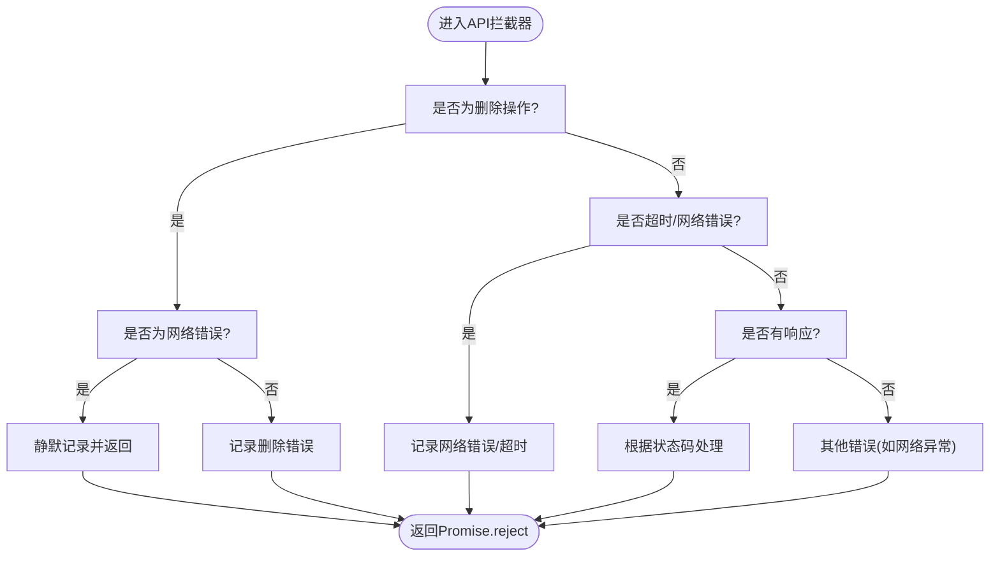
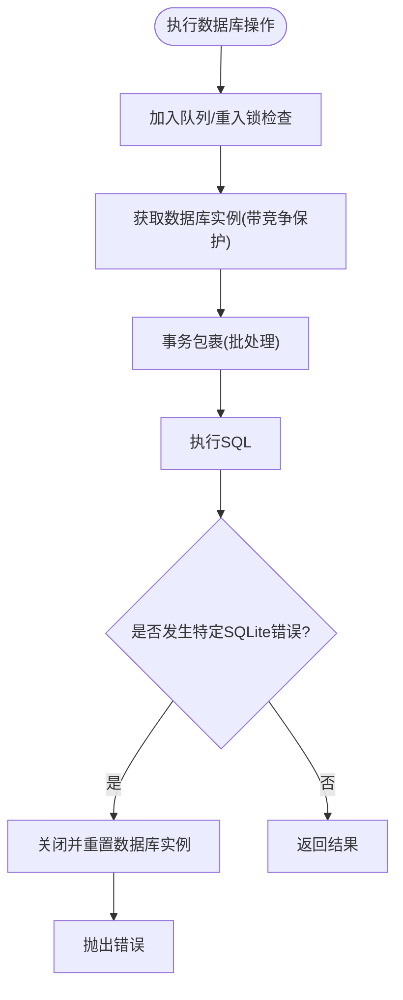
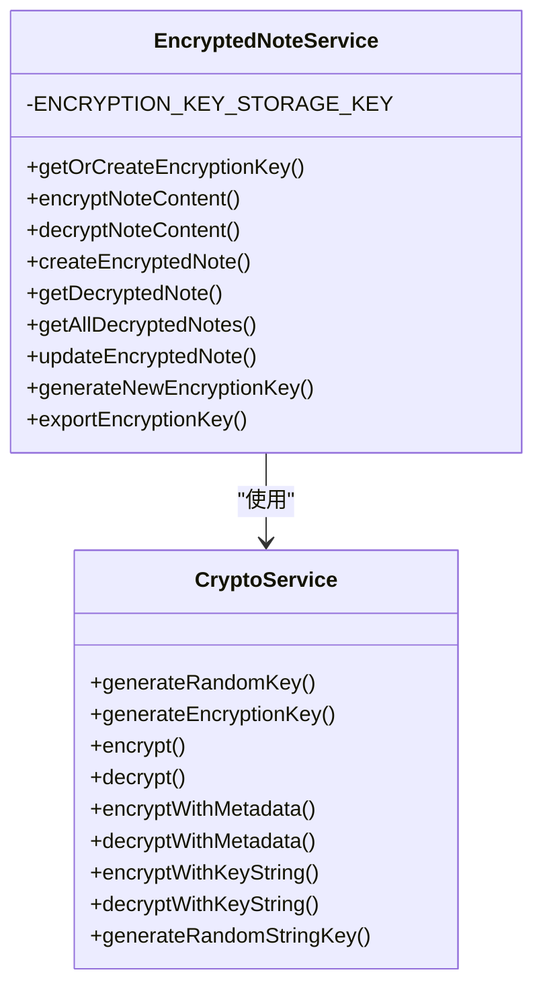
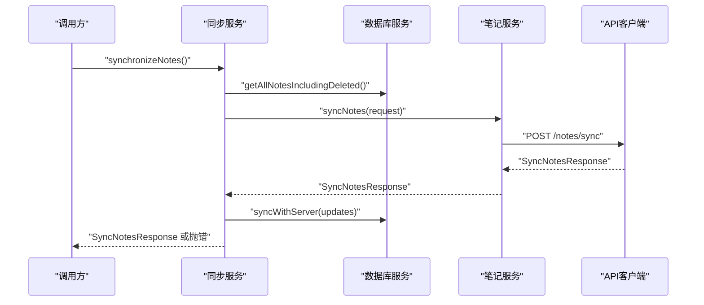
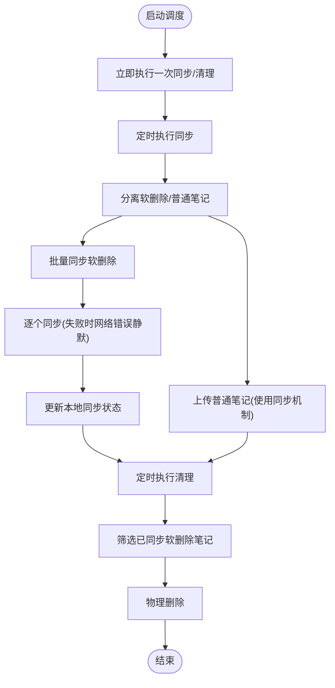
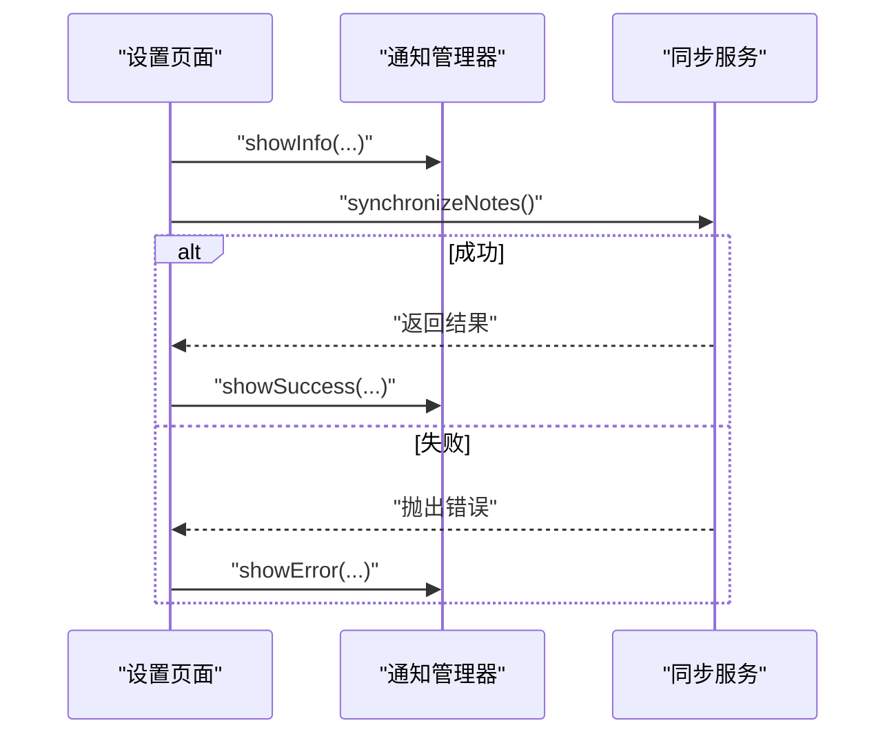
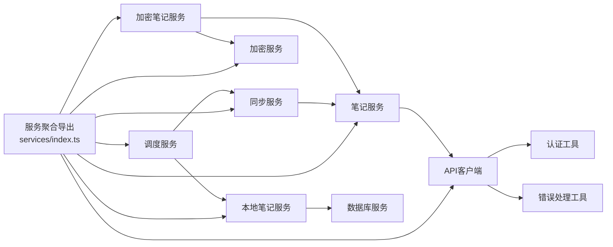

# 运行时错误

<cite>
**本文引用的文件**
- [services/index.ts](file://services/index.ts)
- [utils/ErrorHandler.ts](file://utils/ErrorHandler.ts)
- [services/api/ApiClient.ts](file://services/api/ApiClient.ts)
- [services/notes/NoteService.ts](file://services/notes/NoteService.ts)
- [services/notes/SyncService.ts](file://services/notes/SyncService.ts)
- [services/database/DatabaseService.ts](file://services/database/DatabaseService.ts)
- [services/local/LocalNoteService.ts](file://services/local/LocalNoteService.ts)
- [services/scheduler/SchedulerService.ts](file://services/scheduler/SchedulerService.ts)
- [services/crypto/CryptoService.ts](file://services/crypto/CryptoService.ts)
- [services/crypto/EncryptedNoteService.ts](file://services/crypto/EncryptedNoteService.ts)
- [utils/auth/AuthUtils.ts](file://utils/auth/AuthUtils.ts)
- [types/notes/NoteTypes.ts](file://types/notes/NoteTypes.ts)
- [types/crypto/CryptoTypes.ts](file://types/crypto/CryptoTypes.ts)
- [components/NotificationManager.tsx](file://components/NotificationManager.tsx)
- [app/settings.tsx](file://app/settings.tsx)
</cite>

## 目录

1. [简介](#简介)
2. [项目结构](#项目结构)
3. [核心组件](#核心组件)
4. [架构总览](#架构总览)
5. [详细组件分析](#详细组件分析)
6. [依赖关系分析](#依赖关系分析)
7. [性能考量](#性能考量)
8. [故障排查指南](#故障排查指南)
9. [结论](#结论)
10. [附录](#附录)

## 简介

本指南面向Notes应用的运行时错误诊断与解决，覆盖API调用错误、网络连接失败、数据库操作异常、加密解密错误等场景；同时提供同步服务异常、调度任务失败、组件渲染错误的排查步骤，以及常见错误码含义与解决方案、错误监控与通知系统配置建议。

## 项目结构

应用采用按职责分层的组织方式：

- 服务层：API客户端、笔记服务、同步服务、数据库服务、本地笔记服务、调度服务、加密服务
- 工具层：统一错误处理、认证工具
- 类型层：笔记与加密相关的类型定义
- UI层：通知管理器、设置页面等

图表来源

- [services/api/ApiClient.ts](file://services/api/ApiClient.ts#L1-L92)
- [services/notes/NoteService.ts](file://services/notes/NoteService.ts#L1-L84)
- [services/notes/SyncService.ts](file://services/notes/SyncService.ts#L1-L58)
- [services/database/DatabaseService.ts](file://services/database/DatabaseService.ts#L1-L513)
- [services/local/LocalNoteService.ts](file://services/local/LocalNoteService.ts#L1-L601)
- [services/scheduler/SchedulerService.ts](file://services/scheduler/SchedulerService.ts#L1-L233)
- [services/crypto/CryptoService.ts](file://services/crypto/CryptoService.ts#L1-L205)
- [services/crypto/EncryptedNoteService.ts](file://services/crypto/EncryptedNoteService.ts#L1-L186)
- [utils/ErrorHandler.ts](file://utils/ErrorHandler.ts#L1-L48)
- [utils/auth/AuthUtils.ts](file://utils/auth/AuthUtils.ts#L1-L65)
- [types/notes/NoteTypes.ts](file://types/notes/NoteTypes.ts#L1-L109)
- [types/crypto/CryptoTypes.ts](file://types/crypto/CryptoTypes.ts#L1-L44)
- [components/NotificationManager.tsx](file://components/NotificationManager.tsx#L1-L235)
- [app/settings.tsx](file://app/settings.tsx#L1-L76)

章节来源

- [services/index.ts](file://services/index.ts#L1-L82)

## 核心组件

- API客户端与统一错误处理：负责请求/响应拦截、网络错误识别、状态码处理与统一错误输出
- 笔记服务与同步服务：封装REST接口调用与同步流程
- 数据库服务：提供线程安全的数据库操作、队列化与事务化处理
- 本地笔记服务：面向UI的业务封装，包含删除/批量删除的安全策略
- 调度服务：定时执行同步与清理任务，具备网络错误静默处理能力
- 加密服务与加密笔记服务：提供密钥生成、加解密与笔记内容的透明加解密
- 认证工具：API密钥与URL的读取、校验与回退策略
- 通知管理器：跨平台的通知展示组件

章节来源

- [services/api/ApiClient.ts](file://services/api/ApiClient.ts#L1-L92)
- [utils/ErrorHandler.ts](file://utils/ErrorHandler.ts#L1-L48)
- [services/notes/NoteService.ts](file://services/notes/NoteService.ts#L1-L84)
- [services/notes/SyncService.ts](file://services/notes/SyncService.ts#L1-L58)
- [services/database/DatabaseService.ts](file://services/database/DatabaseService.ts#L1-L513)
- [services/local/LocalNoteService.ts](file://services/local/LocalNoteService.ts#L1-L601)
- [services/scheduler/SchedulerService.ts](file://services/scheduler/SchedulerService.ts#L1-L233)
- [services/crypto/CryptoService.ts](file://services/crypto/CryptoService.ts#L1-L205)
- [services/crypto/EncryptedNoteService.ts](file://services/crypto/EncryptedNoteService.ts#L1-L186)
- [utils/auth/AuthUtils.ts](file://utils/auth/AuthUtils.ts#L1-L65)
- [components/NotificationManager.tsx](file://components/NotificationManager.tsx#L1-L235)

## 架构总览

下图展示了从UI触发到服务层与数据库/加密层交互的整体流程，以及错误在各层的传播与处理路径。

图表来源

- [app/settings.tsx](file://app/settings.tsx#L1-L76)
- [components/NotificationManager.tsx](file://components/NotificationManager.tsx#L1-L235)
- [services/notes/SyncService.ts](file://services/notes/SyncService.ts#L1-L58)
- [services/notes/NoteService.ts](file://services/notes/NoteService.ts#L1-L84)
- [services/api/ApiClient.ts](file://services/api/ApiClient.ts#L1-L92)
- [utils/auth/AuthUtils.ts](file://utils/auth/AuthUtils.ts#L1-L65)
- [services/database/DatabaseService.ts](file://services/database/DatabaseService.ts#L1-L513)

## 详细组件分析

### API调用错误与网络连接失败

- 网络错误识别：统一通过错误处理工具与API拦截器识别“网络错误/超时”等
- 状态码处理：针对常见HTTP状态码给出明确日志与分支处理
- 删除操作静默策略：对删除类请求在网络错误时采用静默处理，避免阻塞本地删除

图表来源

- [utils/ErrorHandler.ts](file://utils/ErrorHandler.ts#L1-L48)
- [services/api/ApiClient.ts](file://services/api/ApiClient.ts#L44-L89)

章节来源

- [utils/ErrorHandler.ts](file://utils/ErrorHandler.ts#L1-L48)
- [services/api/ApiClient.ts](file://services/api/ApiClient.ts#L1-L92)

### 数据库操作异常

- 实例获取与初始化竞争：带轮询等待与超时保护
- 任务队列与重入锁：避免高频操作导致的死锁与竞态
- 事务化批处理：保证批量创建/更新/删除的原子性
- 连接异常自愈：检测特定SQLite错误后主动重置数据库实例
- 同步对比优化：使用内存Map减少高频查询与死锁风险

图表来源

- [services/database/DatabaseService.ts](file://services/database/DatabaseService.ts#L18-L115)

章节来源

- [services/database/DatabaseService.ts](file://services/database/DatabaseService.ts#L1-L513)

### 加密解密错误

- 密钥生成与存储：随机密钥生成、Base64/十六进制转换、安全存储
- 加解密流程：IV拼接、算法选择、元数据封装
- 加密笔记服务：透明加解密、密钥生命周期管理

图表来源

- [services/crypto/CryptoService.ts](file://services/crypto/CryptoService.ts#L1-L205)
- [services/crypto/EncryptedNoteService.ts](file://services/crypto/EncryptedNoteService.ts#L1-L186)

章节来源

- [services/crypto/CryptoService.ts](file://services/crypto/CryptoService.ts#L1-L205)
- [services/crypto/EncryptedNoteService.ts](file://services/crypto/EncryptedNoteService.ts#L1-L186)
- [types/crypto/CryptoTypes.ts](file://types/crypto/CryptoTypes.ts#L1-L44)

### 同步服务异常

- 同步流程：读取本地笔记 -> 发送同步请求 -> 应用服务器更新 -> 返回结果
- 错误处理：捕获并记录错误，向上抛出以便上层处理

图表来源

- [services/notes/SyncService.ts](file://services/notes/SyncService.ts#L13-L36)
- [services/notes/NoteService.ts](file://services/notes/NoteService.ts#L69-L70)
- [services/database/DatabaseService.ts](file://services/database/DatabaseService.ts#L211-L260)

章节来源

- [services/notes/SyncService.ts](file://services/notes/SyncService.ts#L1-L58)
- [services/notes/NoteService.ts](file://services/notes/NoteService.ts#L1-L84)
- [services/database/DatabaseService.ts](file://services/database/DatabaseService.ts#L1-L513)

### 调度任务失败

- 启动/停止：定时器管理、立即执行一次
- 同步任务：分离软删除与普通笔记，分别处理
- 删除同步：批量优先，失败时逐个重试；网络错误静默处理并更新本地状态
- 清理任务：筛选已同步软删除笔记并物理删除

图表来源

- [services/scheduler/SchedulerService.ts](file://services/scheduler/SchedulerService.ts#L23-L98)
- [services/scheduler/SchedulerService.ts](file://services/scheduler/SchedulerService.ts#L104-L176)
- [services/scheduler/SchedulerService.ts](file://services/scheduler/SchedulerService.ts#L196-L229)

章节来源

- [services/scheduler/SchedulerService.ts](file://services/scheduler/SchedulerService.ts#L1-L233)

### 组件渲染错误

- 通知管理器：提供跨平台通知展示，包含模态与Toast两种形式
- 设置页面：触发同步并基于结果展示通知

图表来源

- [components/NotificationManager.tsx](file://components/NotificationManager.tsx#L34-L101)
- [app/settings.tsx](file://app/settings.tsx#L15-L24)

章节来源

- [components/NotificationManager.tsx](file://components/NotificationManager.tsx#L1-L235)
- [app/settings.tsx](file://app/settings.tsx#L1-L76)

## 依赖关系分析

- 服务聚合导出：通过统一入口导出API、笔记、同步、调度、加密、本地服务与类型
- 依赖方向：UI层依赖服务层；服务层依赖工具层；加密/数据库/调度服务相互协作

图表来源

- [services/index.ts](file://services/index.ts#L1-L82)
- [services/api/ApiClient.ts](file://services/api/ApiClient.ts#L1-L92)
- [utils/ErrorHandler.ts](file://utils/ErrorHandler.ts#L1-L48)
- [utils/auth/AuthUtils.ts](file://utils/auth/AuthUtils.ts#L1-L65)
- [services/notes/NoteService.ts](file://services/notes/NoteService.ts#L1-L84)
- [services/notes/SyncService.ts](file://services/notes/SyncService.ts#L1-L58)
- [services/local/LocalNoteService.ts](file://services/local/LocalNoteService.ts#L1-L601)
- [services/database/DatabaseService.ts](file://services/database/DatabaseService.ts#L1-L513)
- [services/scheduler/SchedulerService.ts](file://services/scheduler/SchedulerService.ts#L1-L233)
- [services/crypto/CryptoService.ts](file://services/crypto/CryptoService.ts#L1-L205)
- [services/crypto/EncryptedNoteService.ts](file://services/crypto/EncryptedNoteService.ts#L1-L186)

章节来源

- [services/index.ts](file://services/index.ts#L1-L82)

## 性能考量

- 数据库批处理与事务：减少多次往返与锁竞争
- 内存Map对比：降低频繁查询带来的性能损耗
- 队列化与重入锁：避免高并发下的死锁与竞态
- 调度任务间隔可配置：平衡实时性与资源消耗

## 故障排查指南

### API调用错误

- 症状：请求失败、状态码异常、网络错误/超时
- 排查步骤：
  - 检查API密钥与URL配置是否正确
  - 查看统一错误处理与API拦截器的日志
  - 区分删除操作的静默策略与非删除操作的严格错误处理
- 常见错误码与含义：
  - 401 未授权：检查API密钥有效性
  - 403 禁止访问：检查权限与服务端策略
  - 404 资源不存在：确认资源ID与接口路径
  - 500 服务器内部错误：联系服务端排查
- 解决方案：
  - 重新配置API密钥与URL
  - 重试请求或降级处理
  - 对删除类请求在网络错误时采用静默策略

章节来源

- [utils/ErrorHandler.ts](file://utils/ErrorHandler.ts#L1-L48)
- [services/api/ApiClient.ts](file://services/api/ApiClient.ts#L44-L89)
- [utils/auth/AuthUtils.ts](file://utils/auth/AuthUtils.ts#L27-L62)

### 网络连接失败

- 症状：超时、网络错误、请求中断
- 排查步骤：
  - 检查设备网络状态与代理设置
  - 查看拦截器中的网络错误日志
  - 对删除类请求采用静默策略，避免阻塞本地删除
- 解决方案：
  - 增加重试与指数退避
  - 优化超时阈值
  - 降级为本地可用状态

章节来源

- [services/api/ApiClient.ts](file://services/api/ApiClient.ts#L51-L89)
- [utils/ErrorHandler.ts](file://utils/ErrorHandler.ts#L18-L47)

### 数据库操作异常

- 症状：初始化失败、并发冲突、死锁、连接异常
- 排查步骤：
  - 关注数据库实例获取的竞争保护与轮询等待
  - 检查批处理事务是否完整提交
  - 观察特定SQLite错误后是否触发实例重置
- 解决方案：
  - 使用队列化与重入锁避免并发问题
  - 事务包裹关键批处理操作
  - 在检测到特定错误时重置数据库实例并重建连接

章节来源

- [services/database/DatabaseService.ts](file://services/database/DatabaseService.ts#L18-L115)
- [services/database/DatabaseService.ts](file://services/database/DatabaseService.ts#L164-L205)
- [services/database/DatabaseService.ts](file://services/database/DatabaseService.ts#L211-L260)

### 加密解密错误

- 症状：密钥格式错误、解密失败、密钥长度不匹配
- 排查步骤：
  - 检查密钥生成与存储流程
  - 确认加密/解密算法与IV格式
  - 验证密钥长度与字符串密钥处理逻辑
- 解决方案：
  - 重新生成并导出密钥
  - 使用带元数据的加解密格式
  - 确保密钥长度符合算法要求

章节来源

- [services/crypto/CryptoService.ts](file://services/crypto/CryptoService.ts#L65-L101)
- [services/crypto/CryptoService.ts](file://services/crypto/CryptoService.ts#L158-L193)
- [services/crypto/EncryptedNoteService.ts](file://services/crypto/EncryptedNoteService.ts#L18-L37)
- [services/crypto/EncryptedNoteService.ts](file://services/crypto/EncryptedNoteService.ts#L45-L67)

### 同步服务异常

- 症状：同步失败、服务器更新未生效
- 排查步骤：
  - 检查本地笔记读取与请求体构造
  - 查看服务器返回的updates并应用到本地
  - 关注错误捕获与抛出路径
- 解决方案：
  - 重试同步或分批同步
  - 清理本地待同步状态并重试

章节来源

- [services/notes/SyncService.ts](file://services/notes/SyncService.ts#L13-L36)
- [services/notes/NoteService.ts](file://services/notes/NoteService.ts#L69-L70)
- [services/database/DatabaseService.ts](file://services/database/DatabaseService.ts#L211-L260)

### 调度任务失败

- 症状：定时任务未执行、删除同步失败、清理未完成
- 排查步骤：
  - 检查定时器启动与停止逻辑
  - 分离软删除与普通笔记的同步路径
  - 对网络错误采用静默策略并更新本地状态
- 解决方案：
  - 调整定时间隔
  - 增强网络错误处理与本地状态一致性

章节来源

- [services/scheduler/SchedulerService.ts](file://services/scheduler/SchedulerService.ts#L23-L98)
- [services/scheduler/SchedulerService.ts](file://services/scheduler/SchedulerService.ts#L104-L176)
- [services/scheduler/SchedulerService.ts](file://services/scheduler/SchedulerService.ts#L196-L229)

### 组件渲染错误

- 症状：通知不显示、同步按钮无反馈
- 排查步骤：
  - 检查通知管理器上下文提供与使用
  - 确认设置页面的同步调用与错误分支
- 解决方案：
  - 确保在根组件中提供通知上下文
  - 在同步前后正确调用通知API

章节来源

- [components/NotificationManager.tsx](file://components/NotificationManager.tsx#L34-L101)
- [app/settings.tsx](file://app/settings.tsx#L15-L24)

### 常见错误码与解决方案

- 401 未授权：检查API密钥格式与存储，必要时重新保存
- 403 禁止访问：检查权限与服务端策略
- 404 资源不存在：确认ID与接口路径
- 500 服务器内部错误：联系服务端排查
- 网络错误/超时：重试、降级、静默处理（删除类）

章节来源

- [services/api/ApiClient.ts](file://services/api/ApiClient.ts#L44-L89)
- [utils/ErrorHandler.ts](file://utils/ErrorHandler.ts#L18-L47)

### 错误监控与通知系统配置

- 日志策略：
  - API拦截器与统一错误处理集中记录
  - 数据库与调度服务关键节点输出日志
- 通知策略：
  - 使用通知管理器在UI层展示成功/错误/提示/警告
  - 设置页面在同步前后展示相应通知
- 建议：
  - 结合日志与通知形成闭环反馈
  - 对网络错误采用静默策略提升用户体验

章节来源

- [utils/ErrorHandler.ts](file://utils/ErrorHandler.ts#L1-L48)
- [services/api/ApiClient.ts](file://services/api/ApiClient.ts#L51-L89)
- [services/database/DatabaseService.ts](file://services/database/DatabaseService.ts#L48-L55)
- [services/scheduler/SchedulerService.ts](file://services/scheduler/SchedulerService.ts#L96-L98)
- [components/NotificationManager.tsx](file://components/NotificationManager.tsx#L83-L101)
- [app/settings.tsx](file://app/settings.tsx#L15-L24)

## 结论

本指南提供了Notes应用在API、数据库、加密、同步与调度等关键领域的运行时错误诊断与解决方法。通过统一的错误处理、数据库队列化与事务化、加密服务的密钥管理与加解密流程、以及调度任务的静默策略，应用能够在复杂运行环境下保持稳定性与用户体验。建议结合日志与通知体系，持续完善监控与告警机制。

## 附录

- 类型定义参考：
  - 笔记类型与分页响应
  - 加密密钥与加密数据结构
- 服务聚合导出便于统一导入与使用

章节来源

- [types/notes/NoteTypes.ts](file://types/notes/NoteTypes.ts#L1-L109)
- [types/crypto/CryptoTypes.ts](file://types/crypto/CryptoTypes.ts#L1-L44)
- [services/index.ts](file://services/index.ts#L1-L82)
