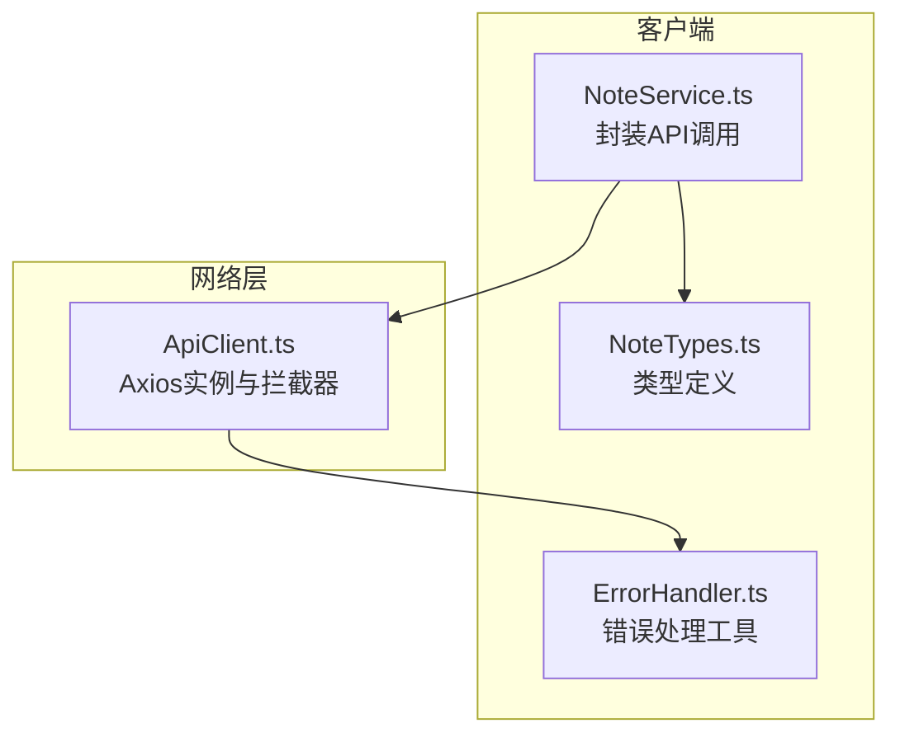
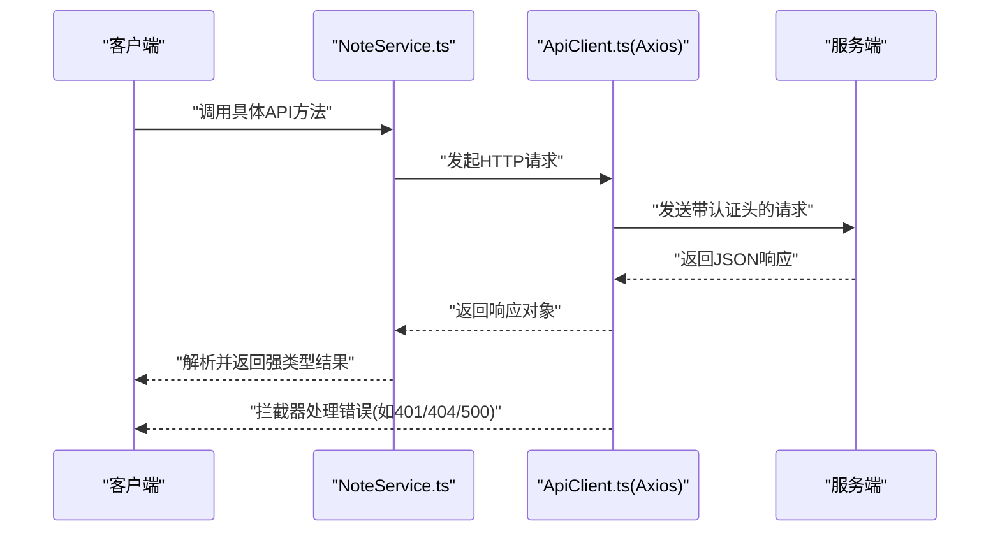
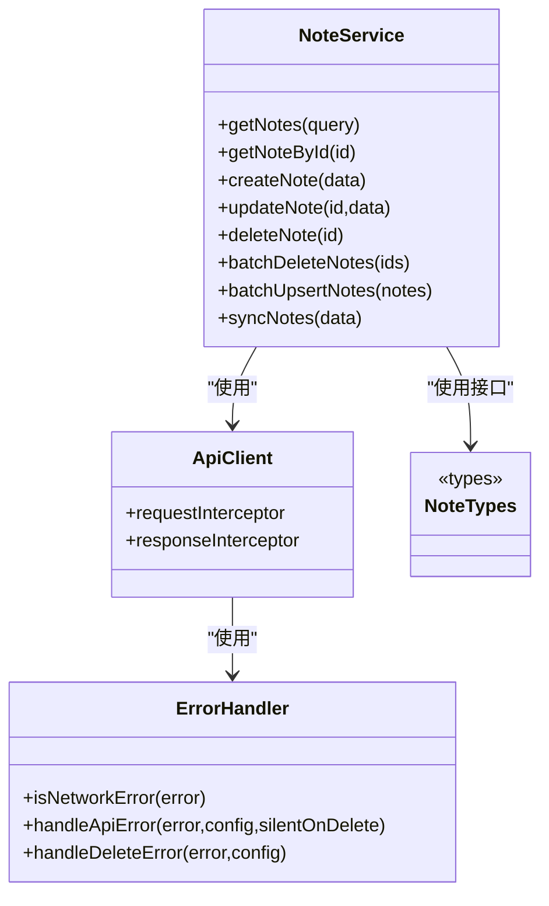

# API响应模型

<cite>
**本文引用的文件**
- [api-doc.md](file://api-doc.md)
- [NoteTypes.ts](file://types/notes/NoteTypes.ts)
- [NoteService.ts](file://services/notes/NoteService.ts)
- [ApiClient.ts](file://services/api/ApiClient.ts)
- [ErrorHandler.ts](file://utils/ErrorHandler.ts)
- [package.json](file://package.json)
</cite>

## 目录

1. [简介](#简介)
2. [项目结构](#项目结构)
3. [核心组件](#核心组件)
4. [架构总览](#架构总览)
5. [详细组件分析](#详细组件分析)
6. [依赖关系分析](#依赖关系分析)
7. [性能考量](#性能考量)
8. [故障排查指南](#故障排查指南)
9. [结论](#结论)
10. [附录](#附录)

## 简介

本文件面向客户端开发者与集成方，系统化梳理笔记服务的API响应模型与数据结构，覆盖成功响应与错误响应的统一格式、分页响应结构、批量操作响应字段、状态码映射与客户端处理策略，并给出版本兼容性与向后兼容性建议、响应校验规则与缓存策略建议。文档中的所有响应结构均以仓库现有类型定义与API文档为准。

## 项目结构

本项目采用前端应用与服务层分离的结构，API响应模型主要由类型定义与服务封装两部分组成：

- 类型定义：集中于 types/notes/NoteTypes.ts，定义了笔记实体与各类响应/请求的接口。
- 服务封装：services/notes/NoteService.ts 封装对 API 的调用，返回强类型响应。
- 客户端拦截器：services/api/ApiClient.ts 提供统一的请求/响应拦截与错误处理。
- 错误处理工具：utils/ErrorHandler.ts 提供通用错误判断与处理逻辑。

图表来源

- [NoteService.ts](file://services/notes/NoteService.ts#L1-L84)
- [NoteTypes.ts](file://types/notes/NoteTypes.ts#L1-L109)
- [ApiClient.ts](file://services/api/ApiClient.ts#L1-L92)
- [ErrorHandler.ts](file://utils/ErrorHandler.ts#L1-L48)

章节来源

- [NoteService.ts](file://services/notes/NoteService.ts#L1-L84)
- [NoteTypes.ts](file://types/notes/NoteTypes.ts#L1-L109)
- [ApiClient.ts](file://services/api/ApiClient.ts#L1-L92)
- [ErrorHandler.ts](file://utils/ErrorHandler.ts#L1-L48)

## 核心组件

- 成功响应统一字段
  - success: boolean，表示本次请求是否成功
  - timestamp: string（可选），ISO 8601时间戳（在导出响应中出现）
  - error/message/timestamp: 在错误响应中出现，不在成功响应中
- 错误响应统一字段
  - success: false
  - error: string，错误代码
  - message: string，错误描述
  - timestamp: string，ISO 8601时间戳
- 分页响应结构
  - total: number，总记录数
  - data: Array，数据数组
  - page: number，当前页码
  - limit: number，每页记录数

章节来源

- [api-doc.md](file://api-doc.md#L14-L38)
- [api-doc.md](file://api-doc.md#L413-L424)
- [NoteTypes.ts](file://types/notes/NoteTypes.ts#L14-L19)

## 架构总览

下图展示了客户端调用到API响应的关键流程，以及成功/错误响应的统一结构。

图表来源

- [NoteService.ts](file://services/notes/NoteService.ts#L32-L70)
- [ApiClient.ts](file://services/api/ApiClient.ts#L16-L89)

## 详细组件分析

### 成功响应模型

- CreateNoteResponse
  - 字段：success: boolean；id: string
  - 用途：创建笔记成功后的响应
- UpdateNoteResponse
  - 字段：success: boolean
  - 用途：更新笔记成功后的响应
- DeleteNoteResponse
  - 字段：success: boolean
  - 用途：删除笔记成功后的响应
- BatchDeleteNoteResponse
  - 字段：success: boolean；deletedCount: number
  - 用途：批量删除成功后的响应，包含删除计数
- BatchOperationNoteResponse
  - 字段：success: boolean；insertedUpdatedCount: number
  - 用途：批量插入/更新成功后的响应，包含插入/更新计数
- ExportAllNotesResponse
  - 字段：success: boolean；timestamp: string；count: number；data: Note[]
  - 用途：导出所有笔记成功后的响应，包含时间戳、数量与数据数组

章节来源

- [NoteTypes.ts](file://types/notes/NoteTypes.ts#L29-L67)
- [api-doc.md](file://api-doc.md#L112-L148)
- [api-doc.md](file://api-doc.md#L150-L189)
- [api-doc.md](file://api-doc.md#L191-L215)
- [api-doc.md](file://api-doc.md#L217-L251)
- [api-doc.md](file://api-doc.md#L346-L411)
- [api-doc.md](file://api-doc.md#L314-L344)

### 错误响应模型

- 统一错误格式
  - success: false
  - error: string，错误代码
  - message: string，错误描述
  - timestamp: string，ISO 8601时间戳
- 常见错误代码与HTTP状态码映射
  - 401 Unauthorized：API Key无效
  - 404 NOT_FOUND：请求的资源不存在
  - 400 BAD_REQUEST：请求参数错误或缺失
  - 500 InternalError：服务器内部错误

章节来源

- [api-doc.md](file://api-doc.md#L413-L434)

### 分页响应模型

- 结构字段
  - total: number，总记录数
  - data: Array，数据数组
  - page: number，当前页码
  - limit: number，每页记录数
- 使用场景
  - 获取笔记列表时返回分页数据

章节来源

- [api-doc.md](file://api-doc.md#L29-L38)
- [NoteTypes.ts](file://types/notes/NoteTypes.ts#L14-L19)
- [NoteService.ts](file://services/notes/NoteService.ts#L32-L44)

### 同步响应模型

- SyncNotesResponse
  - 字段：success: boolean；updates: Note[]；syncedIds: string[]
  - 用途：笔记同步成功后的响应，包含服务器更新的笔记与已同步的ID集合

章节来源

- [NoteTypes.ts](file://types/notes/NoteTypes.ts#L103-L108)
- [api-doc.md](file://api-doc.md#L253-L312)

### 客户端处理策略

- 成功响应处理
  - 读取 success 字段判断整体结果
  - 对于 CreateNoteResponse，读取 id 字段
  - 对于 BatchDeleteNoteResponse，读取 deletedCount 字段
  - 对于 BatchOperationNoteResponse，读取 insertedUpdatedCount 字段
  - 对于 ExportAllNotesResponse，读取 timestamp、count、data 字段
- 错误响应处理
  - 读取 error、message、timestamp 字段
  - 根据 HTTP 状态码映射执行相应处理（如401重新认证、404提示资源不存在、500提示服务器错误）
- 分页处理
  - 读取 total、data、page、limit 字段
  - 根据 page 与 limit 控制翻页逻辑
- 删除操作特殊处理
  - 对于删除操作的网络错误，客户端可选择静默处理，避免频繁告警

章节来源

- [api-doc.md](file://api-doc.md#L413-L434)
- [ApiClient.ts](file://services/api/ApiClient.ts#L44-L49)
- [ErrorHandler.ts](file://utils/ErrorHandler.ts#L18-L47)

### API端点与响应示例

- 获取笔记列表
  - 响应：分页对象（total、data、page、limit）
- 获取笔记详情
  - 响应：Note 对象（id、title、content、is_encrypted、created_at、updated_at）
- 创建笔记
  - 响应：CreateNoteResponse（success、id）
- 更新笔记
  - 响应：UpdateNoteResponse（success）
- 删除笔记
  - 响应：DeleteNoteResponse（success）
- 批量删除笔记
  - 响应：BatchDeleteNoteResponse（success、deletedCount）
- 笔记同步
  - 响应：SyncNotesResponse（success、updates、syncedIds）
- 导出所有笔记
  - 响应：ExportAllNotesResponse（success、timestamp、count、data）
- 批量插入/更新笔记
  - 响应：BatchOperationNoteResponse（success、insertedUpdatedCount）

章节来源

- [api-doc.md](file://api-doc.md#L42-L79)
- [api-doc.md](file://api-doc.md#L81-L110)
- [api-doc.md](file://api-doc.md#L112-L148)
- [api-doc.md](file://api-doc.md#L150-L189)
- [api-doc.md](file://api-doc.md#L191-L215)
- [api-doc.md](file://api-doc.md#L217-L251)
- [api-doc.md](file://api-doc.md#L253-L312)
- [api-doc.md](file://api-doc.md#L314-L344)
- [api-doc.md](file://api-doc.md#L346-L411)

## 依赖关系分析

- NoteService.ts 依赖 Axios 实例（ApiClient.ts）与类型定义（NoteTypes.ts）
- ApiClient.ts 依赖 ErrorHandler.ts 进行错误处理
- NoteTypes.ts 定义了所有响应/请求的接口，被 NoteService.ts 使用

图表来源

- [NoteService.ts](file://services/notes/NoteService.ts#L1-L84)
- [ApiClient.ts](file://services/api/ApiClient.ts#L1-L92)
- [ErrorHandler.ts](file://utils/ErrorHandler.ts#L1-L48)
- [NoteTypes.ts](file://types/notes/NoteTypes.ts#L1-L109)

章节来源

- [NoteService.ts](file://services/notes/NoteService.ts#L1-L84)
- [ApiClient.ts](file://services/api/ApiClient.ts#L1-L92)
- [ErrorHandler.ts](file://utils/ErrorHandler.ts#L1-L48)
- [NoteTypes.ts](file://types/notes/NoteTypes.ts#L1-L109)

## 性能考量

- 分页参数限制
  - 服务端对 limit 设置了最大值（参考API文档中的“每页数量，默认为20，最大为100”），客户端应遵守该限制，避免请求过大导致性能问题
- 并发与重试
  - 对于删除操作的网络错误，客户端可采用静默策略减少重复告警；对于其他错误，建议结合指数退避策略进行有限重试
- 缓存策略建议
  - 对于只读列表与详情接口，可基于 ETag 或 Last-Modified 实现条件请求；若服务端未提供缓存头，可在客户端按页面键缓存分页数据，避免重复请求
  - 对于批量操作（如批量删除/批量插入），建议在UI层面显示进度与结果汇总，避免频繁刷新

章节来源

- [api-doc.md](file://api-doc.md#L48-L52)
- [ErrorHandler.ts](file://utils/ErrorHandler.ts#L22-L29)

## 故障排查指南

- 常见错误与处理
  - 401 未授权：检查 Authorization 头与 API Key 是否正确
  - 404 资源不存在：确认请求的资源ID是否存在
  - 400 参数错误：检查请求体字段是否符合要求
  - 500 服务器错误：记录错误日志并稍后重试
- 网络错误与超时
  - 对于网络错误或超时，客户端应记录简要信息并提示用户稍后重试
- 删除操作的特殊处理
  - 若删除操作在网络错误情况下，可选择静默处理，避免频繁告警

章节来源

- [api-doc.md](file://api-doc.md#L426-L434)
- [ApiClient.ts](file://services/api/ApiClient.ts#L44-L49)
- [ApiClient.ts](file://services/api/HttpClient.ts#L61-L84)
- [ErrorHandler.ts](file://utils/ErrorHandler.ts#L18-L47)

## 结论

本项目的API响应模型以统一的成功/错误结构与强类型接口为核心，辅以分页与批量操作的专用响应字段，满足常见笔记管理场景。客户端应严格依据 success 字段与各响应对象的字段进行处理，并结合错误码映射与缓存策略提升用户体验与稳定性。由于仓库未提供服务端版本号与明确的版本兼容性声明，建议在集成时关注响应字段的新增/删除变化，并在客户端做向后兼容处理。

## 附录

### API版本兼容性与向后兼容性说明

- 版本号与兼容性
  - 仓库未提供服务端版本号与明确的版本兼容性策略
  - 建议客户端在解析响应时，对可选字段进行存在性检查，避免因字段缺失导致崩溃
- 向后兼容建议
  - 新增字段：客户端应忽略未知字段，确保旧版本也能正常运行
  - 删除字段：客户端应做好降级处理，避免依赖已删除字段
  - 字段类型变更：客户端需适配可能的类型差异（如数字/字符串）

章节来源

- [package.json](file://package.json#L1-L67)

### 响应数据验证规则

- 成功/错误字段
  - success: boolean，必有
  - 错误响应包含 error、message、timestamp
- 分页响应
  - total、data、page、limit 均为数值或数组
- 批量操作
  - deletedCount、insertedUpdatedCount 为非负整数
- 导出响应
  - timestamp 为 ISO 8601 字符串，count 为非负整数，data 为数组

章节来源

- [NoteTypes.ts](file://types/notes/NoteTypes.ts#L14-L19)
- [NoteTypes.ts](file://types/notes/NoteTypes.ts#L29-L67)
- [api-doc.md](file://api-doc.md#L14-L38)
- [api-doc.md](file://api-doc.md#L413-L424)

### 客户端缓存策略建议

- 列表与详情
  - 以 page/limit 作为键缓存分页数据，避免重复请求
- 批量操作
  - 在UI层展示操作进度与结果汇总，减少频繁刷新
- 错误与网络异常
  - 对于网络错误与超时，记录简要信息并在用户重试时提示

章节来源

- [api-doc.md](file://api-doc.md#L48-L52)
- [ErrorHandler.ts](file://utils/ErrorHandler.ts#L22-L29)
