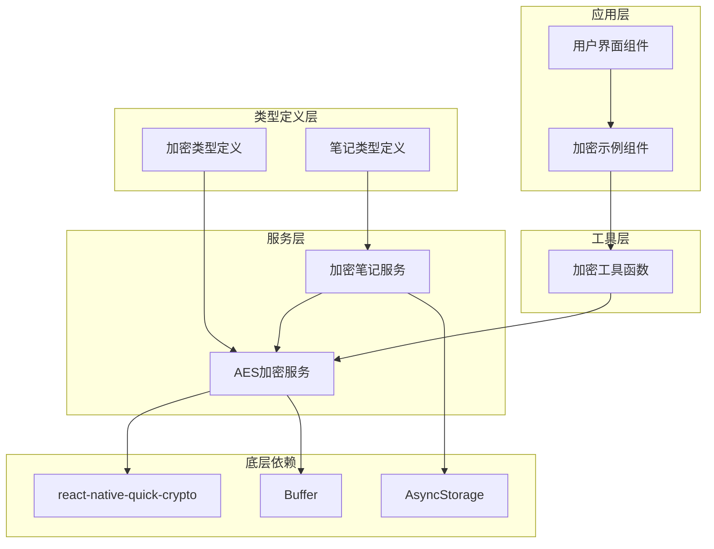
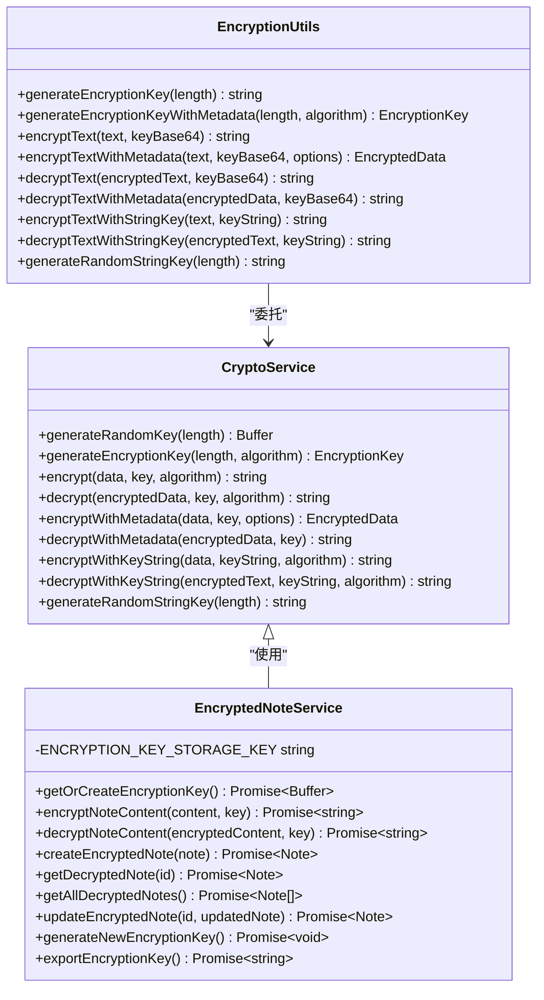
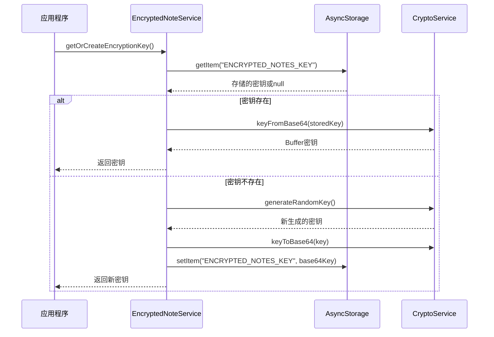
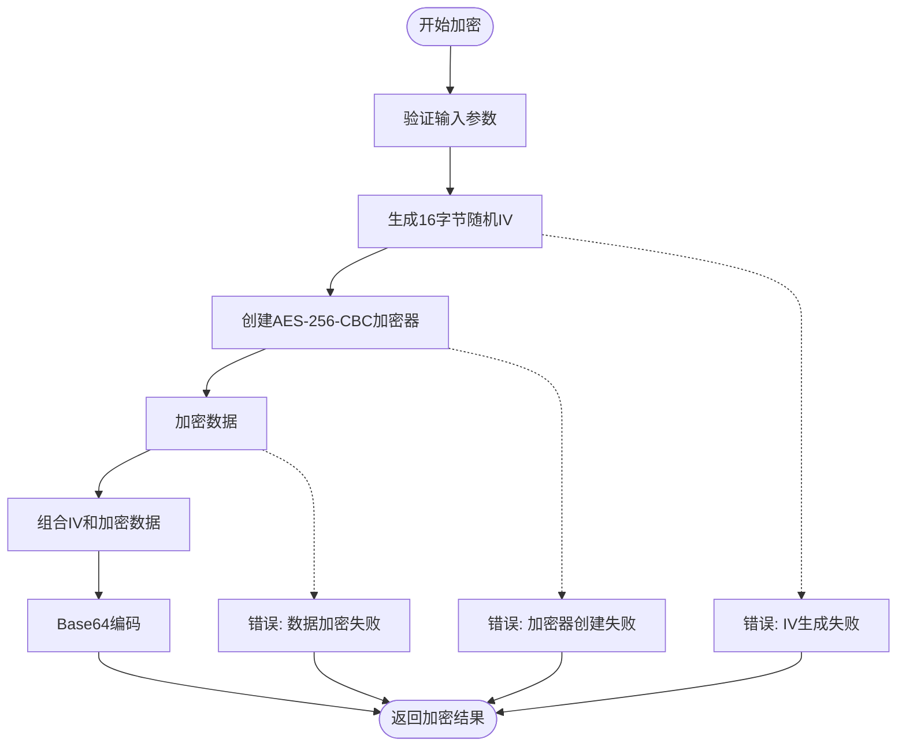
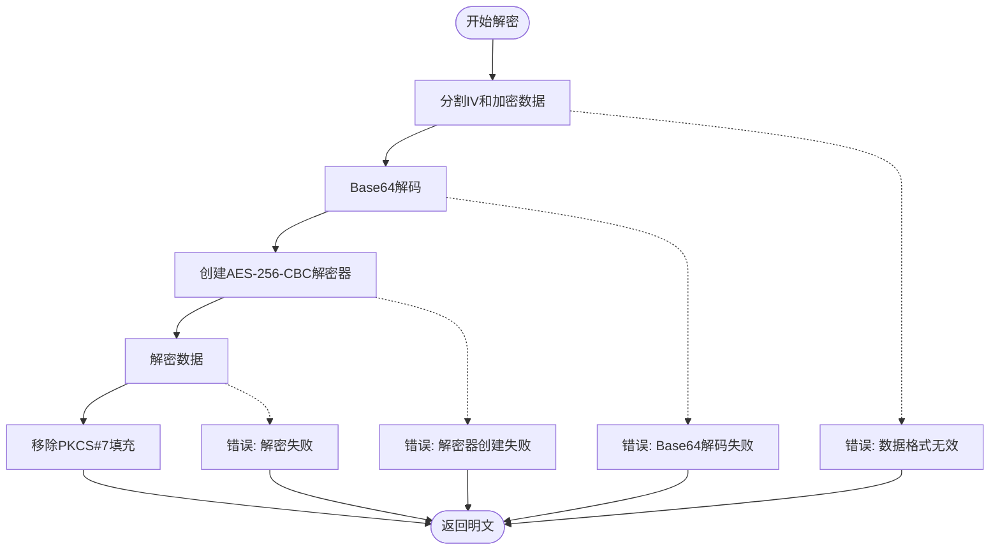
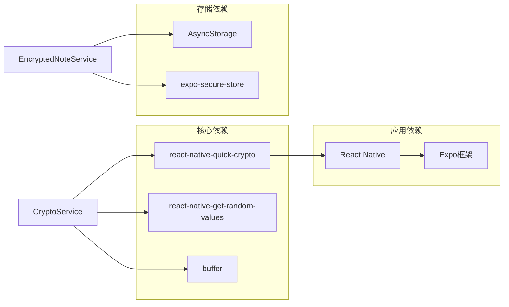

# 加密数据模型

<cite>
**本文档引用的文件**
- [CryptoTypes.ts](file://types/crypto/CryptoTypes.ts)
- [CryptoService.ts](file://services/crypto/CryptoService.ts)
- [EncryptedNoteService.ts](file://services/crypto/EncryptedNoteService.ts)
- [EncryptionUtils.ts](file://utils/crypto/EncryptionUtils.ts)
- [NoteTypes.ts](file://types/notes/NoteTypes.ts)
- [EncryptionExample.tsx](file://components/EncryptionExample.tsx)
- [package.json](file://package.json)
</cite>

## 目录

1. [简介](#简介)
2. [项目结构](#项目结构)
3. [核心组件](#核心组件)
4. [架构概览](#架构概览)
5. [详细组件分析](#详细组件分析)
6. [依赖关系分析](#依赖关系分析)
7. [性能考虑](#性能考虑)
8. [故障排除指南](#故障排除指南)
9. [结论](#结论)

## 简介

本项目实现了基于AES-256-CBC算法的加密数据模型，提供了完整的加密、解密和密钥管理功能。系统采用现代加密标准，确保数据在传输和存储过程中的安全性。本文档详细说明了加密相关的数据结构、算法实现细节、密钥管理机制以及安全最佳实践。

## 项目结构

加密功能分布在多个层次中，形成了清晰的分层架构：



**图表来源**

- [CryptoService.ts](file://services/crypto/CryptoService.ts#L1-L205)
- [EncryptedNoteService.ts](file://services/crypto/EncryptedNoteService.ts#L1-L186)
- [EncryptionUtils.ts](file://utils/crypto/EncryptionUtils.ts#L1-L112)

**章节来源**

- [package.json](file://package.json#L14-L41)

## 核心组件

### 数据类型定义

系统定义了三个核心数据类型来描述加密状态：

#### EncryptionKey 类型

表示加密密钥的完整信息，包含：

- Base64编码的密钥值
- 使用的加密算法
- 密钥长度信息
- 创建时间戳

#### EncryptedData 类型

表示加密后的数据及其元信息：

- 加密后的数据内容
- 初始化向量(IV)
- 使用的算法
- 时间戳标记

#### CryptoConfig 接口

配置加密系统的默认行为：

- 默认加密算法
- 默认密钥长度
- 自动密钥轮换开关
- 密钥轮换间隔

**章节来源**

- [CryptoTypes.ts](file://types/crypto/CryptoTypes.ts#L5-L43)

### 加密服务类

CryptoService类提供了完整的加密功能，包括密钥生成、数据加密/解密等核心操作。

**章节来源**

- [CryptoService.ts](file://services/crypto/CryptoService.ts#L10-L205)

## 架构概览

系统采用分层架构设计，确保职责分离和可维护性：



**图表来源**

- [CryptoService.ts](file://services/crypto/CryptoService.ts#L10-L205)
- [EncryptedNoteService.ts](file://services/crypto/EncryptedNoteService.ts#L11-L186)
- [EncryptionUtils.ts](file://utils/crypto/EncryptionUtils.ts#L8-L112)

## 详细组件分析

### AES-256-CBC 算法实现

系统使用AES-256-CBC算法进行数据加密，该算法具有以下特点：

#### 密钥生成机制

- 使用react-native-quick-crypto库生成加密强度的随机密钥
- 默认密钥长度为256位(32字节)
- 支持不同长度的密钥生成

#### IV向量管理

- 每次加密时生成16字节的随机初始化向量
- IV与加密数据一起存储，确保解密时的一致性
- 通过Base64编码存储IV，便于传输和存储

#### 加密数据格式

加密后的数据采用特定格式存储：

```
IV_BASE64:ENCRYPTED_DATA_BASE64
```

**章节来源**

- [CryptoService.ts](file://services/crypto/CryptoService.ts#L65-L101)

### 密钥管理机制

系统实现了完整的密钥生命周期管理：



**图表来源**

- [EncryptedNoteService.ts](file://services/crypto/EncryptedNoteService.ts#L18-L37)

**章节来源**

- [EncryptedNoteService.ts](file://services/crypto/EncryptedNoteService.ts#L11-L37)

### 加密流程图

以下是完整的AES-256-CBC加密流程：



**图表来源**

- [CryptoService.ts](file://services/crypto/CryptoService.ts#L65-L74)

### 解密流程图

对应的解密流程如下：



**图表来源**

- [CryptoService.ts](file://services/crypto/CryptoService.ts#L83-L101)

### 加密前后数据对比示例

为了更好地理解加密效果，以下是典型的数据对比：

| 类型     | 示例内容                                | 描述                 |
| -------- | --------------------------------------- | -------------------- |
| 明文     | "Hello World"                           | 原始未加密文本       |
| 密文     | "aHR0cHM6Ly93d3cuZ29vZ2xlLmNvbQ=="      | Base64编码的加密结果 |
| IV       | "Uk9XV0lOSVhWV0pJQ0VX"                  | 16字节随机初始化向量 |
| 完整格式 | "Uk9XV0lOSVhWV0pJQVdO:Y29udGVudF90ZXh0" | IV:密文格式          |

**章节来源**

- [EncryptionExample.tsx](file://components/EncryptionExample.tsx#L13-L233)

## 依赖关系分析

系统依赖的关键外部库：



**图表来源**

- [package.json](file://package.json#L14-L41)

**章节来源**

- [package.json](file://package.json#L14-L41)

## 性能考虑

### 内存管理最佳实践

1. **Buffer优化**：使用Buffer直接处理二进制数据，避免不必要的字符串转换
2. **异步操作**：所有加密操作都是异步的，避免阻塞主线程
3. **密钥缓存**：EncryptedNoteService会缓存已获取的密钥，减少重复生成开销

### 性能优化建议

1. **批量处理**：对于大量数据的加密，考虑分批处理以避免内存峰值
2. **算法选择**：AES-256-CBC提供良好的安全性和性能平衡
3. **缓存策略**：合理使用密钥缓存，避免频繁的密钥生成操作

### 内存管理最佳实践

- 及时释放不再使用的Buffer对象
- 避免在循环中重复创建大型对象
- 使用WeakRef进行对象引用管理（如适用）

## 故障排除指南

### 常见错误及解决方案

#### 加密数据格式错误

**错误信息**：加密数据格式错误
**原因**：解密时数据格式不符合预期
**解决方案**：

- 确保使用相同的加密方法生成数据
- 检查Base64编码是否完整
- 验证分隔符":"是否存在

#### 密钥不匹配

**错误信息**：解密失败
**原因**：使用的密钥与加密时的密钥不一致
**解决方案**：

- 确保密钥存储和读取的完整性
- 检查Base64编码/解码过程
- 验证密钥长度是否正确

#### 存储访问失败

**错误信息**：无法初始化加密密钥
**原因**：AsyncStorage访问权限问题
**解决方案**：

- 检查设备存储权限
- 确认AsyncStorage初始化正常
- 验证应用权限设置

**章节来源**

- [CryptoService.ts](file://services/crypto/CryptoService.ts#L86-L88)
- [EncryptedNoteService.ts](file://services/crypto/EncryptedNoteService.ts#L34-L36)

## 结论

本加密数据模型提供了完整、安全且高效的加密解决方案。通过合理的架构设计和严格的实现规范，系统能够满足现代应用对数据安全的需求。

### 主要优势

1. **安全性**：采用AES-256-CBC算法，提供企业级加密强度
2. **易用性**：提供简洁的API接口，支持多种密钥格式
3. **可靠性**：完善的错误处理和恢复机制
4. **可扩展性**：模块化设计，易于功能扩展和维护

### 最佳实践建议

1. **密钥管理**：定期轮换密钥，建立完善的密钥备份策略
2. **性能监控**：监控加密操作的性能指标，及时发现瓶颈
3. **安全审计**：定期审查加密实现，确保符合最新的安全标准
4. **用户教育**：向用户提供正确的密钥管理和数据保护指导

通过遵循这些指导原则，可以确保系统的长期安全性和稳定性。
