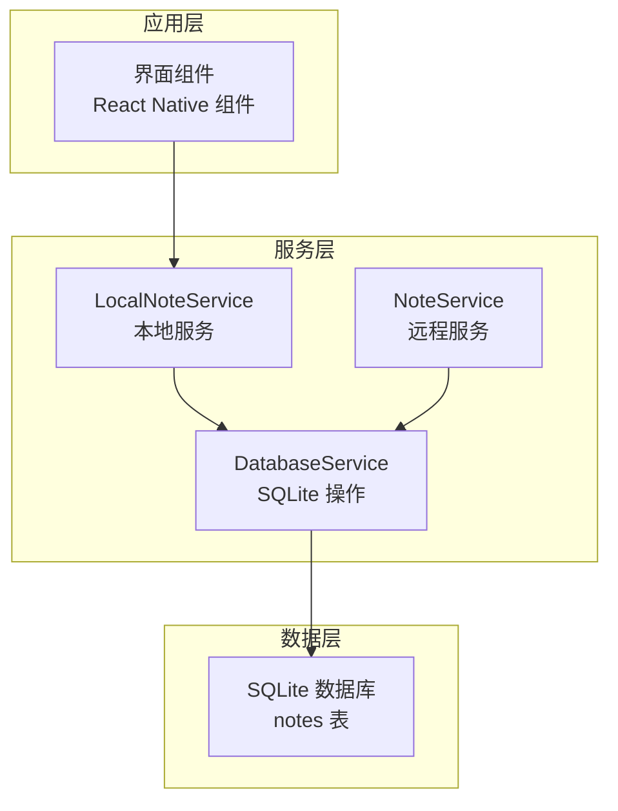
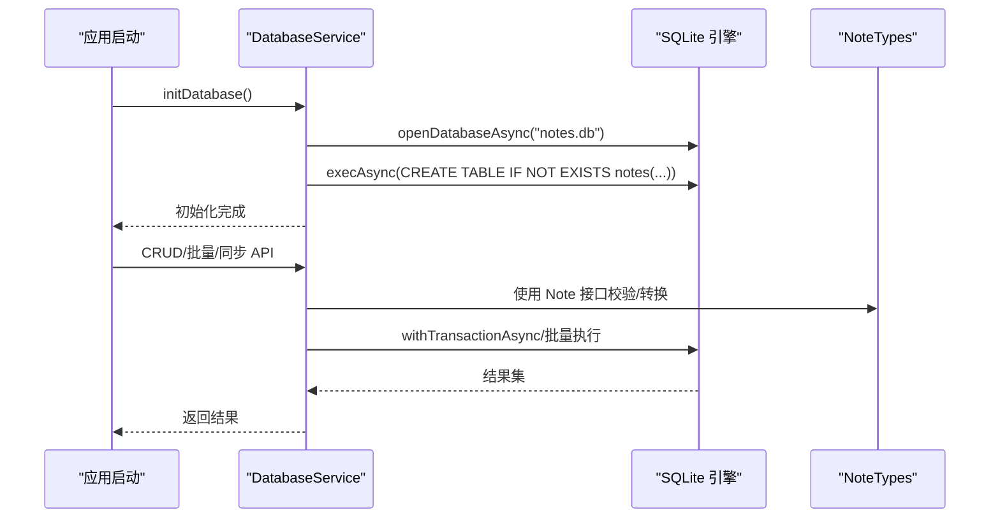
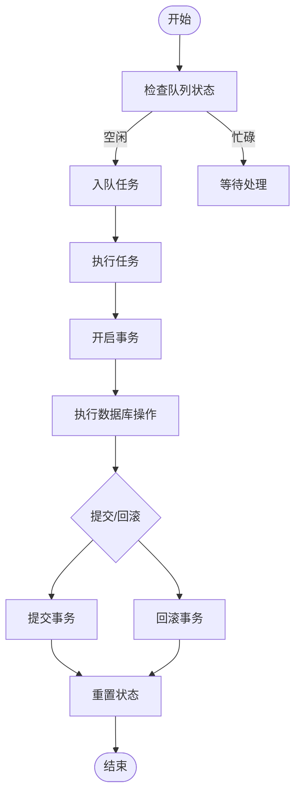
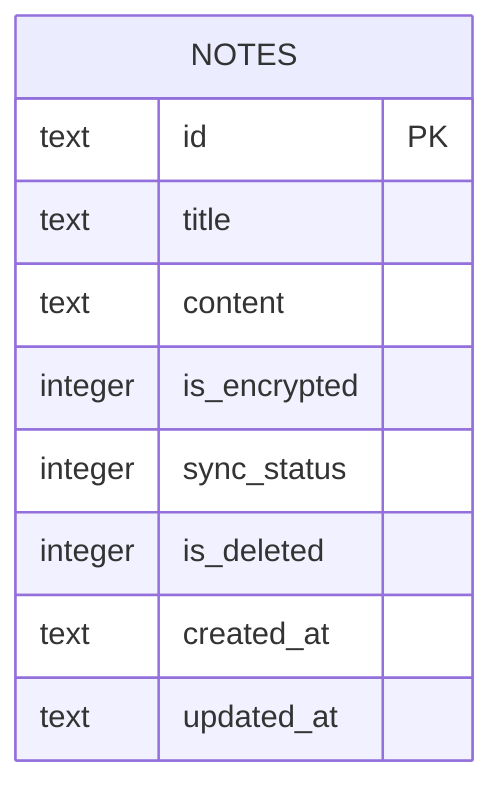
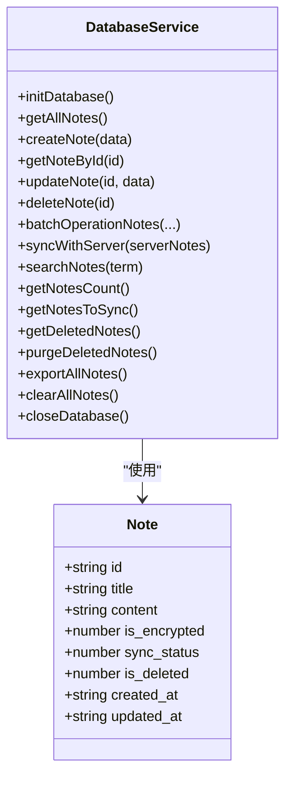

# 数据库表结构

<cite>
**本文引用的文件**
- [DatabaseService.ts](file://services/database/DatabaseService.ts)
- [NoteTypes.ts](file://types/notes/NoteTypes.ts)
- [开发文档.md](file://docs/开发文档.md)
- [api-doc.md](file://api-doc.md)
</cite>

## 目录

1. [简介](#简介)
2. [项目结构](#项目结构)
3. [核心组件](#核心组件)
4. [架构总览](#架构总览)
5. [详细组件分析](#详细组件分析)
6. [依赖分析](#依赖分析)
7. [性能考虑](#性能考虑)
8. [故障排查指南](#故障排查指南)
9. [结论](#结论)
10. [附录](#附录)

## 简介

本文件面向数据库表结构与SQLite本地存储的设计与实现，聚焦notes表的完整结构、字段定义、约束与索引策略，解释主键设计、软删除机制与参照完整性现状，并给出ER图与表关系图、SQL创建语句与初始化脚本、查询优化策略、索引设计与性能调优建议、事务处理机制与并发控制方案，以及数据迁移脚本与版本升级策略。本文同时结合前端数据库服务层与类型定义，确保读者能够从架构到实现全面理解notes表的设计与运行机制。

## 项目结构

本项目采用分层架构，数据库服务层位于服务目录下，类型定义位于types目录，文档位于docs与根目录的API文档中。notes表的创建与维护集中在数据库服务层，类型定义保证了前后端一致的数据契约。



图表来源

- [开发文档.md](file://docs/开发文档.md#L252-L329)
- [DatabaseService.ts](file://services/database/DatabaseService.ts#L1-L513)

章节来源

- [开发文档.md](file://docs/开发文档.md#L130-L161)
- [DatabaseService.ts](file://services/database/DatabaseService.ts#L1-L56)

## 核心组件

- notes表：本地SQLite表，承载笔记的增删改查、软删除、同步状态与时间戳等核心字段。
- DatabaseService：封装SQLite连接、表初始化、事务与并发控制、批量操作与同步逻辑。
- NoteTypes：定义Note接口及请求/响应类型，确保前后端字段一致性。

章节来源

- [DatabaseService.ts](file://services/database/DatabaseService.ts#L35-L46)
- [NoteTypes.ts](file://types/notes/NoteTypes.ts#L1-L11)

## 架构总览

notes表的创建与维护由DatabaseService在应用启动时完成；业务层通过DatabaseService提供的API进行CRUD、批量操作与同步；类型定义确保Note对象的字段与约束在TS层面得到保障。



图表来源

- [DatabaseService.ts](file://services/database/DatabaseService.ts#L31-L56)
- [DatabaseService.ts](file://services/database/DatabaseService.ts#L169-L205)
- [NoteTypes.ts](file://types/notes/NoteTypes.ts#L1-L11)

## 详细组件分析

### notes表结构与字段定义

- 表名：notes
- 主键：id（TEXT，PRIMARY KEY NOT NULL）
- 核心字段：
  - title：TEXT NOT NULL
  - content：TEXT NOT NULL
  - is_encrypted：INTEGER DEFAULT 0（0/1）
  - sync_status：INTEGER DEFAULT 0（0=已同步，1=待同步）
  - is_deleted：INTEGER DEFAULT 0（软删除标记，0/1）
  - created_at：TEXT NOT NULL（ISO 8601）
  - updated_at：TEXT NOT NULL（ISO 8601）

字段说明与用途

- id：全局唯一标识，采用字符串形式（非自增整数），便于跨端同步与迁移。
- title/content：笔记标题与正文，均为必填。
- is_encrypted：是否加密，配合加密服务使用。
- sync_status：用于增量同步标记，减少网络传输与冲突。
- is_deleted：软删除，保留历史记录，便于恢复与审计。
- created_at/updated_at：时间戳，采用ISO 8601字符串，便于排序与比较。

章节来源

- [DatabaseService.ts](file://services/database/DatabaseService.ts#L35-L46)
- [开发文档.md](file://docs/开发文档.md#L137-L148)
- [NoteTypes.ts](file://types/notes/NoteTypes.ts#L1-L11)

### 索引策略

- 当前实现：未显式创建索引。
- 建议索引：
  - idx_notes_title：title列索引，提升按标题搜索效率。
  - idx_notes_updated_at：updated_at列索引，提升按更新时间排序与分页查询效率。
  - idx_notes_is_deleted：is_deleted列索引，提升软删除过滤查询效率。
  - idx_notes_sync_status：sync_status列索引，提升同步状态筛选效率。

章节来源

- [开发文档.md](file://docs/开发文档.md#L137-L148)
- [api-doc.md](file://api-doc.md#L437-L448)

### 主键设计与参照完整性

- 主键：id（TEXT PRIMARY KEY NOT NULL），无外键关系。
- 参照完整性：当前无外键约束，不涉及级联删除/更新。
- 设计考量：字符串主键便于分布式同步与去中心化合并；无外键简化了跨端一致性处理。

章节来源

- [DatabaseService.ts](file://services/database/DatabaseService.ts#L35-L46)

### 查询与检索

- 列表查询：按updated_at降序，过滤is_deleted=0。
- 搜索查询：title或content模糊匹配，过滤is_deleted=0。
- 计数查询：统计is_deleted=0的记录数。
- 同步查询：筛选sync_status=1的待同步记录。

章节来源

- [DatabaseService.ts](file://services/database/DatabaseService.ts#L264-L269)
- [DatabaseService.ts](file://services/database/DatabaseService.ts#L414-L423)
- [DatabaseService.ts](file://services/database/DatabaseService.ts#L425-L432)
- [DatabaseService.ts](file://services/database/DatabaseService.ts#L392-L398)

### 事务处理与并发控制

- 事务：批量操作与同步均使用withTransactionAsync，确保原子性。
- 并发：任务队列+重入锁，避免高频调用导致的竞态与死锁；异常时自动重置数据库实例。
- 重入保护：isInsideQueueFlow防止嵌套调用再次入队。



图表来源

- [DatabaseService.ts](file://services/database/DatabaseService.ts#L62-L115)
- [DatabaseService.ts](file://services/database/DatabaseService.ts#L169-L205)
- [DatabaseService.ts](file://services/database/DatabaseService.ts#L217-L256)

章节来源

- [DatabaseService.ts](file://services/database/DatabaseService.ts#L62-L115)
- [DatabaseService.ts](file://services/database/DatabaseService.ts#L169-L205)
- [DatabaseService.ts](file://services/database/DatabaseService.ts#L217-L256)

### 批量操作与同步

- 批量操作：先软删除，再更新，最后批量创建，整体在一个事务内完成，保证一致性。
- 同步策略：以updated_at时间戳为准，服务端与客户端对比决定覆盖或跳过。
- 内存Map：一次性拉取本地全量索引，避免循环内重复查询。

章节来源

- [DatabaseService.ts](file://services/database/DatabaseService.ts#L160-L205)
- [DatabaseService.ts](file://services/database/DatabaseService.ts#L211-L256)

### ER图与表关系图

- notes表：单表，无外键关联。
- 关系图（概念示意）：



图表来源

- [DatabaseService.ts](file://services/database/DatabaseService.ts#L35-L46)

## 依赖分析

- 类型依赖：NoteTypes定义Note接口，DatabaseService在运行时使用该接口进行参数校验与返回值转换。
- 运行时依赖：expo-sqlite提供SQLite能力，DatabaseService封装打开数据库、执行DDL/DML与事务。



图表来源

- [NoteTypes.ts](file://types/notes/NoteTypes.ts#L1-L11)
- [DatabaseService.ts](file://services/database/DatabaseService.ts#L147-L512)

章节来源

- [NoteTypes.ts](file://types/notes/NoteTypes.ts#L1-L11)
- [DatabaseService.ts](file://services/database/DatabaseService.ts#L147-L512)

## 性能考虑

- 查询优化
  - 建议为title、updated_at、is_deleted、sync_status建立索引，以提升搜索、排序与过滤性能。
  - 使用LIMIT与分页参数，避免一次性加载过多数据。
- 写入优化
  - 批量操作使用事务，减少日志开销与锁竞争。
  - 批量插入/更新时避免循环内逐条查询，可复用内存Map。
- 并发控制
  - 任务队列+重入锁避免死锁；异常时自动重置数据库实例，提高鲁棒性。
- 存储与迁移
  - 字符串主键便于跨端迁移；若未来引入外键，需谨慎评估性能与一致性成本。

章节来源

- [DatabaseService.ts](file://services/database/DatabaseService.ts#L62-L115)
- [DatabaseService.ts](file://services/database/DatabaseService.ts#L169-L205)
- [DatabaseService.ts](file://services/database/DatabaseService.ts#L211-L256)

## 故障排查指南

- 数据库连接问题
  - 现象：报错包含“null”或“prepareAsync”。
  - 处理：自动重置数据库实例并关闭旧连接，重新获取新实例。
- 死锁与竞态
  - 现象：高频调用导致阻塞或异常。
  - 处理：启用任务队列与重入锁，避免嵌套入队；必要时增加超时与重试。
- 同步冲突
  - 现象：客户端与服务端时间戳不同步导致覆盖或遗漏。
  - 处理：以updated_at为准进行合并；确保时间源一致（如UTC）。

章节来源

- [DatabaseService.ts](file://services/database/DatabaseService.ts#L78-L94)
- [DatabaseService.ts](file://services/database/DatabaseService.ts#L62-L115)
- [开发文档.md](file://docs/开发文档.md#L187-L207)

## 结论

notes表采用轻量、灵活的单表设计，结合字符串主键与软删除机制，满足本地SQLite存储与跨端同步需求。通过事务与任务队列实现高可靠写入，配合类型定义确保数据一致性。建议尽快补充索引以提升查询性能，并在后续版本中评估外键与分区策略以进一步增强一致性与扩展性。

## 附录

### SQL创建语句与初始化脚本

- notes表创建（含字段与默认值）
- 建议索引（按需添加）
- 初始化脚本（首次部署或迁移时执行）

```sql
-- notes 表创建
CREATE TABLE IF NOT EXISTS notes (
  id           TEXT PRIMARY KEY NOT NULL,
  title        TEXT NOT NULL,
  content      TEXT NOT NULL,
  is_encrypted INTEGER DEFAULT 0,
  sync_status  INTEGER DEFAULT 0,
  is_deleted   INTEGER DEFAULT 0,
  created_at   TEXT NOT NULL,
  updated_at   TEXT NOT NULL
);

-- 建议索引（按需添加）
CREATE INDEX IF NOT EXISTS idx_notes_title ON notes(title);
CREATE INDEX IF NOT EXISTS idx_notes_updated_at ON notes(updated_at);
CREATE INDEX IF NOT EXISTS idx_notes_is_deleted ON notes(is_deleted);
CREATE INDEX IF NOT EXISTS idx_notes_sync_status ON notes(sync_status);
```

章节来源

- [DatabaseService.ts](file://services/database/DatabaseService.ts#L35-L46)
- [开发文档.md](file://docs/开发文档.md#L137-L148)
- [api-doc.md](file://api-doc.md#L437-L448)

### 查询优化策略与索引设计

- 搜索优化：为title与content建立全文索引或虚拟表（如FTS5），提升模糊匹配性能。
- 排序优化：为updated_at建立索引，避免排序扫描。
- 过滤优化：为is_deleted与sync_status建立索引，减少过滤成本。
- 分页优化：结合updated_at与LIMIT，避免深度分页。

章节来源

- [DatabaseService.ts](file://services/database/DatabaseService.ts#L414-L423)
- [DatabaseService.ts](file://services/database/DatabaseService.ts#L392-L398)

### 事务处理机制与并发控制

- 事务：批量操作与同步均使用withTransactionAsync，确保原子性。
- 并发：executeDbOperation提供任务队列与重入锁，避免死锁与竞态。
- 异常恢复：捕获特定错误后自动重置数据库实例，提升可用性。

章节来源

- [DatabaseService.ts](file://services/database/DatabaseService.ts#L62-L115)
- [DatabaseService.ts](file://services/database/DatabaseService.ts#L169-L205)
- [DatabaseService.ts](file://services/database/DatabaseService.ts#L217-L256)

### 数据迁移脚本与版本升级策略

- 版本号：建议在应用中维护数据库版本号（如schema_version表）。
- 升级策略：
  - 升级前备份：导出所有笔记至JSON或CSV。
  - DDL变更：使用ALTER TABLE或重建表（注意数据迁移与索引重建）。
  - 索引重建：新增索引需在低峰期执行，避免长时间锁表。
  - 回滚预案：保留DDL逆向脚本与备份，确保可快速回滚。
- 外键引入（可选）：
  - 若未来引入外键，需评估性能影响与迁移成本，建议分阶段上线并监控慢查询。

章节来源

- [DatabaseService.ts](file://services/database/DatabaseService.ts#L35-L46)
- [开发文档.md](file://docs/开发文档.md#L137-L148)
