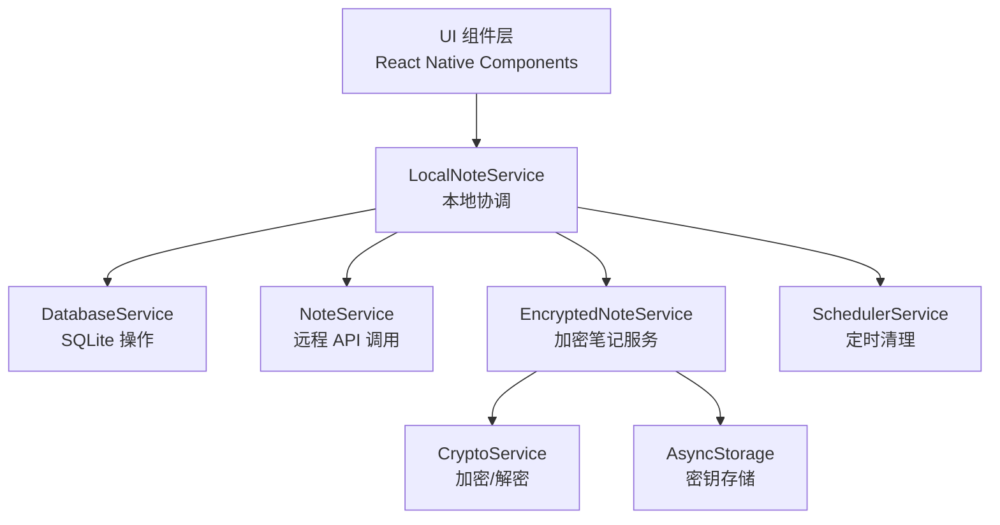
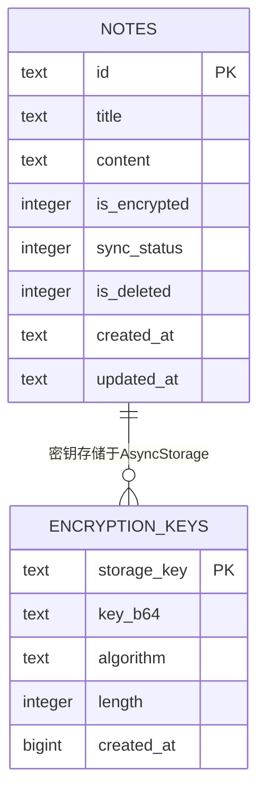
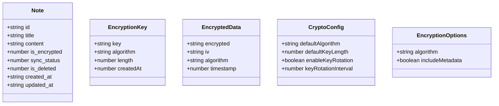
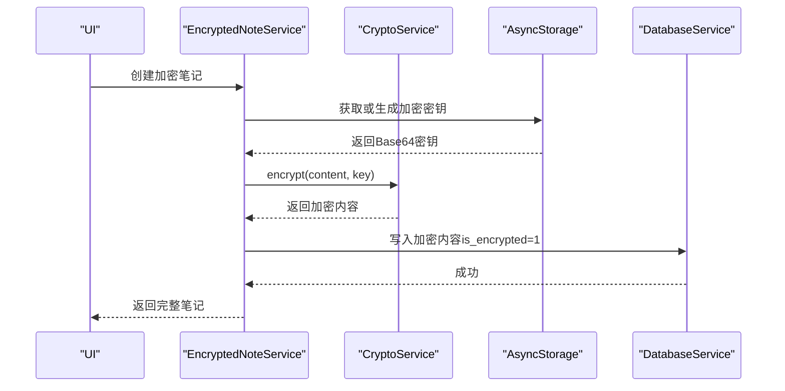
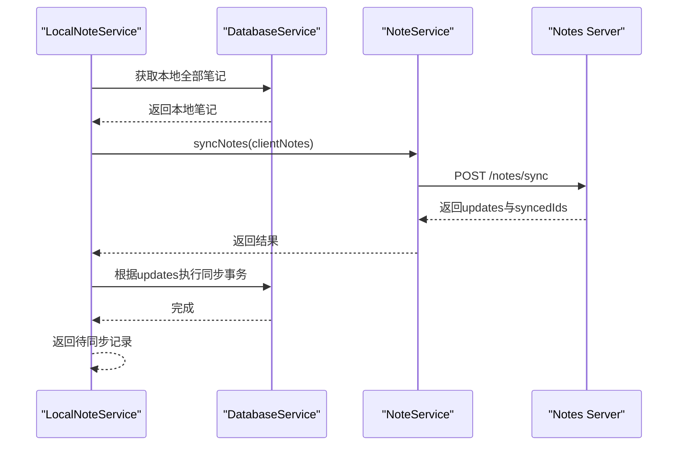
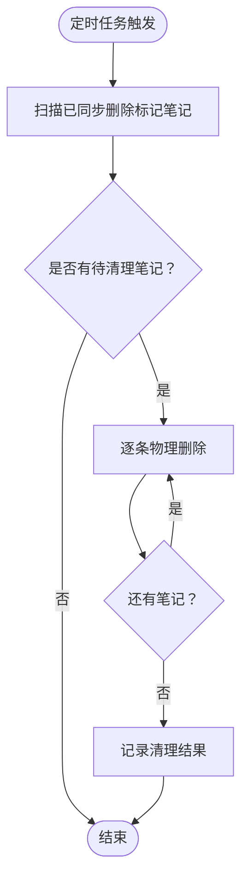
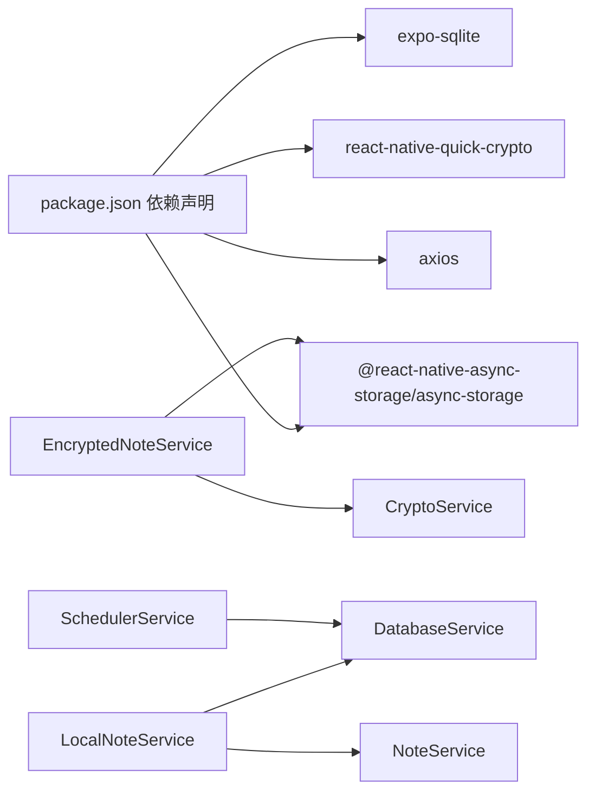

# 数据模型设计

<cite>
**本文引用的文件**
- [DatabaseService.ts](file://services/database/DatabaseService.ts)
- [NoteTypes.ts](file://types/notes/NoteTypes.ts)
- [CryptoTypes.ts](file://types/crypto/CryptoTypes.ts)
- [CryptoService.ts](file://services/crypto/CryptoService.ts)
- [EncryptedNoteService.ts](file://services/crypto/EncryptedNoteService.ts)
- [EncryptionUtils.ts](file://utils/crypto/EncryptionUtils.ts)
- [LocalNoteService.ts](file://services/local/LocalNoteService.ts)
- [NoteService.ts](file://services/notes/NoteService.ts)
- [SchedulerService.ts](file://services/scheduler/SchedulerService.ts)
- [api-doc.md](file://api-doc.md)
- [开发文档.md](file://docs/开发文档.md)
- [package.json](file://package.json)
</cite>

## 目录

1. [简介](#简介)
2. [项目结构](#项目结构)
3. [核心组件](#核心组件)
4. [架构总览](#架构总览)
5. [详细组件分析](#详细组件分析)
6. [依赖分析](#依赖分析)
7. [性能考虑](#性能考虑)
8. [故障排查指南](#故障排查指南)
9. [结论](#结论)
10. [附录](#附录)

## 简介

本文件面向Notes应用，系统化梳理数据模型设计，覆盖实体关系、字段定义与数据类型、主键/外键、索引与约束、数据验证与业务规则、数据库模式图与示例数据、数据访问模式与缓存策略、性能考量、数据生命周期与归档规则、迁移路径与版本管理、以及数据安全与隐私要求。文档同时补充加密数据模型与密钥管理相关数据结构，帮助开发者与运维人员建立一致的数据视图。

## 项目结构

Notes应用采用分层架构：UI层（组件）、服务层（LocalNoteService、NoteService、DatabaseService、EncryptedNoteService、CryptoService等）、类型层（NoteTypes、CryptoTypes）、工具层（EncryptionUtils）与调度层（SchedulerService）。数据持久化基于SQLite（本地），并通过NoteService与远端API交互实现同步与批量操作。

图表来源

- [LocalNoteService.ts](file://services/local/LocalNoteService.ts#L1-L601)
- [DatabaseService.ts](file://services/database/DatabaseService.ts#L1-L513)
- [NoteService.ts](file://services/notes/NoteService.ts#L1-L84)
- [EncryptedNoteService.ts](file://services/crypto/EncryptedNoteService.ts#L1-L186)
- [CryptoService.ts](file://services/crypto/CryptoService.ts#L1-L205)
- [SchedulerService.ts](file://services/scheduler/SchedulerService.ts#L213-L232)

章节来源

- [LocalNoteService.ts](file://services/local/LocalNoteService.ts#L1-L601)
- [DatabaseService.ts](file://services/database/DatabaseService.ts#L1-L513)
- [NoteService.ts](file://services/notes/NoteService.ts#L1-L84)
- [EncryptedNoteService.ts](file://services/crypto/EncryptedNoteService.ts#L1-L186)
- [CryptoService.ts](file://services/crypto/CryptoService.ts#L1-L205)
- [SchedulerService.ts](file://services/scheduler/SchedulerService.ts#L213-L232)

## 核心组件

- 实体与数据类型
  - Note：笔记实体，包含id、title、content、is_encrypted、sync_status、is_deleted、created_at、updated_at等字段。
  - 分页与批量操作响应/请求类型：PaginatedResponse、BatchDeleteNoteRequest/Response、BatchOperationNoteRequest/Response、SyncNotesRequest/Response等。
- 加密相关类型
  - EncryptionKey：密钥对象（key、algorithm、length、createdAt）。
  - EncryptedData：加密数据对象（encrypted、iv、algorithm、timestamp）。
  - CryptoConfig：默认算法、密钥长度、密钥轮换配置。
  - EncryptionOptions：加密选项（algorithm、includeMetadata）。

章节来源

- [NoteTypes.ts](file://types/notes/NoteTypes.ts#L1-L109)
- [CryptoTypes.ts](file://types/crypto/CryptoTypes.ts#L1-L44)

## 架构总览

下图展示Notes应用的数据模型与服务交互关系，包括本地SQLite表结构、加密密钥存储、同步流程与定时清理。

图表来源

- [DatabaseService.ts](file://services/database/DatabaseService.ts#L35-L46)
- [EncryptedNoteService.ts](file://services/crypto/EncryptedNoteService.ts#L12-L37)

## 详细组件分析

### 数据库表结构与约束

- 表名：notes
- 主键：id（TEXT，PRIMARY KEY）
- 字段与类型
  - id: TEXT（主键）
  - title: TEXT（NOT NULL）
  - content: TEXT（NOT NULL）
  - is_encrypted: INTEGER（默认0；0未加密，1加密）
  - sync_status: INTEGER（默认0；0已同步，1待同步）
  - is_deleted: INTEGER（默认0；0未删除，1已删除）
  - created_at: TEXT（NOT NULL）
  - updated_at: TEXT（NOT NULL）
- 索引
  - idx_notes_title：在title上创建索引，提升搜索性能。
- 约束
  - 非空约束：title、content、created_at、updated_at。
  - 默认值：is_encrypted、sync_status、is_deleted。
- 外键
  - 无外键约束（自关联/无参照完整性需求）。

章节来源

- [DatabaseService.ts](file://services/database/DatabaseService.ts#L35-L46)
- [api-doc.md](file://api-doc.md#L435-L448)

### 数据模型类图

图表来源

- [NoteTypes.ts](file://types/notes/NoteTypes.ts#L2-L11)
- [CryptoTypes.ts](file://types/crypto/CryptoTypes.ts#L5-L43)

### 数据访问模式与缓存策略

- 访问模式
  - 本地优先：LocalNoteService封装DatabaseService与NoteService，优先本地操作，失败时保留待同步状态。
  - 批量操作：batchOperationNotes在事务内原子执行“删除-更新-创建”，保证一致性。
  - 同步：syncWithServer在内存Map中对比本地与服务器差异，减少重复查询。
- 缓存策略
  - 本地SQLite：作为主要持久化存储。
  - AsyncStorage：存储加密密钥，避免每次启动重新生成密钥。
  - 运行时队列：executeDbOperation通过任务队列与重入锁避免并发冲突与死锁。

章节来源

- [LocalNoteService.ts](file://services/local/LocalNoteService.ts#L118-L211)
- [DatabaseService.ts](file://services/database/DatabaseService.ts#L62-L115)
- [EncryptedNoteService.ts](file://services/crypto/EncryptedNoteService.ts#L18-L37)

### 加密数据模型与密钥管理

- 加密服务
  - CryptoService：提供随机密钥生成、AES加密/解密、带元数据的加密/解密、字符串密钥处理等。
  - EncryptionUtils：对CryptoService的便捷封装，便于在应用层直接调用。
- 加密笔记服务
  - EncryptedNoteService：负责密钥获取/生成、笔记内容加密/解密、创建/更新/获取加密笔记。
  - 密钥存储：通过AsyncStorage以键值形式存储Base64编码的密钥，键名为固定常量。
- 数据结构
  - EncryptionKey：密钥对象，包含key、algorithm、length、createdAt。
  - EncryptedData：加密结果对象，包含encrypted、iv、algorithm、timestamp。
  - CryptoConfig：默认算法、密钥长度、密钥轮换开关与周期。
  - EncryptionOptions：可选算法与是否包含元数据。

图表来源

- [EncryptedNoteService.ts](file://services/crypto/EncryptedNoteService.ts#L74-L89)
- [CryptoService.ts](file://services/crypto/CryptoService.ts#L65-L101)
- [EncryptionUtils.ts](file://utils/crypto/EncryptionUtils.ts#L38-L41)

章节来源

- [CryptoService.ts](file://services/crypto/CryptoService.ts#L1-L205)
- [EncryptionUtils.ts](file://utils/crypto/EncryptionUtils.ts#L1-L112)
- [EncryptedNoteService.ts](file://services/crypto/EncryptedNoteService.ts#L1-L186)

### 同步与数据一致性

- 同步流程
  - 本地收集全部笔记（含已删除），发送至服务器。
  - 服务器返回差异更新，本地按时间戳比较决定覆盖或跳过。
  - 同步完成后，返回待同步记录集合，供后续处理。
- 一致性保障
  - 事务：批量操作与同步均在事务中执行，避免中间态。
  - 待同步状态：本地删除/更新后立即标记sync_status=1，确保后续重试。

图表来源

- [LocalNoteService.ts](file://services/local/LocalNoteService.ts#L443-L466)
- [DatabaseService.ts](file://services/database/DatabaseService.ts#L211-L259)
- [NoteService.ts](file://services/notes/NoteService.ts#L69-L70)
- [api-doc.md](file://api-doc.md#L253-L312)

章节来源

- [LocalNoteService.ts](file://services/local/LocalNoteService.ts#L443-L466)
- [DatabaseService.ts](file://services/database/DatabaseService.ts#L211-L259)
- [NoteService.ts](file://services/notes/NoteService.ts#L69-L70)
- [api-doc.md](file://api-doc.md#L253-L312)

### 数据生命周期、保留与归档

- 生命周期
  - 创建：写入created_at与updated_at。
  - 更新：更新updated_at，标记sync_status=1。
  - 删除：软删除（is_deleted=1，sync_status=1），定期清理。
- 保留策略
  - 本地保留软删除记录，直至清理任务执行。
- 归档规则
  - 通过定时任务清理已同步的删除标记笔记，执行物理删除。
- 清理流程

图表来源

- [SchedulerService.ts](file://services/scheduler/SchedulerService.ts#L213-L232)
- [DatabaseService.ts](file://services/database/DatabaseService.ts#L446-L451)

章节来源

- [SchedulerService.ts](file://services/scheduler/SchedulerService.ts#L213-L232)
- [DatabaseService.ts](file://services/database/DatabaseService.ts#L446-L451)

### 数据验证与业务规则

- 本地校验
  - 批量删除前对ID进行非空与类型校验，非法ID抛错。
  - 更新前检查记录是否存在，不存在则抛错。
- 网络容错
  - 删除/批量删除在网络异常时，本地仍执行软删除并保留待同步状态，避免数据丢失。
- 同步策略
  - 以updated_at为准进行冲突解决：服务器更新时间更晚则覆盖，否则跳过。
- 加密规则
  - is_encrypted=1时，content为加密文本；解密失败抛错。

章节来源

- [DatabaseService.ts](file://services/database/DatabaseService.ts#L314-L337)
- [DatabaseService.ts](file://services/database/DatabaseService.ts#L293-L301)
- [LocalNoteService.ts](file://services/local/LocalNoteService.ts#L118-L152)
- [LocalNoteService.ts](file://services/local/LocalNoteService.ts#L154-L211)
- [DatabaseService.ts](file://services/database/DatabaseService.ts#L244-L255)

### 示例数据

- 笔记实体示例
  - id: UUID字符串
  - title: 非空字符串
  - content: 文本（可能为加密文本）
  - is_encrypted: 0或1
  - created_at/updated_at: ISO 8601字符串
- 加密密钥示例
  - key: Base64编码的密钥
  - algorithm: 如“aes-256-cbc”
  - length: 32（字节）
  - createdAt: 时间戳

章节来源

- [api-doc.md](file://api-doc.md#L18-L27)
- [CryptoTypes.ts](file://types/crypto/CryptoTypes.ts#L5-L14)

### 数据迁移路径与版本管理

- 迁移建议
  - 新增字段：在CREATE TABLE语句中添加默认值，并在历史数据上执行ALTER迁移。
  - 字段变更：评估兼容性，必要时提供数据转换脚本。
  - 索引变更：在低峰期执行，避免长时间锁表。
- 版本管理
  - 通过应用版本号与数据库schema版本号协同管理，确保升级路径清晰。
  - 采用事务与队列机制保证迁移过程中的数据一致性。

[本节为通用实践指导，无需特定文件引用]

## 依赖分析

- 外部依赖
  - expo-sqlite：本地SQLite数据库。
  - react-native-quick-crypto：原生加密能力。
  - @react-native-async-storage/async-storage：密钥持久化。
  - axios：HTTP客户端，用于调用远端API。
- 内部依赖
  - LocalNoteService依赖DatabaseService与NoteService，协调本地与远程。
  - EncryptedNoteService依赖CryptoService与AsyncStorage，负责密钥与内容加解密。
  - SchedulerService依赖DatabaseService，执行清理任务。

图表来源

- [package.json](file://package.json#L14-L41)
- [LocalNoteService.ts](file://services/local/LocalNoteService.ts#L1-L28)
- [EncryptedNoteService.ts](file://services/crypto/EncryptedNoteService.ts#L1-L6)
- [SchedulerService.ts](file://services/scheduler/SchedulerService.ts#L213-L232)

章节来源

- [package.json](file://package.json#L14-L41)

## 性能考虑

- 查询优化
  - 在title上建立索引，提升搜索性能。
  - 同步阶段一次性加载本地笔记，避免循环内重复查询。
- 并发与锁
  - 使用任务队列与重入锁避免并发冲突与死锁。
  - 事务包裹批量操作，确保原子性。
- 存储与IO
  - AsyncStorage仅存储密钥，避免大对象频繁读写。
  - 清理任务定期物理删除，释放空间。

章节来源

- [DatabaseService.ts](file://services/database/DatabaseService.ts#L103-L115)
- [DatabaseService.ts](file://services/database/DatabaseService.ts#L211-L259)
- [api-doc.md](file://api-doc.md#L447-L448)

## 故障排查指南

- 数据库连接问题
  - 当出现“null”或“prepareAsync”相关错误时，自动关闭并重置数据库实例。
- 网络异常
  - 删除/同步失败时，本地仍执行软删除并保留待同步状态，避免数据丢失。
- 加密失败
  - 解密失败抛出错误，检查密钥是否正确、加密数据格式是否合法。

章节来源

- [DatabaseService.ts](file://services/database/DatabaseService.ts#L79-L94)
- [LocalNoteService.ts](file://services/local/LocalNoteService.ts#L118-L152)
- [EncryptedNoteService.ts](file://services/crypto/EncryptedNoteService.ts#L60-L67)

## 结论

本数据模型文档系统化描述了Notes应用的实体关系、字段定义、约束与索引、数据访问与缓存策略、性能优化、生命周期与清理、迁移与版本管理，以及加密与密钥管理的关键数据结构。通过事务、队列与网络容错等机制，确保在高并发与弱网环境下仍能维持数据一致性与可用性。

## 附录

- API端点与响应格式参考：[api-doc.md](file://api-doc.md#L1-L449)
- 服务层架构说明：[开发文档.md](file://docs/开发文档.md#L252-L271)
