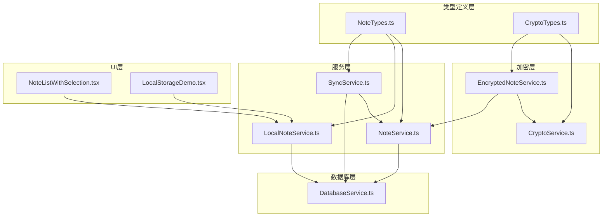
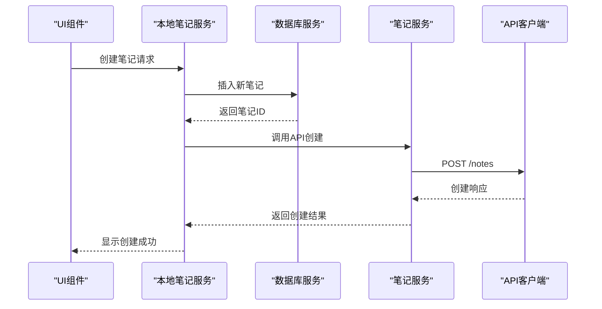
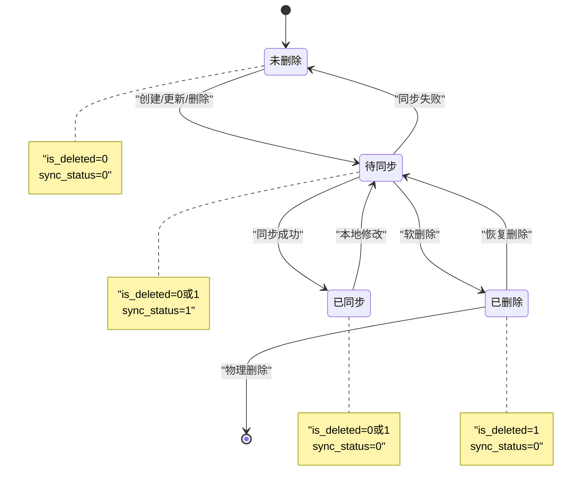
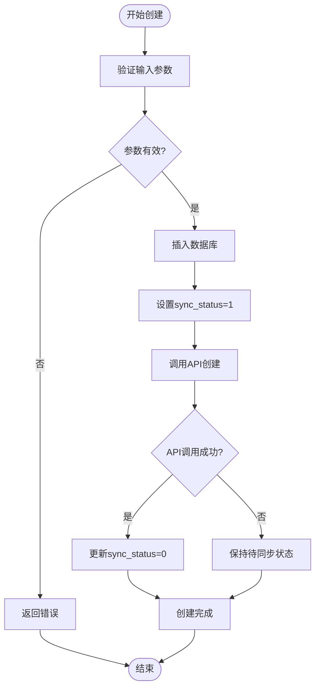
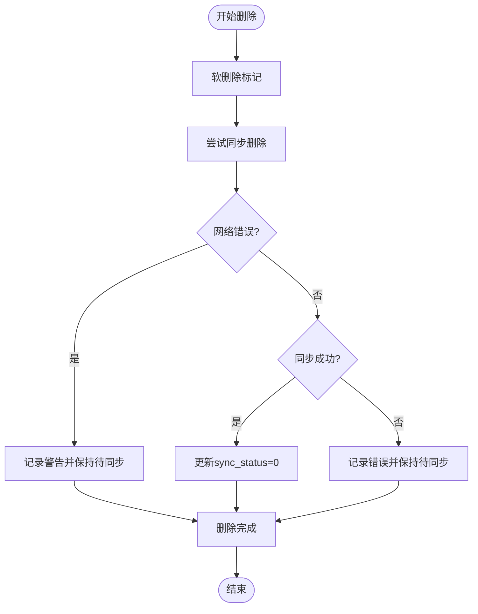
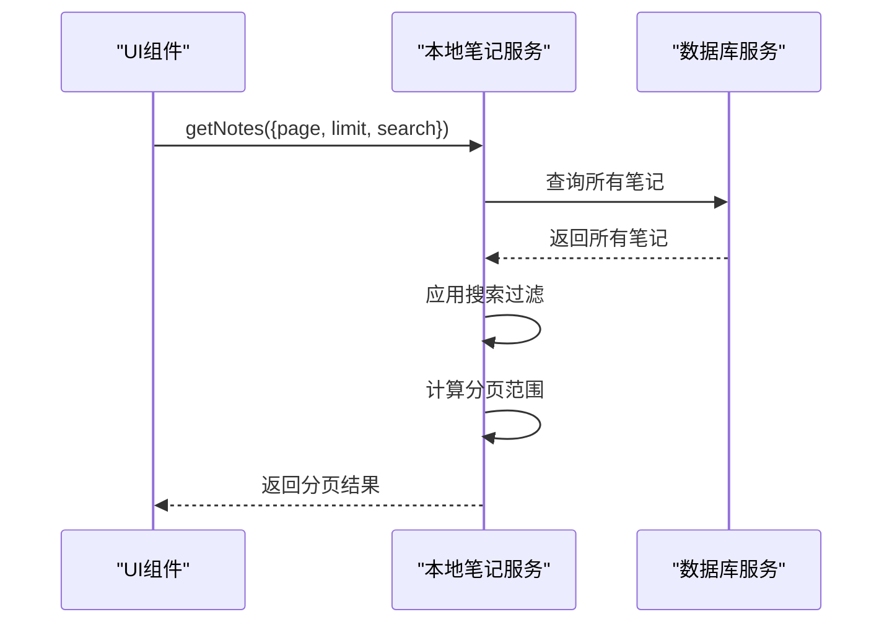
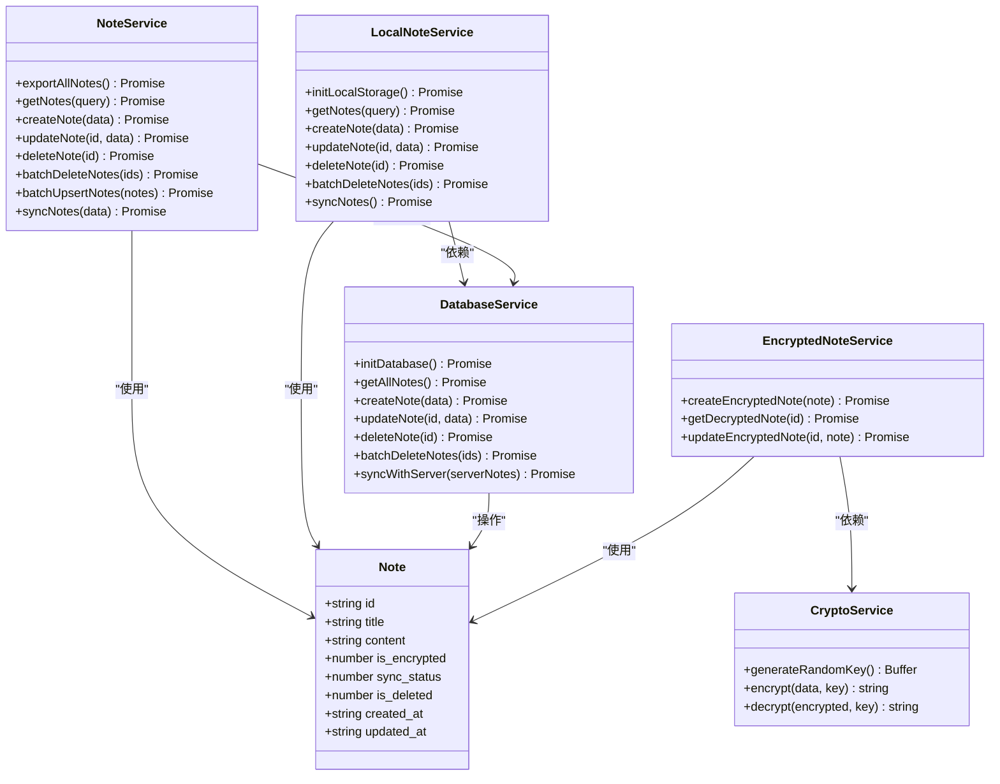

# 笔记实体模型

<cite>
**本文档引用的文件**
- [NoteTypes.ts](file://types/notes/NoteTypes.ts)
- [NoteService.ts](file://services/notes/NoteService.ts)
- [LocalNoteService.ts](file://services/local/LocalNoteService.ts)
- [DatabaseService.ts](file://services/database/DatabaseService.ts)
- [SyncService.ts](file://services/notes/SyncService.ts)
- [CryptoService.ts](file://services/crypto/CryptoService.ts)
- [EncryptedNoteService.ts](file://services/crypto/EncryptedNoteService.ts)
- [CryptoTypes.ts](file://types/crypto/CryptoTypes.ts)
- [NoteListWithSelection.tsx](file://components/NoteListWithSelection.tsx)
- [LocalStorageDemo.tsx](file://components/LocalStorageDemo.tsx)
</cite>

## 目录

1. [简介](#简介)
2. [项目结构](#项目结构)
3. [核心组件](#核心组件)
4. [架构概览](#架构概览)
5. [详细组件分析](#详细组件分析)
6. [依赖关系分析](#依赖关系分析)
7. [性能考量](#性能考量)
8. [故障排除指南](#故障排除指南)
9. [结论](#结论)
10. [附录](#附录)

## 简介

本文件为笔记实体模型的详细数据模型文档，涵盖Note接口的字段定义、数据类型、业务含义以及相关约束。文档重点解释以下核心字段的设计考虑：

- id：全局唯一标识符
- title：笔记标题
- content：笔记内容
- is_encrypted：加密状态标志
- sync_status：同步状态标志
- is_deleted：软删除标志
- created_at/updated_at：时间戳字段

同时，文档包含笔记状态转换图、生命周期管理、创建/更新/删除/同步机制说明，并提供实际JSON示例数据展示不同状态的笔记对象。最后，文档记录分页查询、搜索过滤和批量操作相关的数据结构。

## 项目结构

该项目采用分层架构设计，围绕笔记实体模型构建了类型定义、服务层、数据库层和UI组件层。核心文件组织如下：

- 类型定义层：types/notes/NoteTypes.ts 定义Note接口及相关请求/响应类型
- 服务层：services/notes/NoteService.ts 提供API调用封装；services/local/LocalNoteService.ts 提供本地操作封装；services/notes/SyncService.ts 提供同步逻辑
- 数据库层：services/database/DatabaseService.ts 提供SQLite数据库操作
- 加密层：services/crypto/CryptoService.ts 提供加密/解密能力；services/crypto/EncryptedNoteService.ts 提供加密笔记的完整流程
- UI层：components/NoteListWithSelection.tsx 和 components/LocalStorageDemo.tsx 展示笔记列表和本地存储演示



**图表来源**

- [NoteTypes.ts](file://types/notes/NoteTypes.ts#L1-L109)
- [NoteService.ts](file://services/notes/NoteService.ts#L1-L84)
- [LocalNoteService.ts](file://services/local/LocalNoteService.ts#L1-L601)
- [DatabaseService.ts](file://services/database/DatabaseService.ts#L1-L513)
- [SyncService.ts](file://services/notes/SyncService.ts#L1-L58)
- [CryptoService.ts](file://services/crypto/CryptoService.ts#L1-L205)
- [EncryptedNoteService.ts](file://services/crypto/EncryptedNoteService.ts#L1-L186)
- [CryptoTypes.ts](file://types/crypto/CryptoTypes.ts#L1-L44)
- [NoteListWithSelection.tsx](file://components/NoteListWithSelection.tsx#L1-L200)
- [LocalStorageDemo.tsx](file://components/LocalStorageDemo.tsx#L1-L320)

**章节来源**

- [NoteTypes.ts](file://types/notes/NoteTypes.ts#L1-L109)
- [NoteService.ts](file://services/notes/NoteService.ts#L1-L84)
- [LocalNoteService.ts](file://services/local/LocalNoteService.ts#L1-L601)
- [DatabaseService.ts](file://services/database/DatabaseService.ts#L1-L513)
- [SyncService.ts](file://services/notes/SyncService.ts#L1-L58)
- [CryptoService.ts](file://services/crypto/CryptoService.ts#L1-L205)
- [EncryptedNoteService.ts](file://services/crypto/EncryptedNoteService.ts#L1-L186)
- [CryptoTypes.ts](file://types/crypto/CryptoTypes.ts#L1-L44)
- [NoteListWithSelection.tsx](file://components/NoteListWithSelection.tsx#L1-L200)
- [LocalStorageDemo.tsx](file://components/LocalStorageDemo.tsx#L1-L320)

## 核心组件

本节详细分析Note接口及其相关组件，包括字段定义、约束、默认值和验证规则。

### Note接口字段定义

Note接口定义了笔记实体的核心字段，具体如下：

- id: string - 全局唯一标识符，作为主键使用
- title: string - 笔记标题，必填
- content: string - 笔记内容，必填
- is_encrypted: number - 加密状态标志，0表示未加密，1表示已加密
- sync_status: number - 同步状态标志，0表示已同步，1表示待同步
- is_deleted: number - 软删除标志，0表示未删除，1表示已删除
- created_at: string - 创建时间戳，ISO 8601格式
- updated_at: string - 更新时间戳，ISO 8601格式

### 字段约束与默认值

根据数据库表结构定义，各字段的约束和默认值如下：

- id: 主键，NOT NULL
- title: NOT NULL
- content: NOT NULL
- is_encrypted: INTEGER DEFAULT 0
- sync_status: INTEGER DEFAULT 0
- is_deleted: INTEGER DEFAULT 0
- created_at: NOT NULL
- updated_at: NOT NULL

### 验证规则

- id必须唯一且非空
- title和content不能为空
- is_encrypted、sync_status、is_deleted必须为0或1
- created_at和updated_at必须为有效的ISO 8601时间戳
- 数据库层对软删除进行了过滤，查询时默认排除is_deleted=1的记录

**章节来源**

- [NoteTypes.ts](file://types/notes/NoteTypes.ts#L2-L11)
- [DatabaseService.ts](file://services/database/DatabaseService.ts#L36-L46)

## 架构概览

系统采用分层架构，围绕笔记实体模型构建了完整的数据流：

- UI层负责用户交互和数据展示
- 服务层封装API调用和业务逻辑
- 数据库层提供持久化存储
- 加密层提供数据安全保障



**图表来源**

- [LocalNoteService.ts](file://services/local/LocalNoteService.ts#L85-L96)
- [DatabaseService.ts](file://services/database/DatabaseService.ts#L271-L281)
- [NoteService.ts](file://services/notes/NoteService.ts#L48-L52)

**章节来源**

- [LocalNoteService.ts](file://services/local/LocalNoteService.ts#L1-L601)
- [DatabaseService.ts](file://services/database/DatabaseService.ts#L1-L513)
- [NoteService.ts](file://services/notes/NoteService.ts#L1-L84)

## 详细组件分析

### 笔记状态转换图

笔记实体遵循软删除机制，支持多种状态转换。状态转换图如下：



**图表来源**

- [DatabaseService.ts](file://services/database/DatabaseService.ts#L303-L312)
- [DatabaseService.ts](file://services/database/DatabaseService.ts#L434-L444)

### 生命周期管理

笔记实体的生命周期包括创建、更新、删除和同步四个主要阶段：

#### 创建阶段

- 本地创建：插入数据库时设置sync_status=1，表示需要同步
- 服务器创建：通过API调用创建远程笔记
- 加密创建：加密内容后创建加密笔记

#### 更新阶段

- 本地更新：更新内容并设置sync_status=1
- 服务器更新：通过API更新远程笔记
- 加密更新：加密新内容后更新

#### 删除阶段

- 软删除：标记is_deleted=1，sync_status=1
- 物理删除：从数据库中永久移除
- 安全删除：先检查服务器状态再执行删除

#### 同步阶段

- 上传同步：将本地变更同步到服务器
- 下载同步：从服务器获取最新数据
- 双向同步：合并本地和服务器的变更

**章节来源**

- [DatabaseService.ts](file://services/database/DatabaseService.ts#L271-L312)
- [LocalNoteService.ts](file://services/local/LocalNoteService.ts#L119-L152)
- [SyncService.ts](file://services/notes/SyncService.ts#L13-L36)

### 创建、更新、删除和同步机制

#### 创建机制



**图表来源**

- [LocalNoteService.ts](file://services/local/LocalNoteService.ts#L85-L96)
- [DatabaseService.ts](file://services/database/DatabaseService.ts#L271-L281)

#### 删除机制



**图表来源**

- [LocalNoteService.ts](file://services/local/LocalNoteService.ts#L119-L152)
- [DatabaseService.ts](file://services/database/DatabaseService.ts#L303-L312)

### 分页查询、搜索过滤和批量操作

#### 分页查询

分页查询通过GetNotesQuery接口实现，支持以下参数：

- page: number - 页码，默认1
- limit: number - 每页数量，默认20
- search: string - 搜索关键词



**图表来源**

- [LocalNoteService.ts](file://services/local/LocalNoteService.ts#L33-L64)
- [NoteTypes.ts](file://types/notes/NoteTypes.ts#L92-L96)

#### 搜索过滤

搜索功能支持按标题和内容进行模糊匹配，使用toLowerCase()方法进行大小写不敏感的搜索。

#### 批量操作

批量操作支持创建、更新和删除的组合操作，通过BatchOperationNoteRequest实现：

- createData: CreateNoteRequest[] - 创建数据
- updateData: {id: string, data: UpdateNoteRequest}[] - 更新数据
- deleteIds: string[] - 删除ID列表

**章节来源**

- [LocalNoteService.ts](file://services/local/LocalNoteService.ts#L33-L64)
- [NoteTypes.ts](file://types/notes/NoteTypes.ts#L59-L67)

### 实际JSON示例数据

#### 未加密的普通笔记

```json
{
  "id": "1698765432100",
  "title": "项目计划",
  "content": "本周工作计划：\n- 完成需求分析\n- 设计数据库结构\n- 开发核心功能",
  "is_encrypted": 0,
  "sync_status": 0,
  "is_deleted": 0,
  "created_at": "2023-10-27T09:00:00.000Z",
  "updated_at": "2023-10-27T10:30:00.000Z"
}
```

#### 加密笔记

```json
{
  "id": "1698765432101",
  "title": "加密笔记",
  "content": "加密内容：U2FsdGVkX1+...（加密后的Base64数据）",
  "is_encrypted": 1,
  "sync_status": 1,
  "is_deleted": 0,
  "created_at": "2023-10-27T11:00:00.000Z",
  "updated_at": "2023-10-27T11:15:00.000Z"
}
```

#### 待同步状态的笔记

```json
{
  "id": "1698765432102",
  "title": "待同步笔记",
  "content": "这是更新后的内容",
  "is_encrypted": 0,
  "sync_status": 1,
  "is_deleted": 0,
  "created_at": "2023-10-27T08:00:00.000Z",
  "updated_at": "2023-10-27T12:00:00.000Z"
}
```

#### 已删除的笔记

```json
{
  "id": "1698765432103",
  "title": "已删除笔记",
  "content": "这条笔记已被删除",
  "is_encrypted": 0,
  "sync_status": 0,
  "is_deleted": 1,
  "created_at": "2023-10-27T07:00:00.000Z",
  "updated_at": "2023-10-27T13:00:00.000Z"
}
```

## 依赖关系分析



**图表来源**

- [NoteTypes.ts](file://types/notes/NoteTypes.ts#L2-L11)
- [NoteService.ts](file://services/notes/NoteService.ts#L1-L84)
- [LocalNoteService.ts](file://services/local/LocalNoteService.ts#L1-L601)
- [DatabaseService.ts](file://services/database/DatabaseService.ts#L1-L513)
- [CryptoService.ts](file://services/crypto/CryptoService.ts#L1-L205)
- [EncryptedNoteService.ts](file://services/crypto/EncryptedNoteService.ts#L1-L186)

**章节来源**

- [NoteTypes.ts](file://types/notes/NoteTypes.ts#L1-L109)
- [NoteService.ts](file://services/notes/NoteService.ts#L1-L84)
- [LocalNoteService.ts](file://services/local/LocalNoteService.ts#L1-L601)
- [DatabaseService.ts](file://services/database/DatabaseService.ts#L1-L513)
- [CryptoService.ts](file://services/crypto/CryptoService.ts#L1-L205)
- [EncryptedNoteService.ts](file://services/crypto/EncryptedNoteService.ts#L1-L186)

## 性能考量

系统在多个层面实现了性能优化：

- 数据库连接池：通过重入锁防止嵌套调用死锁
- 任务队列：支持高频操作下的并发控制
- 内存映射：同步时使用Map进行快速对比
- 事务处理：批量操作使用withTransactionAsync确保原子性
- 索引优化：按updated_at排序查询优化

## 故障排除指南

常见问题及解决方案：

- 数据库连接异常：检查数据库初始化状态，必要时重置数据库实例
- 同步失败：检查网络状态，重试机制会自动处理临时网络错误
- 加密失败：验证密钥有效性，重新生成密钥后重试
- 批量操作失败：检查输入参数，确保ID格式正确

**章节来源**

- [DatabaseService.ts](file://services/database/DatabaseService.ts#L18-L56)
- [LocalNoteService.ts](file://services/local/LocalNoteService.ts#L125-L143)

## 结论

本笔记实体模型设计充分考虑了数据一致性、安全性、性能和用户体验。通过软删除机制、同步状态管理和加密支持，系统能够可靠地处理各种使用场景。分层架构设计使得代码具有良好的可维护性和扩展性。

## 附录

### API定义

- GET /notes - 获取笔记列表（支持分页和搜索）
- GET /notes/:id - 获取指定笔记
- POST /notes - 创建笔记
- PATCH /notes/:id - 更新笔记
- DELETE /notes/:id - 删除笔记
- DELETE /notes/batch - 批量删除笔记
- POST /notes/batch - 批量插入或更新笔记
- POST /notes/sync - 同步笔记

### 数据结构参考

- Note接口：定义笔记实体的所有字段
- PaginatedResponse<T>：分页响应通用结构
- CreateNoteRequest/UpdateNoteRequest：创建/更新请求参数
- BatchOperationNoteRequest/BatchOperationNoteResponse：批量操作请求/响应

**章节来源**

- [NoteTypes.ts](file://types/notes/NoteTypes.ts#L13-L109)
- [NoteService.ts](file://services/notes/NoteService.ts#L32-L70)
