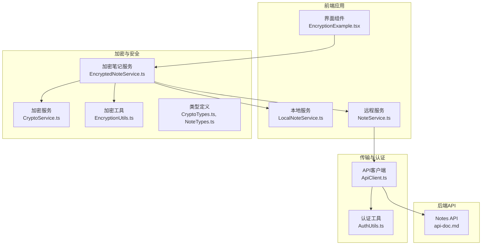
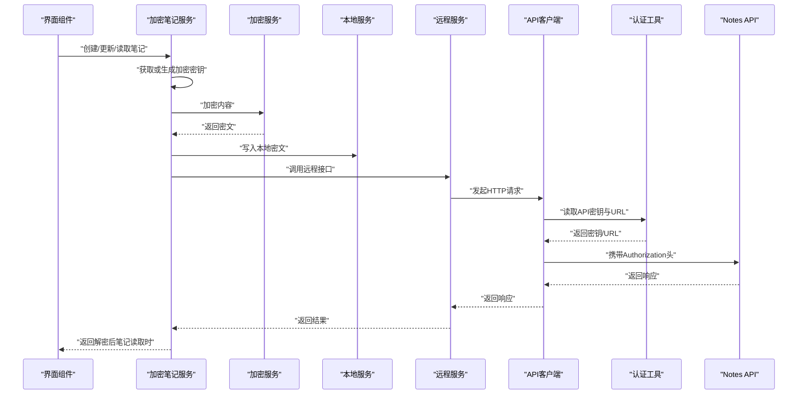
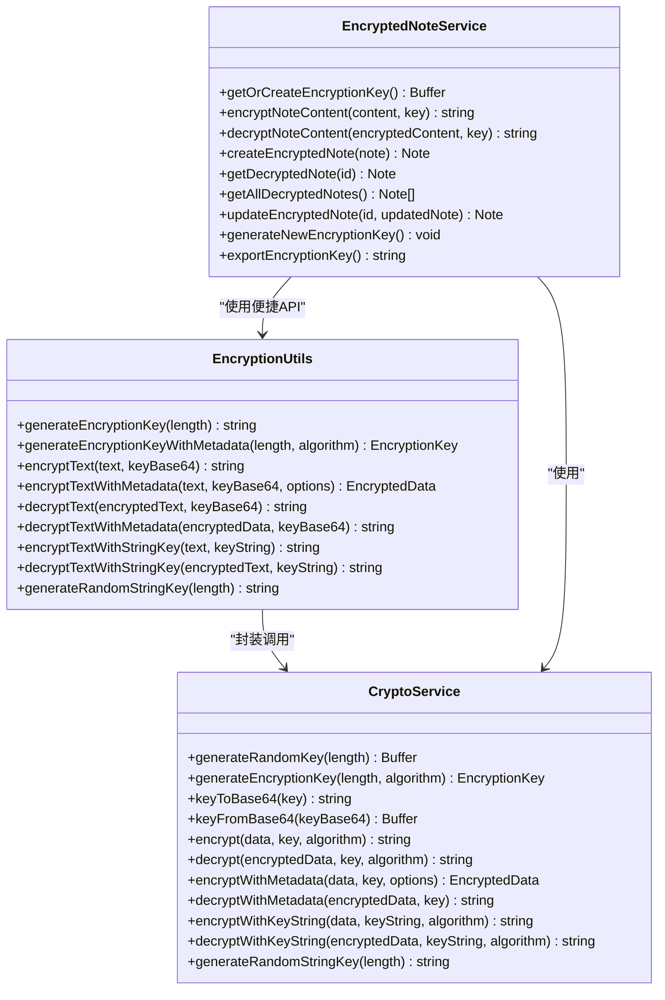
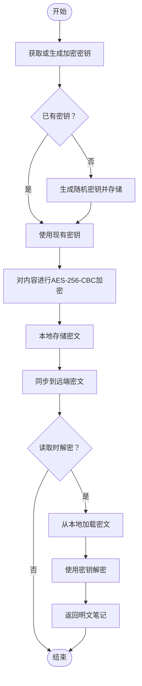
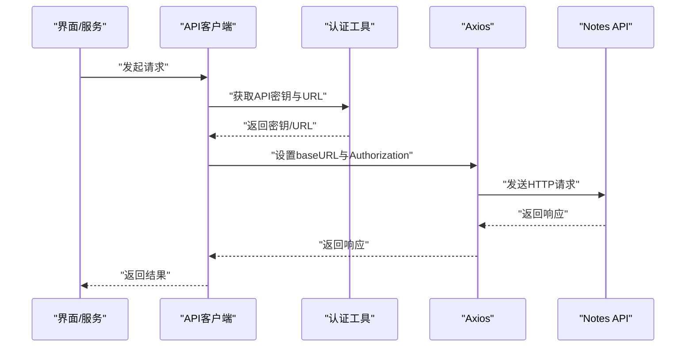
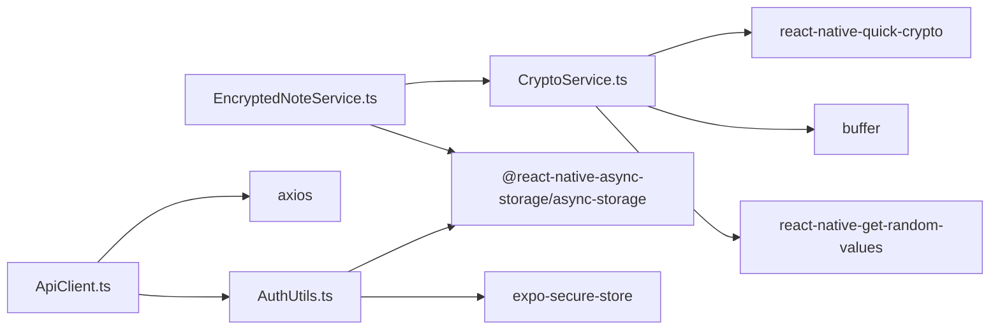

# 安全架构

<cite>
**本文引用的文件**
- [CryptoService.ts](file://services/crypto/CryptoService.ts)
- [EncryptedNoteService.ts](file://services/crypto/EncryptedNoteService.ts)
- [EncryptionUtils.ts](file://utils/crypto/EncryptionUtils.ts)
- [CryptoTypes.ts](file://types/crypto/CryptoTypes.ts)
- [ApiClient.ts](file://services/api/ApiClient.ts)
- [AuthUtils.ts](file://utils/auth/AuthUtils.ts)
- [NoteService.ts](file://services/note/NoteService.ts)
- [LocalNoteService.ts](file://services/local/LocalNoteService.ts)
- [SyncService.ts](file://services/note/SyncService.ts)
- [EncryptionExample.tsx](file://components/EncryptionExample.tsx)
- [NoteTypes.ts](file://types/notes/NoteTypes.ts)
- [package.json](file://package.json)
- [开发文档.md](file://docs/开发文档.md)
- [api-doc.md](file://api-doc.md)
</cite>

## 目录

1. [引言](#引言)
2. [项目结构](#项目结构)
3. [核心组件](#核心组件)
4. [架构总览](#架构总览)
5. [详细组件分析](#详细组件分析)
6. [依赖关系分析](#依赖关系分析)
7. [性能考虑](#性能考虑)
8. [故障排查指南](#故障排查指南)
9. [结论](#结论)
10. [附录](#附录)

## 引言

本文件面向Notes应用的安全架构文档，聚焦端到端加密的设计理念与实现机制，覆盖以下主题：

- AES-256-CBC算法的应用与密钥管理策略
- 加密数据的存储格式、解密流程与完整性校验
- 密钥派生、盐值与随机数生成的安全实践
- 数据传输加密、API认证与会话管理
- 威胁模型、攻击防护与安全审计
- 合规性要求、隐私保护与数据销毁策略

## 项目结构

Notes应用采用分层架构，围绕“本地存储 + 远程同步”的模式组织安全相关模块：

- 加密层：CryptoService、EncryptionUtils、EncryptedNoteService
- 认证与传输层：ApiClient、AuthUtils
- 业务服务层：NoteService、LocalNoteService、SyncService
- 类型与示例：CryptoTypes、EncryptionExample、NoteTypes
- 依赖与文档：package.json、开发文档.md、api-doc.md

图表来源

- [EncryptionExample.tsx](file://components/EncryptionExample.tsx#L1-L195)
- [EncryptedNoteService.ts](file://services/crypto/EncryptedNoteService.ts#L1-L186)
- [CryptoService.ts](file://services/crypto/CryptoService.ts#L1-L205)
- [EncryptionUtils.ts](file://utils/crypto/EncryptionUtils.ts#L1-L112)
- [NoteService.ts](file://services/note/NoteService.ts#L1-L84)
- [ApiClient.ts](file://services/api/ApiClient.ts#L1-L92)
- [AuthUtils.ts](file://utils/auth/AuthUtils.ts#L1-L65)
- [api-doc.md](file://api-doc.md#L160-L344)

章节来源

- [开发文档.md](file://docs/开发文档.md#L273-L344)

## 核心组件

- 加密服务（CryptoService）：提供AES-256-CBC密钥生成、加密/解密、带元数据的加密/解密、字符串密钥处理等能力。
- 加密笔记服务（EncryptedNoteService）：负责密钥生命周期管理（生成、存储、导出）、笔记内容的加密/解密与持久化。
- 加密工具（EncryptionUtils）：对外暴露便捷的加密/解密与密钥生成API，封装CryptoService。
- API客户端（ApiClient）：统一配置Axios实例、动态设置基础URL与Authorization头、错误拦截与处理。
- 认证工具（AuthUtils）：API密钥与URL的存储、校验与回退逻辑；加密密钥的安全存储。
- 本地/远程服务：LocalNoteService与NoteService分别负责本地SQLite与远端API交互。

章节来源

- [CryptoService.ts](file://services/crypto/CryptoService.ts#L1-L205)
- [EncryptedNoteService.ts](file://services/crypto/EncryptedNoteService.ts#L1-L186)
- [EncryptionUtils.ts](file://utils/crypto/EncryptionUtils.ts#L1-L112)
- [ApiClient.ts](file://services/api/ApiClient.ts#L1-L92)
- [AuthUtils.ts](file://utils/auth/AuthUtils.ts#L1-L65)
- [LocalNoteService.ts](file://services/local/LocalNoteService.ts#L1-L601)
- [NoteService.ts](file://services/note/NoteService.ts#L1-L84)

## 架构总览

端到端加密链路由“本地生成密钥 → 加密内容 → 本地存储/同步 → 远端接收（密文）”构成。解密流程则反向进行，仅在本地可用密钥时解密。

图表来源

- [EncryptedNoteService.ts](file://services/crypto/EncryptedNoteService.ts#L74-L111)
- [CryptoService.ts](file://services/crypto/CryptoService.ts#L45-L101)
- [LocalNoteService.ts](file://services/local/LocalNoteService.ts#L85-L114)
- [NoteService.ts](file://services/note/NoteService.ts#L48-L70)
- [ApiClient.ts](file://services/api/ApiClient.ts#L17-L41)
- [AuthUtils.ts](file://utils/auth/AuthUtils.ts#L27-L30)
- [api-doc.md](file://api-doc.md#L160-L344)

## 详细组件分析

### 加密服务（CryptoService）

- AES-256-CBC算法：默认使用aes-256-cbc，密钥长度为32字节（256位），初始化向量（IV）长度为16字节。
- 随机数生成：基于react-native-quick-crypto与react-native-get-random-values，确保高熵随机源。
- 密钥管理：
  - generateRandomKey：生成随机密钥Buffer。
  - generateEncryptionKey：生成带元数据的密钥对象（包含算法、长度、创建时间）。
  - keyToBase64/keyFromBase64：密钥与Base64互转。
  - encrypt/decrypt：标准AES-256-CBC加密/解密，输出格式为“IV:密文”。
  - encryptWithMetadata/decryptWithMetadata：返回包含IV、算法、时间戳的元数据对象。
  - encryptWithKeyString/decryptWithKeyString：支持字符串密钥，必要时进行SHA-256哈希处理以满足256位长度。
- 安全要点：
  - 每次加密均生成新IV并前置拼接，避免重复IV风险。
  - 不在日志中输出密钥或密文。
  - 通过工具层（EncryptionUtils）统一暴露API，减少直接依赖底层加密库。

图表来源

- [CryptoService.ts](file://services/crypto/CryptoService.ts#L10-L205)
- [EncryptionUtils.ts](file://utils/crypto/EncryptionUtils.ts#L1-L112)
- [EncryptedNoteService.ts](file://services/crypto/EncryptedNoteService.ts#L11-L186)

章节来源

- [CryptoService.ts](file://services/crypto/CryptoService.ts#L10-L205)
- [EncryptionUtils.ts](file://utils/crypto/EncryptionUtils.ts#L1-L112)
- [CryptoTypes.ts](file://types/crypto/CryptoTypes.ts#L5-L44)

### 加密笔记服务（EncryptedNoteService）

- 密钥生命周期：
  - 通过AsyncStorage存储Base64编码的密钥，首次运行自动生成并持久化。
  - 支持导出密钥（用于备份）与重新生成密钥（注意：会破坏旧密文可解密性）。
- 笔记加密/解密：
  - 写入：对content进行AES-256-CBC加密，标记is_encrypted=1，写入本地与远程。
  - 读取：从本地获取密文，使用当前密钥解密，返回明文内容。
- 同步与一致性：
  - 本地优先：本地操作（增删改）先落库，再异步同步至远端。
  - 容错：网络异常时不阻断本地删除/更新，维持待同步状态，后续重试。
- 安全要点：
  - 本地密钥与远端数据均为密文，降低泄露面。
  - 密钥存储在本地，建议配合设备锁/生物识别策略（由上层应用策略决定）。

图表来源

- [EncryptedNoteService.ts](file://services/crypto/EncryptedNoteService.ts#L18-L131)
- [CryptoService.ts](file://services/crypto/CryptoService.ts#L65-L101)

章节来源

- [EncryptedNoteService.ts](file://services/crypto/EncryptedNoteService.ts#L11-L186)

### API客户端与认证（ApiClient + AuthUtils）

- API客户端：
  - Axios实例配置超时、Content-Type。
  - 请求拦截器：动态设置baseURL（来自AsyncStorage），注入Authorization头（Bearer Token）。
  - 响应拦截器：集中处理401/403/404/500等状态码与网络错误，避免敏感信息泄露。
- 认证工具：
  - API密钥与URL存储：优先从环境变量回退到安全存储（expo-secure-store）。
  - URL校验：开发环境允许http/https，生产环境强制https。
  - 加密密钥安全存储：使用SecureStore保存加密密钥，避免明文落盘。

图表来源

- [ApiClient.ts](file://services/api/ApiClient.ts#L17-L41)
- [AuthUtils.ts](file://utils/auth/AuthUtils.ts#L27-L30)
- [api-doc.md](file://api-doc.md#L160-L344)

章节来源

- [ApiClient.ts](file://services/api/ApiClient.ts#L1-L92)
- [AuthUtils.ts](file://utils/auth/AuthUtils.ts#L1-L65)

### 数据类型与存储格式

- 加密数据格式：
  - 标准格式：“IV:密文”，其中IV为16字节，Base64编码；密文为Base64编码。
  - 元数据格式：包含encrypted、iv、algorithm、timestamp字段，便于跨版本兼容与审计。
- 笔记类型：
  - Note包含id、title、content（密文）、is_encrypted、sync_status、created_at、updated_at等字段。
  - is_encrypted用于标识内容是否加密（1表示加密）。

章节来源

- [CryptoService.ts](file://services/crypto/CryptoService.ts#L72-L74)
- [CryptoService.ts](file://services/crypto/CryptoService.ts#L122-L127)
- [NoteTypes.ts](file://types/notes/NoteTypes.ts#L2-L11)
- [NoteTypes.ts](file://types/notes/NoteTypes.ts#L75-L89)

### 本地与远程同步（LocalNoteService + NoteService + SyncService）

- 本地优先策略：本地操作先落库，再异步同步至远端；网络异常不阻断本地操作。
- 安全删除：提供安全删除与批量安全删除，先检查服务端状态，再执行本地软删除，并尽力同步。
- 同步接口：支持批量导入/导出、同步、清理等操作。

章节来源

- [LocalNoteService.ts](file://services/local/LocalNoteService.ts#L119-L152)
- [LocalNoteService.ts](file://services/local/LocalNoteService.ts#L231-L292)
- [LocalNoteService.ts](file://services/local/LocalNoteService.ts#L443-L466)
- [NoteService.ts](file://services/note/NoteService.ts#L1-L84)
- [SyncService.ts](file://services/note/SyncService.ts#L1-L58)

## 依赖关系分析

- 加密库依赖：
  - react-native-quick-crypto：提供AES-256-CBC与随机数生成。
  - buffer：提供Buffer操作。
  - react-native-get-random-values：为Web Crypto API提供polyfill。
- 安全存储：
  - expo-secure-store：用于保存API密钥与加密密钥。
  - @react-native-async-storage/async-storage：用于保存API URL与加密密钥（非敏感）。
- 网络与工具：
  - axios：HTTP客户端。
  - dayjs：时间处理（可用于审计时间戳）。

图表来源

- [package.json](file://package.json#L14-L41)
- [CryptoService.ts](file://services/crypto/CryptoService.ts#L1-L4)
- [EncryptedNoteService.ts](file://services/crypto/EncryptedNoteService.ts#L5)
- [ApiClient.ts](file://services/api/ApiClient.ts#L1-L3)
- [AuthUtils.ts](file://utils/auth/AuthUtils.ts#L1-L2)

章节来源

- [package.json](file://package.json#L14-L41)

## 性能考虑

- 加密开销：AES-256-CBC为CPU密集型，建议：
  - 批量操作时合并请求，减少网络往返。
  - 本地缓存常用数据，避免频繁解密。
  - 控制加密频率，避免对高频小操作造成明显延迟。
- 存储与I/O：SQLite写入与加密/解密并行时，建议：
  - 使用事务批量写入。
  - 控制日志级别，避免在热路径输出大段密文。
- 网络优化：合理设置超时与重试策略，结合本地容错设计。

## 故障排查指南

- 加密/解密错误：
  - 检查密钥长度与算法匹配（如256位算法需32字节密钥）。
  - 确认加密数据格式为“IV:密文”且IV与密文均为Base64。
  - 若使用字符串密钥，确认长度不足时是否触发了哈希处理。
- API认证失败：
  - 检查Authorization头是否正确设置（Bearer Token）。
  - 确认API密钥格式与存储位置（环境变量/安全存储）。
  - 校验API URL协议（生产环境必须为https）。
- 同步异常：
  - 网络错误时本地操作不应阻断，检查本地同步状态是否为待同步。
  - 批量删除/更新时关注部分失败的场景，记录并重试。

章节来源

- [CryptoService.ts](file://services/crypto/CryptoService.ts#L85-L88)
- [ApiClient.ts](file://services/api/ApiClient.ts#L44-L89)
- [AuthUtils.ts](file://utils/auth/AuthUtils.ts#L42-L53)
- [LocalNoteService.ts](file://services/local/LocalNoteService.ts#L120-L152)

## 结论

Notes应用通过“本地生成密钥 + AES-256-CBC加密 + 本地存储/远端同步”的端到端加密方案，实现了对笔记内容的强保护。配合Axios拦截器与安全存储策略，系统在保障数据机密性的同时，兼顾了可用性与容错性。建议在部署层面进一步强化密钥管理与审计能力，并完善合规与隐私保护策略。

## 附录

### 威胁模型与防护策略

- 威胁模型
  - 设备丢失/被盗：本地密钥与远端数据均为密文，降低泄露风险。
  - 网络中间人攻击：API通信通过Authorization头与HTTPS（生产环境）保护。
  - 服务端侧数据泄露：内容为密文，服务端无法读取明文。
  - 本地存储泄露：密钥与URL分别存储在安全存储与普通存储，降低同时泄露概率。
- 防护策略
  - 强制HTTPS（生产环境）。
  - 限制API密钥权限范围与有效期。
  - 严格控制日志输出，避免密钥/密文外泄。
  - 定期轮换密钥（若实现密钥轮换策略）。

### 合规性、隐私与数据销毁

- 合规性要求
  - 数据最小化：仅存储必要的笔记元数据与密文。
  - 用户同意：在设置界面提供密钥导出/销毁等敏感操作的二次确认。
- 隐私保护
  - 本地加密与最小化数据收集，避免在远端留存明文。
  - 对审计日志中的时间戳与操作上下文进行脱敏处理。
- 数据销毁
  - 物理删除：永久删除本地笔记记录。
  - 密钥销毁：提供密钥导出与删除功能，配合用户确认流程。
  - 同步状态清理：确保待同步状态在删除后得到正确更新。

### 安全审计机制建议

- 审计事件
  - 密钥生成/导出/删除、笔记创建/更新/删除、同步成功/失败、网络错误。
- 审计记录
  - 记录时间戳、操作类型、受影响对象ID、结果状态。
- 审计存储
  - 本地安全存储或受控的日志通道，避免明文落盘。
