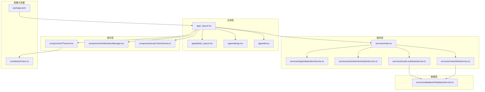
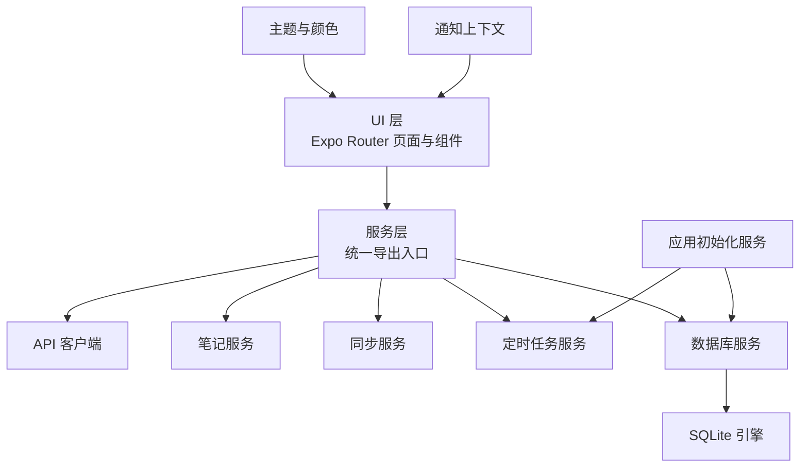
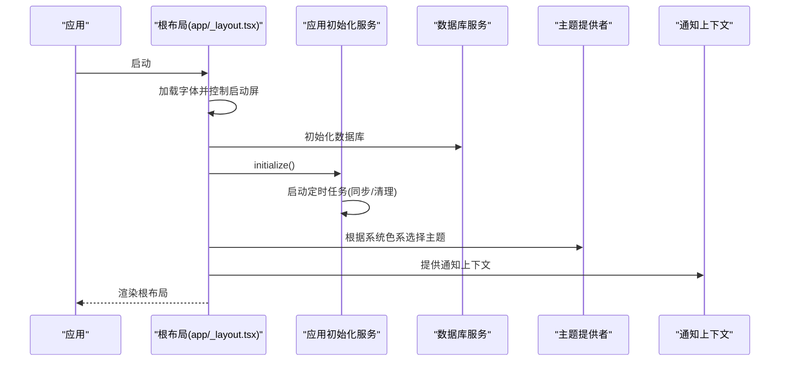
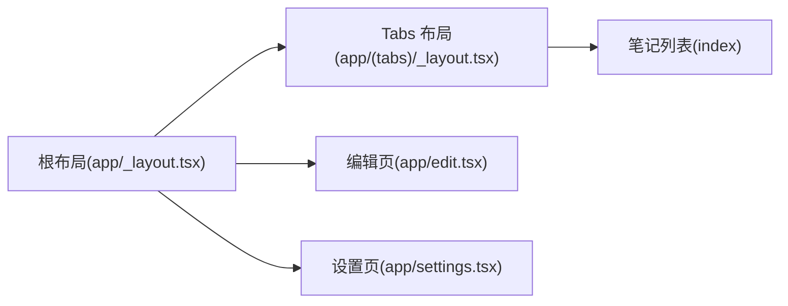
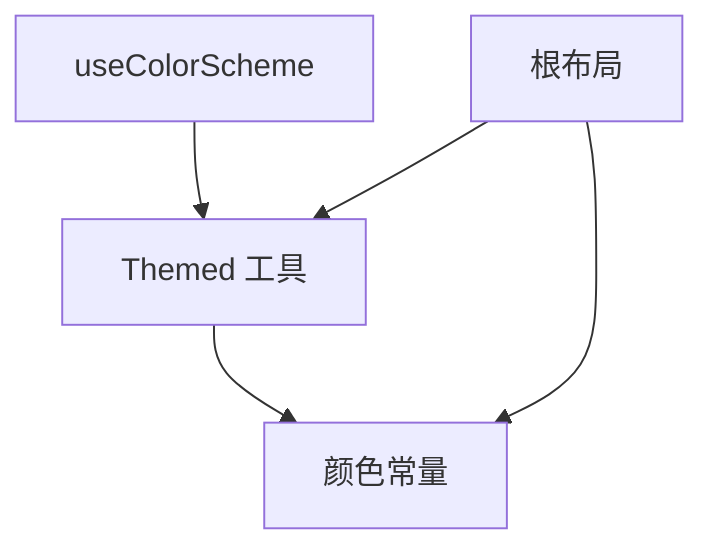
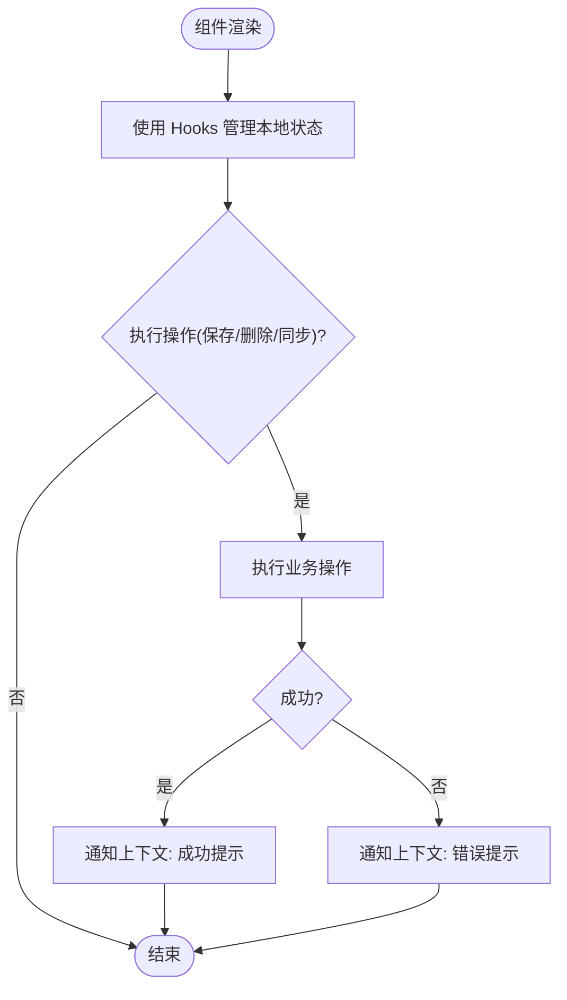
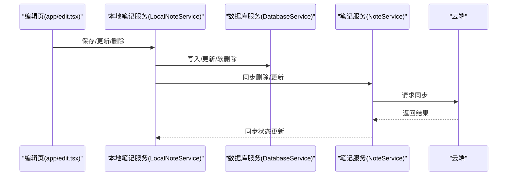
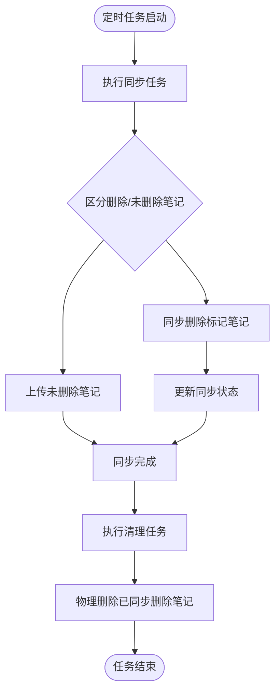
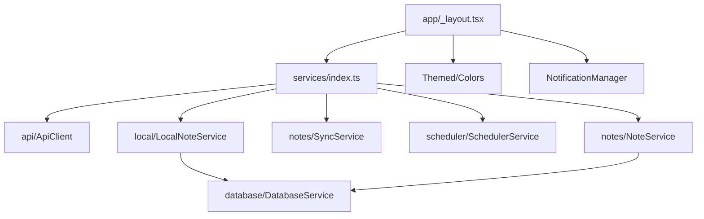

# 应用架构

<cite>
**本文档引用的文件**
- [package.json](file://package.json)
- [app/_layout.tsx](file://app/_layout.tsx)
- [app/(tabs)/_layout.tsx](file://app/(tabs)/_layout.tsx)
- [app/settings.tsx](file://app/settings.tsx)
- [app/edit.tsx](file://app/edit.tsx)
- [services/AppInitializationService.ts](file://services/AppInitializationService.ts)
- [services/index.ts](file://services/index.ts)
- [services/scheduler/SchedulerService.ts](file://services/scheduler/SchedulerService.ts)
- [services/local/LocalNoteService.ts](file://services/local/LocalNoteService.ts)
- [services/database/DatabaseService.ts](file://services/database/DatabaseService.ts)
- [services/notes/NoteService.ts](file://services/notes/NoteService.ts)
- [components/NotificationManager.tsx](file://components/NotificationManager.tsx)
- [components/Themed.tsx](file://components/Themed.tsx)
- [components/useColorScheme.ts](file://components/useColorScheme.ts)
- [constants/Colors.ts](file://constants/Colors.ts)
</cite>

## 目录

1. [简介](#简介)
2. [项目结构](#项目结构)
3. [核心组件](#核心组件)
4. [架构总览](#架构总览)
5. [组件详解](#组件详解)
6. [依赖关系分析](#依赖关系分析)
7. [性能考量](#性能考量)
8. [故障排查指南](#故障排查指南)
9. [结论](#结论)
10. [附录](#附录)

## 简介

本应用采用基于 Expo Router 的单页应用架构，结合本地 SQLite 数据库存储与云端同步机制，围绕“笔记”这一核心业务域构建。应用遵循分层架构与模块化组织原则，将 UI 层、服务层、数据层清晰分离，并通过服务注册与依赖注入模式（通过统一导出入口）实现松耦合与可扩展性。应用启动流程包含字体加载、本地存储初始化、定时任务启动与主题提供者装配；导航体系由 Expo Router 提供，页面按目录组织，支持栈式导航与模态展示；主题管理基于系统色系与自定义颜色常量；状态管理以 React Hooks 为主，配合通知上下文提供全局提示能力。

## 项目结构

应用采用按功能域划分的模块化组织方式：

- app：页面与布局，按目录组织页面与子路由
- components：通用 UI 组件与主题、通知等横切能力
- services：服务层，包含 API 客户端、笔记服务、数据库服务、定时任务、加密服务等
- types：类型定义
- utils：工具函数与错误处理
- constants：常量定义（如颜色）

图表来源

- [app/\_layout.tsx](file://app/_layout.tsx#L1-L84)
- [app/(tabs)/\_layout.tsx](<file://app/(tabs)/_layout.tsx#L1-L53>)
- [app/settings.tsx](file://app/settings.tsx#L1-L132)
- [app/edit.tsx](file://app/edit.tsx#L1-L517)
- [services/index.ts](file://services/index.ts#L1-L82)
- [services/AppInitializationService.ts](file://services/AppInitializationService.ts#L1-L63)
- [services/scheduler/SchedulerService.ts](file://services/scheduler/SchedulerService.ts#L1-L233)
- [services/local/LocalNoteService.ts](file://services/local/LocalNoteService.ts#L1-L601)
- [services/notes/NoteService.ts](file://services/notes/NoteService.ts#L1-L84)
- [services/database/DatabaseService.ts](file://services/database/DatabaseService.ts#L1-L513)
- [components/Themed.tsx](file://components/Themed.tsx#L1-L65)
- [components/NotificationManager.tsx](file://components/NotificationManager.tsx#L1-L235)
- [components/useColorScheme.ts](file://components/useColorScheme.ts#L1-L2)
- [constants/Colors.ts](file://constants/Colors.ts#L1-L20)
- [package.json](file://package.json#L1-L69)

章节来源

- [package.json](file://package.json#L1-L69)
- [app/\_layout.tsx](file://app/_layout.tsx#L1-L84)

## 核心组件

- 应用根布局与主题提供者：负责字体加载、启动屏控制、主题切换与全局通知提供者装配。
- 页面与导航：通过 Expo Router 的目录约定组织页面，支持栈式导航与模态展示。
- 服务注册与依赖注入：通过统一导出入口聚合服务，便于跨模块复用。
- 数据库与本地存储：封装 SQLite 访问、事务与队列化执行，保证高并发场景下的稳定性。
- 定时任务：后台周期性同步与清理，保障数据一致性与本地空间回收。
- 主题与通知：基于系统色系的主题适配与全局通知上下文。

章节来源

- [app/\_layout.tsx](file://app/_layout.tsx#L1-L84)
- [services/index.ts](file://services/index.ts#L1-L82)
- [services/database/DatabaseService.ts](file://services/database/DatabaseService.ts#L1-L513)
- [services/scheduler/SchedulerService.ts](file://services/scheduler/SchedulerService.ts#L1-L233)
- [components/Themed.tsx](file://components/Themed.tsx#L1-L65)
- [components/NotificationManager.tsx](file://components/NotificationManager.tsx#L1-L235)

## 架构总览

应用采用分层架构与模块化组织：

- 表现层：React Native + Expo Router，页面按目录组织，支持嵌套路由与模态。
- 服务层：统一导出入口，封装 API、笔记、同步、定时任务、加密等服务。
- 数据层：SQLite 封装，提供队列化执行、事务与状态管理，确保并发安全。
- 基础设施：主题、通知、颜色常量、字体与启动屏。

图表来源

- [services/index.ts](file://services/index.ts#L1-L82)
- [services/AppInitializationService.ts](file://services/AppInitializationService.ts#L1-L63)
- [services/database/DatabaseService.ts](file://services/database/DatabaseService.ts#L1-L513)
- [components/Themed.tsx](file://components/Themed.tsx#L1-L65)
- [components/NotificationManager.tsx](file://components/NotificationManager.tsx#L1-L235)

## 组件详解

### 应用启动序列与初始化流程

应用启动时的关键步骤：

- 字体加载与启动屏控制：在根布局中加载字体并在加载完成后隐藏启动屏。
- 本地存储初始化：在根布局挂载时初始化数据库。
- 应用初始化服务：启动定时任务服务，设置同步与清理周期。
- 主题与通知：根据系统色系选择主题，并提供全局通知上下文。

图表来源

- [app/\_layout.tsx](file://app/_layout.tsx#L35-L65)
- [services/AppInitializationService.ts](file://services/AppInitializationService.ts#L16-L37)
- [services/database/DatabaseService.ts](file://services/database/DatabaseService.ts#L147-L155)

章节来源

- [app/\_layout.tsx](file://app/_layout.tsx#L35-L65)
- [services/AppInitializationService.ts](file://services/AppInitializationService.ts#L16-L37)

### 导航系统架构与页面组织

- 根布局定义顶层栈与初始路由名，控制模态展示。
- tabs 子路由提供笔记列表页的头部与栈配置。
- settings 与 edit 等页面通过路由参数与导航 API 进行跳转与返回。
- 页面组件通过服务层读写数据，实现关注点分离。

图表来源

- [app/\_layout.tsx](file://app/_layout.tsx#L73-L82)
- [app/(tabs)/\_layout.tsx](<file://app/(tabs)/_layout.tsx#L7-L27>)
- [app/settings.tsx](file://app/settings.tsx#L11-L73)
- [app/edit.tsx](file://app/edit.tsx#L20-L81)

章节来源

- [app/\_layout.tsx](file://app/_layout.tsx#L73-L82)
- [app/(tabs)/\_layout.tsx](<file://app/(tabs)/_layout.tsx#L7-L27>)
- [app/settings.tsx](file://app/settings.tsx#L11-L73)
- [app/edit.tsx](file://app/edit.tsx#L20-L81)

### 主题管理机制

- 主题颜色来自常量定义，支持浅色与深色模式。
- 组件通过主题工具函数根据系统色系选择颜色。
- 根布局使用主题提供者包裹，确保全局主题生效。

图表来源

- [components/useColorScheme.ts](file://components/useColorScheme.ts#L1-L2)
- [components/Themed.tsx](file://components/Themed.tsx#L23-L35)
- [constants/Colors.ts](file://constants/Colors.ts#L1-L20)
- [app/\_layout.tsx](file://app/_layout.tsx#L70-L72)

章节来源

- [components/Themed.tsx](file://components/Themed.tsx#L23-L35)
- [constants/Colors.ts](file://constants/Colors.ts#L1-L20)
- [app/\_layout.tsx](file://app/_layout.tsx#L70-L72)

### 应用状态管理与错误边界

- 状态管理：页面组件使用 React Hooks 管理本地状态（如编辑页的标题、内容、选项状态等）。
- 错误边界：根布局声明错误边界，捕获导航树中的异常并交由边界处理。
- 通知：通过通知上下文提供全局提示，覆盖成功、错误、信息与警告四类场景。

图表来源

- [app/edit.tsx](file://app/edit.tsx#L129-L190)
- [app/settings.tsx](file://app/settings.tsx#L16-L25)
- [components/NotificationManager.tsx](file://components/NotificationManager.tsx#L83-L101)

章节来源

- [app/edit.tsx](file://app/edit.tsx#L129-L190)
- [app/settings.tsx](file://app/settings.tsx#L16-L25)
- [components/NotificationManager.tsx](file://components/NotificationManager.tsx#L83-L101)

### 数据流与服务交互

- 编辑页通过本地笔记服务写入数据库，同时异步尝试同步至云端。
- 设置页触发同步服务，将本地变更与云端进行对比与合并。
- 数据库服务提供队列化执行与事务，确保并发安全与一致性。

图表来源

- [app/edit.tsx](file://app/edit.tsx#L149-L174)
- [services/local/LocalNoteService.ts](file://services/local/LocalNoteService.ts#L85-L114)
- [services/database/DatabaseService.ts](file://services/database/DatabaseService.ts#L293-L301)
- [services/notes/NoteService.ts](file://services/notes/NoteService.ts#L48-L55)

章节来源

- [app/edit.tsx](file://app/edit.tsx#L149-L174)
- [services/local/LocalNoteService.ts](file://services/local/LocalNoteService.ts#L85-L114)
- [services/database/DatabaseService.ts](file://services/database/DatabaseService.ts#L293-L301)
- [services/notes/NoteService.ts](file://services/notes/NoteService.ts#L48-L55)

### 定时任务与数据清理

- 定时任务服务周期性执行同步与清理任务，避免阻塞主线程。
- 同步任务：将本地待同步笔记与云端进行对比与合并；删除标记的笔记优先同步删除。
- 清理任务：移除本地已同步的删除标记笔记，释放存储空间。

图表来源

- [services/scheduler/SchedulerService.ts](file://services/scheduler/SchedulerService.ts#L73-L98)
- [services/scheduler/SchedulerService.ts](file://services/scheduler/SchedulerService.ts#L104-L176)
- [services/scheduler/SchedulerService.ts](file://services/scheduler/SchedulerService.ts#L196-L229)

章节来源

- [services/scheduler/SchedulerService.ts](file://services/scheduler/SchedulerService.ts#L73-L98)
- [services/scheduler/SchedulerService.ts](file://services/scheduler/SchedulerService.ts#L104-L176)
- [services/scheduler/SchedulerService.ts](file://services/scheduler/SchedulerService.ts#L196-L229)

## 依赖关系分析

- 统一导出入口：服务层通过单一入口导出 API、笔记、同步、定时任务、本地存储等能力，便于跨模块复用。
- 组件依赖：页面组件依赖服务层与主题/通知组件；服务层依赖数据库与 API 客户端。
- 外部依赖：Expo Router、React Navigation、SQLite、Axios 等。

图表来源

- [services/index.ts](file://services/index.ts#L1-L82)
- [services/local/LocalNoteService.ts](file://services/local/LocalNoteService.ts#L1-L17)
- [services/database/DatabaseService.ts](file://services/database/DatabaseService.ts#L1-L5)
- [app/\_layout.tsx](file://app/_layout.tsx#L1-L14)
- [components/Themed.tsx](file://components/Themed.tsx#L1-L65)
- [components/NotificationManager.tsx](file://components/NotificationManager.tsx#L1-L235)

章节来源

- [services/index.ts](file://services/index.ts#L1-L82)
- [services/local/LocalNoteService.ts](file://services/local/LocalNoteService.ts#L1-L17)
- [services/database/DatabaseService.ts](file://services/database/DatabaseService.ts#L1-L5)
- [app/\_layout.tsx](file://app/_layout.tsx#L1-L14)

## 性能考量

- 数据库并发控制：通过队列化执行与重入锁避免并发冲突与死锁，事务封装减少多次往返。
- 自动保存与防抖：编辑页对频繁输入进行防抖，降低写入频率，提升用户体验。
- 同步策略：删除与更新分别处理，网络错误时采用静默处理与状态回退，避免阻塞本地操作。
- 主题与通知：主题颜色计算与通知上下文按需渲染，减少不必要的重绘。

章节来源

- [services/database/DatabaseService.ts](file://services/database/DatabaseService.ts#L62-L115)
- [app/edit.tsx](file://app/edit.tsx#L193-L205)
- [services/local/LocalNoteService.ts](file://services/local/LocalNoteService.ts#L119-L152)

## 故障排查指南

- 启动屏不消失：检查字体加载与启动屏控制逻辑，确保在字体加载完成后隐藏启动屏。
- 数据库初始化失败：查看数据库连接与表结构创建日志，确认 SQLite 实例可用。
- 同步失败：检查网络错误与超时处理，确认删除与更新的回退策略是否生效。
- 通知不可见：确认通知上下文包裹范围与平台差异（Android 使用 Toast，iOS 使用自定义模态）。

章节来源

- [app/\_layout.tsx](file://app/_layout.tsx#L35-L65)
- [services/database/DatabaseService.ts](file://services/database/DatabaseService.ts#L147-L155)
- [services/local/LocalNoteService.ts](file://services/local/LocalNoteService.ts#L119-L152)
- [components/NotificationManager.tsx](file://components/NotificationManager.tsx#L83-L101)

## 结论

本应用通过清晰的分层架构与模块化组织，实现了 UI、服务与数据的有效解耦；借助 Expo Router 的路由体系与本地 SQLite 存储，提供了稳定的数据持久化与同步能力；通过主题与通知等横切关注点，提升了用户体验与开发效率。定时任务与队列化数据库访问进一步增强了系统的可靠性与性能表现。

## 附录

- 依赖注入模式：通过服务层统一导出入口，实现模块间低耦合与可替换性。
- 服务注册机制：在服务层集中注册与暴露 API、笔记、同步、定时任务与本地存储能力，便于按需引入。

章节来源

- [services/index.ts](file://services/index.ts#L1-L82)
- [services/AppInitializationService.ts](file://services/AppInitializationService.ts#L16-L37)
