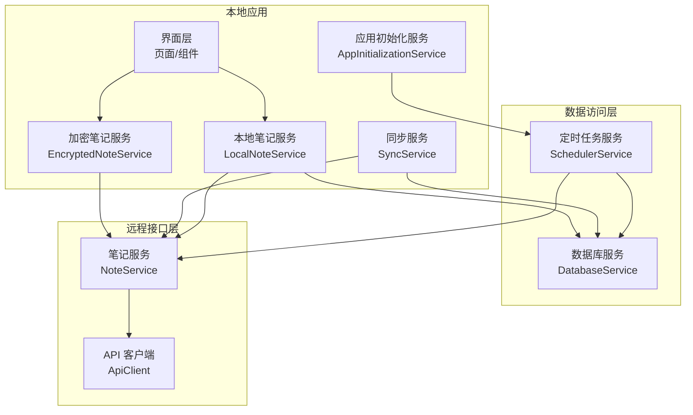
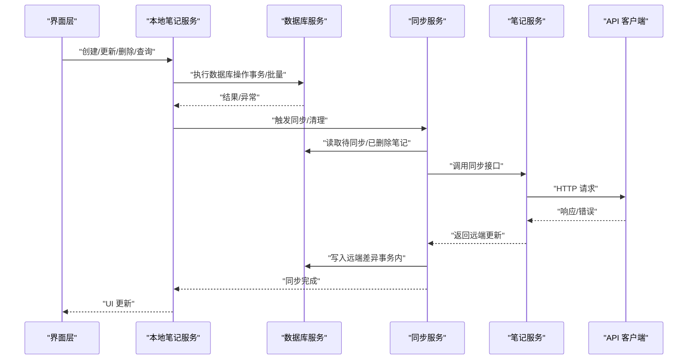
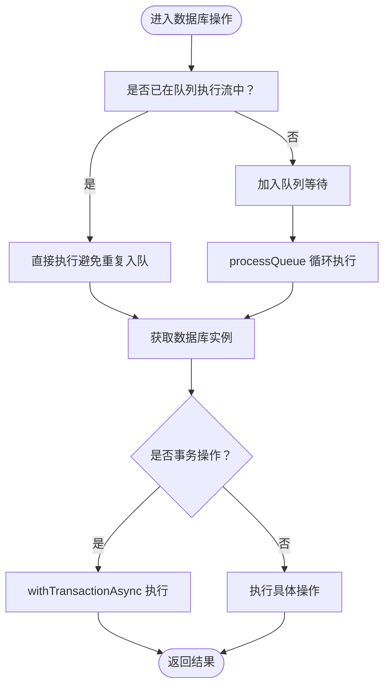
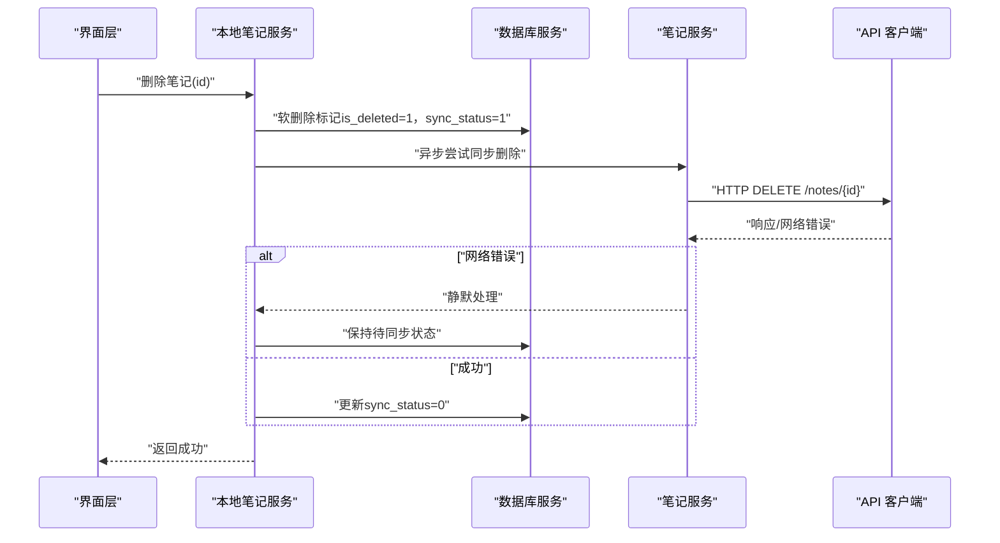
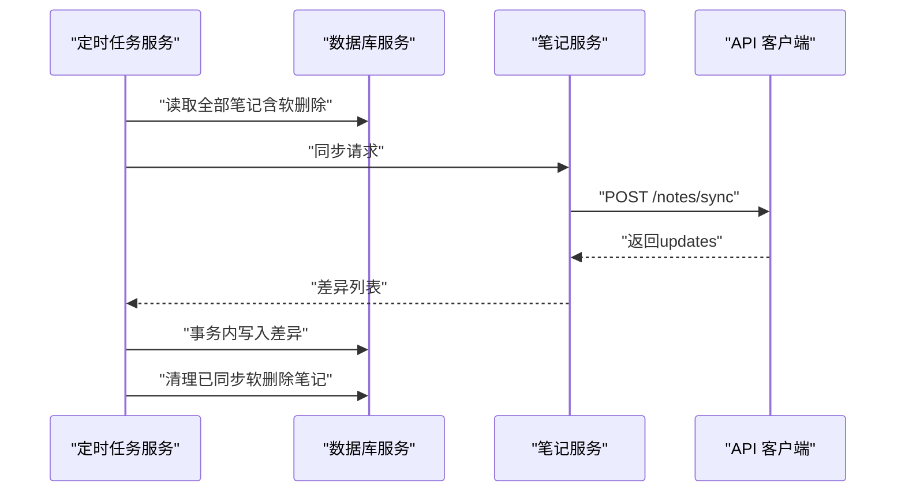
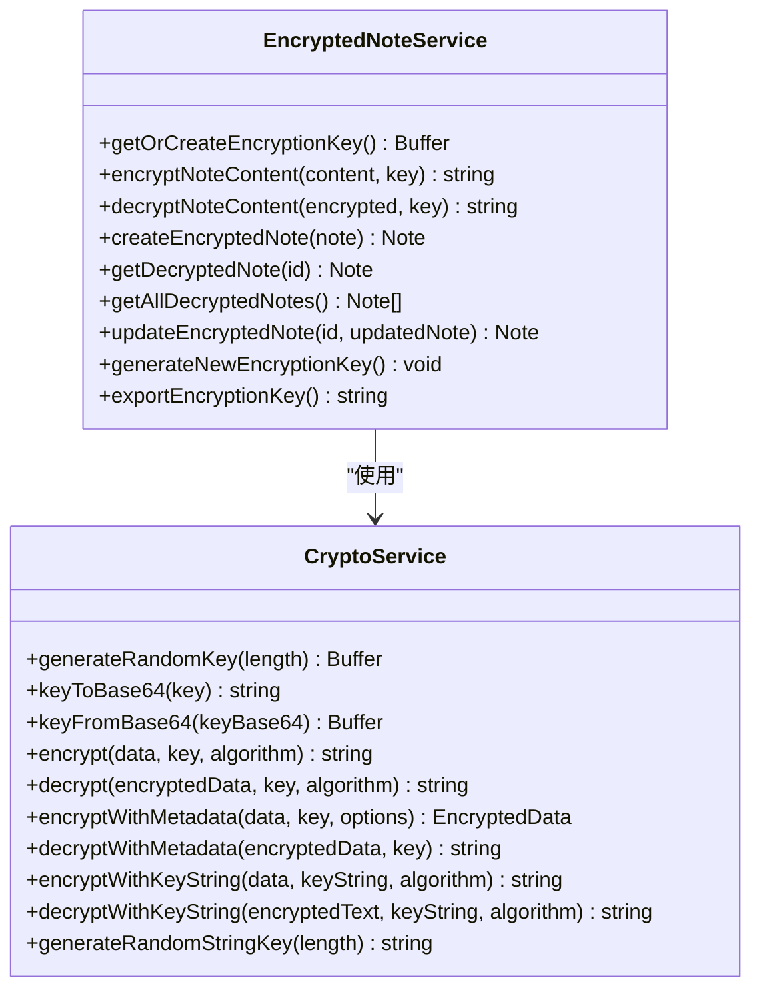
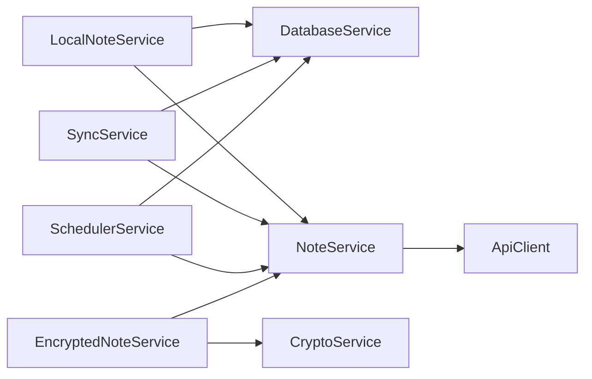
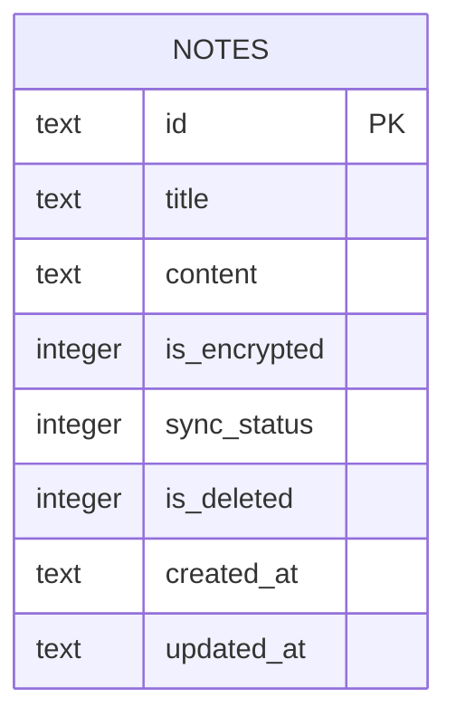
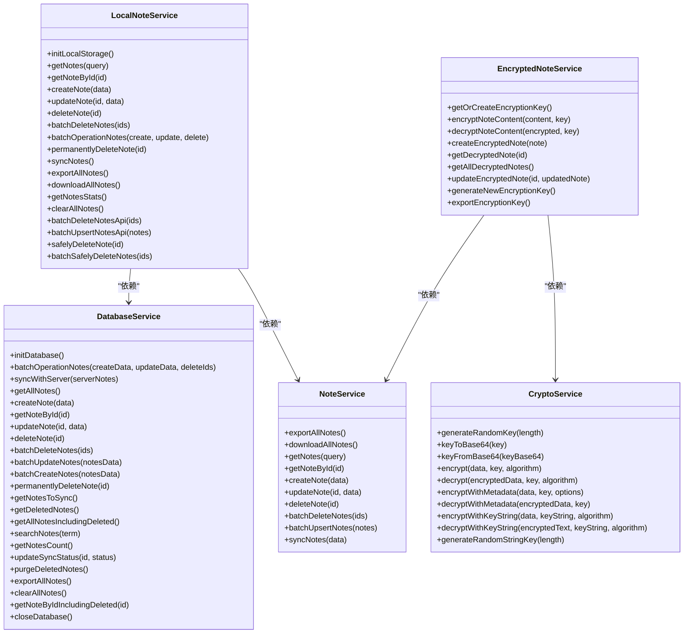

# 数据层架构

<cite>
**本文引用的文件**
- [services/database/DatabaseService.ts](file://services/database/DatabaseService.ts)
- [services/local/LocalNoteService.ts](file://services/local/LocalNoteService.ts)
- [services/notes/NoteService.ts](file://services/notes/NoteService.ts)
- [services/notes/SyncService.ts](file://services/notes/SyncService.ts)
- [services/api/ApiClient.ts](file://services/api/ApiClient.ts)
- [services/AppInitializationService.ts](file://services/AppInitializationService.ts)
- [services/scheduler/SchedulerService.ts](file://services/scheduler/SchedulerService.ts)
- [services/crypto/CryptoService.ts](file://services/crypto/CryptoService.ts)
- [services/crypto/EncryptedNoteService.ts](file://services/crypto/EncryptedNoteService.ts)
- [types/notes/NoteTypes.ts](file://types/notes/NoteTypes.ts)
- [utils/auth/AuthUtils.ts](file://utils/auth/AuthUtils.ts)
- [utils/ErrorHandler.ts](file://utils/ErrorHandler.ts)
</cite>

## 目录

1. [简介](#简介)
2. [项目结构](#项目结构)
3. [核心组件](#核心组件)
4. [架构总览](#架构总览)
5. [详细组件分析](#详细组件分析)
6. [依赖分析](#依赖分析)
7. [性能考虑](#性能考虑)
8. [故障排查指南](#故障排查指南)
9. [结论](#结论)
10. [附录](#附录)

## 简介

本文件系统化梳理 Notes 应用的数据层架构，重点覆盖以下方面：

- 数据访问层设计：基于 SQLite 的本地持久化与 Repository 风格封装，统一的数据库操作入口与并发控制。
- 数据模型与实体关系：笔记实体的字段设计、软删除与同步状态字段的作用。
- 查询与事务：批量操作、事务原子性、内存对比优化、索引与查询建议。
- 本地存储与远程同步：一致性策略、待同步状态管理、定时清理与幂等处理。
- 缓存与性能：任务队列、重入保护、批量优化、网络错误容忍。
- 加密与安全：内容级加密、密钥管理、解密流程。
- 迁移、版本与备份：当前实现中的清理与导出能力，以及可扩展建议。

## 项目结构

数据层由三层协作构成：

- 本地数据库层：SQLite 封装与事务、队列化执行、批量操作与同步。
- 业务服务层：本地笔记服务、同步服务、加密笔记服务，负责业务编排与错误处理。
- 远程接口层：Axios 客户端、拦截器、统一错误处理。

图表来源

- [services/local/LocalNoteService.ts](file://services/local/LocalNoteService.ts#L1-L601)
- [services/database/DatabaseService.ts](file://services/database/DatabaseService.ts#L1-L513)
- [services/notes/SyncService.ts](file://services/notes/SyncService.ts#L1-L58)
- [services/scheduler/SchedulerService.ts](file://services/scheduler/SchedulerService.ts#L1-L233)
- [services/api/ApiClient.ts](file://services/api/ApiClient.ts#L1-L92)
- [services/notes/NoteService.ts](file://services/notes/NoteService.ts#L1-L84)
- [services/AppInitializationService.ts](file://services/AppInitializationService.ts#L1-L63)

章节来源

- [services/local/LocalNoteService.ts](file://services/local/LocalNoteService.ts#L1-L601)
- [services/database/DatabaseService.ts](file://services/database/DatabaseService.ts#L1-L513)
- [services/notes/NoteService.ts](file://services/notes/NoteService.ts#L1-L84)
- [services/api/ApiClient.ts](file://services/api/ApiClient.ts#L1-L92)
- [services/notes/SyncService.ts](file://services/notes/SyncService.ts#L1-L58)
- [services/AppInitializationService.ts](file://services/AppInitializationService.ts#L1-L63)
- [services/scheduler/SchedulerService.ts](file://services/scheduler/SchedulerService.ts#L1-L233)

## 核心组件

- 数据库服务（Repository 风格）：集中封装 SQLite 访问、表初始化、事务、批量操作、同步逻辑、查询与清理。
- 本地笔记服务：面向 UI 的业务封装，提供 CRUD、分页、搜索、统计、导出、同步等。
- 同步服务：协调本地与远端的双向同步，处理幂等与一致性。
- 加密笔记服务：内容级加密与解密，密钥管理与密文存储。
- API 客户端：统一请求/响应拦截、错误分类处理、鉴权注入。
- 定时任务服务：周期性同步与清理，保障本地删除与远端一致。
- 应用初始化服务：启动定时任务，统一生命周期管理。

章节来源

- [services/database/DatabaseService.ts](file://services/database/DatabaseService.ts#L1-L513)
- [services/local/LocalNoteService.ts](file://services/local/LocalNoteService.ts#L1-L601)
- [services/notes/SyncService.ts](file://services/notes/SyncService.ts#L1-L58)
- [services/crypto/EncryptedNoteService.ts](file://services/crypto/EncryptedNoteService.ts#L1-L186)
- [services/api/ApiClient.ts](file://services/api/ApiClient.ts#L1-L92)
- [services/scheduler/SchedulerService.ts](file://services/scheduler/SchedulerService.ts#L1-L233)
- [services/AppInitializationService.ts](file://services/AppInitializationService.ts#L1-L63)

## 架构总览

数据流从 UI 层进入本地服务层，经数据库服务持久化；同时通过同步服务与远端 API 交互，配合定时任务实现自动同步与清理。加密服务在内容层面提供安全存储。

图表来源

- [services/local/LocalNoteService.ts](file://services/local/LocalNoteService.ts#L443-L466)
- [services/notes/SyncService.ts](file://services/notes/SyncService.ts#L13-L36)
- [services/database/DatabaseService.ts](file://services/database/DatabaseService.ts#L211-L260)
- [services/notes/NoteService.ts](file://services/notes/NoteService.ts#L69-L70)
- [services/api/ApiClient.ts](file://services/api/ApiClient.ts#L1-L92)

## 详细组件分析

### 数据库服务（Repository 模式）

- 设计要点
  - 单例数据库实例与初始化竞态保护，避免空指针与重复初始化。
  - 任务队列 + 重入保护：解决高频调用导致的并发冲突与死锁。
  - 事务包裹：批量操作与同步逻辑保证原子性，防止“删了没建”。
  - 内存 Map 对比：同步时一次性加载本地索引，避免循环查库。
  - 错误自愈：针对特定 SQLite 错误自动关闭并重置连接。
- 关键能力
  - 基础 CRUD、批量创建/更新/删除、软删除、搜索、统计、导出、清理。
  - 待同步状态管理与同步状态更新。
  - 事务内同步：按时间戳比较，保留本地较新的数据，避免覆盖。
- 性能特性
  - 队列串行化降低锁竞争。
  - 批量操作减少往返次数。
  - 内存对比减少数据库扫描。

图表来源

- [services/database/DatabaseService.ts](file://services/database/DatabaseService.ts#L62-L115)
- [services/database/DatabaseService.ts](file://services/database/DatabaseService.ts#L160-L205)
- [services/database/DatabaseService.ts](file://services/database/DatabaseService.ts#L211-L260)

章节来源

- [services/database/DatabaseService.ts](file://services/database/DatabaseService.ts#L1-L513)

### 本地笔记服务（业务编排）

- 设计要点
  - 本地 CRUD 与分页、搜索、统计、导出、清空等。
  - 删除策略：软删除优先，异步同步至远端；网络错误不阻塞本地删除，维持最终一致性。
  - 安全删除：先检查远端是否存在，再决定本地标记与同步行为。
  - 批量操作：批量创建/更新/删除，结合数据库服务的事务与队列。
  - 同步：拉取本地全量（含软删除）提交远端，接收远端差异并合并。
- 错误处理
  - API 网络错误与超时静默处理，确保本地操作不受影响。
  - 统一错误分类与日志记录，便于定位问题。

图表来源

- [services/local/LocalNoteService.ts](file://services/local/LocalNoteService.ts#L119-L152)
- [services/notes/NoteService.ts](file://services/notes/NoteService.ts#L54-L55)
- [services/api/ApiClient.ts](file://services/api/ApiClient.ts#L51-L89)

章节来源

- [services/local/LocalNoteService.ts](file://services/local/LocalNoteService.ts#L1-L601)

### 同步服务与定时任务

- 同步服务
  - 读取本地全部笔记（含软删除），提交远端，接收远端差异并写回本地。
  - 采用时间戳比较，保留本地较新的数据，避免覆盖。
- 定时任务
  - 周期性执行同步与清理：同步删除标记笔记、上传非删除笔记、清理已同步的软删除笔记。
  - 对网络错误进行静默处理，避免阻塞本地流程。

图表来源

- [services/notes/SyncService.ts](file://services/notes/SyncService.ts#L13-L36)
- [services/scheduler/SchedulerService.ts](file://services/scheduler/SchedulerService.ts#L73-L98)
- [services/scheduler/SchedulerService.ts](file://services/scheduler/SchedulerService.ts#L104-L176)
- [services/scheduler/SchedulerService.ts](file://services/scheduler/SchedulerService.ts#L196-L229)

章节来源

- [services/notes/SyncService.ts](file://services/notes/SyncService.ts#L1-L58)
- [services/scheduler/SchedulerService.ts](file://services/scheduler/SchedulerService.ts#L1-L233)

### 加密笔记服务

- 设计要点
  - 密钥管理：首次使用生成并安全存储，后续复用。
  - 内容加密：创建/更新时对内容加密，存储密文；读取时解密。
  - 与本地服务协同：在本地服务的分页/列表场景下，解密后返回给 UI。
- 安全注意
  - 密钥更换会破坏历史密文，需谨慎处理。
  - 采用原生加密库，确保跨平台一致性。

图表来源

- [services/crypto/EncryptedNoteService.ts](file://services/crypto/EncryptedNoteService.ts#L1-L186)
- [services/crypto/CryptoService.ts](file://services/crypto/CryptoService.ts#L1-L205)

章节来源

- [services/crypto/EncryptedNoteService.ts](file://services/crypto/EncryptedNoteService.ts#L1-L186)
- [services/crypto/CryptoService.ts](file://services/crypto/CryptoService.ts#L1-L205)

### API 客户端与错误处理

- 配置
  - 动态 baseURL 与 Authorization 注入，统一超时与请求头。
  - 请求拦截器：异步获取 API 地址与密钥，注入请求。
  - 响应拦截器：网络错误、超时、状态码分类处理，删除操作网络错误静默。
- 错误工具
  - 统一判断网络错误与删除操作，支持静默处理策略。

章节来源

- [services/api/ApiClient.ts](file://services/api/ApiClient.ts#L1-L92)
- [utils/ErrorHandler.ts](file://utils/ErrorHandler.ts#L1-L48)
- [utils/auth/AuthUtils.ts](file://utils/auth/AuthUtils.ts#L1-L65)

## 依赖分析

- 组件耦合
  - LocalNoteService 依赖 DatabaseService 与 NoteService，形成“业务编排 + 数据持久化 + 远端交互”的闭环。
  - SyncService 与 SchedulerService 依赖 DatabaseService 与 NoteService，承担一致性与生命周期职责。
  - EncryptedNoteService 依赖 CryptoService 与 NoteService，专注于内容安全。
- 外部依赖
  - SQLite（expo-sqlite）：本地持久化。
  - Axios：HTTP 客户端与拦截器。
  - React Native 加密库：原生加密与密钥生成。
  - 安全存储：Expo Secure Store 与 AsyncStorage。

图表来源

- [services/local/LocalNoteService.ts](file://services/local/LocalNoteService.ts#L1-L17)
- [services/notes/SyncService.ts](file://services/notes/SyncService.ts#L1-L3)
- [services/scheduler/SchedulerService.ts](file://services/scheduler/SchedulerService.ts#L1-L7)
- [services/crypto/EncryptedNoteService.ts](file://services/crypto/EncryptedNoteService.ts#L1-L5)
- [services/api/ApiClient.ts](file://services/api/ApiClient.ts#L1-L11)

章节来源

- [services/local/LocalNoteService.ts](file://services/local/LocalNoteService.ts#L1-L601)
- [services/notes/SyncService.ts](file://services/notes/SyncService.ts#L1-L58)
- [services/scheduler/SchedulerService.ts](file://services/scheduler/SchedulerService.ts#L1-L233)
- [services/crypto/EncryptedNoteService.ts](file://services/crypto/EncryptedNoteService.ts#L1-L186)
- [services/api/ApiClient.ts](file://services/api/ApiClient.ts#L1-L92)

## 性能考虑

- 并发与队列
  - 任务队列串行化，避免高并发下的锁竞争与死锁。
  - 重入保护：嵌套调用直接执行，避免重复入队。
- 事务与批量
  - 批量操作与同步均在事务内执行，保证原子性与一致性。
  - 批量删除/创建/更新减少往返次数。
- 内存优化
  - 同步阶段一次性加载本地索引，使用内存 Map 进行对比，避免循环查库。
- 查询与索引
  - 当前查询主要基于主键与软删除过滤，建议在 id、updated_at、is_deleted 上建立索引以提升排序与筛选性能。
- 网络容错
  - 删除操作在网络错误时静默处理，确保本地可用性与最终一致性。

章节来源

- [services/database/DatabaseService.ts](file://services/database/DatabaseService.ts#L62-L115)
- [services/database/DatabaseService.ts](file://services/database/DatabaseService.ts#L160-L205)
- [services/database/DatabaseService.ts](file://services/database/DatabaseService.ts#L211-L260)
- [services/local/LocalNoteService.ts](file://services/local/LocalNoteService.ts#L119-L152)
- [services/scheduler/SchedulerService.ts](file://services/scheduler/SchedulerService.ts#L104-L176)

## 故障排查指南

- 数据库连接问题
  - 现象：初始化失败、空指针、prepareAsync 错误。
  - 处理：自动重置数据库实例并关闭旧连接，重新初始化。
- 网络错误与超时
  - 现象：删除操作网络错误、同步失败。
  - 处理：删除操作静默处理，保持本地状态；其他错误记录并上抛。
- 同步不一致
  - 现象：远端覆盖本地更新。
  - 处理：同步时按 updated_at 比较，保留本地较新的数据。
- 加密相关
  - 现象：密文无法解密。
  - 处理：确认密钥存在且未被更改；必要时导出/导入密钥。

章节来源

- [services/database/DatabaseService.ts](file://services/database/DatabaseService.ts#L80-L94)
- [services/api/ApiClient.ts](file://services/api/ApiClient.ts#L51-L89)
- [utils/ErrorHandler.ts](file://utils/ErrorHandler.ts#L1-L48)
- [services/notes/SyncService.ts](file://services/notes/SyncService.ts#L217-L255)
- [services/crypto/EncryptedNoteService.ts](file://services/crypto/EncryptedNoteService.ts#L169-L182)

## 结论

该数据层以 SQLite 为核心，采用 Repository 风格封装与任务队列化执行，结合事务与内存对比优化，实现了高性能、高可靠的一致性数据访问。通过软删除与待同步状态管理，配合定时任务与网络错误静默处理，确保本地与远端的最终一致性。加密服务在内容层面提供了安全存储能力。建议后续引入索引优化与版本迁移/备份策略以进一步提升性能与可维护性。

## 附录

### 数据模型与实体关系

- 实体：Note
  - 字段：id、title、content、is_encrypted、sync_status、is_deleted、created_at、updated_at。
  - 约束：id 主键；is_deleted 与 sync_status 用于软删除与同步状态管理。
- 关系：单一实体，无外键关系，遵循扁平化设计以简化查询与同步。

图表来源

- [types/notes/NoteTypes.ts](file://types/notes/NoteTypes.ts#L2-L11)
- [services/database/DatabaseService.ts](file://services/database/DatabaseService.ts#L35-L46)

### 数据层架构图（代码级）

图表来源

- [services/database/DatabaseService.ts](file://services/database/DatabaseService.ts#L488-L512)
- [services/local/LocalNoteService.ts](file://services/local/LocalNoteService.ts#L579-L600)
- [services/notes/NoteService.ts](file://services/notes/NoteService.ts#L72-L83)
- [services/crypto/EncryptedNoteService.ts](file://services/crypto/EncryptedNoteService.ts#L1-L186)
- [services/crypto/CryptoService.ts](file://services/crypto/CryptoService.ts#L10-L205)

### 数据迁移、版本管理与备份恢复

- 当前实现
  - 清理：支持清理软删除且已同步的笔记（物理删除）。
  - 导出：支持导出所有笔记（不含软删除）。
- 建议策略
  - 版本迁移：新增表字段或调整结构时，使用事务执行 ALTER/CREATE/REPLACE 流程，并记录版本号。
  - 备份：定期导出笔记数据（JSON），结合密钥备份，确保可恢复。
  - 恢复：导入时校验版本与完整性，按 id 合并或替换，保持同步状态一致性。

章节来源

- [services/database/DatabaseService.ts](file://services/database/DatabaseService.ts#L446-L464)
- [services/local/LocalNoteService.ts](file://services/local/LocalNoteService.ts#L381-L408)
