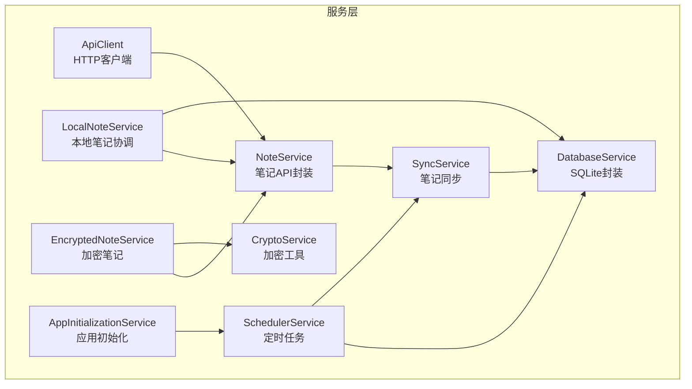
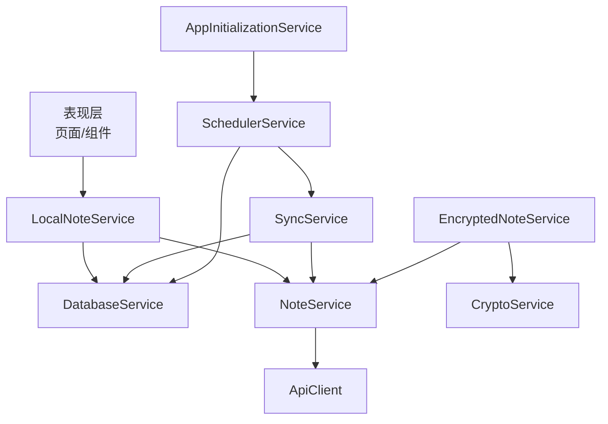
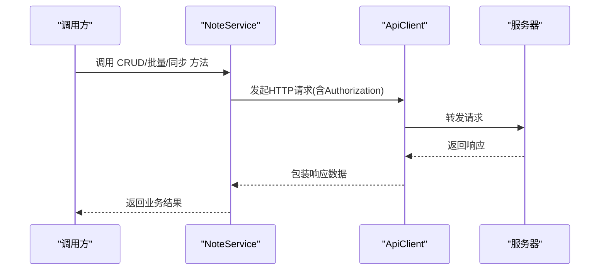
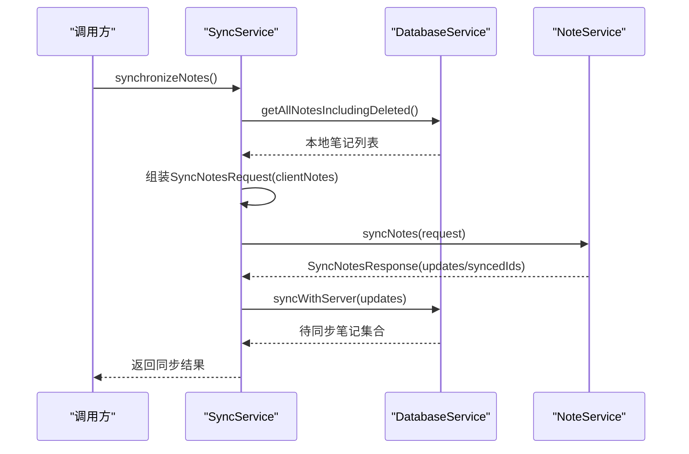
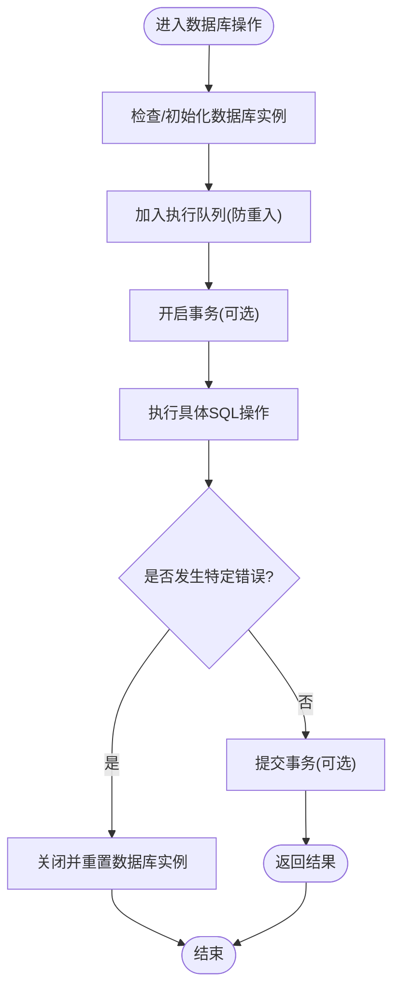
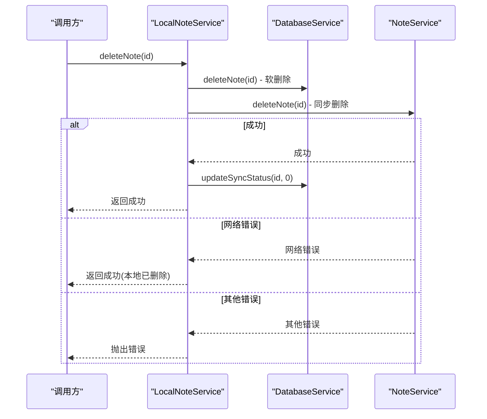
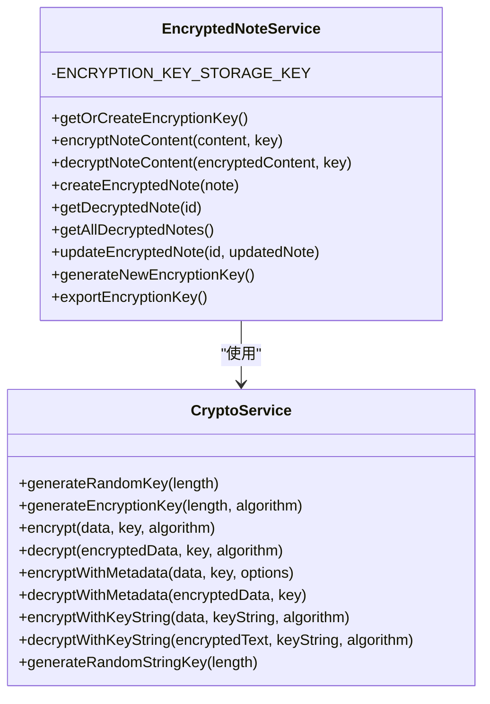
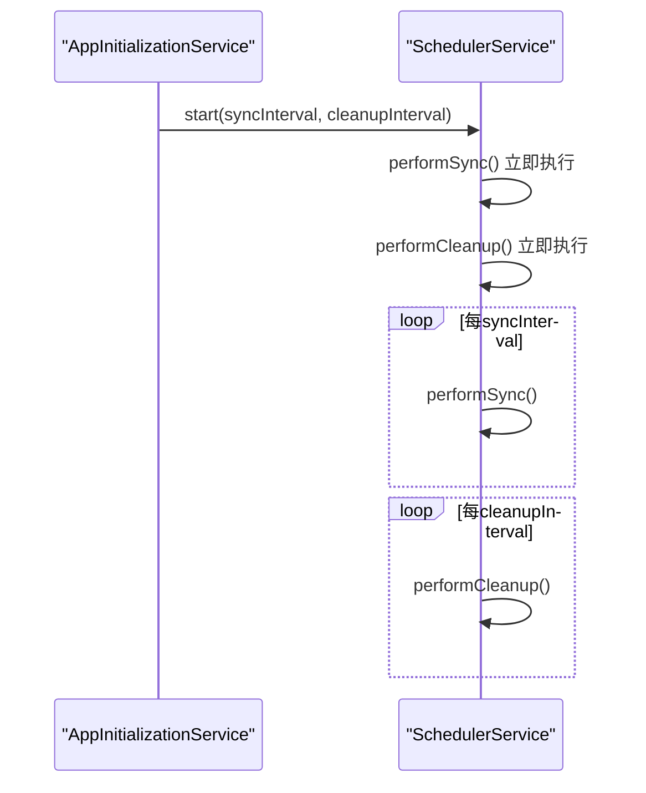
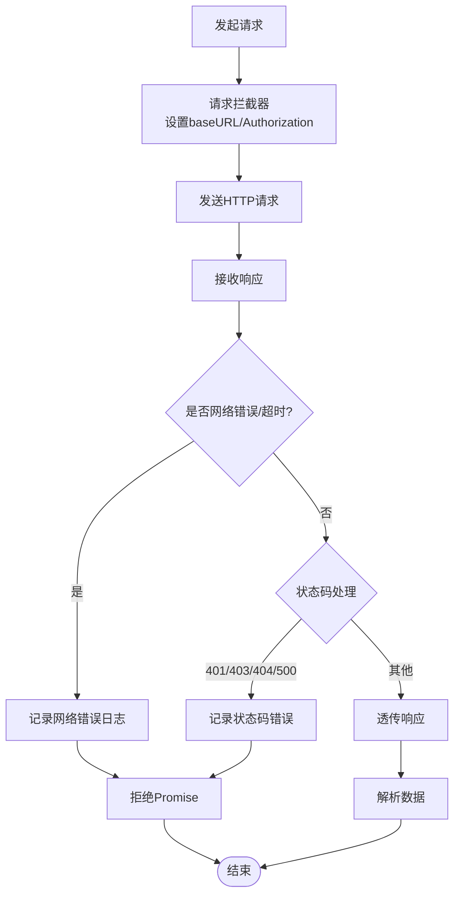
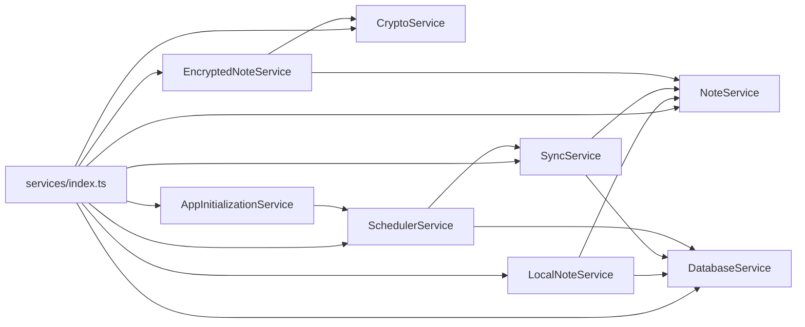

# 服务层设计

<cite>
**本文引用的文件**
- [services/index.ts](file://services/index.ts)
- [services/notes/NoteService.ts](file://services/notes/NoteService.ts)
- [services/notes/SyncService.ts](file://services/notes/SyncService.ts)
- [services/database/DatabaseService.ts](file://services/database/DatabaseService.ts)
- [services/local/LocalNoteService.ts](file://services/local/LocalNoteService.ts)
- [services/api/ApiClient.ts](file://services/api/ApiClient.ts)
- [services/crypto/CryptoService.ts](file://services/crypto/CryptoService.ts)
- [services/crypto/EncryptedNoteService.ts](file://services/crypto/EncryptedNoteService.ts)
- [services/scheduler/SchedulerService.ts](file://services/scheduler/SchedulerService.ts)
- [services/AppInitializationService.ts](file://services/AppInitializationService.ts)
- [types/notes/NoteTypes.ts](file://types/notes/NoteTypes.ts)
- [types/crypto/CryptoTypes.ts](file://types/crypto/CryptoTypes.ts)
- [utils/auth/AuthUtils.ts](file://utils/auth/AuthUtils.ts)
- [utils/ErrorHandler.ts](file://utils/ErrorHandler.ts)
- [package.json](file://package.json)
</cite>

## 目录

1. [简介](#简介)
2. [项目结构](#项目结构)
3. [核心组件](#核心组件)
4. [架构总览](#架构总览)
5. [详细组件分析](#详细组件分析)
6. [依赖分析](#依赖分析)
7. [性能考虑](#性能考虑)
8. [故障排查指南](#故障排查指南)
9. [结论](#结论)
10. [附录](#附录)

## 简介

本设计文档面向Notes应用的服务层，系统化阐述服务层的架构模式与设计原则，涵盖服务抽象、依赖注入与接口隔离；明确核心服务组件的职责边界，包括NoteService、SyncService、DatabaseService、LocalNoteService、CryptoService、EncryptedNoteService、SchedulerService与AppInitializationService；阐明服务间协作关系、数据传递模式与错误处理机制；总结服务生命周期管理、单例模式应用与异步处理策略；并给出服务注册机制、依赖解析与配置管理方案。最后提供架构图与组件交互序列图，直观展示服务调用链与数据流转过程。

## 项目结构

服务层采用按功能域分层的组织方式，核心目录如下：

- services/api：封装HTTP客户端与统一拦截器
- services/notes：笔记领域服务（NoteService、SyncService）
- services/database：本地数据库服务（SQLite）
- services/local：本地笔记服务（协调数据库与远程API）
- services/crypto：加密服务（CryptoService、EncryptedNoteService）
- services/scheduler：定时任务服务
- services/AppInitializationService：应用初始化服务
- types：类型定义（笔记、加密）
- utils：工具类（鉴权、错误处理）

图表来源

- [services/api/ApiClient.ts](file://services/api/ApiClient.ts#L1-L92)
- [services/notes/NoteService.ts](file://services/notes/NoteService.ts#L1-L84)
- [services/notes/SyncService.ts](file://services/notes/SyncService.ts#L1-L58)
- [services/database/DatabaseService.ts](file://services/database/DatabaseService.ts#L1-L513)
- [services/local/LocalNoteService.ts](file://services/local/LocalNoteService.ts#L1-L601)
- [services/crypto/CryptoService.ts](file://services/crypto/CryptoService.ts#L1-L205)
- [services/crypto/EncryptedNoteService.ts](file://services/crypto/EncryptedNoteService.ts#L1-L186)
- [services/scheduler/SchedulerService.ts](file://services/scheduler/SchedulerService.ts#L1-L233)
- [services/AppInitializationService.ts](file://services/AppInitializationService.ts#L1-L63)

章节来源

- [services/index.ts](file://services/index.ts#L1-L82)
- [package.json](file://package.json#L14-L41)

## 核心组件

- NoteService：封装笔记的CRUD、批量操作与同步接口，统一通过ApiClient发起HTTP请求。
- SyncService：负责将本地笔记与服务器进行双向同步，协调DatabaseService与NoteService。
- DatabaseService：封装SQLite数据库访问，提供并发控制、事务与批处理能力。
- LocalNoteService：面向UI层的本地笔记服务，协调数据库与远程API，提供幂等与容错删除策略。
- CryptoService：提供AES加密、解密与密钥生成等核心加密能力。
- EncryptedNoteService：基于CryptoService实现笔记内容的透明加解密与持久化。
- SchedulerService：定时执行同步与清理任务，保障数据一致性与存储健康。
- AppInitializationService：应用启动时初始化定时任务，提供生命周期管理。
- ApiClient：Axios实例，统一设置baseURL、Authorization头与错误处理。
- 类型系统：NoteTypes与CryptoTypes定义数据契约，确保跨服务一致性。

章节来源

- [services/notes/NoteService.ts](file://services/notes/NoteService.ts#L1-L84)
- [services/notes/SyncService.ts](file://services/notes/SyncService.ts#L1-L58)
- [services/database/DatabaseService.ts](file://services/database/DatabaseService.ts#L1-L513)
- [services/local/LocalNoteService.ts](file://services/local/LocalNoteService.ts#L1-L601)
- [services/crypto/CryptoService.ts](file://services/crypto/CryptoService.ts#L1-L205)
- [services/crypto/EncryptedNoteService.ts](file://services/crypto/EncryptedNoteService.ts#L1-L186)
- [services/scheduler/SchedulerService.ts](file://services/scheduler/SchedulerService.ts#L1-L233)
- [services/AppInitializationService.ts](file://services/AppInitializationService.ts#L1-L63)
- [services/api/ApiClient.ts](file://services/api/ApiClient.ts#L1-L92)
- [types/notes/NoteTypes.ts](file://types/notes/NoteTypes.ts#L1-L109)
- [types/crypto/CryptoTypes.ts](file://types/crypto/CryptoTypes.ts#L1-L44)

## 架构总览

服务层遵循“分层+领域服务”的架构模式：

- 表现层通过LocalNoteService与UI交互，LocalNoteService作为门面协调数据库与远程API。
- 领域服务层由NoteService、SyncService、EncryptedNoteService组成，负责业务编排。
- 基础设施层由DatabaseService与ApiClient构成，分别负责数据持久化与网络通信。
- 工具层提供加密与错误处理能力，贯穿各服务。
- SchedulerService与AppInitializationService负责异步与生命周期管理。

图表来源

- [services/local/LocalNoteService.ts](file://services/local/LocalNoteService.ts#L1-L601)
- [services/database/DatabaseService.ts](file://services/database/DatabaseService.ts#L1-L513)
- [services/notes/NoteService.ts](file://services/notes/NoteService.ts#L1-L84)
- [services/api/ApiClient.ts](file://services/api/ApiClient.ts#L1-L92)
- [services/notes/SyncService.ts](file://services/notes/SyncService.ts#L1-L58)
- [services/crypto/EncryptedNoteService.ts](file://services/crypto/EncryptedNoteService.ts#L1-L186)
- [services/crypto/CryptoService.ts](file://services/crypto/CryptoService.ts#L1-L205)
- [services/scheduler/SchedulerService.ts](file://services/scheduler/SchedulerService.ts#L1-L233)
- [services/AppInitializationService.ts](file://services/AppInitializationService.ts#L1-L63)

## 详细组件分析

### NoteService（笔记API服务）

职责

- 封装笔记的增删改查、批量操作与同步接口，统一通过ApiClient发起HTTP请求。
- 提供导出、下载等聚合能力。

设计要点

- 使用泛型响应类型，保证接口契约清晰。
- 通过模块化导出与默认导出，便于按需引入与整体引用。

图表来源

- [services/notes/NoteService.ts](file://services/notes/NoteService.ts#L22-L70)
- [services/api/ApiClient.ts](file://services/api/ApiClient.ts#L16-L41)

章节来源

- [services/notes/NoteService.ts](file://services/notes/NoteService.ts#L1-L84)
- [types/notes/NoteTypes.ts](file://types/notes/NoteTypes.ts#L74-L108)

### SyncService（笔记同步服务）

职责

- 将本地笔记与服务器进行双向同步，协调DatabaseService与NoteService。
- 提供两类同步入口：全量同步与增量上传。

设计要点

- 通过DatabaseService.getAllNotesIncludingDeleted获取本地全量数据。
- 将clientNotes封装为SyncNotesRequest，调用NoteService.syncNotes。
- 若服务器返回updates，交由DatabaseService.syncWithServer进行内存Map对比与事务落库。

图表来源

- [services/notes/SyncService.ts](file://services/notes/SyncService.ts#L13-L36)
- [services/database/DatabaseService.ts](file://services/database/DatabaseService.ts#L211-L260)
- [services/notes/NoteService.ts](file://services/notes/NoteService.ts#L69-L70)

章节来源

- [services/notes/SyncService.ts](file://services/notes/SyncService.ts#L1-L58)
- [services/database/DatabaseService.ts](file://services/database/DatabaseService.ts#L211-L260)
- [types/notes/NoteTypes.ts](file://types/notes/NoteTypes.ts#L98-L108)

### DatabaseService（数据库服务）

职责

- 封装SQLite数据库访问，提供并发控制、事务与批处理能力。
- 提供笔记的增删改查、批量操作、同步、导出、清理等能力。

设计要点

- 数据库实例懒加载与初始化竞态保护，避免空指针与重复初始化。
- 任务队列与重入锁，解决高频操作下的并发冲突与死锁。
- 批量操作使用withTransactionAsync，确保原子性。
- 同步逻辑使用内存Map对比，提升性能并避免循环查询。

图表来源

- [services/database/DatabaseService.ts](file://services/database/DatabaseService.ts#L18-L115)
- [services/database/DatabaseService.ts](file://services/database/DatabaseService.ts#L165-L205)
- [services/database/DatabaseService.ts](file://services/database/DatabaseService.ts#L211-L260)

章节来源

- [services/database/DatabaseService.ts](file://services/database/DatabaseService.ts#L1-L513)

### LocalNoteService（本地笔记服务）

职责

- 面向UI层的本地笔记服务，协调数据库与远程API。
- 提供幂等与容错删除策略，确保在网络错误时不丢失本地数据。

设计要点

- 删除与批量删除采用“先本地软删除，再异步同步”的策略，网络错误时静默处理并保持待同步状态。
- 安全删除先检查服务端状态，再决定本地行为，兼顾一致性与安全性。
- 提供统计、导出、清理等辅助能力。

图表来源

- [services/local/LocalNoteService.ts](file://services/local/LocalNoteService.ts#L119-L152)
- [services/local/LocalNoteService.ts](file://services/local/LocalNoteService.ts#L157-L211)
- [services/database/DatabaseService.ts](file://services/database/DatabaseService.ts#L303-L312)

章节来源

- [services/local/LocalNoteService.ts](file://services/local/LocalNoteService.ts#L1-L601)

### CryptoService 与 EncryptedNoteService（加密服务）

职责

- CryptoService：提供AES加密、解密与密钥生成等核心加密能力。
- EncryptedNoteService：基于CryptoService实现笔记内容的透明加解密与持久化，管理加密密钥存储。

设计要点

- 密钥生成与存储：使用AsyncStorage存储Base64编码的密钥，首次使用自动生成。
- 内容加解密：对笔记content进行加密存储，读取时解密返回。
- 更新流程：更新时对content重新加密，确保一致性。

图表来源

- [services/crypto/CryptoService.ts](file://services/crypto/CryptoService.ts#L10-L204)
- [services/crypto/EncryptedNoteService.ts](file://services/crypto/EncryptedNoteService.ts#L11-L183)

章节来源

- [services/crypto/CryptoService.ts](file://services/crypto/CryptoService.ts#L1-L205)
- [services/crypto/EncryptedNoteService.ts](file://services/crypto/EncryptedNoteService.ts#L1-L186)
- [types/crypto/CryptoTypes.ts](file://types/crypto/CryptoTypes.ts#L5-L44)

### SchedulerService 与 AppInitializationService（定时与生命周期）

职责

- SchedulerService：定时执行同步与清理任务，保障数据一致性与存储健康。
- AppInitializationService：应用启动时初始化定时任务，提供生命周期管理。

设计要点

- 启动时立即执行一次同步与清理，随后按配置周期执行。
- 同步任务：分离删除标记与非删除笔记，分别处理。
- 清理任务：物理删除已同步的软删除笔记，释放空间。
- 生命周期：支持start/stop，避免重复启动与资源泄漏。

图表来源

- [services/AppInitializationService.ts](file://services/AppInitializationService.ts#L16-L37)
- [services/scheduler/SchedulerService.ts](file://services/scheduler/SchedulerService.ts#L23-L50)
- [services/scheduler/SchedulerService.ts](file://services/scheduler/SchedulerService.ts#L73-L98)
- [services/scheduler/SchedulerService.ts](file://services/scheduler/SchedulerService.ts#L196-L229)

章节来源

- [services/scheduler/SchedulerService.ts](file://services/scheduler/SchedulerService.ts#L1-L233)
- [services/AppInitializationService.ts](file://services/AppInitializationService.ts#L1-L63)

### ApiClient（HTTP客户端）

职责

- Axios实例封装，统一设置baseURL、Authorization头与错误处理。
- 请求拦截器：动态获取API地址与密钥，设置请求头。
- 响应拦截器：统一处理网络错误、超时与状态码错误。

设计要点

- 动态baseURL与Authorization头，支持多环境配置。
- 针对删除操作的网络错误提供静默处理策略，避免阻塞本地操作。
- 统一错误日志与分类处理，便于调试与监控。

图表来源

- [services/api/ApiClient.ts](file://services/api/ApiClient.ts#L16-L41)
- [services/api/ApiClient.ts](file://services/api/ApiClient.ts#L51-L89)
- [utils/ErrorHandler.ts](file://utils/ErrorHandler.ts#L18-L47)

章节来源

- [services/api/ApiClient.ts](file://services/api/ApiClient.ts#L1-L92)
- [utils/auth/AuthUtils.ts](file://utils/auth/AuthUtils.ts#L26-L30)
- [utils/ErrorHandler.ts](file://utils/ErrorHandler.ts#L1-L48)

## 依赖分析

- 模块导出与聚合：services/index.ts统一导出各服务与类型，便于上层按需引入。
- 服务耦合关系：
  - LocalNoteService依赖DatabaseService与NoteService，形成“本地协调层”。
  - SyncService依赖DatabaseService与NoteService，形成“同步编排层”。
  - EncryptedNoteService依赖CryptoService与NoteService，形成“加密编排层”。
  - SchedulerService依赖SyncService与DatabaseService，形成“后台任务层”。
  - AppInitializationService依赖SchedulerService，形成“生命周期管理层”。

图表来源

- [services/index.ts](file://services/index.ts#L1-L82)

章节来源

- [services/index.ts](file://services/index.ts#L1-L82)

## 性能考虑

- 并发控制：DatabaseService使用任务队列与重入锁，避免高频操作导致的死锁与竞态。
- 事务与批处理：批量操作使用withTransactionAsync，确保原子性与一致性。
- 内存对比：同步逻辑使用Map进行内存对比，减少数据库循环查询开销。
- 网络容错：删除操作在网络错误时静默处理，避免阻塞本地流程，提升用户体验。
- 定时任务：合理设置同步与清理间隔，平衡数据一致性与系统负载。

## 故障排查指南

常见问题与定位建议

- 网络错误/超时：检查ApiClient拦截器日志，确认API地址与密钥配置是否正确。
- 401/403：检查鉴权头设置与密钥有效性。
- 404：确认资源是否存在，注意删除操作的预期404场景。
- 数据库连接异常：查看DatabaseService的实例重置逻辑与错误分类处理。
- 同步不一致：检查SyncService的updates处理与DatabaseService的syncWithServer逻辑。
- 加密异常：确认密钥存储与生成流程，验证加解密输入格式。

章节来源

- [services/api/ApiClient.ts](file://services/api/ApiClient.ts#L51-L89)
- [utils/ErrorHandler.ts](file://utils/ErrorHandler.ts#L18-L47)
- [services/database/DatabaseService.ts](file://services/database/DatabaseService.ts#L80-L94)
- [services/notes/SyncService.ts](file://services/notes/SyncService.ts#L27-L31)
- [services/crypto/EncryptedNoteService.ts](file://services/crypto/EncryptedNoteService.ts#L18-L37)

## 结论

本服务层设计通过清晰的职责划分与严格的接口隔离，实现了笔记领域的高内聚、低耦合。配合并发控制、事务批处理、内存对比与网络容错等机制，有效提升了系统的稳定性与性能。定时任务与应用初始化服务进一步完善了生命周期管理。建议在后续迭代中持续关注错误日志与监控指标，完善可观测性与自动化测试，以保障服务层的长期可靠性。

## 附录

- 服务注册与依赖解析
  - 通过services/index.ts统一导出，上层按需引入，避免循环依赖。
  - 服务间通过显式导入与类型约束进行依赖注入，无需容器框架。
- 配置管理
  - API密钥与URL通过AuthUtils提供安全存储与回退策略。
  - 环境变量与运行时配置结合，满足开发与生产的差异化需求。
- 单例与生命周期
  - SchedulerService与AppInitializationService采用单例模式，避免重复初始化。
  - 支持start/stop与destroy，确保资源正确释放。

章节来源

- [services/index.ts](file://services/index.ts#L1-L82)
- [utils/auth/AuthUtils.ts](file://utils/auth/AuthUtils.ts#L1-L65)
- [services/AppInitializationService.ts](file://services/AppInitializationService.ts#L16-L37)
- [services/scheduler/SchedulerService.ts](file://services/scheduler/SchedulerService.ts#L23-L68)
