# 架构设计

<cite>
**本文引用的文件**
- [package.json](file://package.json)
- [app.json](file://app.json)
- [services/index.ts](file://services/index.ts)
- [services/AppInitializationService.ts](file://services/AppInitializationService.ts)
- [services/api/ApiClient.ts](file://services/api/ApiClient.ts)
- [services/notes/NoteService.ts](file://services/notes/NoteService.ts)
- [services/notes/SyncService.ts](file://services/notes/SyncService.ts)
- [services/database/DatabaseService.ts](file://services/database/DatabaseService.ts)
- [services/local/LocalNoteService.ts](file://services/local/LocalNoteService.ts)
- [services/scheduler/SchedulerService.ts](file://services/scheduler/SchedulerService.ts)
- [services/crypto/CryptoService.ts](file://services/crypto/CryptoService.ts)
- [services/crypto/EncryptedNoteService.ts](file://services/crypto/EncryptedNoteService.ts)
- [utils/auth/AuthUtils.ts](file://utils/auth/AuthUtils.ts)
- [utils/crypto/EncryptionUtils.ts](file://utils/crypto/EncryptionUtils.ts)
- [types/notes/NoteTypes.ts](file://types/notes/NoteTypes.ts)
- [types/crypto/CryptoTypes.ts](file://types/crypto/CryptoTypes.ts)
</cite>

## 目录

1. [简介](#简介)
2. [项目结构](#项目结构)
3. [核心组件](#核心组件)
4. [架构总览](#架构总览)
5. [详细组件分析](#详细组件分析)
6. [依赖分析](#依赖分析)
7. [性能考量](#性能考量)
8. [故障排查指南](#故障排查指南)
9. [结论](#结论)
10. [附录](#附录)

## 简介

本架构设计文档面向 Notes 应用，目标是提供一套清晰、可维护且可扩展的系统设计方案。文档覆盖高层设计模式（分层架构、模块化设计、事件驱动）、组件交互关系、数据流向、集成模式、技术决策与权衡、基础设施与部署拓扑、横切关注点（安全、监控、灾备）、技术栈与第三方依赖、版本兼容性、应用初始化流程、服务注册与依赖注入模式等。

## 项目结构

项目采用基于功能域的模块化组织方式，主要目录与职责如下：

- app：应用入口与页面路由（Expo Router）
- components：UI 组件与主题封装
- services：业务服务层（API 客户端、笔记服务、同步服务、数据库服务、本地笔记服务、调度服务、加密服务）
- types：TypeScript 类型定义（笔记与加密）
- utils：工具模块（鉴权、加密工具）
- constants：常量定义
- docs：开发与迁移文档

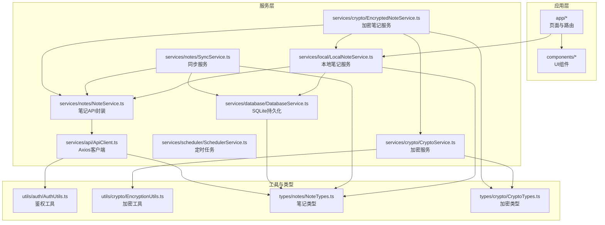

图表来源

- [services/index.ts](file://services/index.ts#L1-L82)
- [services/api/ApiClient.ts](file://services/api/ApiClient.ts#L1-L92)
- [services/notes/NoteService.ts](file://services/notes/NoteService.ts#L1-L84)
- [services/notes/SyncService.ts](file://services/notes/SyncService.ts#L1-L58)
- [services/database/DatabaseService.ts](file://services/database/DatabaseService.ts#L1-L513)
- [services/local/LocalNoteService.ts](file://services/local/LocalNoteService.ts#L1-L601)
- [services/scheduler/SchedulerService.ts](file://services/scheduler/SchedulerService.ts#L1-L233)
- [services/crypto/CryptoService.ts](file://services/crypto/CryptoService.ts#L1-L205)
- [services/crypto/EncryptedNoteService.ts](file://services/crypto/EncryptedNoteService.ts#L1-L186)
- [utils/auth/AuthUtils.ts](file://utils/auth/AuthUtils.ts#L1-L65)
- [utils/crypto/EncryptionUtils.ts](file://utils/crypto/EncryptionUtils.ts#L1-L112)
- [types/notes/NoteTypes.ts](file://types/notes/NoteTypes.ts#L1-L109)
- [types/crypto/CryptoTypes.ts](file://types/crypto/CryptoTypes.ts#L1-L44)

章节来源

- [package.json](file://package.json#L1-L69)
- [app.json](file://app.json#L1-L40)

## 核心组件

- API 客户端（Axios）：统一请求/响应拦截、动态 baseURL、鉴权头注入、错误处理策略
- 笔记服务：对后端接口的封装，提供 CRUD、批量操作、导出/下载、同步
- 同步服务：协调本地与服务端的差异，处理软删除与更新合并
- 数据库服务（SQLite）：本地持久化、事务与队列化并发控制、软删除与同步状态管理
- 本地笔记服务：面向 UI 的业务封装，提供安全删除、批量操作、导出下载、统计
- 调度服务：定时同步与清理，保障数据一致性与空间回收
- 加密服务：AES 加密/解密、密钥生成与存储、元数据封装
- 加密笔记服务：端到端加密的笔记创建/读取/更新流程
- 鉴权工具：API Key/URL 的安全存储与校验
- 加密工具：基于 CryptoService 的便捷函数

章节来源

- [services/api/ApiClient.ts](file://services/api/ApiClient.ts#L1-L92)
- [services/notes/NoteService.ts](file://services/notes/NoteService.ts#L1-L84)
- [services/notes/SyncService.ts](file://services/notes/SyncService.ts#L1-L58)
- [services/database/DatabaseService.ts](file://services/database/DatabaseService.ts#L1-L513)
- [services/local/LocalNoteService.ts](file://services/local/LocalNoteService.ts#L1-L601)
- [services/scheduler/SchedulerService.ts](file://services/scheduler/SchedulerService.ts#L1-L233)
- [services/crypto/CryptoService.ts](file://services/crypto/CryptoService.ts#L1-L205)
- [services/crypto/EncryptedNoteService.ts](file://services/crypto/EncryptedNoteService.ts#L1-L186)
- [utils/auth/AuthUtils.ts](file://utils/auth/AuthUtils.ts#L1-L65)
- [utils/crypto/EncryptionUtils.ts](file://utils/crypto/EncryptionUtils.ts#L1-L112)

## 架构总览

系统采用分层架构与模块化设计：

- 表现层：React/React Native + Expo Router 页面与组件
- 业务层：服务模块（笔记、同步、调度、加密）
- 数据访问层：SQLite 本地数据库 + Axios 远程 API
- 工具层：鉴权、加密工具与类型定义

事件驱动体现在调度服务的定时任务与数据库队列化操作；数据流贯穿“本地变更 -> 待同步状态 -> 定时同步 -> 服务端 -> 本地落库/更新”。

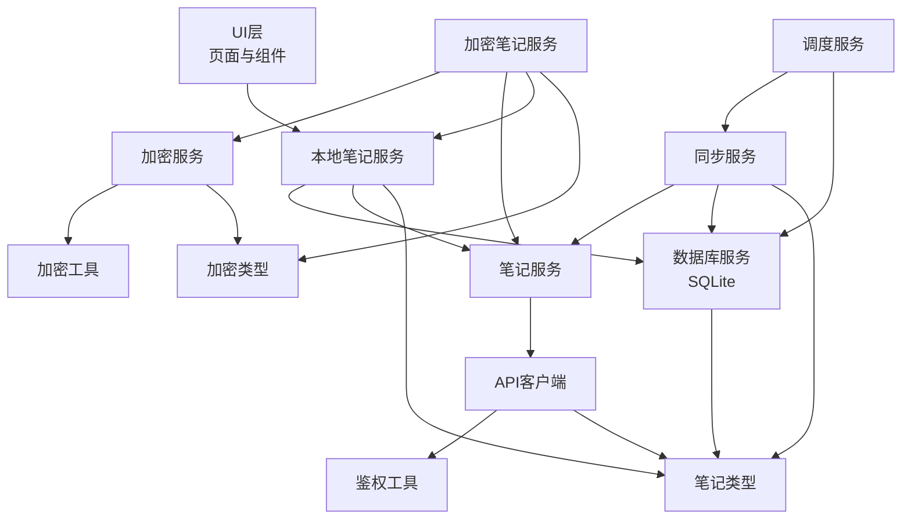

图表来源

- [services/local/LocalNoteService.ts](file://services/local/LocalNoteService.ts#L1-L601)
- [services/database/DatabaseService.ts](file://services/database/DatabaseService.ts#L1-L513)
- [services/notes/NoteService.ts](file://services/notes/NoteService.ts#L1-L84)
- [services/notes/SyncService.ts](file://services/notes/SyncService.ts#L1-L58)
- [services/scheduler/SchedulerService.ts](file://services/scheduler/SchedulerService.ts#L1-L233)
- [services/api/ApiClient.ts](file://services/api/ApiClient.ts#L1-L92)
- [services/crypto/CryptoService.ts](file://services/crypto/CryptoService.ts#L1-L205)
- [services/crypto/EncryptedNoteService.ts](file://services/crypto/EncryptedNoteService.ts#L1-L186)
- [utils/auth/AuthUtils.ts](file://utils/auth/AuthUtils.ts#L1-L65)
- [utils/crypto/EncryptionUtils.ts](file://utils/crypto/EncryptionUtils.ts#L1-L112)
- [types/notes/NoteTypes.ts](file://types/notes/NoteTypes.ts#L1-L109)
- [types/crypto/CryptoTypes.ts](file://types/crypto/CryptoTypes.ts#L1-L44)

## 详细组件分析

### 应用初始化与服务注册

- 初始化服务负责启动调度服务，设置同步与清理周期，避免重复初始化
- 通过静态单例模式管理生命周期，提供销毁能力

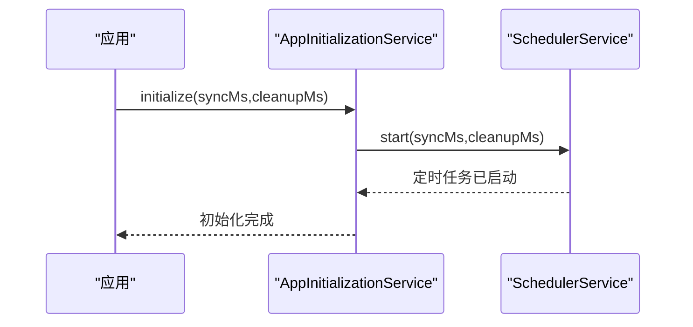

图表来源

- [services/AppInitializationService.ts](file://services/AppInitializationService.ts#L1-L63)
- [services/scheduler/SchedulerService.ts](file://services/scheduler/SchedulerService.ts#L1-L233)

章节来源

- [services/AppInitializationService.ts](file://services/AppInitializationService.ts#L1-L63)

### API 客户端与鉴权

- 请求拦截器：动态设置 baseURL（来自安全存储或环境变量），注入 Authorization 头
- 响应拦截器：统一处理 401/403/404/500，区分删除场景的错误处理
- 超时与网络错误：明确日志输出，避免泄露敏感信息

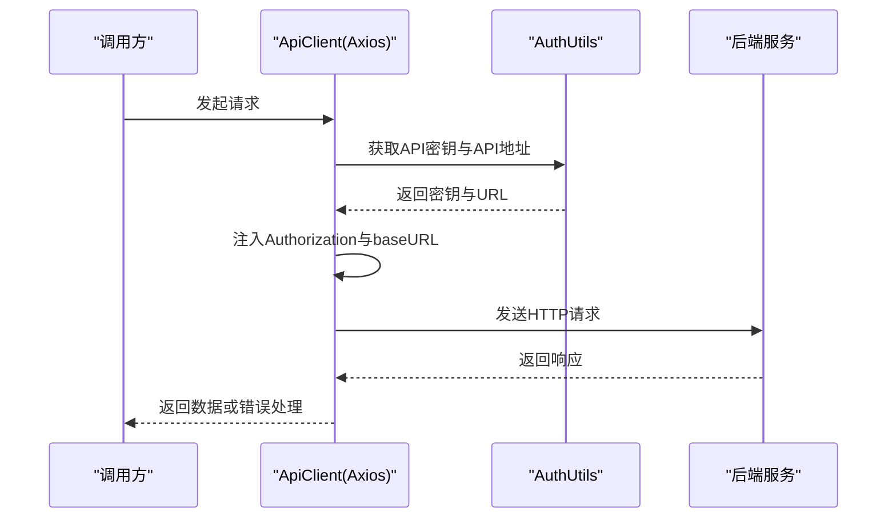

图表来源

- [services/api/ApiClient.ts](file://services/api/ApiClient.ts#L1-L92)
- [utils/auth/AuthUtils.ts](file://utils/auth/AuthUtils.ts#L1-L65)

章节来源

- [services/api/ApiClient.ts](file://services/api/ApiClient.ts#L1-L92)
- [utils/auth/AuthUtils.ts](file://utils/auth/AuthUtils.ts#L1-L65)

### 笔记服务与同步

- 笔记服务封装 CRUD、批量操作、导出/下载、同步
- 同步服务：拉取本地全部笔记（含软删除），构造请求体，调用后端同步接口，回写数据库并更新同步状态

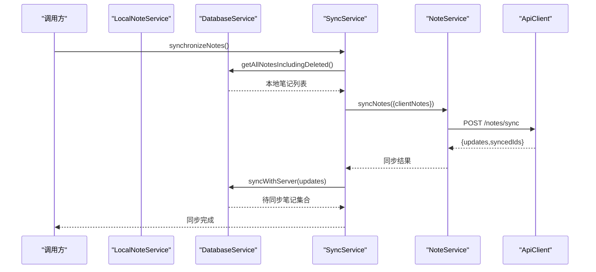

图表来源

- [services/notes/SyncService.ts](file://services/notes/SyncService.ts#L1-L58)
- [services/notes/NoteService.ts](file://services/notes/NoteService.ts#L1-L84)
- [services/database/DatabaseService.ts](file://services/database/DatabaseService.ts#L1-L513)
- [services/api/ApiClient.ts](file://services/api/ApiClient.ts#L1-L92)

章节来源

- [services/notes/NoteService.ts](file://services/notes/NoteService.ts#L1-L84)
- [services/notes/SyncService.ts](file://services/notes/SyncService.ts#L1-L58)
- [services/database/DatabaseService.ts](file://services/database/DatabaseService.ts#L1-L513)

### 本地笔记服务与安全删除

- 提供安全删除：先检查服务端是否存在，再执行本地软删除，同步到服务端，失败时保留本地待同步状态
- 批量删除：支持网络错误静默处理，逐个兜底同步
- 导出/下载：将本地笔记导出为 JSON Blob

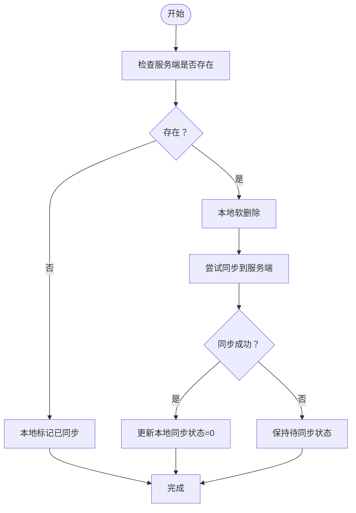

图表来源

- [services/local/LocalNoteService.ts](file://services/local/LocalNoteService.ts#L231-L292)

章节来源

- [services/local/LocalNoteService.ts](file://services/local/LocalNoteService.ts#L1-L601)

### 数据库服务与并发控制

- 数据库实例懒加载与初始化竞态保护
- 操作队列化与重入锁，避免嵌套调用死锁
- 事务内批量操作，保证原子性
- 内存 Map 对比优化同步性能

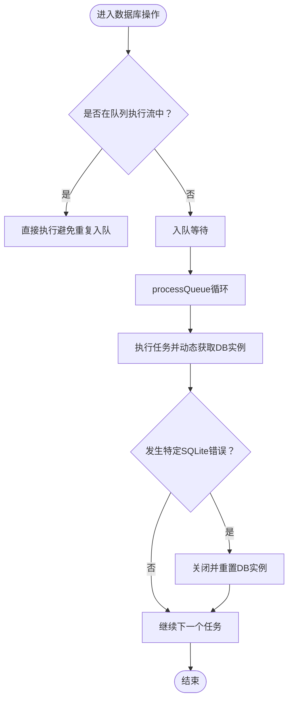

图表来源

- [services/database/DatabaseService.ts](file://services/database/DatabaseService.ts#L62-L115)

章节来源

- [services/database/DatabaseService.ts](file://services/database/DatabaseService.ts#L1-L513)

### 调度服务与定时任务

- 启动时立即执行一次同步与清理
- 定时同步：分离软删除与普通笔记，分别处理
- 定时清理：物理删除已同步的软删除笔记
- 网络错误静默处理，避免阻塞本地流程

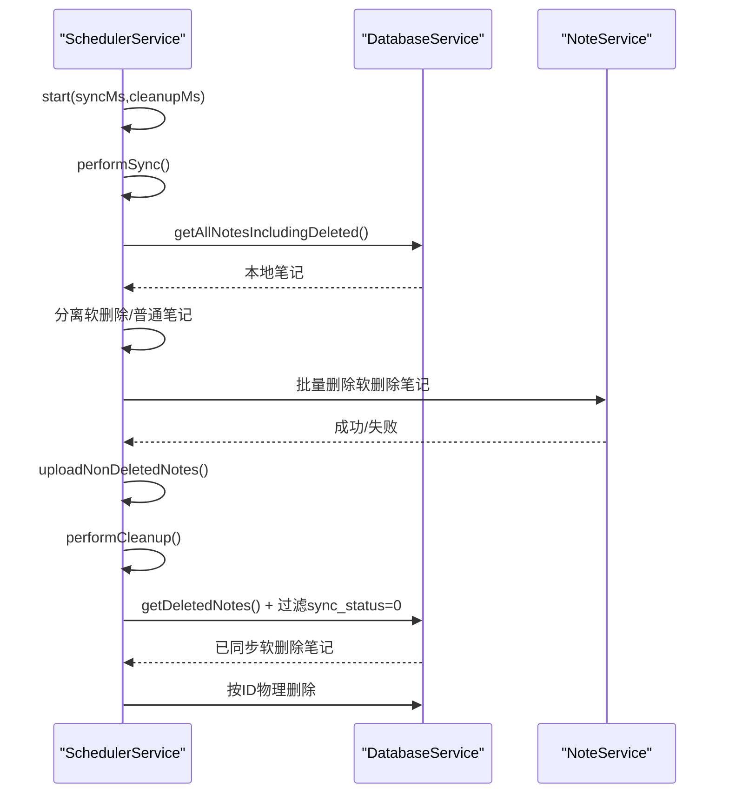

图表来源

- [services/scheduler/SchedulerService.ts](file://services/scheduler/SchedulerService.ts#L1-L233)
- [services/database/DatabaseService.ts](file://services/database/DatabaseService.ts#L1-L513)
- [services/notes/NoteService.ts](file://services/notes/NoteService.ts#L1-L84)

章节来源

- [services/scheduler/SchedulerService.ts](file://services/scheduler/SchedulerService.ts#L1-L233)

### 加密服务与端到端加密

- 加密服务：AES 加密/解密、密钥生成、元数据封装
- 加密笔记服务：统一密钥存储与复用，创建/读取/更新时自动加解密
- 加密工具：便捷函数封装

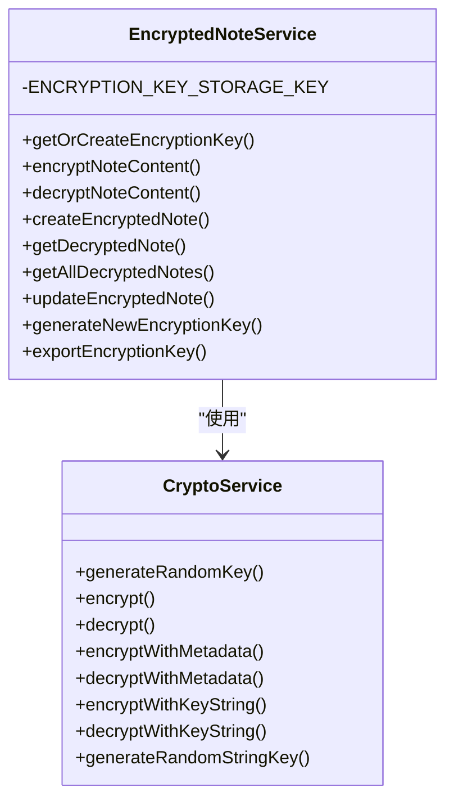

图表来源

- [services/crypto/CryptoService.ts](file://services/crypto/CryptoService.ts#L1-L205)
- [services/crypto/EncryptedNoteService.ts](file://services/crypto/EncryptedNoteService.ts#L1-L186)

章节来源

- [services/crypto/CryptoService.ts](file://services/crypto/CryptoService.ts#L1-L205)
- [services/crypto/EncryptedNoteService.ts](file://services/crypto/EncryptedNoteService.ts#L1-L186)
- [utils/crypto/EncryptionUtils.ts](file://utils/crypto/EncryptionUtils.ts#L1-L112)

## 依赖分析

- 技术栈与版本要点
  - React 19、React Native 0.81、Expo 54、Expo Router
  - Axios 作为 HTTP 客户端
  - Expo SQLite、AsyncStorage、Secure Store 提供本地持久化与安全存储
  - react-native-quick-crypto 与 buffer 提供原生加密能力
  - Tailwind/Nativewind 用于样式

- 关键外部依赖与用途
  - @react-native-async-storage/async-storage：持久化配置与密钥
  - expo-secure-store：安全存储 API Key/加密密钥
  - expo-sqlite：本地数据库
  - react-native-quick-crypto：AES 加密
  - dayjs：时间处理
  - react-native-reanimated、worklets：动画与性能

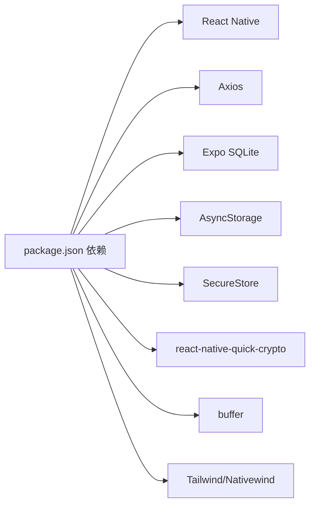

图表来源

- [package.json](file://package.json#L14-L41)

章节来源

- [package.json](file://package.json#L1-L69)

## 性能考量

- 数据库并发：队列化与重入锁避免死锁；事务内批量操作保证原子性
- 同步性能：内存 Map 一次性构建本地索引，减少循环查询
- 网络容错：删除与同步场景对网络错误静默处理，提升可用性
- 定时任务：按需拆分同步与清理任务，降低峰值负载

## 故障排查指南

- API 网络错误/超时：查看请求拦截器日志，确认 baseURL 与 API Key 注入情况
- 401/403：检查鉴权工具中的密钥存储与格式
- 404：在删除场景下为预期行为，注意与业务逻辑结合
- 数据库异常：关注特定 SQLite 错误提示，系统会自动重置数据库实例
- 加密异常：确认密钥存储与格式，避免密钥长度不匹配

章节来源

- [services/api/ApiClient.ts](file://services/api/ApiClient.ts#L44-L89)
- [utils/auth/AuthUtils.ts](file://utils/auth/AuthUtils.ts#L1-L65)
- [services/database/DatabaseService.ts](file://services/database/DatabaseService.ts#L79-L94)

## 结论

本架构以模块化与分层为核心，结合事件驱动（定时任务）与强健的本地持久化策略，实现了高可用、可扩展的笔记应用。通过加密服务与安全存储保障数据隐私，通过数据库队列化与事务优化提升性能与一致性。建议在后续迭代中引入更细粒度的监控埋点与灾备策略，持续优化用户体验与系统韧性。

## 附录

- 系统上下文图（概念性）

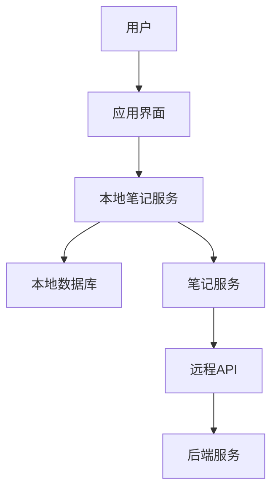

- 部署拓扑（概念性）
  - 移动端：React Native 应用（Expo）
  - 服务端：REST API（由 Axios 客户端对接）
  - 数据库：SQLite（移动端）+ 远端数据库（服务端）

- 可扩展性建议
  - 引入缓存层（如内存缓存）减少频繁查询
  - 增加指标采集与告警（监控同步成功率、数据库队列长度、网络错误率）
  - 灾难恢复：定期导出/备份本地笔记，支持密钥迁移与恢复
