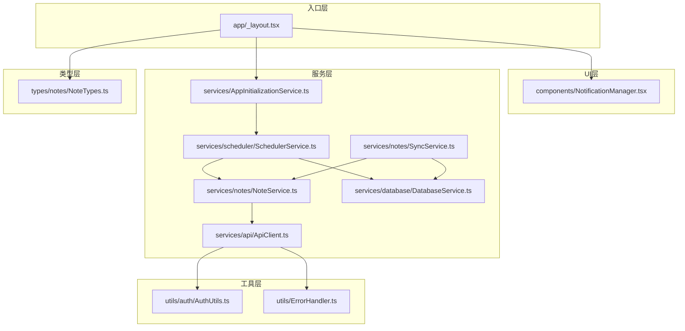
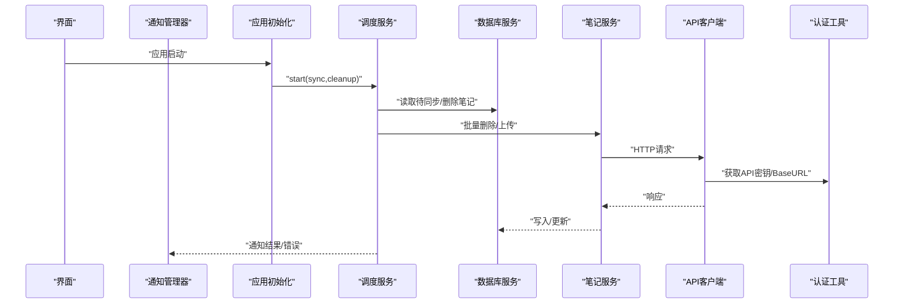
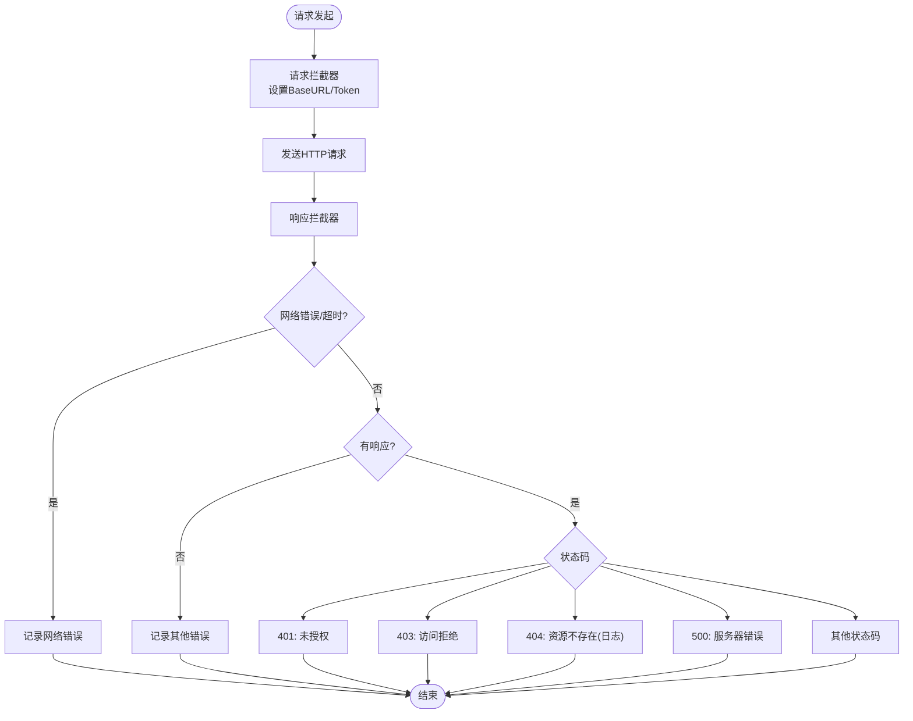
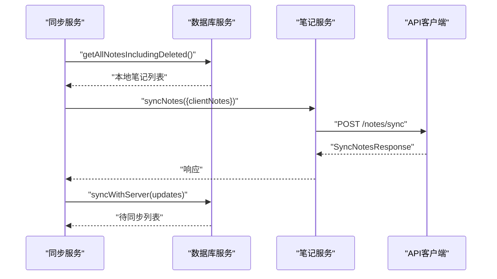
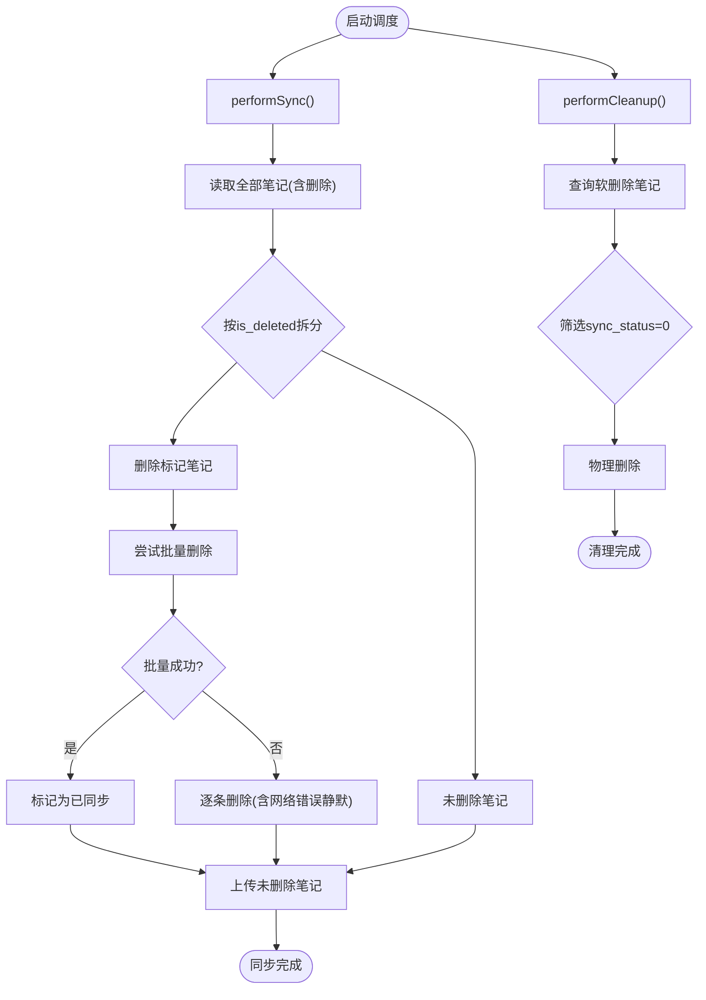
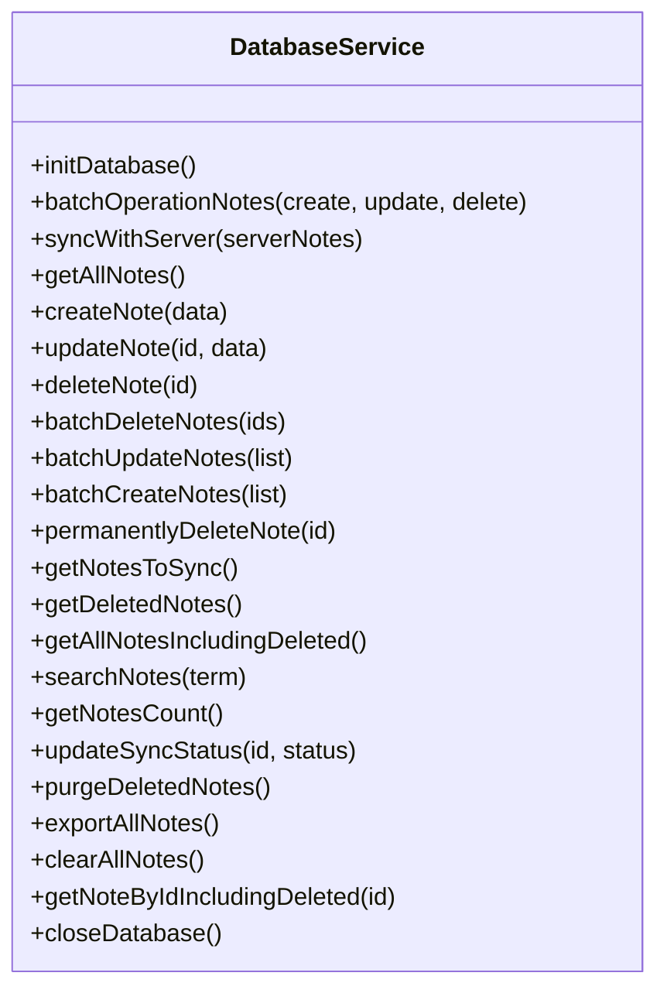
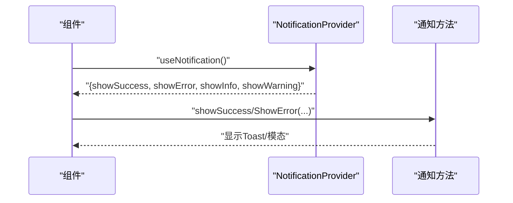
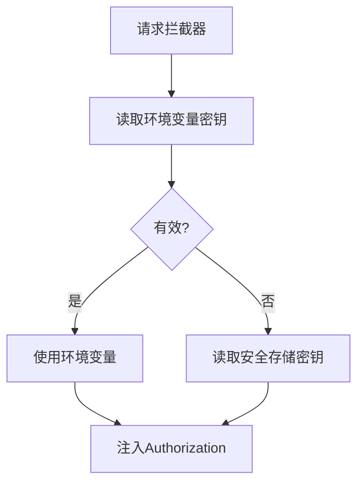
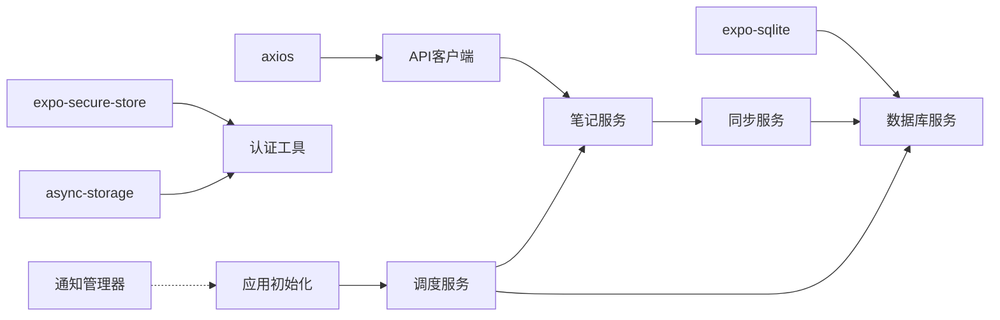

# 集成模式

<cite>
**本文引用的文件**
- [services/api/ApiClient.ts](file://services/api/ApiClient.ts)
- [services/notes/NoteService.ts](file://services/notes/NoteService.ts)
- [services/notes/SyncService.ts](file://services/notes/SyncService.ts)
- [services/scheduler/SchedulerService.ts](file://services/scheduler/SchedulerService.ts)
- [services/AppInitializationService.ts](file://services/AppInitializationService.ts)
- [services/database/DatabaseService.ts](file://services/database/DatabaseService.ts)
- [utils/auth/AuthUtils.ts](file://utils/auth/AuthUtils.ts)
- [utils/ErrorHandler.ts](file://utils/ErrorHandler.ts)
- [components/NotificationManager.tsx](file://components/NotificationManager.tsx)
- [types/notes/NoteTypes.ts](file://types/notes/NoteTypes.ts)
- [services/index.ts](file://services/index.ts)
- [app/_layout.tsx](file://app/_layout.tsx)
- [package.json](file://package.json)
</cite>

## 目录

1. [简介](#简介)
2. [项目结构](#项目结构)
3. [核心组件](#核心组件)
4. [架构总览](#架构总览)
5. [详细组件分析](#详细组件分析)
6. [依赖分析](#依赖分析)
7. [性能考虑](#性能考虑)
8. [故障排查指南](#故障排查指南)
9. [结论](#结论)
10. [附录](#附录)

## 简介

本文件面向Notes应用的集成模式，系统化阐述应用与外部系统的集成策略，涵盖RESTful API集成、定时任务调度与通知系统集成；解释API客户端设计模式、请求重试与错误处理策略；说明调度服务实现原理、任务队列管理与执行监控机制；梳理第三方服务集成、SDK使用与依赖管理策略；并提供集成测试策略、监控告警与故障恢复建议，以及版本兼容与升级策略。

## 项目结构

应用采用按职责分层的服务化组织方式：

- 服务层：API客户端、笔记服务、同步服务、调度服务、数据库服务、应用初始化服务
- 工具层：认证工具、错误处理工具
- 类型层：笔记与同步相关类型定义
- UI层：通知管理器组件
- 入口层：应用布局负责初始化与全局通知提供

**图表来源**

- [app/\_layout.tsx](file://app/_layout.tsx#L32-L62)
- [services/AppInitializationService.ts](file://services/AppInitializationService.ts#L16-L37)
- [services/scheduler/SchedulerService.ts](file://services/scheduler/SchedulerService.ts#L23-L50)
- [services/notes/NoteService.ts](file://services/notes/NoteService.ts#L18-L18)
- [services/notes/SyncService.ts](file://services/notes/SyncService.ts#L13-L36)
- [services/api/ApiClient.ts](file://services/api/ApiClient.ts#L6-L41)
- [utils/auth/AuthUtils.ts](file://utils/auth/AuthUtils.ts#L27-L30)
- [utils/ErrorHandler.ts](file://utils/ErrorHandler.ts#L18-L47)
- [services/database/DatabaseService.ts](file://services/database/DatabaseService.ts#L18-L56)

**章节来源**

- [app/\_layout.tsx](file://app/_layout.tsx#L32-L62)
- [services/index.ts](file://services/index.ts#L1-L82)

## 核心组件

- API客户端：基于Axios封装，统一请求/响应拦截、动态BaseURL与鉴权头注入、错误分类处理与网络错误识别
- 笔记服务：封装REST接口（分页、CRUD、批量、同步）
- 同步服务：协调本地笔记与服务端的双向同步
- 调度服务：周期性执行同步与清理任务，处理删除标记与网络异常
- 数据库服务：SQLite封装，提供队列化与事务化操作、状态字段与软删除
- 认证工具：安全存储API密钥与URL，格式校验与回退策略
- 错误处理工具：统一错误分类与日志策略
- 通知管理器：跨平台Toast与模态通知
- 应用初始化服务：启动定时任务与生命周期管理

**章节来源**

- [services/api/ApiClient.ts](file://services/api/ApiClient.ts#L6-L92)
- [services/notes/NoteService.ts](file://services/notes/NoteService.ts#L18-L84)
- [services/notes/SyncService.ts](file://services/notes/SyncService.ts#L13-L58)
- [services/scheduler/SchedulerService.ts](file://services/scheduler/SchedulerService.ts#L13-L233)
- [services/database/DatabaseService.ts](file://services/database/DatabaseService.ts#L18-L513)
- [utils/auth/AuthUtils.ts](file://utils/auth/AuthUtils.ts#L27-L65)
- [utils/ErrorHandler.ts](file://utils/ErrorHandler.ts#L18-L48)
- [components/NotificationManager.tsx](file://components/NotificationManager.tsx#L34-L174)
- [services/AppInitializationService.ts](file://services/AppInitializationService.ts#L16-L60)

## 架构总览

应用通过API客户端与服务端交互，笔记服务提供REST方法，同步服务负责数据一致性，调度服务周期性触发同步与清理，数据库服务承载本地数据与状态，通知管理器提供用户反馈，认证工具保障凭据安全，错误处理工具统一日志与告警。

**图表来源**

- [app/\_layout.tsx](file://app/_layout.tsx#L38-L44)
- [services/AppInitializationService.ts](file://services/AppInitializationService.ts#L28-L29)
- [services/scheduler/SchedulerService.ts](file://services/scheduler/SchedulerService.ts#L73-L98)
- [services/notes/NoteService.ts](file://services/notes/NoteService.ts#L57-L70)
- [services/api/ApiClient.ts](file://services/api/ApiClient.ts#L17-L41)
- [utils/auth/AuthUtils.ts](file://utils/auth/AuthUtils.ts#L27-L30)
- [components/NotificationManager.tsx](file://components/NotificationManager.tsx#L83-L101)

## 详细组件分析

### API客户端与REST集成

- 设计模式
  - Axios实例化与拦截器：统一设置超时、内容类型、动态BaseURL与Authorization头
  - 请求拦截：异步获取API地址与密钥，清洗URL尾部斜杠，注入Bearer Token
  - 响应拦截：按状态码分类处理；区分网络错误、超时、404等；对删除操作单独处理
- 错误处理策略
  - 网络错误/超时：仅记录简要信息，避免泄露细节
  - 4xx/5xx：按状态码映射处理；404作为常见场景记录日志
  - 删除操作：对网络错误可静默处理，避免阻塞本地流程
- 重试机制
  - 当前未内置自动重试；可在上层业务（如调度服务）根据场景引入指数退避策略

**图表来源**

- [services/api/ApiClient.ts](file://services/api/ApiClient.ts#L17-L89)
- [utils/ErrorHandler.ts](file://utils/ErrorHandler.ts#L18-L47)

**章节来源**

- [services/api/ApiClient.ts](file://services/api/ApiClient.ts#L6-L92)
- [utils/ErrorHandler.ts](file://utils/ErrorHandler.ts#L18-L48)

### 笔记服务与同步服务

- 笔记服务
  - 提供分页查询、详情、CRUD、批量删除/写入、全量同步等REST方法
  - 所有调用均通过API客户端，确保统一鉴权与错误处理
- 同步服务
  - 将本地全部笔记打包发送至服务端，接收服务端差异更新并落库
  - 返回结构包含更新项与已同步ID集合，便于后续状态同步

**图表来源**

- [services/notes/SyncService.ts](file://services/notes/SyncService.ts#L13-L36)
- [services/notes/NoteService.ts](file://services/notes/NoteService.ts#L69-L70)
- [services/database/DatabaseService.ts](file://services/database/DatabaseService.ts#L211-L260)

**章节来源**

- [services/notes/NoteService.ts](file://services/notes/NoteService.ts#L18-L84)
- [services/notes/SyncService.ts](file://services/notes/SyncService.ts#L13-L58)
- [services/database/DatabaseService.ts](file://services/database/DatabaseService.ts#L211-L260)

### 调度服务与任务队列

- 实现原理
  - 启动时立即执行一次同步与清理，随后按配置间隔循环执行
  - 同步阶段：分离删除与未删除笔记，分别处理批量删除与上传
  - 删除同步：优先批量删除，失败时逐条重试；网络错误时本地也标记为已同步，避免重复尝试
  - 清理阶段：物理删除本地已同步的软删除笔记
- 任务队列管理
  - 使用单线程队列保证数据库操作串行化，避免竞态与死锁
  - 事务化批量操作，提升吞吐与一致性
- 执行监控
  - 关键步骤均输出日志，便于观察执行进度与异常

**图表来源**

- [services/scheduler/SchedulerService.ts](file://services/scheduler/SchedulerService.ts#L23-L233)
- [services/database/DatabaseService.ts](file://services/database/DatabaseService.ts#L400-L451)

**章节来源**

- [services/scheduler/SchedulerService.ts](file://services/scheduler/SchedulerService.ts#L13-L233)
- [services/database/DatabaseService.ts](file://services/database/DatabaseService.ts#L62-L115)

### 数据库服务与状态管理

- 数据库实例获取与初始化
  - 首次打开时创建表结构，失败重试与超时轮询
- 任务队列与并发控制
  - 单队列串行执行，避免嵌套调用导致死锁
  - 特定SQLite错误自动重置数据库实例
- 批量操作与事务
  - 批量删除/更新/创建在事务内执行，保证原子性
- 同步对比优化
  - 内存Map构建本地索引，减少循环查询与死锁风险
- 状态字段
  - is_deleted：软删除标记
  - sync_status：同步状态（0已同步，1待同步）

**图表来源**

- [services/database/DatabaseService.ts](file://services/database/DatabaseService.ts#L147-L513)

**章节来源**

- [services/database/DatabaseService.ts](file://services/database/DatabaseService.ts#L18-L513)

### 通知系统集成

- 通知提供器
  - 提供成功/错误/信息/警告四类通知
  - Android使用Toast，iOS使用自定义模态
- 使用方式
  - 通过上下文钩子useNotification在组件中调用
- 与调度服务联动
  - 在同步/清理失败或完成时触发通知，提升可观测性

**图表来源**

- [components/NotificationManager.tsx](file://components/NotificationManager.tsx#L22-L101)

**章节来源**

- [components/NotificationManager.tsx](file://components/NotificationManager.tsx#L34-L174)

### 认证与安全

- API密钥与URL存储
  - 使用安全存储与异步存储分别保存密钥与URL
  - 支持环境变量回退，开发/生产协议校验
- 请求注入
  - 请求拦截器动态读取并注入Authorization头

**图表来源**

- [utils/auth/AuthUtils.ts](file://utils/auth/AuthUtils.ts#L27-L30)
- [services/api/ApiClient.ts](file://services/api/ApiClient.ts#L17-L35)

**章节来源**

- [utils/auth/AuthUtils.ts](file://utils/auth/AuthUtils.ts#L11-L65)
- [services/api/ApiClient.ts](file://services/api/ApiClient.ts#L17-L35)

## 依赖分析

- 外部依赖
  - axios：HTTP客户端
  - expo-sqlite：本地数据库
  - expo-secure-store/async-storage：凭据与配置存储
  - react-native-reanimated：动画与通知
- 内部依赖
  - API客户端依赖认证工具与错误处理
  - 笔记/同步服务依赖API客户端与数据库服务
  - 调度服务依赖笔记/同步服务与数据库服务
  - 应用初始化服务依赖调度服务
  - 通知管理器独立于业务逻辑

**图表来源**

- [package.json](file://package.json#L14-L40)
- [services/api/ApiClient.ts](file://services/api/ApiClient.ts#L1-L3)
- [utils/auth/AuthUtils.ts](file://utils/auth/AuthUtils.ts#L1-L2)
- [services/database/DatabaseService.ts](file://services/database/DatabaseService.ts#L1-L1)
- [services/notes/NoteService.ts](file://services/notes/NoteService.ts#L18-L18)
- [services/notes/SyncService.ts](file://services/notes/SyncService.ts#L1-L3)
- [services/scheduler/SchedulerService.ts](file://services/scheduler/SchedulerService.ts#L1-L7)
- [services/AppInitializationService.ts](file://services/AppInitializationService.ts#L1-L1)
- [components/NotificationManager.tsx](file://components/NotificationManager.tsx#L1-L11)

**章节来源**

- [package.json](file://package.json#L14-L40)
- [services/index.ts](file://services/index.ts#L1-L82)

## 性能考虑

- 数据库并发
  - 单队列串行化与事务化批量操作，降低锁竞争与死锁概率
- 同步对比
  - 内存Map预构建本地索引，减少循环查询与IO
- 网络与重试
  - 建议在上层业务引入指数退避与抖动，避免雪崩
- 通知与渲染
  - Toast与模态按需触发，避免频繁重渲染

[本节为通用指导，无需具体文件引用]

## 故障排查指南

- API网络错误/超时
  - 检查请求拦截器注入的BaseURL与Token
  - 观察响应拦截器日志，确认是否为网络错误
- 删除操作失败
  - 若为网络错误，调度服务会静默处理并标记为已同步
  - 非网络错误时，逐条删除并记录失败明细
- 数据库异常
  - 特定SQLite错误会触发数据库实例重置，若持续失败，检查磁盘空间与权限
- 通知未显示
  - 确认NotificationProvider包裹范围与useNotification调用位置

**章节来源**

- [services/api/ApiClient.ts](file://services/api/ApiClient.ts#L51-L89)
- [utils/ErrorHandler.ts](file://utils/ErrorHandler.ts#L18-L47)
- [services/scheduler/SchedulerService.ts](file://services/scheduler/SchedulerService.ts#L104-L176)
- [services/database/DatabaseService.ts](file://services/database/DatabaseService.ts#L79-L94)
- [components/NotificationManager.tsx](file://components/NotificationManager.tsx#L83-L101)

## 结论

本集成模式以API客户端为核心，结合笔记/同步服务、调度服务与数据库服务，形成闭环的数据一致性与自动化运维能力。通过统一的错误处理与通知体系，提升了可观测性与用户体验。建议在现有基础上补充网络重试与监控告警，进一步增强稳定性与可维护性。

[本节为总结，无需具体文件引用]

## 附录

### API定义概览

- 笔记相关
  - GET /notes?page&limit&search
  - GET /notes/:id
  - POST /notes
  - PATCH /notes/:id
  - DELETE /notes/:id
  - DELETE /notes/batch
  - POST /notes/batch
  - POST /notes/sync
- 导出相关
  - GET /notes/export/all (JSON)
  - GET /notes/export/all (Blob)

**章节来源**

- [services/notes/NoteService.ts](file://services/notes/NoteService.ts#L22-L70)
- [types/notes/NoteTypes.ts](file://types/notes/NoteTypes.ts#L14-L108)

### 集成测试策略

- 单元测试
  - API客户端：模拟请求/响应、错误分支、拦截器行为
  - 数据库服务：队列化与事务化操作、错误恢复
  - 同步服务：本地与服务端差异对比、状态更新
- 集成测试
  - 端到端：启动调度服务，验证同步/清理流程与通知
  - 回放测试：构造不同网络与数据库异常场景，验证降级策略
- 监控与告警
  - 关键日志埋点：同步开始/完成、删除批次统计、清理数量
  - 告警阈值：连续失败次数、平均耗时、数据库重置次数

[本节为通用指导，无需具体文件引用]

### 版本兼容与升级策略

- API版本
  - 通过BaseURL与路径前缀管理多版本端点，保持向后兼容
- 客户端升级
  - 类型定义变更需同步更新，避免运行时错误
  - 新增字段建议默认值与容错处理
- 依赖升级
  - 严格遵循语义化版本，先在预发验证再灰度发布
  - 对数据库Schema变更采用迁移脚本或兼容读取

**章节来源**

- [utils/auth/AuthUtils.ts](file://utils/auth/AuthUtils.ts#L42-L53)
- [types/notes/NoteTypes.ts](file://types/notes/NoteTypes.ts#L99-L108)
