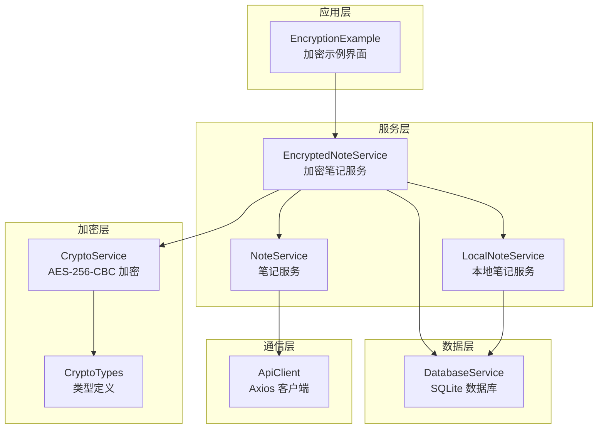
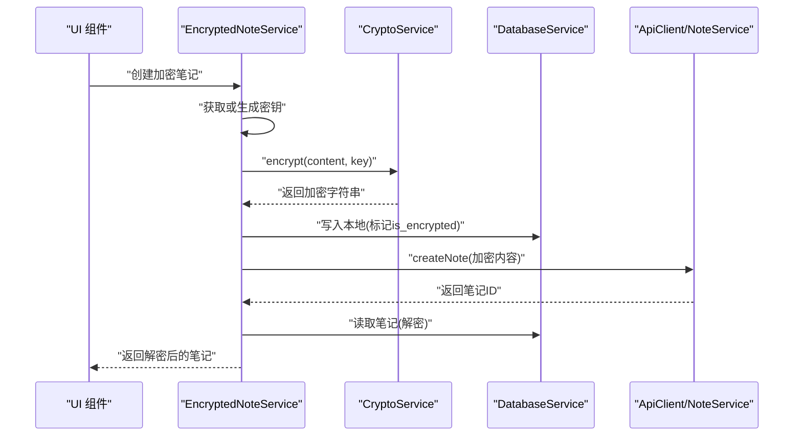
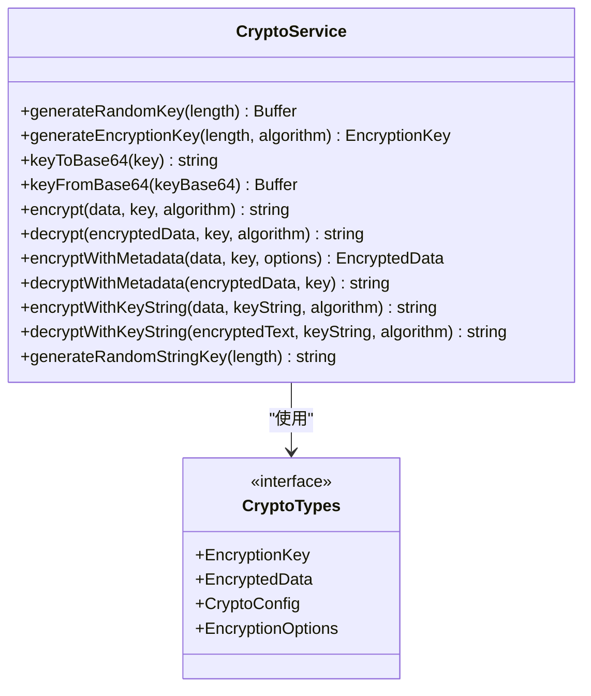
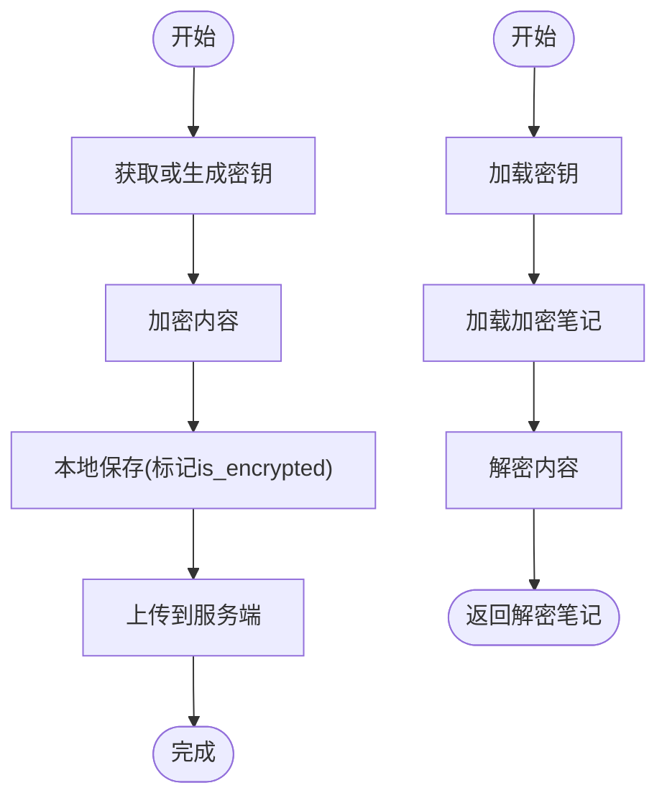
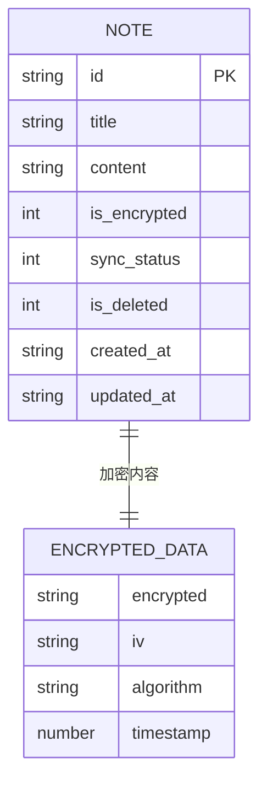
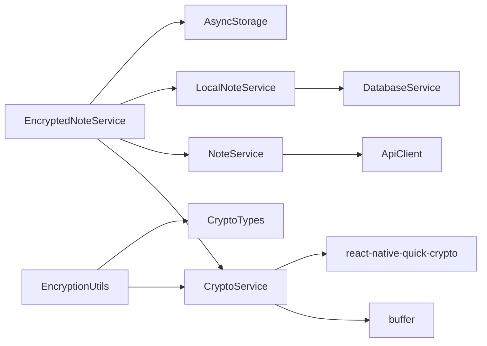

# 加密服务

<cite>
**本文引用的文件**
- [CryptoService.ts](file://services/crypto/CryptoService.ts)
- [EncryptedNoteService.ts](file://services/crypto/EncryptedNoteService.ts)
- [CryptoTypes.ts](file://types/crypto/CryptoTypes.ts)
- [EncryptionUtils.ts](file://utils/crypto/EncryptionUtils.ts)
- [ApiClient.ts](file://services/api/ApiClient.ts)
- [NoteService.ts](file://services/notes/NoteService.ts)
- [LocalNoteService.ts](file://services/local/LocalNoteService.ts)
- [NoteTypes.ts](file://types/notes/NoteTypes.ts)
- [EncryptionExample.tsx](file://components/EncryptionExample.tsx)
- [AuthUtils.ts](file://utils/auth/AuthUtils.ts)
- [DatabaseService.ts](file://services/database/DatabaseService.ts)
- [package.json](file://package.json)
</cite>

## 目录

1. [简介](#简介)
2. [项目结构](#项目结构)
3. [核心组件](#核心组件)
4. [架构总览](#架构总览)
5. [详细组件分析](#详细组件分析)
6. [依赖关系分析](#依赖关系分析)
7. [性能考量](#性能考量)
8. [故障排查指南](#故障排查指南)
9. [结论](#结论)
10. [附录](#附录)

## 简介

本加密服务基于 AES-256-CBC 实现，提供端到端加密能力，覆盖密钥生成、IV 处理、加密/解密流程、密钥管理策略、加密数据存储格式与元数据管理、以及与笔记系统集成的端到端安全传输机制。文档同时给出 API 接口说明、安全威胁分析与防护建议，帮助开发者理解并正确使用该加密体系。

## 项目结构

加密服务主要由以下模块组成：

- 加密核心：CryptoService 提供 AES-256-CBC 的密钥生成、加密、解密、元数据封装等能力
- 工具层：EncryptionUtils 提供便捷的加密/解密与密钥生成函数
- 笔记加密服务：EncryptedNoteService 负责密钥持久化、笔记内容的加解密与与笔记服务的集成
- 类型定义：CryptoTypes 定义加密相关的数据结构
- 数据层：DatabaseService 提供本地 SQLite 访问与同步状态管理
- 通信层：ApiClient 提供统一的 API 客户端与拦截器
- UI 示例：EncryptionExample 展示加密/解密的交互示例

图表来源

- [EncryptedNoteService.ts](file://services/crypto/EncryptedNoteService.ts#L1-L186)
- [CryptoService.ts](file://services/crypto/CryptoService.ts#L1-L205)
- [NoteService.ts](file://services/notes/NoteService.ts#L1-L84)
- [LocalNoteService.ts](file://services/local/LocalNoteService.ts#L1-L601)
- [DatabaseService.ts](file://services/database/DatabaseService.ts#L1-L513)
- [ApiClient.ts](file://services/api/ApiClient.ts#L1-L92)
- [CryptoTypes.ts](file://types/crypto/CryptoTypes.ts#L1-L44)
- [EncryptionExample.tsx](file://components/EncryptionExample.tsx#L1-L233)

章节来源

- [EncryptedNoteService.ts](file://services/crypto/EncryptedNoteService.ts#L1-L186)
- [CryptoService.ts](file://services/crypto/CryptoService.ts#L1-L205)
- [NoteService.ts](file://services/notes/NoteService.ts#L1-L84)
- [LocalNoteService.ts](file://services/local/LocalNoteService.ts#L1-L601)
- [DatabaseService.ts](file://services/database/DatabaseService.ts#L1-L513)
- [ApiClient.ts](file://services/api/ApiClient.ts#L1-L92)
- [CryptoTypes.ts](file://types/crypto/CryptoTypes.ts#L1-L44)
- [EncryptionExample.tsx](file://components/EncryptionExample.tsx#L1-L233)

## 核心组件

- CryptoService：提供 AES-256-CBC 加密、解密、密钥生成、密钥编解码、元数据封装等静态方法
- EncryptedNoteService：负责密钥的获取/生成/轮换、笔记内容的加解密、与笔记服务的集成
- EncryptionUtils：面向上层的便捷函数，封装 CryptoService 的常用操作
- CryptoTypes：定义 EncryptionKey、EncryptedData、CryptoConfig、EncryptionOptions 等类型
- DatabaseService：提供本地 SQLite 访问、批处理、事务、同步状态管理
- ApiClient：统一的 Axios 客户端，包含请求/响应拦截器与错误处理
- NoteService/LocalNoteService：笔记的远程与本地 CRUD、批量操作、同步

章节来源

- [CryptoService.ts](file://services/crypto/CryptoService.ts#L1-L205)
- [EncryptedNoteService.ts](file://services/crypto/EncryptedNoteService.ts#L1-L186)
- [EncryptionUtils.ts](file://utils/crypto/EncryptionUtils.ts#L1-L112)
- [CryptoTypes.ts](file://types/crypto/CryptoTypes.ts#L1-L44)
- [DatabaseService.ts](file://services/database/DatabaseService.ts#L1-L513)
- [ApiClient.ts](file://services/api/ApiClient.ts#L1-L92)
- [NoteService.ts](file://services/notes/NoteService.ts#L1-L84)
- [LocalNoteService.ts](file://services/local/LocalNoteService.ts#L1-L601)

## 架构总览

加密服务采用“端到端”设计：客户端生成/持有密钥，笔记内容在本地加密后再上传；服务端仅接收加密数据；解密仅在客户端完成。密钥通过安全存储持久化，支持密钥轮换；笔记的同步状态与本地数据库配合，保证在网络异常时仍可继续工作。

图表来源

- [EncryptedNoteService.ts](file://services/crypto/EncryptedNoteService.ts#L74-L89)
- [CryptoService.ts](file://services/crypto/CryptoService.ts#L65-L101)
- [DatabaseService.ts](file://services/database/DatabaseService.ts#L271-L281)
- [NoteService.ts](file://services/notes/NoteService.ts#L48-L52)

## 详细组件分析

### CryptoService 组件分析

- 密钥生成：使用原生随机数生成器生成 256 位密钥，支持自定义长度
- IV 处理：每次加密生成 16 字节随机 IV，与加密结果一起返回
- 加密/解密：采用 AES-256-CBC，自动填充，支持带元数据的封装
- 密钥编解码：提供 Buffer 与 Base64 互转，支持字符串密钥的哈希处理
- 元数据封装：EncryptedData 包含加密内容、IV、算法、时间戳

图表来源

- [CryptoService.ts](file://services/crypto/CryptoService.ts#L10-L205)
- [CryptoTypes.ts](file://types/crypto/CryptoTypes.ts#L5-L43)

章节来源

- [CryptoService.ts](file://services/crypto/CryptoService.ts#L10-L205)
- [CryptoTypes.ts](file://types/crypto/CryptoTypes.ts#L1-L44)

### EncryptedNoteService 组件分析

- 密钥管理：通过 AsyncStorage 存储 Base64 编码的密钥；首次运行自动生成并持久化
- 笔记加解密：对笔记内容进行加密存储；读取时解密返回
- 与笔记服务集成：创建/更新/获取笔记时，自动处理 is_encrypted 标志
- 密钥轮换：提供生成新密钥的方法，注意会破坏旧数据的可解密性

图表来源

- [EncryptedNoteService.ts](file://services/crypto/EncryptedNoteService.ts#L18-L131)

章节来源

- [EncryptedNoteService.ts](file://services/crypto/EncryptedNoteService.ts#L1-L186)

### EncryptionUtils 组件分析

- 提供高层封装：生成密钥、加密/解密文本、带元数据的加密/解密、字符串密钥的加解密、随机字符串密钥生成
- 与 CryptoService 解耦：通过工具函数屏蔽底层 Buffer/Base64 转换细节

章节来源

- [EncryptionUtils.ts](file://utils/crypto/EncryptionUtils.ts#L1-L112)

### 数据模型与存储格式

- 笔记实体：包含 id、title、content、is_encrypted、sync_status、is_deleted、created_at、updated_at
- 加密数据格式：加密字符串采用“IV:密文”的形式，其中 IV 与密文均为 Base64
- 元数据封装：EncryptedData 包含 encrypted、iv、algorithm、timestamp

图表来源

- [NoteTypes.ts](file://types/notes/NoteTypes.ts#L2-L11)
- [CryptoTypes.ts](file://types/crypto/CryptoTypes.ts#L16-L25)

章节来源

- [NoteTypes.ts](file://types/notes/NoteTypes.ts#L1-L109)
- [CryptoTypes.ts](file://types/crypto/CryptoTypes.ts#L1-L44)

### API 接口文档

- 笔记相关接口（NoteService）
  - GET /notes：分页获取笔记列表
  - GET /notes/:id：按 ID 获取笔记
  - POST /notes：创建笔记
  - PATCH /notes/:id：更新笔记
  - DELETE /notes/:id：删除笔记
  - POST /notes/sync：同步笔记
  - POST /notes/batch：批量操作笔记
  - GET /notes/export/all：导出所有笔记
- 加密服务工具函数（EncryptionUtils）
  - generateEncryptionKey(length=32) -> Base64 密钥
  - generateEncryptionKeyWithMetadata(length, algorithm='aes-256-cbc') -> EncryptionKey
  - encryptText(text, keyBase64) -> 加密字符串
  - encryptTextWithMetadata(text, keyBase64, options?) -> EncryptedData
  - decryptText(encryptedText, keyBase64) -> 明文
  - decryptTextWithMetadata(encryptedData, keyBase64) -> 明文
  - encryptTextWithStringKey(text, keyString) -> 加密字符串
  - decryptTextWithStringKey(encryptedText, keyString) -> 明文
  - generateRandomStringKey(length=32) -> 随机字符串密钥

章节来源

- [NoteService.ts](file://services/notes/NoteService.ts#L32-L70)
- [EncryptionUtils.ts](file://utils/crypto/EncryptionUtils.ts#L14-L111)

## 依赖关系分析

- CryptoService 依赖 react-native-quick-crypto 与 buffer，用于原生加密与随机数生成
- EncryptedNoteService 依赖 CryptoService、NoteService、LocalNoteService、AsyncStorage
- EncryptionUtils 依赖 CryptoService 与类型定义
- DatabaseService 提供本地 SQLite 访问与同步状态管理
- ApiClient 提供统一的 HTTP 客户端与拦截器

图表来源

- [CryptoService.ts](file://services/crypto/CryptoService.ts#L1-L4)
- [EncryptedNoteService.ts](file://services/crypto/EncryptedNoteService.ts#L1-L6)
- [EncryptionUtils.ts](file://utils/crypto/EncryptionUtils.ts#L1-L2)
- [LocalNoteService.ts](file://services/local/LocalNoteService.ts#L1-L17)
- [NoteService.ts](file://services/notes/NoteService.ts#L1-L18)
- [ApiClient.ts](file://services/api/ApiClient.ts#L1-L11)
- [package.json](file://package.json#L14-L41)

章节来源

- [package.json](file://package.json#L14-L41)
- [CryptoService.ts](file://services/crypto/CryptoService.ts#L1-L4)
- [EncryptedNoteService.ts](file://services/crypto/EncryptedNoteService.ts#L1-L6)
- [EncryptionUtils.ts](file://utils/crypto/EncryptionUtils.ts#L1-L2)
- [LocalNoteService.ts](file://services/local/LocalNoteService.ts#L1-L17)
- [NoteService.ts](file://services/notes/NoteService.ts#L1-L18)
- [ApiClient.ts](file://services/api/ApiClient.ts#L1-L11)

## 性能考量

- 批量加密/解密：建议在上层业务中合并多次调用，减少上下文切换与内存分配
- 内存管理：避免在 UI 循环中频繁创建大对象；复用 Buffer/字符串
- CPU 使用率控制：AES-256-CBC 为轻量级对称加密，通常不会成为瓶颈；注意避免在主线程执行大量加密任务
- I/O 优化：本地 SQLite 使用事务与批处理，减少磁盘写入次数；网络请求使用拦截器统一处理
- 异常与回退：网络错误时不阻塞本地操作，保证用户体验与数据一致性

[本节为通用性能建议，无需具体文件来源]

## 故障排查指南

- 加密数据格式错误：解密时若分割后的部分数量不为 2，会抛出格式错误；检查加密/解密是否使用同一密钥与算法
- 密钥长度不匹配：当字符串密钥长度不符合 256 位要求时，内部会进行哈希处理；确保密钥来源可靠
- 网络错误与超时：ApiClient 的响应拦截器对网络错误与超时进行统一处理；必要时重试或提示用户
- 本地数据库连接问题：DatabaseService 提供重入锁与队列机制，避免并发冲突；遇到连接异常会尝试重置实例
- 密钥轮换风险：轮换密钥会导致旧数据不可解密，应提前备份旧密钥或迁移数据

章节来源

- [CryptoService.ts](file://services/crypto/CryptoService.ts#L85-L88)
- [CryptoService.ts](file://services/crypto/CryptoService.ts#L165-L169)
- [ApiClient.ts](file://services/api/ApiClient.ts#L51-L89)
- [DatabaseService.ts](file://services/database/DatabaseService.ts#L62-L115)
- [EncryptedNoteService.ts](file://services/crypto/EncryptedNoteService.ts#L169-L173)

## 结论

该加密服务以 AES-256-CBC 为核心，结合本地密钥存储与端到端加密流程，实现了笔记内容的安全存储与传输。通过工具层封装与服务层集成，开发者可以以较低成本接入加密能力。建议在生产环境中配合密钥轮换策略与安全存储，持续监控性能与稳定性，并完善错误处理与日志记录。

[本节为总结性内容，无需具体文件来源]

## 附录

### 安全威胁分析与防护措施

- 威胁场景
  - 密钥泄露：密钥存储在客户端，需使用安全存储与最小权限原则
  - 中间人攻击：服务端应强制 HTTPS，客户端验证证书
  - 重放攻击：服务端对请求进行幂等与时间戳校验
  - 侧信道攻击：避免在日志中输出密钥与明文
- 防护措施
  - 密钥管理：使用安全存储保存密钥；定期轮换；限制密钥导出
  - 传输安全：强制 HTTPS；校验证书；限制请求频率
  - 数据完整性：当前实现未包含完整性校验，建议引入 HMAC-SHA256 或 AEAD 模式
  - 日志与调试：禁用敏感信息输出；开发环境与生产环境区分

[本节为概念性内容，无需具体文件来源]

### 端到端加密设计理念

- 客户端生成密钥并本地存储
- 笔记内容在客户端加密后上传
- 服务端仅存储加密数据，不接触明文
- 解密仅在客户端完成，确保数据隐私

[本节为概念性内容，无需具体文件来源]

### 加密数据存储格式与元数据管理

- 存储格式：IV:密文（Base64）
- 元数据：EncryptedData 包含 encrypted、iv、algorithm、timestamp
- 笔记实体：is_encrypted 标识内容是否加密；sync_status 管理同步状态

章节来源

- [CryptoService.ts](file://services/crypto/CryptoService.ts#L72-L74)
- [CryptoTypes.ts](file://types/crypto/CryptoTypes.ts#L16-L25)
- [NoteTypes.ts](file://types/notes/NoteTypes.ts#L2-L11)

### 密钥管理策略（最佳实践）

- 密钥生成：使用原生随机数生成器，长度符合算法要求
- 密钥存储：优先使用安全存储；其次使用加密的本地存储
- 密钥轮换：制定周期性轮换计划；轮换时迁移数据或提供过渡期
- 密钥导出：严格限制导出范围与用途；导出后立即销毁内存副本
- 密钥销毁：不再使用的密钥应立即从内存与存储中清除

[本节为通用最佳实践，无需具体文件来源]

### UI 示例与使用参考

- EncryptionExample 展示了密钥生成、文本加解密、字符串密钥加解密的交互流程

章节来源

- [EncryptionExample.tsx](file://components/EncryptionExample.tsx#L1-L233)
