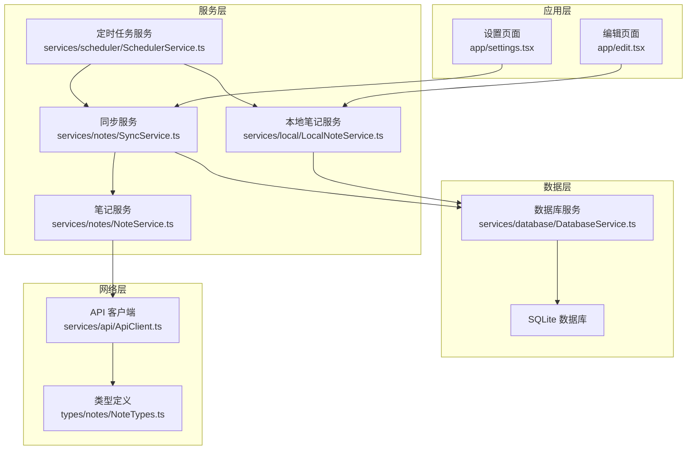
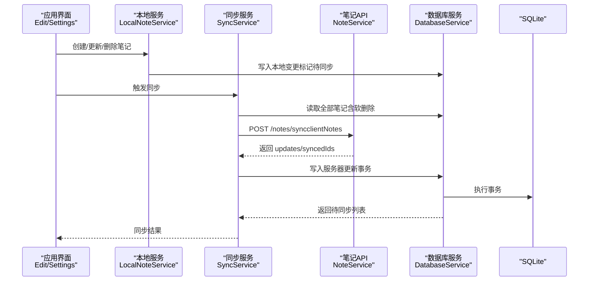
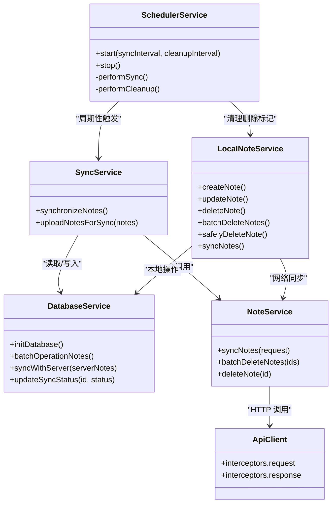
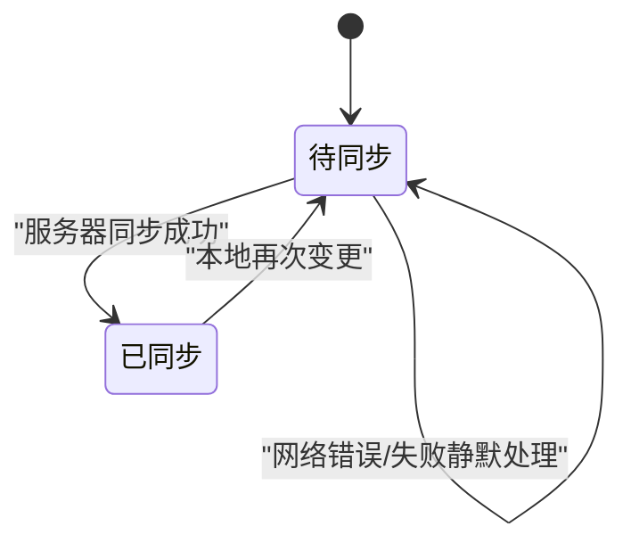
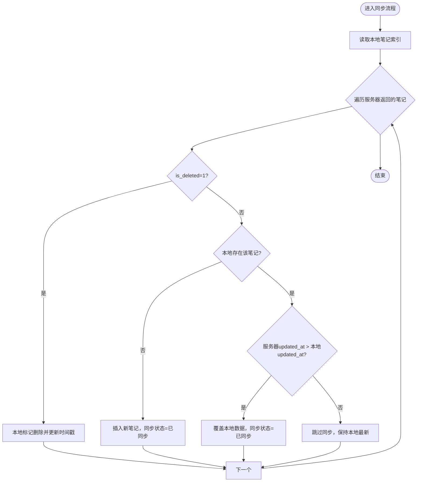
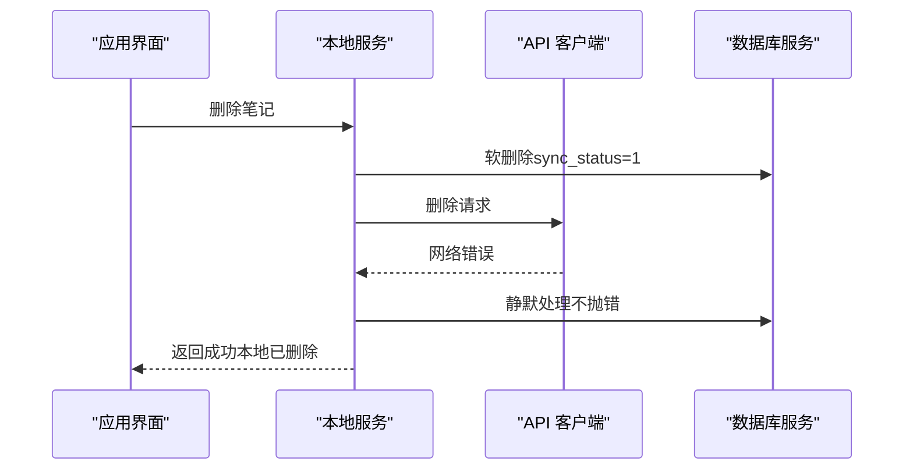

# 数据同步服务

<cite>
**本文档引用的文件**
- [services/notes/SyncService.ts](file://services/notes/SyncService.ts)
- [services/notes/NoteService.ts](file://services/notes/NoteService.ts)
- [services/local/LocalNoteService.ts](file://services/local/LocalNoteService.ts)
- [services/database/DatabaseService.ts](file://services/database/DatabaseService.ts)
- [types/notes/NoteTypes.ts](file://types/notes/NoteTypes.ts)
- [services/api/ApiClient.ts](file://services/api/ApiClient.ts)
- [services/scheduler/SchedulerService.ts](file://services/scheduler/SchedulerService.ts)
- [utils/ErrorHandler.ts](file://utils/ErrorHandler.ts)
- [utils/auth/AuthUtils.ts](file://utils/auth/AuthUtils.ts)
- [app/edit.tsx](file://app/edit.tsx)
- [app/settings.tsx](file://app/settings.tsx)
</cite>

## 目录

1. [简介](#简介)
2. [项目结构](#项目结构)
3. [核心组件](#核心组件)
4. [架构总览](#架构总览)
5. [详细组件分析](#详细组件分析)
6. [依赖关系分析](#依赖关系分析)
7. [性能考量](#性能考量)
8. [故障排查指南](#故障排查指南)
9. [结论](#结论)
10. [附录](#附录)

## 简介

本项目是一个基于 React Native 的笔记应用，提供本地 SQLite 数据库存储与远端服务器之间的双向同步能力。同步设计遵循“离线优先”的理念：所有本地变更立即生效并标记为“待同步”，随后异步尝试与服务器同步；在网络异常时，本地操作不被阻塞，确保用户体验连续性。服务器返回的更新会与本地数据进行时间戳对比，决定覆盖或跳过，从而实现最终一致性。

## 项目结构

围绕数据同步的关键模块如下：

- 类型定义：统一的笔记与同步请求/响应类型
- API 客户端：Axios 实例封装，含请求/响应拦截器与错误处理
- 本地服务：封装 CRUD 与同步入口，负责离线优先策略与错误静默处理
- 数据库服务：SQLite 访问层，提供事务、队列与内存映射优化
- 同步服务：对外暴露同步入口，协调本地与服务器
- 定时任务：周期性触发同步与清理，保障最终一致性
- 应用层：编辑页面与设置页面触发同步与展示结果

图表来源

- [services/local/LocalNoteService.ts](file://services/local/LocalNoteService.ts#L1-L601)
- [services/notes/NoteService.ts](file://services/notes/NoteService.ts#L1-L84)
- [services/notes/SyncService.ts](file://services/notes/SyncService.ts#L1-L58)
- [services/database/DatabaseService.ts](file://services/database/DatabaseService.ts#L1-L513)
- [services/api/ApiClient.ts](file://services/api/ApiClient.ts#L1-L92)
- [types/notes/NoteTypes.ts](file://types/notes/NoteTypes.ts#L1-L109)
- [services/scheduler/SchedulerService.ts](file://services/scheduler/SchedulerService.ts#L1-L233)
- [app/edit.tsx](file://app/edit.tsx#L1-L517)
- [app/settings.tsx](file://app/settings.tsx#L1-L120)

章节来源

- [services/local/LocalNoteService.ts](file://services/local/LocalNoteService.ts#L1-L601)
- [services/notes/NoteService.ts](file://services/notes/NoteService.ts#L1-L84)
- [services/notes/SyncService.ts](file://services/notes/SyncService.ts#L1-L58)
- [services/database/DatabaseService.ts](file://services/database/DatabaseService.ts#L1-L513)
- [services/api/ApiClient.ts](file://services/api/ApiClient.ts#L1-L92)
- [types/notes/NoteTypes.ts](file://types/notes/NoteTypes.ts#L1-L109)
- [services/scheduler/SchedulerService.ts](file://services/scheduler/SchedulerService.ts#L1-L233)
- [app/edit.tsx](file://app/edit.tsx#L1-L517)
- [app/settings.tsx](file://app/settings.tsx#L1-L120)

## 核心组件

- 同步服务：对外提供同步入口，收集本地全部笔记（含软删除）并提交服务器，接收服务器更新后写入数据库。
- 本地笔记服务：封装 CRUD 与同步入口，实现“离线优先”策略，删除与批量删除在网络错误时静默处理，确保本地操作不被阻塞。
- 数据库服务：提供 SQLite 访问、事务、队列执行、内存映射对比、同步状态管理等能力。
- API 客户端：统一请求/响应拦截、错误分类处理、网络错误静默策略。
- 定时任务服务：周期性执行同步与清理，保障最终一致性。
- 类型定义：统一的笔记、分页、导出、同步请求/响应等类型。

章节来源

- [services/notes/SyncService.ts](file://services/notes/SyncService.ts#L1-L58)
- [services/local/LocalNoteService.ts](file://services/local/LocalNoteService.ts#L1-L601)
- [services/database/DatabaseService.ts](file://services/database/DatabaseService.ts#L1-L513)
- [services/api/ApiClient.ts](file://services/api/ApiClient.ts#L1-L92)
- [services/scheduler/SchedulerService.ts](file://services/scheduler/SchedulerService.ts#L1-L233)
- [types/notes/NoteTypes.ts](file://types/notes/NoteTypes.ts#L1-L109)

## 架构总览

系统采用分层架构：

- 应用层：编辑与设置页面触发本地操作与手动同步。
- 服务层：本地服务负责离线优先策略，同步服务协调本地与服务器交互，定时任务保障周期性同步与清理。
- 数据层：SQLite 存储笔记与同步状态，数据库服务提供事务与队列保障一致性。
- 网络层：API 客户端统一处理鉴权、超时、网络错误与业务错误。

图表来源

- [services/local/LocalNoteService.ts](file://services/local/LocalNoteService.ts#L119-L152)
- [services/notes/SyncService.ts](file://services/notes/SyncService.ts#L13-L36)
- [services/notes/NoteService.ts](file://services/notes/NoteService.ts#L69-L70)
- [services/database/DatabaseService.ts](file://services/database/DatabaseService.ts#L211-L260)

## 详细组件分析

### 同步服务（SyncService）

职责

- 收集本地全部笔记（含软删除），提交服务器进行双向同步。
- 接收服务器返回的更新，写入本地数据库。
- 返回同步结果，包含更新数量与已同步 ID 列表。

关键点

- 使用数据库服务获取全部笔记，确保软删除状态也被同步。
- 通过笔记服务发起同步请求，接收服务器更新并写入数据库。
- 错误捕获与抛出，便于上层 UI 展示。

章节来源

- [services/notes/SyncService.ts](file://services/notes/SyncService.ts#L1-L58)
- [services/notes/NoteService.ts](file://services/notes/NoteService.ts#L69-L70)
- [services/database/DatabaseService.ts](file://services/database/DatabaseService.ts#L408-L412)

### 本地笔记服务（LocalNoteService）

职责

- 离线优先策略：本地操作立即生效，标记为“待同步”。
- 删除与批量删除在网络错误时静默处理，确保本地删除不被阻塞。
- 安全删除：先检查服务端是否存在，再进行本地删除与同步。
- 同步入口：提供同步方法，整合本地与服务器数据。

关键点

- 删除与批量删除：本地软删除后尝试同步，若网络错误则静默处理，保持“待同步”状态。
- 安全删除：检查服务端状态，若服务端不存在则本地标记为“已同步”。
- 同步：获取本地全部笔记（含软删除）并提交服务器，接收更新后写入数据库。

章节来源

- [services/local/LocalNoteService.ts](file://services/local/LocalNoteService.ts#L119-L152)
- [services/local/LocalNoteService.ts](file://services/local/LocalNoteService.ts#L157-L211)
- [services/local/LocalNoteService.ts](file://services/local/LocalNoteService.ts#L231-L292)
- [services/local/LocalNoteService.ts](file://services/local/LocalNoteService.ts#L443-L466)

### 数据库服务（DatabaseService）

职责

- 数据库连接与初始化，表结构确保。
- 任务队列与重入锁，保障高并发场景下的一致性。
- 批量操作与事务，确保原子性。
- 内存映射对比，提升同步性能。
- 同步状态管理：待同步、已同步、同步失败等状态转换。

关键点

- 任务队列：executeDbOperation 包装所有数据库操作，避免并发冲突。
- 内存映射对比：syncWithServer 一次性读取本地索引，减少循环内查询。
- 时间戳对比：服务器更新时间戳大于本地则覆盖，否则跳过。
- 同步状态：更新时将 sync_status 设为“待同步”，成功后置为“已同步”。

章节来源

- [services/database/DatabaseService.ts](file://services/database/DatabaseService.ts#L18-L56)
- [services/database/DatabaseService.ts](file://services/database/DatabaseService.ts#L62-L115)
- [services/database/DatabaseService.ts](file://services/database/DatabaseService.ts#L160-L205)
- [services/database/DatabaseService.ts](file://services/database/DatabaseService.ts#L211-L260)
- [services/database/DatabaseService.ts](file://services/database/DatabaseService.ts#L434-L444)

### API 客户端（ApiClient）

职责

- 统一请求拦截：动态设置 baseURL 与 Authorization。
- 统一响应拦截：网络错误、超时、业务错误分类处理。
- 删除操作错误静默：针对删除操作在网络错误时静默处理。

关键点

- 请求拦截器：异步获取 API URL 与密钥，设置请求头。
- 响应拦截器：根据状态码与错误类型输出不同级别日志。
- 删除错误静默：删除操作在网络错误时仅输出警告，不阻塞本地流程。

章节来源

- [services/api/ApiClient.ts](file://services/api/ApiClient.ts#L1-L92)
- [utils/ErrorHandler.ts](file://utils/ErrorHandler.ts#L1-L48)

### 定时任务服务（SchedulerService）

职责

- 周期性执行同步与清理任务。
- 同步被标记删除的笔记到服务端，无论是否成功均更新本地状态。
- 清理本地数据库中已同步的删除标记笔记。

关键点

- 同步任务：分离删除与非删除笔记，分别处理。
- 删除同步：批量失败时逐个重试，网络错误时静默处理并更新本地状态。
- 清理任务：过滤已同步的删除标记笔记并物理删除。

章节来源

- [services/scheduler/SchedulerService.ts](file://services/scheduler/SchedulerService.ts#L1-L233)

### 类型定义（NoteTypes）

职责

- 统一笔记结构与分页、导出、同步请求/响应类型。
- 定义同步状态字段：sync_status（0 已同步，1 待同步）。

关键点

- Note：包含 id、title、content、is_encrypted、sync_status、is_deleted、created_at、updated_at。
- SyncNotesRequest/Response：客户端笔记集合与服务器返回的更新集合。

章节来源

- [types/notes/NoteTypes.ts](file://types/notes/NoteTypes.ts#L1-L109)

### 应用层集成

- 编辑页面：自动保存与手动保存，触发本地服务写入数据库。
- 设置页面：手动触发同步，展示同步结果。

章节来源

- [app/edit.tsx](file://app/edit.tsx#L129-L190)
- [app/settings.tsx](file://app/settings.tsx#L16-L25)

## 依赖关系分析

图表来源

- [services/notes/SyncService.ts](file://services/notes/SyncService.ts#L1-L58)
- [services/local/LocalNoteService.ts](file://services/local/LocalNoteService.ts#L1-L601)
- [services/database/DatabaseService.ts](file://services/database/DatabaseService.ts#L1-L513)
- [services/notes/NoteService.ts](file://services/notes/NoteService.ts#L1-L84)
- [services/api/ApiClient.ts](file://services/api/ApiClient.ts#L1-L92)
- [services/scheduler/SchedulerService.ts](file://services/scheduler/SchedulerService.ts#L1-L233)

## 性能考量

- 任务队列与重入锁：数据库操作通过队列串行执行，避免并发冲突与死锁。
- 内存映射对比：同步时一次性读取本地索引，减少循环内查询，提升对比效率。
- 事务封装：批量操作与同步写入使用事务，确保原子性与一致性。
- 离线优先：本地操作立即生效，网络错误时静默处理，避免 UI 阻塞。
- 定时任务：周期性同步与清理，降低峰值压力，保障最终一致性。

章节来源

- [services/database/DatabaseService.ts](file://services/database/DatabaseService.ts#L62-L115)
- [services/database/DatabaseService.ts](file://services/database/DatabaseService.ts#L211-L260)
- [services/scheduler/SchedulerService.ts](file://services/scheduler/SchedulerService.ts#L23-L50)

## 故障排查指南

常见问题与定位建议

- 同步失败：检查网络状态与 API 配置，查看 API 客户端响应拦截器日志。
- 删除失败：确认是否为网络错误，若是则本地删除仍会生效，但可能需要重试。
- 数据不一致：检查 sync_status 字段，确认是否已同步；必要时手动触发同步。
- 定时任务未执行：确认定时任务是否已启动，检查日志输出。

章节来源

- [services/api/ApiClient.ts](file://services/api/ApiClient.ts#L51-L89)
- [utils/ErrorHandler.ts](file://utils/ErrorHandler.ts#L18-L47)
- [services/scheduler/SchedulerService.ts](file://services/scheduler/SchedulerService.ts#L73-L98)

## 结论

本数据同步服务通过“离线优先”与“最终一致性”设计，在保证用户体验的同时实现了可靠的双向同步。本地服务负责即时落盘与错误静默，数据库服务提供事务与队列保障，API 客户端统一处理网络与业务错误，定时任务确保长期一致性。未来可进一步引入冲突合并策略、增量同步优化与重试退避机制，以应对更复杂的业务场景。

## 附录

### 同步状态管理与转换

- 待同步：本地变更后 sync_status = 1。
- 已同步：服务器同步成功后 sync_status = 0。
- 同步失败：保留“待同步”状态，等待后续重试或定时任务清理。

图表来源

- [services/database/DatabaseService.ts](file://services/database/DatabaseService.ts#L434-L444)
- [services/local/LocalNoteService.ts](file://services/local/LocalNoteService.ts#L119-L152)

### 冲突解决策略（基于时间戳）

- 服务器更新时间戳 > 本地时间戳：覆盖本地数据，同步状态置为“已同步”。
- 服务器更新时间戳 ≤ 本地时间戳：跳过同步，保持本地最新。

图表来源

- [services/database/DatabaseService.ts](file://services/database/DatabaseService.ts#L211-L260)

### 离线优先与网络异常处理

- 删除与批量删除：本地软删除后尝试同步，网络错误时静默处理，保持“待同步”状态。
- 安全删除：先检查服务端状态，若服务端不存在则本地标记为“已同步”。
- API 删除错误静默：删除操作在网络错误时仅输出警告，不阻塞本地流程。

图表来源

- [services/local/LocalNoteService.ts](file://services/local/LocalNoteService.ts#L119-L152)
- [services/api/ApiClient.ts](file://services/api/ApiClient.ts#L51-L89)

### 增量同步与最小化传输

- 本地仅提交 sync_status=1 的笔记，减少传输量。
- 服务器返回 updates 集合，本地按时间戳对比后选择性覆盖。
- 定时任务周期性同步，避免频繁全量传输。

章节来源

- [services/database/DatabaseService.ts](file://services/database/DatabaseService.ts#L392-L398)
- [services/notes/SyncService.ts](file://services/notes/SyncService.ts#L13-L36)

### 最佳实践

- 批量同步：使用批量删除与批量插入/更新，减少请求次数。
- 并发控制：通过数据库任务队列与事务，避免并发写入冲突。
- 重试机制：定时任务定期重试“待同步”状态的笔记，结合网络错误静默策略。
- 错误处理：区分网络错误与业务错误，对删除操作在网络错误时静默处理。

章节来源

- [services/scheduler/SchedulerService.ts](file://services/scheduler/SchedulerService.ts#L104-L176)
- [utils/ErrorHandler.ts](file://utils/ErrorHandler.ts#L18-L47)
