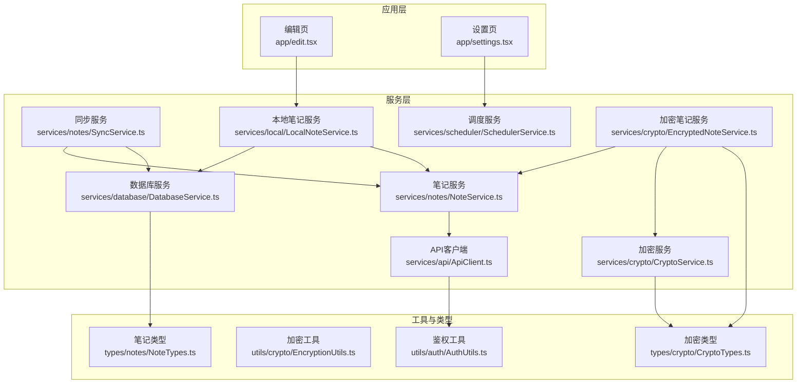
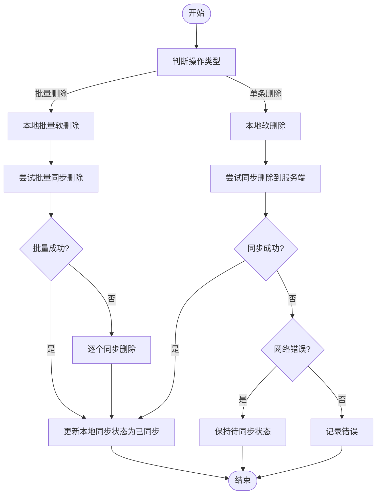
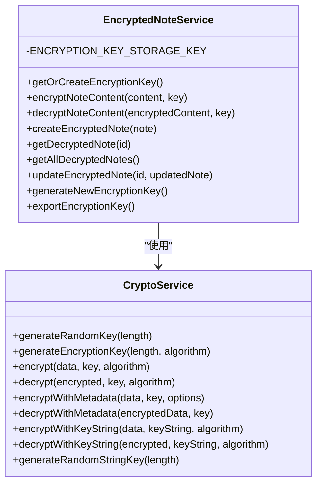
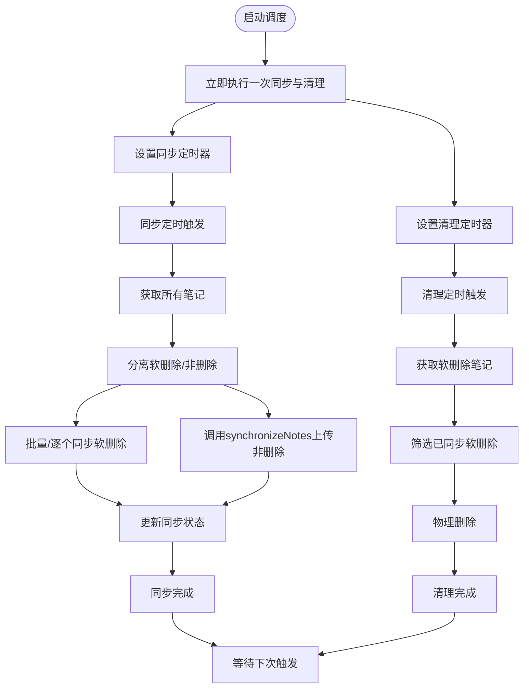
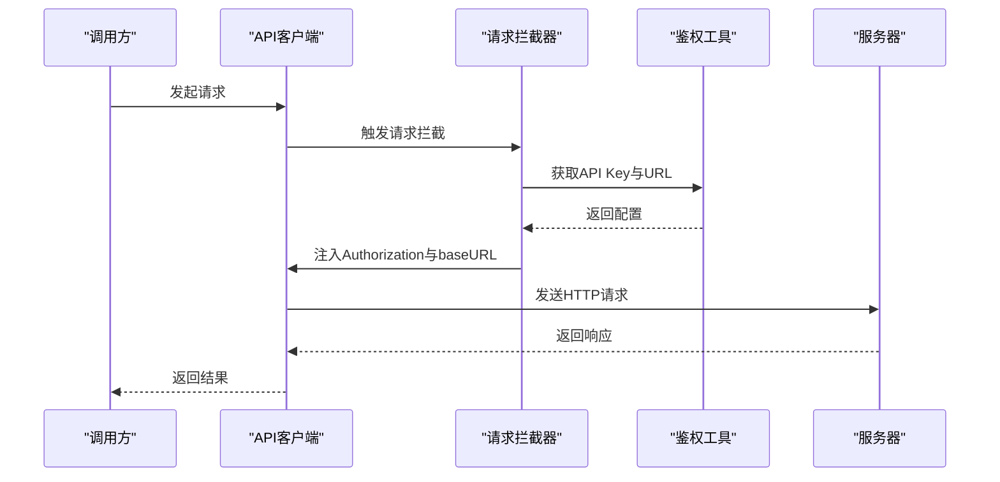
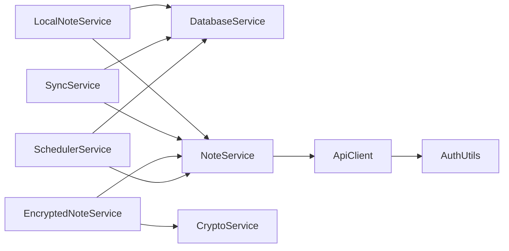

# 核心功能模块

<cite>
**本文档引用的文件**
- [services/index.ts](file://services/index.ts)
- [services/notes/NoteService.ts](file://services/notes/NoteService.ts)
- [services/notes/SyncService.ts](file://services/notes/SyncService.ts)
- [services/database/DatabaseService.ts](file://services/database/DatabaseService.ts)
- [services/local/LocalNoteService.ts](file://services/local/LocalNoteService.ts)
- [services/scheduler/SchedulerService.ts](file://services/scheduler/SchedulerService.ts)
- [services/crypto/CryptoService.ts](file://services/crypto/CryptoService.ts)
- [services/crypto/EncryptedNoteService.ts](file://services/crypto/EncryptedNoteService.ts)
- [services/api/ApiClient.ts](file://services/api/ApiClient.ts)
- [utils/crypto/EncryptionUtils.ts](file://utils/crypto/EncryptionUtils.ts)
- [utils/auth/AuthUtils.ts](file://utils/auth/AuthUtils.ts)
- [types/notes/NoteTypes.ts](file://types/notes/NoteTypes.ts)
- [types/crypto/CryptoTypes.ts](file://types/crypto/CryptoTypes.ts)
- [app/edit.tsx](file://app/edit.tsx)
- [app/settings.tsx](file://app/settings.tsx)
</cite>

## 目录

1. [简介](#简介)
2. [项目结构](#项目结构)
3. [核心组件](#核心组件)
4. [架构总览](#架构总览)
5. [详细组件分析](#详细组件分析)
6. [依赖关系分析](#依赖关系分析)
7. [性能考量](#性能考量)
8. [故障排查指南](#故障排查指南)
9. [结论](#结论)
10. [附录](#附录)

## 简介

本文件面向Notes应用的核心功能模块，系统化梳理笔记管理、数据同步、加密存储与调度管理四大模块的设计与实现，解释模块间的依赖与协作，给出使用场景、配置项与参数说明、扩展点与最佳实践，并辅以可视化图示帮助不同层次的读者快速理解与上手。

## 项目结构

项目采用按“职责域”划分的服务层组织方式，核心模块分布如下：

- 服务层：notes（笔记）、database（本地数据库）、scheduler（调度）、crypto（加密）、api（HTTP客户端）
- 工具层：auth（鉴权与配置）、crypto（加密工具）
- 类型层：notes（笔记类型）、crypto（加密类型）
- 应用层：页面入口与交互（如编辑页、设置页）



图表来源

- [app/edit.tsx](file://app/edit.tsx#L1-L517)
- [app/settings.tsx](file://app/settings.tsx#L1-L132)
- [services/notes/NoteService.ts](file://services/notes/NoteService.ts#L1-L84)
- [services/notes/SyncService.ts](file://services/notes/SyncService.ts#L1-L58)
- [services/local/LocalNoteService.ts](file://services/local/LocalNoteService.ts#L1-L601)
- [services/database/DatabaseService.ts](file://services/database/DatabaseService.ts#L1-L513)
- [services/scheduler/SchedulerService.ts](file://services/scheduler/SchedulerService.ts#L1-L233)
- [services/crypto/CryptoService.ts](file://services/crypto/CryptoService.ts#L1-L205)
- [services/crypto/EncryptedNoteService.ts](file://services/crypto/EncryptedNoteService.ts#L1-L186)
- [services/api/ApiClient.ts](file://services/api/ApiClient.ts#L1-L92)
- [utils/auth/AuthUtils.ts](file://utils/auth/AuthUtils.ts#L1-L65)
- [utils/crypto/EncryptionUtils.ts](file://utils/crypto/EncryptionUtils.ts#L1-L112)
- [types/notes/NoteTypes.ts](file://types/notes/NoteTypes.ts#L1-L109)
- [types/crypto/CryptoTypes.ts](file://types/crypto/CryptoTypes.ts#L1-L44)

章节来源

- [services/index.ts](file://services/index.ts#L1-L82)

## 核心组件

- 笔记服务（NoteService）：封装REST API调用，提供笔记的增删改查、批量操作与同步接口。
- 同步服务（SyncService）：协调本地与服务器的笔记同步，处理差异合并与冲突策略。
- 数据库服务（DatabaseService）：基于SQLite的本地持久化，提供事务、队列化并发控制与高效对比同步。
- 本地笔记服务（LocalNoteService）：面向UI的业务封装，负责分页、搜索、软删除、安全删除与导出。
- 调度服务（SchedulerService）：定时任务，周期性同步与清理软删除笔记，保证最终一致性。
- 加密服务（CryptoService）：提供AES密钥生成、加解密与元数据封装。
- 加密笔记服务（EncryptedNoteService）：在NoteService之上提供透明的加密/解密能力。
- API客户端（ApiClient）：Axios封装，统一注入鉴权头、错误处理与超时控制。
- 鉴权工具（AuthUtils）：API Key与URL的安全存储与校验。
- 加密工具（EncryptionUtils）：对CryptoService的便捷封装。
- 类型定义（NoteTypes、CryptoTypes）：统一的数据契约与参数/响应结构。

章节来源

- [services/notes/NoteService.ts](file://services/notes/NoteService.ts#L1-L84)
- [services/notes/SyncService.ts](file://services/notes/SyncService.ts#L1-L58)
- [services/database/DatabaseService.ts](file://services/database/DatabaseService.ts#L1-L513)
- [services/local/LocalNoteService.ts](file://services/local/LocalNoteService.ts#L1-L601)
- [services/scheduler/SchedulerService.ts](file://services/scheduler/SchedulerService.ts#L1-L233)
- [services/crypto/CryptoService.ts](file://services/crypto/CryptoService.ts#L1-L205)
- [services/crypto/EncryptedNoteService.ts](file://services/crypto/EncryptedNoteService.ts#L1-L186)
- [services/api/ApiClient.ts](file://services/api/ApiClient.ts#L1-L92)
- [utils/auth/AuthUtils.ts](file://utils/auth/AuthUtils.ts#L1-L65)
- [utils/crypto/EncryptionUtils.ts](file://utils/crypto/EncryptionUtils.ts#L1-L112)
- [types/notes/NoteTypes.ts](file://types/notes/NoteTypes.ts#L1-L109)
- [types/crypto/CryptoTypes.ts](file://types/crypto/CryptoTypes.ts#L1-L44)

## 架构总览

整体采用“UI层 → 本地服务层 → 数据库/网络”的分层设计。UI通过本地服务层与数据库交互，同时通过NoteService与服务器通信；加密服务贯穿笔记读写链路，提供透明的加解密；调度服务保障异步一致性与资源回收。

```mermaid
sequenceDiagram
participant UI as "编辑页<br/>app/edit.tsx"
participant Local as "本地笔记服务<br/>LocalNoteService"
participant DB as "数据库服务<br/>DatabaseService"
participant Note as "笔记服务<br/>NoteService"
participant API as "API客户端<br/>ApiClient"
participant Server as "服务器"
UI->>Local : 保存/更新笔记
Local->>DB : 写入本地SQLite软删除/同步状态
alt 需要同步
Local->>Note : 调用删除/批量删除API
Note->>API : 发送HTTP请求
API->>Server : POST/DELETE /notes/*
Server-->>API : 响应
API-->>Note : 结果
Note-->>Local : 成功/失败
Local->>DB : 更新同步状态
end
```

图表来源

- [app/edit.tsx](file://app/edit.tsx#L129-L190)
- [services/local/LocalNoteService.ts](file://services/local/LocalNoteService.ts#L119-L152)
- [services/notes/NoteService.ts](file://services/notes/NoteService.ts#L48-L55)
- [services/api/ApiClient.ts](file://services/api/ApiClient.ts#L1-L92)

## 详细组件分析

### 笔记管理（本地与远程）

- 功能要点
  - 列表分页与搜索：本地服务层对SQLite结果进行分页与模糊匹配。
  - CRUD与批量操作：支持创建、更新、软删除、批量创建/更新/删除。
  - 安全删除：先检查服务端状态，再执行本地软删除，保证一致性。
  - 导出与下载：支持导出JSON与下载Blob。
- 关键流程
  - 删除流程：本地软删除后异步同步至服务端；网络错误时静默保留待同步状态。
  - 批量删除：优先批量同步，失败时回退为逐个同步，均不影响本地删除。
- 参数与配置
  - 查询参数：page、limit、search。
  - 批量请求体：ids或notes数组。
- 使用场景
  - 移动端弱网环境下的可靠删除与恢复。
  - 大规模笔记导入/导出与备份。



图表来源

- [services/local/LocalNoteService.ts](file://services/local/LocalNoteService.ts#L119-L211)

章节来源

- [services/local/LocalNoteService.ts](file://services/local/LocalNoteService.ts#L1-L601)
- [types/notes/NoteTypes.ts](file://types/notes/NoteTypes.ts#L1-L109)

### 数据同步（本地与服务器）

- 功能要点
  - 同步入口：synchronizeNotes与uploadNotesForSync。
  - 服务器差异合并：以updated_at为准，覆盖本地或远端数据。
  - 事务与队列：数据库层使用事务与操作队列，避免并发冲突。
- 关键流程
  - 本地收集所有笔记（含软删除），构造请求体发送至服务器。
  - 服务器返回updates，数据库层一次性对比并写入。
- 参数与配置
  - 请求体：clientNotes（Note[]）。
  - 响应：updates（差异集）、syncedIds（已同步ID）。
- 使用场景
  - 多设备间笔记一致性维护。
  - 断网后离线编辑，联网后统一回传。

```mermaid
sequenceDiagram
participant Svc as "同步服务<br/>SyncService"
participant DB as "数据库服务<br/>DatabaseService"
participant Note as "笔记服务<br/>NoteService"
participant API as "API客户端<br/>ApiClient"
participant Server as "服务器"
Svc->>DB : 获取所有笔记含软删除
Svc->>Note : 发送同步请求clientNotes
Note->>API : POST /notes/sync
API->>Server : 发送请求
Server-->>API : 返回updates
API-->>Note : 返回响应
Note-->>Svc : 返回响应
Svc->>DB : 事务内对比并写入updates
DB-->>Svc : 完成
```

图表来源

- [services/notes/SyncService.ts](file://services/notes/SyncService.ts#L13-L36)
- [services/database/DatabaseService.ts](file://services/database/DatabaseService.ts#L211-L260)
- [services/notes/NoteService.ts](file://services/notes/NoteService.ts#L69-L70)
- [services/api/ApiClient.ts](file://services/api/ApiClient.ts#L1-L92)

章节来源

- [services/notes/SyncService.ts](file://services/notes/SyncService.ts#L1-L58)
- [services/database/DatabaseService.ts](file://services/database/DatabaseService.ts#L1-L513)
- [services/notes/NoteService.ts](file://services/notes/NoteService.ts#L1-L84)

### 加密存储（透明加解密）

- 功能要点
  - 密钥管理：首次使用生成随机密钥并安全存储，支持导出与轮换。
  - 内容加解密：对笔记content进行AES-CBC加密，返回带IV的密文。
  - 服务集成：EncryptedNoteService在创建/更新/读取时自动加解密。
- 关键流程
  - 创建加密笔记：生成密钥 → 加密content → 调用NoteService创建 → 拉取完整笔记并解密返回。
  - 更新加密笔记：获取密钥 → 加密新content → 更新并返回解密后结果。
- 参数与配置
  - 算法：默认aes-256-cbc。
  - 密钥长度：默认32字节。
  - 可选元数据：包含IV、算法、时间戳。
- 使用场景
  - 本地敏感笔记的强保护。
  - 与调度/同步结合，实现端到端安全。



图表来源

- [services/crypto/CryptoService.ts](file://services/crypto/CryptoService.ts#L10-L205)
- [services/crypto/EncryptedNoteService.ts](file://services/crypto/EncryptedNoteService.ts#L11-L186)

章节来源

- [services/crypto/CryptoService.ts](file://services/crypto/CryptoService.ts#L1-L205)
- [services/crypto/EncryptedNoteService.ts](file://services/crypto/EncryptedNoteService.ts#L1-L186)
- [utils/crypto/EncryptionUtils.ts](file://utils/crypto/EncryptionUtils.ts#L1-L112)
- [types/crypto/CryptoTypes.ts](file://types/crypto/CryptoTypes.ts#L1-L44)

### 调度管理（定时同步与清理）

- 功能要点
  - 启停控制：start(stop)方法管理定时器生命周期。
  - 同步任务：周期性上传待同步笔记，分离软删除与正常笔记处理。
  - 清理任务：物理删除已同步的软删除笔记，释放空间。
- 关键流程
  - 同步：获取所有笔记 → 分离删除/非删除 → 批量/逐个同步删除 → 调用synchronizeNotes上传非删除。
  - 清理：筛选已同步软删除笔记 → 逐条物理删除。
- 参数与配置
  - 同步间隔：默认30分钟。
  - 清理间隔：默认1小时。
- 使用场景
  - 低频网络环境下的后台一致性维护。
  - 自动回收软删除资源，避免本地膨胀。



图表来源

- [services/scheduler/SchedulerService.ts](file://services/scheduler/SchedulerService.ts#L23-L98)
- [services/scheduler/SchedulerService.ts](file://services/scheduler/SchedulerService.ts#L104-L176)
- [services/scheduler/SchedulerService.ts](file://services/scheduler/SchedulerService.ts#L196-L229)

章节来源

- [services/scheduler/SchedulerService.ts](file://services/scheduler/SchedulerService.ts#L1-L233)

### API与鉴权

- 功能要点
  - Axios拦截器：动态设置baseURL与Authorization头，统一封装错误处理。
  - 鉴权工具：支持环境变量与安全存储双通道，校验API Key与URL格式。
- 关键流程
  - 请求阶段：注入API Key，必要时修正baseURL。
  - 响应阶段：根据状态码与错误类型分类处理，网络错误与超时单独提示。
- 使用场景
  - 多环境部署（开发/生产）与多租户隔离。
  - 与调度/同步配合，实现后台稳定连通。



图表来源

- [services/api/ApiClient.ts](file://services/api/ApiClient.ts#L16-L41)
- [utils/auth/AuthUtils.ts](file://utils/auth/AuthUtils.ts#L26-L39)

章节来源

- [services/api/ApiClient.ts](file://services/api/ApiClient.ts#L1-L92)
- [utils/auth/AuthUtils.ts](file://utils/auth/AuthUtils.ts#L1-L65)

## 依赖关系分析

- 模块耦合
  - LocalNoteService与DatabaseService强耦合，负责UI侧业务编排。
  - SyncService依赖NoteService与DatabaseService，承担一致性协调。
  - EncryptedNoteService依赖NoteService与CryptoService，形成透明加密层。
  - SchedulerService依赖DatabaseService与NoteService，负责后台维护。
  - ApiClient依赖AuthUtils，统一鉴权与错误处理。
- 外部依赖
  - SQLite（expo-sqlite）：本地持久化。
  - react-native-quick-crypto：原生加密。
  - axios：HTTP客户端。
  - expo-secure-store/AsyncStorage：密钥与URL存储。
- 循环依赖
  - 未发现直接循环依赖；通过服务层抽象与类型定义避免环状导入。



图表来源

- [services/local/LocalNoteService.ts](file://services/local/LocalNoteService.ts#L1-L17)
- [services/notes/SyncService.ts](file://services/notes/SyncService.ts#L1-L4)
- [services/crypto/EncryptedNoteService.ts](file://services/crypto/EncryptedNoteService.ts#L1-L5)
- [services/scheduler/SchedulerService.ts](file://services/scheduler/SchedulerService.ts#L1-L7)
- [services/api/ApiClient.ts](file://services/api/ApiClient.ts#L1-L3)

章节来源

- [services/index.ts](file://services/index.ts#L1-L82)

## 性能考量

- 数据库并发与一致性
  - 操作队列与重入锁：避免高频调用导致的竞态与死锁。
  - 事务批处理：批量删除/更新/创建在单事务内完成，减少磁盘往返。
  - 内存Map对比：同步时一次性构建本地索引，降低循环查询成本。
- 网络与可靠性
  - 删除API静默处理：网络错误不阻塞本地删除，提升用户体验。
  - 批量优先：优先批量同步，失败回退逐个同步，兼顾吞吐与鲁棒性。
- 加密开销
  - 建议：对大文档采用分段加密或延迟解密策略；密钥生成与哈希仅在必要时触发。
- 调度频率
  - 同步与清理间隔可按设备性能与网络状况调整，避免频繁I/O与网络请求。

章节来源

- [services/database/DatabaseService.ts](file://services/database/DatabaseService.ts#L62-L115)
- [services/local/LocalNoteService.ts](file://services/local/LocalNoteService.ts#L119-L211)
- [services/scheduler/SchedulerService.ts](file://services/scheduler/SchedulerService.ts#L23-L50)

## 故障排查指南

- 常见错误与定位
  - 网络错误/超时：查看API拦截器日志，确认请求头与baseURL是否正确注入。
  - 401/403：检查API Key有效性与存储位置。
  - 404：删除接口可能返回404（资源不存在），属于预期行为，注意区分。
  - 数据库异常：关注“null/prepareAsync”类错误，服务层会自动重置连接并重试。
- 排查步骤
  - 确认鉴权：使用AuthUtils验证API Key与URL格式。
  - 检查本地状态：确认笔记is_deleted与sync_status是否符合预期。
  - 查看调度：确认SchedulerService是否按预期启动与执行。
- 建议
  - 记录关键路径日志（创建/更新/删除/同步/清理）。
  - 对外暴露健康检查接口（如获取统计信息）便于监控。

章节来源

- [services/api/ApiClient.ts](file://services/api/ApiClient.ts#L44-L89)
- [utils/auth/AuthUtils.ts](file://utils/auth/AuthUtils.ts#L22-L53)
- [services/database/DatabaseService.ts](file://services/database/DatabaseService.ts#L80-L94)

## 结论

本项目通过清晰的分层与职责划分，实现了可靠的笔记管理、稳健的数据同步、透明的加密存储与高效的后台调度。模块间通过服务层抽象解耦，配合完善的错误处理与性能优化，既满足初学者快速上手，也为高级开发者提供了充分的扩展空间与定制选项。

## 附录

### API与类型速览

- 笔记相关
  - GET /notes → 分页列表
  - GET /notes/:id → 单条详情
  - POST /notes → 创建
  - PATCH /notes/:id → 更新
  - DELETE /notes/:id → 删除
  - DELETE /notes/batch → 批量删除
  - POST /notes/batch → 批量插入/更新
  - POST /notes/sync → 同步
- 类型要点
  - Note：id、title、content、is_encrypted、sync_status、is_deleted、created_at、updated_at。
  - SyncNotesRequest/Response：携带clientNotes与updates、syncedIds。
- 加密类型
  - EncryptionKey：key、algorithm、length、createdAt。
  - EncryptedData：encrypted、iv、algorithm、timestamp。

章节来源

- [services/notes/NoteService.ts](file://services/notes/NoteService.ts#L22-L70)
- [types/notes/NoteTypes.ts](file://types/notes/NoteTypes.ts#L1-L109)
- [types/crypto/CryptoTypes.ts](file://types/crypto/CryptoTypes.ts#L1-L44)

### 配置与参数

- API客户端
  - 超时：30秒
  - 鉴权：Authorization Bearer（来自AuthUtils）
  - baseURL：来自AuthUtils.getApiUrl
- 调度服务
  - 同步间隔：默认30分钟
  - 清理间隔：默认1小时
- 加密服务
  - 默认算法：aes-256-cbc
  - 默认密钥长度：32字节
  - 可选元数据：包含IV与时间戳

章节来源

- [services/api/ApiClient.ts](file://services/api/ApiClient.ts#L6-L11)
- [services/scheduler/SchedulerService.ts](file://services/scheduler/SchedulerService.ts#L23-L26)
- [services/crypto/CryptoService.ts](file://services/crypto/CryptoService.ts#L27-L38)
- [utils/auth/AuthUtils.ts](file://utils/auth/AuthUtils.ts#L33-L53)

### 实际应用场景

- 编辑页自动保存与加密切换：见编辑页组件对LocalNoteService与加密选项的集成。
- 设置页手动同步：调用SchedulerService.synchronizeNotes，展示同步结果与通知。
- 批量导入/导出：利用LocalNoteService的批量创建与导出接口，结合加密服务实现安全备份。

章节来源

- [app/edit.tsx](file://app/edit.tsx#L129-L190)
- [app/settings.tsx](file://app/settings.tsx#L16-L25)
- [services/local/LocalNoteService.ts](file://services/local/LocalNoteService.ts#L513-L550)
- [services/local/LocalNoteService.ts](file://services/local/LocalNoteService.ts#L381-L408)
