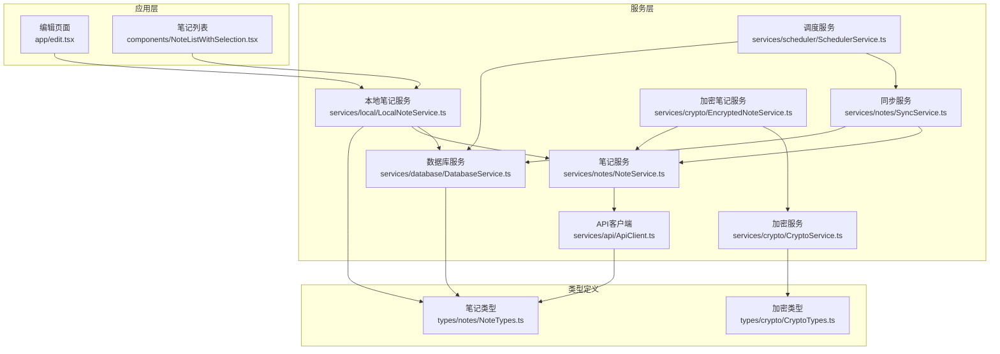
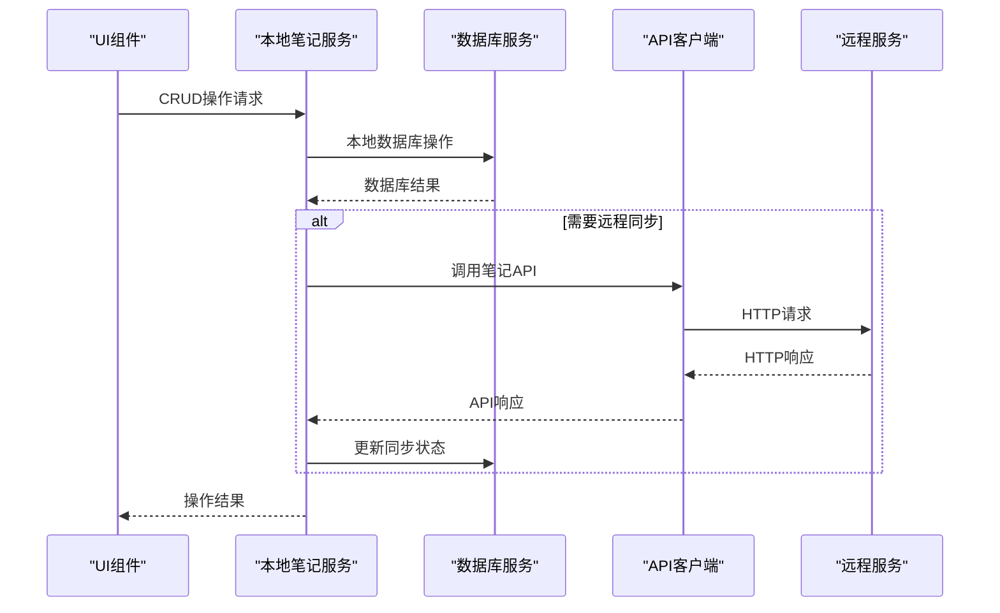
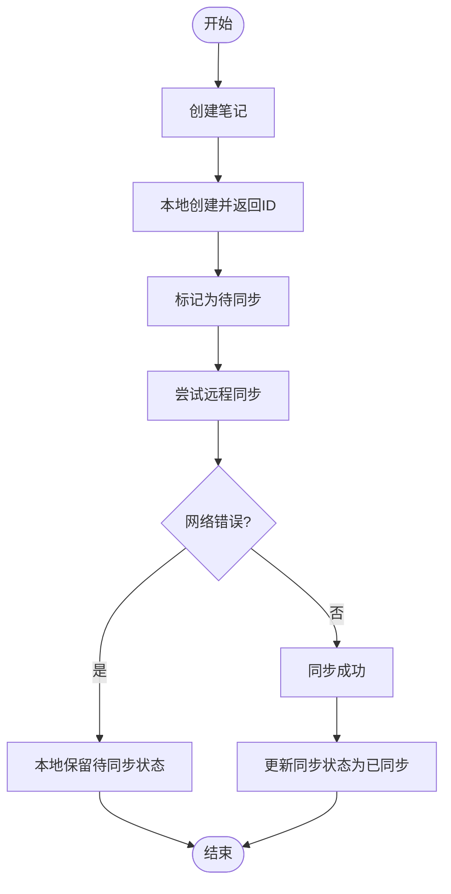
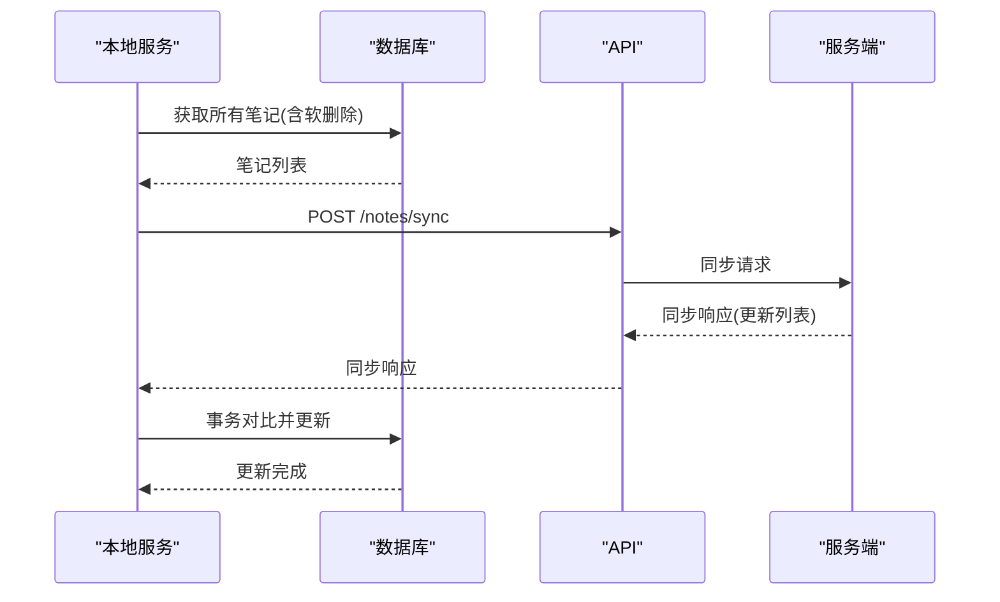
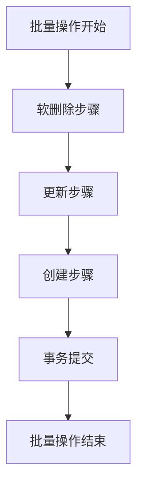
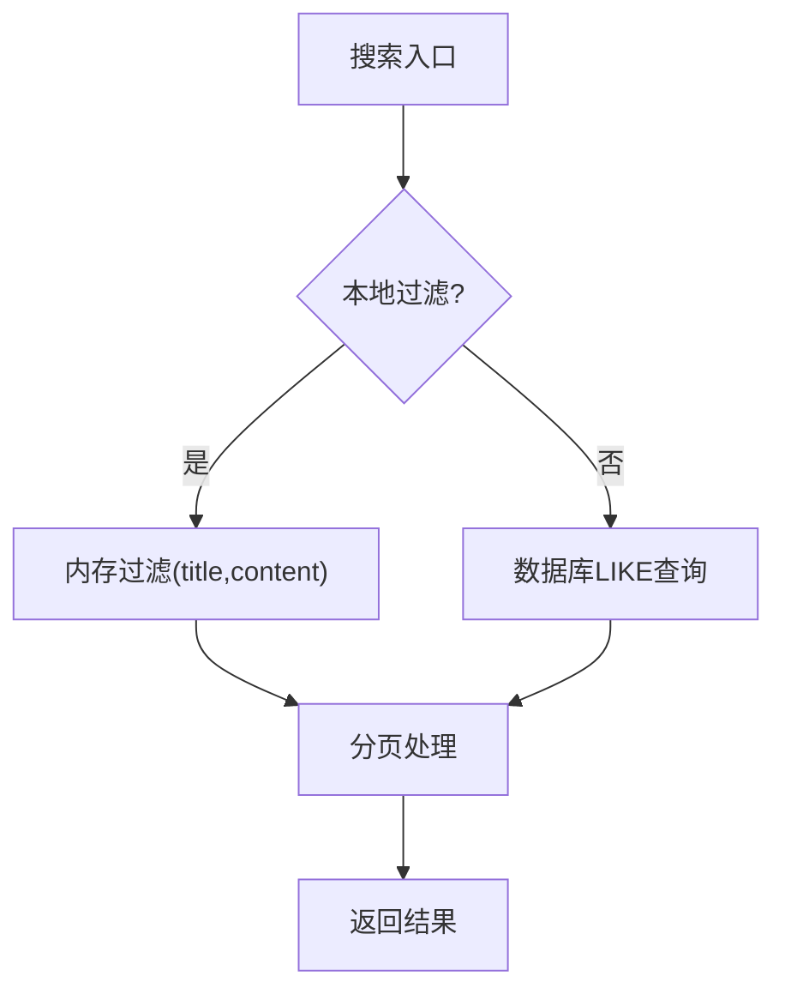
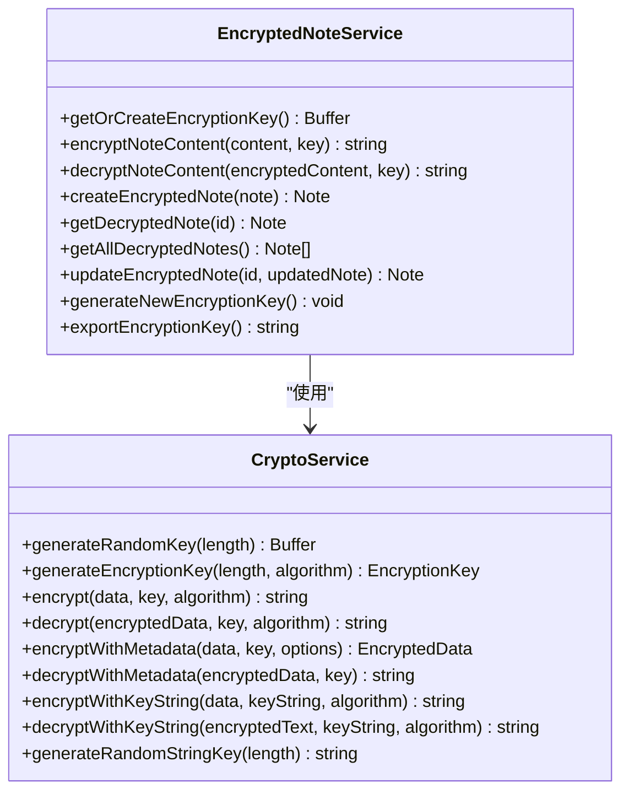
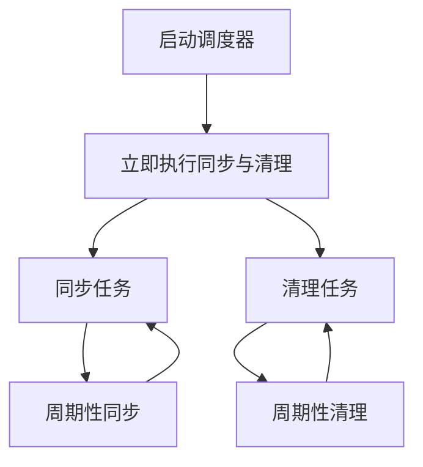
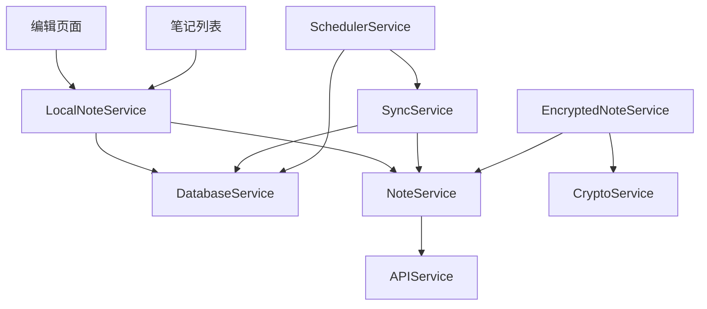

# 笔记管理系统

<cite>
**本文档引用的文件**
- [services/notes/NoteService.ts](file://services/notes/NoteService.ts)
- [services/notes/SyncService.ts](file://services/notes/SyncService.ts)
- [services/local/LocalNoteService.ts](file://services/local/LocalNoteService.ts)
- [services/database/DatabaseService.ts](file://services/database/DatabaseService.ts)
- [services/api/ApiClient.ts](file://services/api/ApiClient.ts)
- [services/scheduler/SchedulerService.ts](file://services/scheduler/SchedulerService.ts)
- [services/AppInitializationService.ts](file://services/AppInitializationService.ts)
- [services/crypto/CryptoService.ts](file://services/crypto/CryptoService.ts)
- [services/crypto/EncryptedNoteService.ts](file://services/crypto/EncryptedNoteService.ts)
- [types/notes/NoteTypes.ts](file://types/notes/NoteTypes.ts)
- [types/crypto/CryptoTypes.ts](file://types/crypto/CryptoTypes.ts)
- [app/edit.tsx](file://app/edit.tsx)
- [components/NoteListWithSelection.tsx](file://components/NoteListWithSelection.tsx)
- [utils/ErrorHandler.ts](file://utils/ErrorHandler.ts)
</cite>

## 目录

1. [简介](#简介)
2. [项目结构](#项目结构)
3. [核心组件](#核心组件)
4. [架构总览](#架构总览)
5. [详细组件分析](#详细组件分析)
6. [依赖关系分析](#依赖关系分析)
7. [性能考虑](#性能考虑)
8. [故障排除指南](#故障排除指南)
9. [结论](#结论)
10. [附录](#附录)

## 简介

本项目是一个跨平台的笔记管理系统，采用React Native + Expo构建，结合本地SQLite数据库与远程API实现笔记的完整生命周期管理。系统支持：

- 笔记的CRUD操作（创建、读取、更新、删除）
- 本地存储与远程同步的协调机制（软删除与硬删除）
- 批量操作的原子性保证
- 搜索与过滤功能
- 笔记统计信息收集
- 加密笔记功能
- 定时任务调度（同步与清理）

## 项目结构

项目采用按功能域划分的模块化组织方式，主要目录与职责如下：

- services：业务服务层，包含API客户端、数据库服务、笔记服务、同步服务、调度服务、加密服务等
- components：UI组件库，如笔记列表、删除确认模态框等
- types：TypeScript类型定义，涵盖笔记类型、加密类型等
- utils：工具类，如错误处理、认证工具等
- app：页面组件，如编辑页面、设置页面等

**图表来源**

- [services/api/ApiClient.ts](file://services/api/ApiClient.ts#L1-L92)
- [services/notes/NoteService.ts](file://services/notes/NoteService.ts#L1-L84)
- [services/local/LocalNoteService.ts](file://services/local/LocalNoteService.ts#L1-L601)
- [services/database/DatabaseService.ts](file://services/database/DatabaseService.ts#L1-L513)
- [services/notes/SyncService.ts](file://services/notes/SyncService.ts#L1-L58)
- [services/scheduler/SchedulerService.ts](file://services/scheduler/SchedulerService.ts#L1-L233)
- [services/crypto/CryptoService.ts](file://services/crypto/CryptoService.ts#L1-L205)
- [services/crypto/EncryptedNoteService.ts](file://services/crypto/EncryptedNoteService.ts#L1-L186)
- [types/notes/NoteTypes.ts](file://types/notes/NoteTypes.ts#L1-L109)
- [types/crypto/CryptoTypes.ts](file://types/crypto/CryptoTypes.ts#L1-L44)

**章节来源**

- [services/api/ApiClient.ts](file://services/api/ApiClient.ts#L1-L92)
- [services/notes/NoteService.ts](file://services/notes/NoteService.ts#L1-L84)
- [services/local/LocalNoteService.ts](file://services/local/LocalNoteService.ts#L1-L601)
- [services/database/DatabaseService.ts](file://services/database/DatabaseService.ts#L1-L513)
- [services/notes/SyncService.ts](file://services/notes/SyncService.ts#L1-L58)
- [services/scheduler/SchedulerService.ts](file://services/scheduler/SchedulerService.ts#L1-L233)
- [services/crypto/CryptoService.ts](file://services/crypto/CryptoService.ts#L1-L205)
- [services/crypto/EncryptedNoteService.ts](file://services/crypto/EncryptedNoteService.ts#L1-L186)
- [types/notes/NoteTypes.ts](file://types/notes/NoteTypes.ts#L1-L109)
- [types/crypto/CryptoTypes.ts](file://types/crypto/CryptoTypes.ts#L1-L44)

## 核心组件

本系统的核心组件围绕“笔记生命周期”展开，包括本地存储、远程同步、批量操作、搜索过滤、统计信息、加密等功能。下面对各核心组件进行深入分析。

**章节来源**

- [services/database/DatabaseService.ts](file://services/database/DatabaseService.ts#L1-L513)
- [services/local/LocalNoteService.ts](file://services/local/LocalNoteService.ts#L1-L601)
- [services/notes/NoteService.ts](file://services/notes/NoteService.ts#L1-L84)
- [services/notes/SyncService.ts](file://services/notes/SyncService.ts#L1-L58)
- [services/scheduler/SchedulerService.ts](file://services/scheduler/SchedulerService.ts#L1-L233)
- [services/api/ApiClient.ts](file://services/api/ApiClient.ts#L1-L92)
- [services/crypto/CryptoService.ts](file://services/crypto/CryptoService.ts#L1-L205)
- [services/crypto/EncryptedNoteService.ts](file://services/crypto/EncryptedNoteService.ts#L1-L186)
- [types/notes/NoteTypes.ts](file://types/notes/NoteTypes.ts#L1-L109)
- [types/crypto/CryptoTypes.ts](file://types/crypto/CryptoTypes.ts#L1-L44)

## 架构总览

系统采用分层架构，从上到下分别为UI层、服务层、数据层。UI层负责用户交互，服务层封装业务逻辑，数据层负责本地持久化与远程通信。

**图表来源**

- [services/local/LocalNoteService.ts](file://services/local/LocalNoteService.ts#L1-L601)
- [services/database/DatabaseService.ts](file://services/database/DatabaseService.ts#L1-L513)
- [services/api/ApiClient.ts](file://services/api/ApiClient.ts#L1-L92)
- [services/notes/NoteService.ts](file://services/notes/NoteService.ts#L1-L84)

## 详细组件分析

### 笔记生命周期管理（CRUD）

- 创建：本地创建后立即返回ID，同时标记为待同步；随后异步尝试远程同步，网络错误不影响本地创建。
- 读取：支持本地读取与远程读取；本地读取默认过滤软删除；远程读取支持分页与搜索。
- 更新：本地更新后标记为待同步；异步同步至远程，网络错误不影响本地更新。
- 删除：采用软删除策略，标记is_deleted=1并设置sync_status=1；定时任务尝试同步删除，网络错误静默处理，本地保留待同步状态。

**图表来源**

- [services/local/LocalNoteService.ts](file://services/local/LocalNoteService.ts#L119-L152)
- [services/database/DatabaseService.ts](file://services/database/DatabaseService.ts#L303-L312)

**章节来源**

- [services/local/LocalNoteService.ts](file://services/local/LocalNoteService.ts#L85-L152)
- [services/database/DatabaseService.ts](file://services/database/DatabaseService.ts#L271-L312)

### 本地存储与远程同步协调机制

- 同步状态字段：sync_status=0表示已同步，sync_status=1表示待同步。
- 软删除与硬删除：
  - 软删除：is_deleted=1，保留本地记录，等待同步；支持批量安全删除，先检查服务端状态再执行本地软删除。
  - 硬删除：物理删除数据库记录，适用于已同步的软删除笔记清理。
- 同步流程：本地获取所有笔记（含软删除），发送至服务端；服务端返回更新列表，本地使用事务对比并更新。

**图表来源**

- [services/notes/SyncService.ts](file://services/notes/SyncService.ts#L13-L36)
- [services/database/DatabaseService.ts](file://services/database/DatabaseService.ts#L211-L260)

**章节来源**

- [services/notes/SyncService.ts](file://services/notes/SyncService.ts#L1-L58)
- [services/database/DatabaseService.ts](file://services/database/DatabaseService.ts#L211-L260)

### 批量操作与原子性保证

- 批量创建：使用withTransactionAsync确保事务内创建，失败回滚。
- 批量更新：逐条更新，保证一致性。
- 批量删除：软删除标记+事务更新，确保“删了没建”的问题。
- 组合批量操作：先删除软删除，再更新，最后创建，使用事务保证原子性。

**图表来源**

- [services/database/DatabaseService.ts](file://services/database/DatabaseService.ts#L160-L205)

**章节来源**

- [services/database/DatabaseService.ts](file://services/database/DatabaseService.ts#L160-L205)

### 搜索与过滤功能

- 本地搜索：在内存中过滤标题与内容，支持分页；适合小规模数据。
- 数据库搜索：使用LIKE查询，支持is_deleted过滤；适合大规模数据。
- 全文搜索优化：建议建立FTS5虚拟表或使用全文搜索引擎，提升搜索性能。

**图表来源**

- [services/local/LocalNoteService.ts](file://services/local/LocalNoteService.ts#L43-L50)
- [services/database/DatabaseService.ts](file://services/database/DatabaseService.ts#L414-L423)

**章节来源**

- [services/local/LocalNoteService.ts](file://services/local/LocalNoteService.ts#L33-L64)
- [services/database/DatabaseService.ts](file://services/database/DatabaseService.ts#L414-L423)

### 笔记统计信息

- 总数统计：COUNT(is_deleted=0)。
- 待同步统计：COUNT(sync_status=1)。
- 软删除统计：COUNT(is_deleted=1)。

**章节来源**

- [services/database/DatabaseService.ts](file://services/database/DatabaseService.ts#L425-L432)

### 加密笔记功能

- 密钥管理：使用AsyncStorage存储Base64编码的密钥，首次使用自动生成。
- 加密流程：创建/更新时加密内容，存储加密文本；读取时解密。
- 加密服务：提供多种加密/解密方法，支持元数据与字符串密钥。

**图表来源**

- [services/crypto/EncryptedNoteService.ts](file://services/crypto/EncryptedNoteService.ts#L1-L186)
- [services/crypto/CryptoService.ts](file://services/crypto/CryptoService.ts#L1-L205)
- [types/crypto/CryptoTypes.ts](file://types/crypto/CryptoTypes.ts#L1-L44)

**章节来源**

- [services/crypto/EncryptedNoteService.ts](file://services/crypto/EncryptedNoteService.ts#L1-L186)
- [services/crypto/CryptoService.ts](file://services/crypto/CryptoService.ts#L1-L205)
- [types/crypto/CryptoTypes.ts](file://types/crypto/CryptoTypes.ts#L1-L44)

### 定时任务调度

- 同步任务：定期执行同步，分离软删除与非删除笔记分别处理。
- 清理任务：清理已同步的软删除笔记，释放空间。
- 错误处理：网络错误静默处理，避免阻塞本地操作。

**图表来源**

- [services/scheduler/SchedulerService.ts](file://services/scheduler/SchedulerService.ts#L23-L49)
- [services/scheduler/SchedulerService.ts](file://services/scheduler/SchedulerService.ts#L73-L98)
- [services/scheduler/SchedulerService.ts](file://services/scheduler/SchedulerService.ts#L196-L229)

**章节来源**

- [services/scheduler/SchedulerService.ts](file://services/scheduler/SchedulerService.ts#L1-L233)

### API接口与错误处理

- API客户端：统一请求拦截器设置baseURL与Authorization，响应拦截器处理网络错误与状态码。
- 错误处理：区分删除操作的网络错误，支持静默处理；其他错误统一输出日志。

**章节来源**

- [services/api/ApiClient.ts](file://services/api/ApiClient.ts#L1-L92)
- [utils/ErrorHandler.ts](file://utils/ErrorHandler.ts#L1-L48)

## 依赖关系分析

系统各模块之间的依赖关系清晰，遵循单一职责原则：

- UI层依赖服务层：编辑页面与笔记列表依赖本地笔记服务。
- 服务层依赖数据层：本地笔记服务依赖数据库服务；同步服务依赖笔记服务与数据库服务。
- 数据层依赖类型定义：数据库服务与笔记服务均依赖类型定义。
- 加密服务独立：加密服务与笔记服务解耦，通过EncryptedNoteService桥接。

**图表来源**

- [app/edit.tsx](file://app/edit.tsx#L1-L517)
- [components/NoteListWithSelection.tsx](file://components/NoteListWithSelection.tsx#L1-L398)
- [services/local/LocalNoteService.ts](file://services/local/LocalNoteService.ts#L1-L601)
- [services/database/DatabaseService.ts](file://services/database/DatabaseService.ts#L1-L513)
- [services/notes/NoteService.ts](file://services/notes/NoteService.ts#L1-L84)
- [services/notes/SyncService.ts](file://services/notes/SyncService.ts#L1-L58)
- [services/scheduler/SchedulerService.ts](file://services/scheduler/SchedulerService.ts#L1-L233)
- [services/crypto/EncryptedNoteService.ts](file://services/crypto/EncryptedNoteService.ts#L1-L186)
- [services/crypto/CryptoService.ts](file://services/crypto/CryptoService.ts#L1-L205)

**章节来源**

- [app/edit.tsx](file://app/edit.tsx#L1-L517)
- [components/NoteListWithSelection.tsx](file://components/NoteListWithSelection.tsx#L1-L398)
- [services/local/LocalNoteService.ts](file://services/local/LocalNoteService.ts#L1-L601)
- [services/database/DatabaseService.ts](file://services/database/DatabaseService.ts#L1-L513)
- [services/notes/NoteService.ts](file://services/notes/NoteService.ts#L1-L84)
- [services/notes/SyncService.ts](file://services/notes/SyncService.ts#L1-L58)
- [services/scheduler/SchedulerService.ts](file://services/scheduler/SchedulerService.ts#L1-L233)
- [services/crypto/EncryptedNoteService.ts](file://services/crypto/EncryptedNoteService.ts#L1-L186)
- [services/crypto/CryptoService.ts](file://services/crypto/CryptoService.ts#L1-L205)

## 性能考虑

- 数据库并发控制：使用任务队列与重入锁避免并发冲突与死锁。
- 事务优化：批量操作使用withTransactionAsync确保原子性，减少中间状态。
- 内存对比：同步时一次性获取本地索引，避免循环中重复查询。
- 搜索优化：建议数据库层面使用LIKE或FTS5，减少内存过滤开销。
- 网络错误处理：删除操作在网络错误时静默处理，避免阻塞本地操作。

[本节为通用性能指导，无需具体文件分析]

## 故障排除指南

- 网络错误：API拦截器会区分删除操作的网络错误并静默处理，其他错误输出日志。
- 同步失败：定时任务会尝试批量同步与逐个同步，网络错误时本地状态更新为已同步。
- 删除失败：本地软删除不受网络影响，定时任务会持续尝试同步删除。

**章节来源**

- [services/api/ApiClient.ts](file://services/api/ApiClient.ts#L51-L89)
- [services/scheduler/SchedulerService.ts](file://services/scheduler/SchedulerService.ts#L104-L176)
- [utils/ErrorHandler.ts](file://utils/ErrorHandler.ts#L1-L48)

## 结论

本系统通过清晰的分层架构与完善的错误处理机制，实现了可靠的笔记生命周期管理。本地SQLite与远程API的协同配合，结合软删除与定时清理策略，确保了数据的一致性与可用性。批量操作的事务保障与搜索优化策略进一步提升了用户体验。加密功能为敏感笔记提供了安全保障。建议后续引入全文搜索与更细粒度的权限控制以进一步完善系统能力。

[本节为总结性内容，无需具体文件分析]

## 附录

### API使用示例（路径参考）

- 创建笔记
  - 本地创建：[services/local/LocalNoteService.ts](file://services/local/LocalNoteService.ts#L85-L96)
  - 远程创建：[services/notes/NoteService.ts](file://services/notes/NoteService.ts#L48-L52)
- 读取笔记
  - 本地读取：[services/local/LocalNoteService.ts](file://services/local/LocalNoteService.ts#L69-L80)
  - 远程读取：[services/notes/NoteService.ts](file://services/notes/NoteService.ts#L46-L46)
- 更新笔记
  - 本地更新：[services/local/LocalNoteService.ts](file://services/local/LocalNoteService.ts#L101-L114)
  - 远程更新：[services/notes/NoteService.ts](file://services/notes/NoteService.ts#L51-L52)
- 删除笔记
  - 本地软删除：[services/local/LocalNoteService.ts](file://services/local/LocalNoteService.ts#L119-L152)
  - 批量软删除：[services/local/LocalNoteService.ts](file://services/local/LocalNoteService.ts#L157-L211)
  - 安全删除：[services/local/LocalNoteService.ts](file://services/local/LocalNoteService.ts#L231-L292)
- 批量操作
  - 组合批量：[services/local/LocalNoteService.ts](file://services/local/LocalNoteService.ts#L555-L577)
  - 数据库批量：[services/database/DatabaseService.ts](file://services/database/DatabaseService.ts#L160-L205)
- 同步
  - 同步笔记：[services/notes/SyncService.ts](file://services/notes/SyncService.ts#L13-L36)
  - 定时同步：[services/scheduler/SchedulerService.ts](file://services/scheduler/SchedulerService.ts#L73-L98)
- 搜索与统计
  - 本地搜索：[services/local/LocalNoteService.ts](file://services/local/LocalNoteService.ts#L43-L50)
  - 数据库搜索：[services/database/DatabaseService.ts](file://services/database/DatabaseService.ts#L414-L423)
  - 统计信息：[services/local/LocalNoteService.ts](file://services/local/LocalNoteService.ts#L413-L423)
- 加密
  - 加密笔记：[services/crypto/EncryptedNoteService.ts](file://services/crypto/EncryptedNoteService.ts#L74-L89)
  - 解密笔记：[services/crypto/EncryptedNoteService.ts](file://services/crypto/EncryptedNoteService.ts#L96-L111)

### 最佳实践建议

- 使用软删除策略，确保数据可恢复性。
- 批量操作使用事务，保证原子性。
- 定期执行同步与清理任务，维持数据一致性。
- 对敏感内容启用加密存储。
- 对搜索功能进行性能优化，避免大规模内存过滤。

[本节为通用建议，无需具体文件分析]
