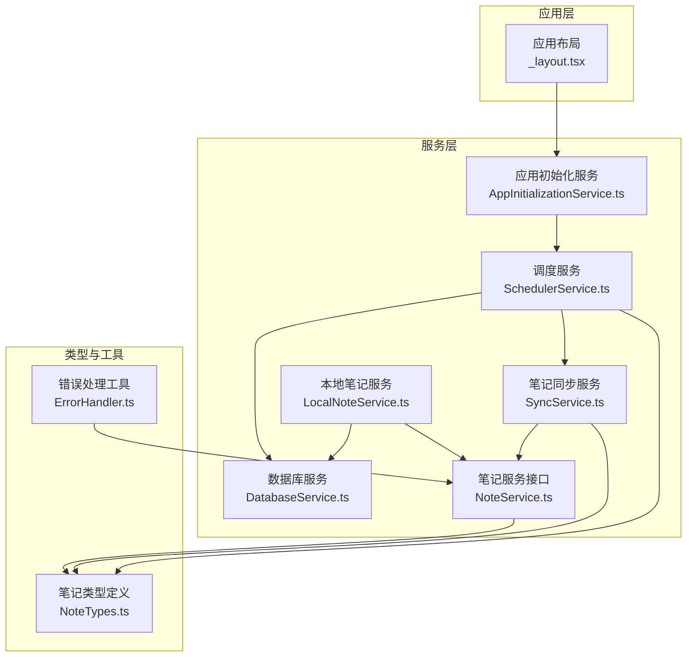
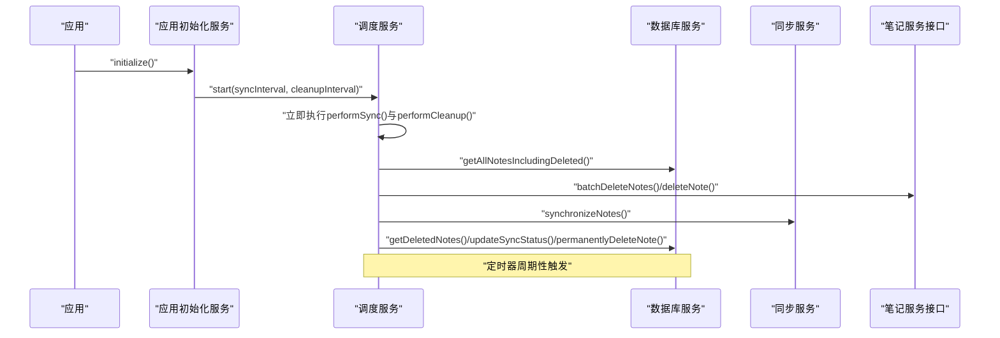
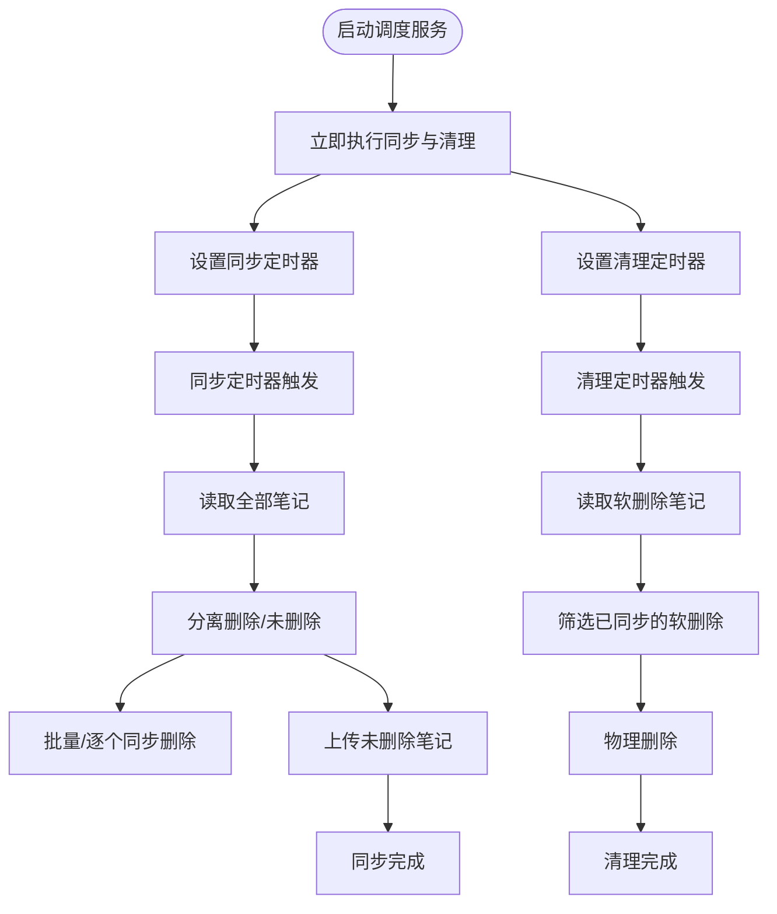
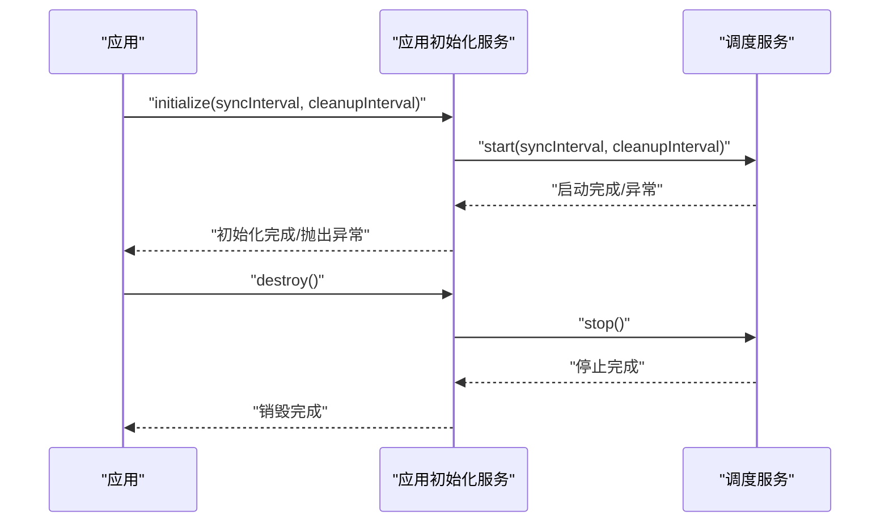
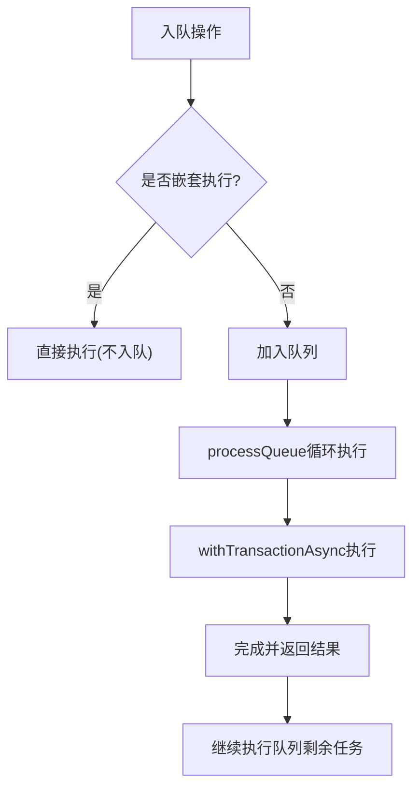
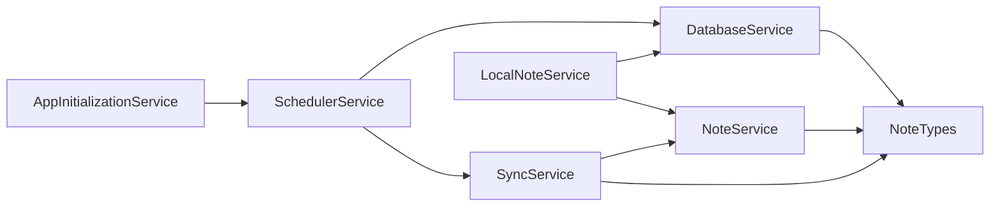

# 调度服务

<cite>
**本文引用的文件**
- [SchedulerService.ts](file://services/scheduler/SchedulerService.ts)
- [AppInitializationService.ts](file://services/AppInitializationService.ts)
- [DatabaseService.ts](file://services/database/DatabaseService.ts)
- [SyncService.ts](file://services/notes/SyncService.ts)
- [NoteService.ts](file://services/notes/NoteService.ts)
- [LocalNoteService.ts](file://services/local/LocalNoteService.ts)
- [_layout.tsx](file://app/_layout.tsx)
- [services/index.ts](file://services/index.ts)
- [NoteTypes.ts](file://types/note/NoteTypes.ts)
- [ErrorHandler.ts](file://utils/ErrorHandler.ts)
- [package.json](file://package.json)
</cite>

## 目录

1. [简介](#简介)
2. [项目结构](#项目结构)
3. [核心组件](#核心组件)
4. [架构总览](#架构总览)
5. [详细组件分析](#详细组件分析)
6. [依赖分析](#依赖分析)
7. [性能考虑](#性能考虑)
8. [故障排查指南](#故障排查指南)
9. [结论](#结论)
10. [附录](#附录)

## 简介

本文件为调度服务的系统化架构文档，聚焦定时任务的设计原理与实现机制，涵盖任务调度算法、执行时机控制、资源管理策略；后台任务处理流程（任务队列管理、优先级排序、并发控制）；应用初始化服务的启动流程（服务依赖关系、初始化顺序、错误恢复机制）；定时同步任务的实现（同步间隔配置、网络状态检测、电池优化策略）；调度服务与其他模块的集成方式（事件监听、状态通知、错误传播机制）；以及配置选项与自定义扩展点。同时提供性能监控与调试工具使用建议，帮助开发者优化调度效率。

## 项目结构

调度服务位于 services/scheduler/SchedulerService.ts，围绕定时任务与数据库/网络交互展开，配合应用初始化服务、数据库服务、笔记同步服务与本地笔记服务协同工作。应用入口在 app/\_layout.tsx 中触发初始化流程。

图表来源

- [SchedulerService.ts](file://services/scheduler/SchedulerService.ts#L1-L233)
- [AppInitializationService.ts](file://services/AppInitializationService.ts#L1-L63)
- [DatabaseService.ts](file://services/database/DatabaseService.ts#L1-L513)
- [SyncService.ts](file://services/notes/SyncService.ts#L1-L58)
- [NoteService.ts](file://services/notes/NoteService.ts#L1-L84)
- [LocalNoteService.ts](file://services/local/LocalNoteService.ts#L1-L601)
- [NoteTypes.ts](file://types/note/NoteTypes.ts#L1-L109)
- [ErrorHandler.ts](file://utils/ErrorHandler.ts#L1-L48)
- [\_layout.tsx](file://app/_layout.tsx#L1-L84)

章节来源

- [SchedulerService.ts](file://services/scheduler/SchedulerService.ts#L1-L233)
- [AppInitializationService.ts](file://services/AppInitializationService.ts#L1-L63)
- [DatabaseService.ts](file://services/database/DatabaseService.ts#L1-L513)
- [SyncService.ts](file://services/notes/SyncService.ts#L1-L58)
- [NoteService.ts](file://services/notes/NoteService.ts#L1-L84)
- [LocalNoteService.ts](file://services/local/LocalNoteService.ts#L1-L601)
- [\_layout.tsx](file://app/_layout.tsx#L1-L84)

## 核心组件

- 调度服务（SchedulerService）：负责定时执行“同步”和“清理”两类后台任务，支持可配置的同步间隔与清理间隔，具备幂等与错误恢复能力。
- 应用初始化服务（AppInitializationService）：负责应用启动时的初始化工作，包括启动调度服务与生命周期管理。
- 数据库服务（DatabaseService）：提供统一的数据库访问与并发控制，采用任务队列与事务封装，保障高并发场景下的数据一致性。
- 笔记同步服务（SyncService）：封装与服务器的同步逻辑，支持批量上传与增量更新。
- 笔记服务接口（NoteService）：封装与后端API交互，提供批量删除、同步等接口。
- 本地笔记服务（LocalNoteService）：面向UI层的业务封装，提供删除、批量删除、安全删除等能力，并与数据库/网络交互。
- 类型定义（NoteTypes）：统一笔记实体与请求/响应结构。
- 错误处理工具（ErrorHandler）：提供网络错误识别与统一错误处理策略。

章节来源

- [SchedulerService.ts](file://services/scheduler/SchedulerService.ts#L1-L233)
- [AppInitializationService.ts](file://services/AppInitializationService.ts#L1-L63)
- [DatabaseService.ts](file://services/database/DatabaseService.ts#L1-L513)
- [SyncService.ts](file://services/notes/SyncService.ts#L1-L58)
- [NoteService.ts](file://services/notes/NoteService.ts#L1-L84)
- [LocalNoteService.ts](file://services/local/LocalNoteService.ts#L1-L601)
- [NoteTypes.ts](file://types/note/NoteTypes.ts#L1-L109)
- [ErrorHandler.ts](file://utils/ErrorHandler.ts#L1-L48)

## 架构总览

调度服务通过定时器驱动两类任务：

- 同步任务：拉取本地全部笔记（含软删除），分离删除与未删除两类，分别调用批量删除与现有同步机制上传未删除笔记。
- 清理任务：筛选已同步的软删除笔记，进行物理删除，释放本地存储空间。

应用初始化服务在应用启动时调用调度服务的启动方法，传入可配置的同步间隔与清理间隔，默认分别为30分钟与1小时。

图表来源

- [AppInitializationService.ts](file://services/AppInitializationService.ts#L16-L37)
- [SchedulerService.ts](file://services/scheduler/SchedulerService.ts#L23-L50)
- [DatabaseService.ts](file://services/database/DatabaseService.ts#L408-L412)
- [SyncService.ts](file://services/notes/SyncService.ts#L13-L36)
- [NoteService.ts](file://services/notes/NoteService.ts#L57-L70)

## 详细组件分析

### 调度服务（SchedulerService）

- 设计要点
  - 双定时器：同步定时器与清理定时器，分别控制不同任务的执行频率。
  - 幂等与容错：同步任务会区分删除与未删除笔记，删除任务支持批量与逐个回退策略；清理任务仅处理已同步的软删除笔记。
  - 网络错误策略：针对网络错误（如超时、断网）采取静默处理，避免重复尝试，同时更新本地同步状态以保证一致性。
- 关键流程
  - 启动：立即执行一次同步与清理，随后按配置间隔启动定时器。
  - 停止：清理定时器并重置运行状态。
  - 同步：读取全部笔记，拆分删除/未删除，分别处理；未删除笔记复用现有同步机制。
  - 清理：筛选已同步的软删除笔记并物理删除。
- 并发与资源管理
  - 通过数据库服务的统一队列与事务封装，避免并发写入冲突。
  - 定时器为异步任务，不会阻塞主线程。

图表来源

- [SchedulerService.ts](file://services/scheduler/SchedulerService.ts#L23-L50)
- [SchedulerService.ts](file://services/scheduler/SchedulerService.ts#L73-L98)
- [SchedulerService.ts](file://services/scheduler/SchedulerService.ts#L196-L229)

章节来源

- [SchedulerService.ts](file://services/scheduler/SchedulerService.ts#L1-L233)

### 应用初始化服务（AppInitializationService）

- 设计要点
  - 单例式静态初始化，避免重复初始化。
  - 在初始化过程中启动调度服务，并捕获异常以便上层处理。
  - 提供销毁方法，停止调度服务并重置状态。
- 生命周期
  - initialize：启动调度服务，设置初始化标志。
  - destroy：停止调度服务，清除标志。
  - isAppInitialized：查询初始化状态。

图表来源

- [AppInitializationService.ts](file://services/AppInitializationService.ts#L16-L37)
- [AppInitializationService.ts](file://services/AppInitializationService.ts#L42-L52)

章节来源

- [AppInitializationService.ts](file://services/AppInitializationService.ts#L1-L63)
- [\_layout.tsx](file://app/_layout.tsx#L42-L47)

### 数据库服务（DatabaseService）

- 设计要点
  - 数据库实例获取与初始化：带轮询等待与超时保护，确保并发安全。
  - 任务队列与重入锁：支持嵌套调用不重复入队，避免死锁；失败时自动重置数据库实例。
  - 事务封装：批量操作（创建/更新/删除）在事务内执行，保证原子性。
  - 同步优化：使用内存Map对比，减少多次查询与死锁风险。
- 并发控制
  - executeDbOperation：统一调度器，串行执行队列任务。
  - processQueue：基于while循环与setImmediate的轻量调度，避免阻塞。
- 资源管理
  - closeDatabase：显式关闭数据库连接，异常时重置实例。

图表来源

- [DatabaseService.ts](file://services/database/DatabaseService.ts#L62-L101)
- [DatabaseService.ts](file://services/database/DatabaseService.ts#L103-L115)

章节来源

- [DatabaseService.ts](file://services/database/DatabaseService.ts#L1-L513)

### 笔记同步服务（SyncService）

- 设计要点
  - synchronizeNotes：读取本地全部笔记（含软删除），构造同步请求，调用后端接口，处理返回的更新集合并回写数据库。
  - uploadNotesForSync：对指定笔记集合进行上传同步。
- 与调度服务的协作
  - 调度服务在“同步任务”中调用 synchronizeNotes，实现未删除笔记的上传与合并。

章节来源

- [SyncService.ts](file://services/notes/SyncService.ts#L1-L58)
- [SchedulerService.ts](file://services/scheduler/SchedulerService.ts#L181-L190)

### 笔记服务接口（NoteService）

- 设计要点
  - 提供批量删除、批量插入/更新、同步等API封装。
  - 与调度服务中的“同步任务”配合，实现删除标记与未删除笔记的上传。
- 错误处理
  - 与错误处理工具配合，识别网络错误并进行静默处理或抛出。

章节来源

- [NoteService.ts](file://services/notes/NoteService.ts#L1-L84)
- [ErrorHandler.ts](file://utils/ErrorHandler.ts#L1-L48)

### 本地笔记服务（LocalNoteService）

- 设计要点
  - 面向UI层的业务封装，提供删除、批量删除、安全删除等能力。
  - 删除操作在本地软删除后尝试同步至服务端，网络错误时静默处理，确保本地删除不被阻塞。
- 与调度服务的协作
  - 调度服务在“同步任务”中调用批量删除接口，失败时逐个删除并更新本地同步状态。
  - 调度服务在“清理任务”中物理删除已同步的软删除笔记。

章节来源

- [LocalNoteService.ts](file://services/local/LocalNoteService.ts#L119-L152)
- [LocalNoteService.ts](file://services/local/LocalNoteService.ts#L157-L211)
- [LocalNoteService.ts](file://services/local/LocalNoteService.ts#L216-L226)
- [SchedulerService.ts](file://services/scheduler/SchedulerService.ts#L104-L176)
- [SchedulerService.ts](file://services/scheduler/SchedulerService.ts#L196-L229)

### 类型定义（NoteTypes）

- 设计要点
  - 统一笔记实体结构与请求/响应类型，便于跨模块传递与校验。
- 与调度服务的协作
  - 调度服务在同步任务中使用Note类型进行过滤与上传。

章节来源

- [NoteTypes.ts](file://types/note/NoteTypes.ts#L1-L109)
- [NoteService.ts](file://services/notes/NoteService.ts#L1-L84)
- [SyncService.ts](file://services/notes/SyncService.ts#L1-L58)

## 依赖分析

- 组件耦合
  - 调度服务依赖数据库服务（读取/更新/删除）、笔记同步服务（上传未删除笔记）、笔记服务接口（批量删除）。
  - 应用初始化服务依赖调度服务，负责启动与销毁。
  - 本地笔记服务与数据库服务、笔记服务接口紧密耦合，为UI层提供业务能力。
- 外部依赖
  - 数据库：expo-sqlite，提供SQLite数据库能力。
  - 网络：axios，提供HTTP请求能力。
- 循环依赖
  - 当前模块间无明显循环依赖；若后续扩展需注意避免引入循环导入。

图表来源

- [AppInitializationService.ts](file://services/AppInitializationService.ts#L1-L63)
- [SchedulerService.ts](file://services/scheduler/SchedulerService.ts#L1-L233)
- [DatabaseService.ts](file://services/database/DatabaseService.ts#L1-L513)
- [SyncService.ts](file://services/notes/SyncService.ts#L1-L58)
- [NoteService.ts](file://services/notes/NoteService.ts#L1-L84)
- [LocalNoteService.ts](file://services/local/LocalNoteService.ts#L1-L601)
- [NoteTypes.ts](file://types/note/NoteTypes.ts#L1-L109)

章节来源

- [package.json](file://package.json#L14-L41)

## 性能考虑

- 定时任务频率
  - 默认同步间隔30分钟、清理间隔1小时，可根据设备性能与网络状况调整。
- 数据库并发
  - 通过统一队列与事务封装，避免高并发写入导致的死锁与数据不一致。
- 网络错误处理
  - 针对网络错误采取静默处理与状态更新，减少重复尝试与电量消耗。
- 任务粒度
  - 批量删除优先，失败后逐个删除，兼顾吞吐与可靠性。
- 存储清理
  - 清理任务仅删除已同步的软删除笔记，避免频繁I/O。

[本节为通用性能指导，无需具体文件分析]

## 故障排查指南

- 同步任务失败
  - 检查网络状态与后端可用性；关注批量删除与逐个删除的回退路径日志。
  - 若出现网络错误，确认静默处理是否生效，本地同步状态是否正确更新。
- 清理任务无效
  - 确认软删除笔记的同步状态字段是否正确更新为已同步。
  - 检查清理任务的过滤条件与物理删除调用。
- 初始化失败
  - 查看应用初始化服务的日志与异常堆栈，确认调度服务启动是否成功。
- 数据库异常
  - 关注数据库实例重置与队列处理逻辑，必要时重启应用以重建数据库连接。

章节来源

- [SchedulerService.ts](file://services/scheduler/SchedulerService.ts#L95-L98)
- [SchedulerService.ts](file://services/scheduler/SchedulerService.ts#L173-L176)
- [DatabaseService.ts](file://services/database/DatabaseService.ts#L78-L95)
- [AppInitializationService.ts](file://services/AppInitializationService.ts#L33-L36)

## 结论

调度服务通过双定时器与数据库/网络的协同，实现了可靠的定时同步与本地清理。其设计强调幂等性、容错性与并发安全，结合应用初始化服务与本地笔记服务，形成完整的后台任务体系。开发者可通过调整定时间隔与扩展错误处理策略，进一步优化调度效率与用户体验。

[本节为总结性内容，无需具体文件分析]

## 附录

### 配置选项与自定义扩展点

- 启动参数
  - 同步间隔（毫秒）：用于设置同步定时器的触发周期。
  - 清理间隔（毫秒）：用于设置清理定时器的触发周期。
- 扩展点
  - 自定义同步策略：可在同步任务中增加过滤条件或分批上传策略。
  - 自定义清理策略：可调整清理阈值与批量删除策略。
  - 错误处理策略：可结合错误处理工具，针对不同错误类型定制行为。

章节来源

- [AppInitializationService.ts](file://services/AppInitializationService.ts#L16-L19)
- [SchedulerService.ts](file://services/scheduler/SchedulerService.ts#L23-L26)
- [ErrorHandler.ts](file://utils/ErrorHandler.ts#L18-L47)

### 调试与监控建议

- 日志定位
  - 关注调度服务的启动、同步、清理阶段日志，定位异常发生点。
  - 数据库服务的队列执行与事务回滚日志，排查并发问题。
- 性能观测
  - 监控定时任务执行耗时与数据库I/O次数，评估清理频率与批量大小。
- 网络诊断
  - 使用错误处理工具识别网络错误类型，结合静默处理策略优化电池使用。

章节来源

- [DatabaseService.ts](file://services/database/DatabaseService.ts#L62-L101)
- [ErrorHandler.ts](file://utils/ErrorHandler.ts#L1-L48)
