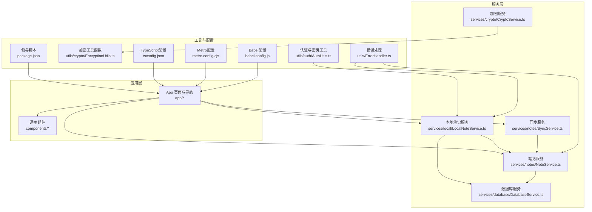
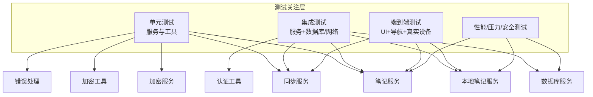
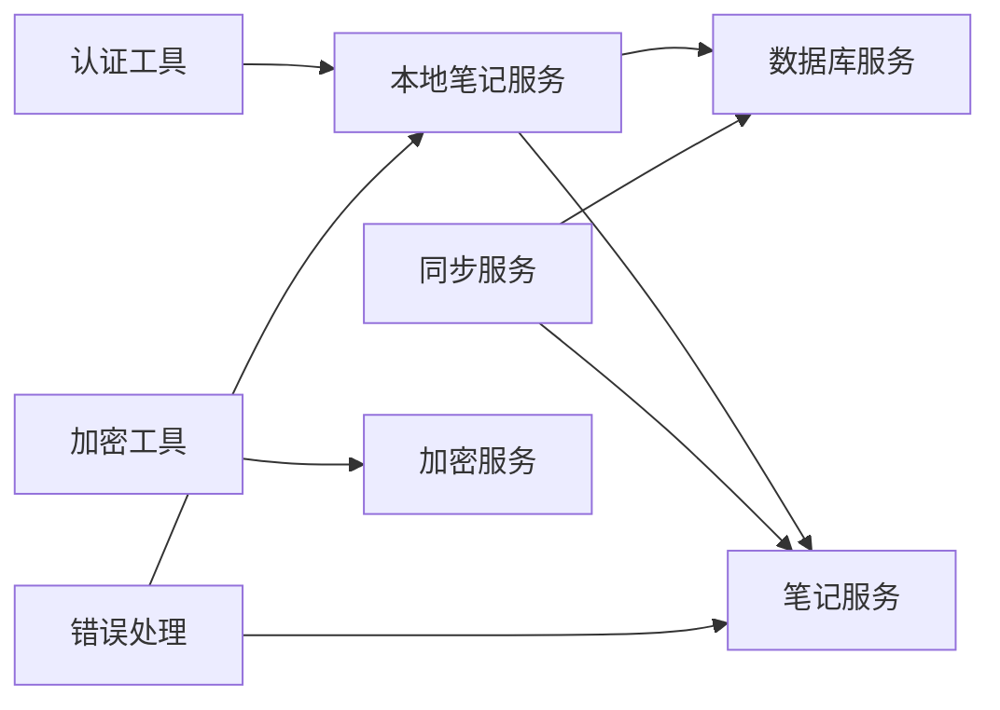

# 测试策略

<cite>
**本文引用的文件**
- [package.json](file://package.json)
- [tsconfig.json](file://tsconfig.json)
- [metro.config.cjs](file://metro.config.cjs)
- [babel.config.js](file://babel.config.js)
- [services/index.ts](file://services/index.ts)
- [services/notes/NoteService.ts](file://services/notes/NoteService.ts)
- [services/database/DatabaseService.ts](file://services/database/DatabaseService.ts)
- [services/local/LocalNoteService.ts](file://services/local/LocalNoteService.ts)
- [services/notes/SyncService.ts](file://services/notes/SyncService.ts)
- [services/crypto/CryptoService.ts](file://services/crypto/CryptoService.ts)
- [utils/auth/AuthUtils.ts](file://utils/auth/AuthUtils.ts)
- [utils/crypto/EncryptionUtils.ts](file://utils/crypto/EncryptionUtils.ts)
- [utils/ErrorHandler.ts](file://utils/ErrorHandler.ts)
</cite>

## 目录

1. [简介](#简介)
2. [项目结构](#项目结构)
3. [核心组件](#核心组件)
4. [架构总览](#架构总览)
5. [详细组件分析](#详细组件分析)
6. [依赖关系分析](#依赖关系分析)
7. [性能考量](#性能考量)
8. [故障排查指南](#故障排查指南)
9. [结论](#结论)
10. [附录](#附录)

## 简介

本测试策略文档面向Notes应用，旨在建立覆盖单元测试、集成测试、端到端测试与性能测试的系统化测试体系。文档明确测试框架选择与配置、测试用例设计原则与覆盖率目标、测试数据准备与管理策略、自动化测试与持续集成流程、测试环境搭建与维护，以及性能测试、压力测试与安全测试的实施方案，并提供测试工具与调试技巧指导。

## 项目结构

Notes应用采用Expo + React Native技术栈，核心业务围绕“笔记服务”“数据库服务”“同步服务”“加密服务”“认证与密钥管理”展开；前端路由与页面位于app目录，通用组件位于components目录，类型定义位于types目录，工具类位于utils目录，服务层位于services目录。

图表来源

- [services/notes/NoteService.ts](file://services/notes/NoteService.ts#L1-L84)
- [services/notes/SyncService.ts](file://services/notes/SyncService.ts#L1-L58)
- [services/database/DatabaseService.ts](file://services/database/DatabaseService.ts#L1-L513)
- [services/local/LocalNoteService.ts](file://services/local/LocalNoteService.ts#L1-L601)
- [services/crypto/CryptoService.ts](file://services/crypto/CryptoService.ts#L1-L205)
- [utils/auth/AuthUtils.ts](file://utils/auth/AuthUtils.ts#L1-L65)
- [utils/crypto/EncryptionUtils.ts](file://utils/crypto/EncryptionUtils.ts#L1-L112)
- [utils/ErrorHandler.ts](file://utils/ErrorHandler.ts#L1-L48)
- [package.json](file://package.json#L1-L69)
- [tsconfig.json](file://tsconfig.json#L1-L12)
- [metro.config.cjs](file://metro.config.cjs#L1-L10)
- [babel.config.js](file://babel.config.js#L1-L15)

章节来源

- [package.json](file://package.json#L1-L69)
- [tsconfig.json](file://tsconfig.json#L1-L12)
- [metro.config.cjs](file://metro.config.cjs#L1-L10)
- [babel.config.js](file://babel.config.js#L1-L15)

## 核心组件

- 笔记服务：封装REST API调用，提供获取、创建、更新、删除、批量操作与同步等接口。
- 数据库服务：基于SQLite封装，提供连接管理、操作队列、事务与批量操作、与服务器同步等能力。
- 本地笔记服务：协调本地数据库与远程API，实现删除与同步的容错策略。
- 同步服务：负责客户端与服务端的双向同步。
- 加密服务与工具：提供AES加解密、密钥生成与元数据封装。
- 认证与密钥工具：提供API密钥与URL的安全存储与校验。
- 错误处理：统一识别网络错误与删除操作的静默处理策略。

章节来源

- [services/notes/NoteService.ts](file://services/notes/NoteService.ts#L1-L84)
- [services/database/DatabaseService.ts](file://services/database/DatabaseService.ts#L1-L513)
- [services/local/LocalNoteService.ts](file://services/local/LocalNoteService.ts#L1-L601)
- [services/notes/SyncService.ts](file://services/notes/SyncService.ts#L1-L58)
- [services/crypto/CryptoService.ts](file://services/crypto/CryptoService.ts#L1-L205)
- [utils/auth/AuthUtils.ts](file://utils/auth/AuthUtils.ts#L1-L65)
- [utils/ErrorHandler.ts](file://utils/ErrorHandler.ts#L1-L48)

## 架构总览

下图展示测试关注点与组件交互关系，强调服务层与工具层的可测性与隔离。

图表来源

- [services/notes/NoteService.ts](file://services/notes/NoteService.ts#L1-L84)
- [services/notes/SyncService.ts](file://services/notes/SyncService.ts#L1-L58)
- [services/database/DatabaseService.ts](file://services/database/DatabaseService.ts#L1-L513)
- [services/local/LocalNoteService.ts](file://services/local/LocalNoteService.ts#L1-L601)
- [services/crypto/CryptoService.ts](file://services/crypto/CryptoService.ts#L1-L205)
- [utils/auth/AuthUtils.ts](file://utils/auth/AuthUtils.ts#L1-L65)
- [utils/ErrorHandler.ts](file://utils/ErrorHandler.ts#L1-L48)

## 详细组件分析

### 单元测试方案

- 测试范围
  - 加密服务与工具：验证密钥生成、加解密、元数据封装与字符串密钥处理。
  - 认证与密钥工具：验证API密钥/URL格式校验、安全存储读写。
  - 错误处理：验证网络错误识别与删除操作静默策略。
  - 笔记服务：验证API参数构造、响应解析与错误传播。
- 测试策略
  - 使用React Test Renderer渲染最小化组件，断言行为而非UI细节。
  - 使用Jest Mock隔离外部依赖（如API、存储、数据库），确保纯函数可测。
  - 对纯函数（如加密工具、错误处理）进行边界条件与异常分支覆盖。
- 覆盖率目标
  - 关键路径与异常分支覆盖率≥80%，核心工具函数≥90%。

章节来源

- [services/crypto/CryptoService.ts](file://services/crypto/CryptoService.ts#L1-L205)
- [utils/crypto/EncryptionUtils.ts](file://utils/crypto/EncryptionUtils.ts#L1-L112)
- [utils/auth/AuthUtils.ts](file://utils/auth/AuthUtils.ts#L1-L65)
- [utils/ErrorHandler.ts](file://utils/ErrorHandler.ts#L1-L48)
- [services/notes/NoteService.ts](file://services/notes/NoteService.ts#L1-L84)

### 集成测试策略

- 测试范围
  - 本地笔记服务与数据库服务：批量操作、软删除、同步状态管理、与服务器同步。
  - 同步服务：客户端与服务器双向同步流程。
  - 笔记服务与数据库服务：事务、队列与并发控制。
- 测试策略
  - 使用内存数据库或临时数据库文件，模拟真实SQL环境。
  - 使用Mock服务器拦截API请求，验证请求体、参数与响应。
  - 验证删除操作在网络错误下的本地容错与同步状态更新。
- 覆盖率目标
  - 关键业务流程覆盖率≥90%，并发与异常场景≥80%。

章节来源

- [services/local/LocalNoteService.ts](file://services/local/LocalNoteService.ts#L1-L601)
- [services/database/DatabaseService.ts](file://services/database/DatabaseService.ts#L1-L513)
- [services/notes/SyncService.ts](file://services/notes/SyncService.ts#L1-L58)

### 端到端测试

- 测试范围
  - 应用启动、导航、笔记增删改查、同步触发与结果反馈。
  - 加密笔记的创建、编辑与解密验证。
  - 设置页面的API密钥与URL配置流程。
- 测试策略
  - 使用Expo Dev Client在真机或模拟器运行，结合快照或元素存在性断言。
  - 使用测试账户与预置数据，确保可重复性。
  - 对关键用户路径进行回归测试，优先保障主流程稳定。
- 覆盖率目标
  - 主要用户路径≥95%，关键异常路径≥80%。

章节来源

- [services/local/LocalNoteService.ts](file://services/local/LocalNoteService.ts#L1-L601)
- [services/notes/NoteService.ts](file://services/notes/NoteService.ts#L1-L84)
- [utils/auth/AuthUtils.ts](file://utils/auth/AuthUtils.ts#L1-L65)

### 性能测试、压力测试与安全测试

- 性能测试
  - 目标：评估数据库批量操作、同步流程、UI渲染与网络请求的性能表现。
  - 方法：使用基准测试工具测量关键操作耗时，对比不同数据规模下的性能曲线。
- 压力测试
  - 目标：验证高并发批量操作与同步时系统的稳定性与资源占用。
  - 方法：模拟大量笔记的创建/更新/删除与同步，监控内存、CPU与数据库锁等待。
- 安全测试
  - 目标：验证密钥存储安全性、API密钥与URL校验、敏感数据传输与存储。
  - 方法：静态扫描密钥硬编码、动态测试弱密钥与不安全协议、验证存储后端权限。

章节来源

- [services/database/DatabaseService.ts](file://services/database/DatabaseService.ts#L1-L513)
- [services/crypto/CryptoService.ts](file://services/crypto/CryptoService.ts#L1-L205)
- [utils/auth/AuthUtils.ts](file://utils/auth/AuthUtils.ts#L1-L65)

### 测试框架选择与配置

- 测试运行时与渲染
  - Jest：用于单元与集成测试，配合React Test Renderer渲染组件。
  - TypeScript支持：通过tsconfig配置与路径映射，确保类型安全。
- 构建与打包
  - Metro：禁用Web平台，聚焦iOS/Android。
  - Babel：启用nativewind与reanimated插件，保证测试环境与生产一致。
- 代码质量
  - ESLint + Prettier：统一风格与规则，husky + lint-staged在提交前自动检查。
- 脚本与CI
  - package.json脚本：提供start/android/ios/lint/format等命令，便于CI流水线复用。

章节来源

- [package.json](file://package.json#L1-L69)
- [tsconfig.json](file://tsconfig.json#L1-L12)
- [metro.config.cjs](file://metro.config.cjs#L1-L10)
- [babel.config.js](file://babel.config.js#L1-L15)

### 测试用例设计原则与覆盖率要求

- 设计原则
  - 原子性：每个用例聚焦单一行为或边界条件。
  - 可重复性：使用固定种子数据与Mock，避免随机性。
  - 可维护性：用例命名清晰，前置条件与断言明确。
  - 可观测性：对关键路径输出日志或指标，便于定位问题。
- 覆盖率要求
  - 语句覆盖率：≥80%
  - 分支覆盖率：≥75%
  - 函数覆盖率：≥90%
  - 行覆盖率：≥80%

### 测试数据准备与管理策略

- 数据准备
  - 使用工厂函数或构建器生成测试笔记数据，包含正常、边界与异常场景。
  - 为加密场景准备固定密钥与元数据，确保可复现。
- 数据隔离
  - 单测使用内存或临时数据库；集成测使用独立测试数据库。
  - 使用Mock服务器与测试环境变量，避免污染生产数据。
- 数据清理
  - 每个用例结束后清理数据库与存储，确保用例间无副作用。

### 自动化测试与持续集成流程

- CI阶段建议
  - 安装依赖与缓存
  - Lint与格式检查
  - 单元测试与覆盖率上报
  - 集成测试（可选在专用容器中）
  - 端到端测试（可选在云真机/模拟器）
  - 性能回归阈值检查
- 触发策略
  - Pull Request触发基础测试；主分支推送触发全量测试与发布前检查。
- 报告与回溯
  - 生成测试报告与覆盖率图表，失败时保留日志与截图。

### 测试环境搭建与维护

- 本地环境
  - 安装Node、Expo CLI与平台SDK；配置Metro与Babel以匹配生产环境。
  - 使用Expo Dev Client在真机/模拟器运行E2E测试。
- 测试数据库
  - 配置独立数据库文件或容器，确保可快速初始化与销毁。
- Mock与假数据
  - 使用Mock服务器拦截API，注入测试响应；使用假数据生成器保证多样性。

### 测试工具与调试技巧

- 工具
  - Jest：测试运行与断言
  - React Test Renderer：组件渲染与行为断言
  - Mock服务器：拦截与伪造API响应
  - 性能分析工具：追踪数据库锁、网络延迟与UI卡顿
- 调试技巧
  - 逐步缩小范围：先单测后集成测，再E2E测。
  - 日志与指标：在关键路径输出时间戳与状态，便于定位瓶颈。
  - 稳定性测试：在长时间运行中观察内存泄漏与数据库锁等待。

## 依赖关系分析

- 组件耦合
  - 本地笔记服务依赖数据库服务与笔记服务，承担删除与同步的容错策略。
  - 同步服务依赖笔记服务与数据库服务，负责双向同步。
  - 加密工具依赖加密服务，提供便捷的加解密入口。
- 外部依赖
  - SQLite：本地持久化
  - Axios：网络请求
  - AsyncStorage/SecureStore：密钥与配置存储
- 循环依赖
  - 当前结构未发现循环依赖；若后续扩展需注意模块拆分与接口抽象。

图表来源

- [services/local/LocalNoteService.ts](file://services/local/LocalNoteService.ts#L1-L601)
- [services/database/DatabaseService.ts](file://services/database/DatabaseService.ts#L1-L513)
- [services/notes/NoteService.ts](file://services/notes/NoteService.ts#L1-L84)
- [services/notes/SyncService.ts](file://services/notes/SyncService.ts#L1-L58)
- [services/crypto/CryptoService.ts](file://services/crypto/CryptoService.ts#L1-L205)
- [utils/auth/AuthUtils.ts](file://utils/auth/AuthUtils.ts#L1-L65)
- [utils/ErrorHandler.ts](file://utils/ErrorHandler.ts#L1-L48)

章节来源

- [services/index.ts](file://services/index.ts#L1-L82)

## 性能考量

- 数据库性能
  - 使用事务与批量操作减少锁竞争；队列化高频操作避免死锁。
  - 同步时使用内存Map对比，降低重复查询成本。
- 网络性能
  - 统一错误处理与超时控制，区分网络错误与业务错误。
  - 删除操作在网络错误下静默本地删除，提升用户体验。
- 加密性能
  - 优先使用内存中的密钥Buffer，避免频繁序列化/反序列化。
  - 对大文本加密采用分块策略（如适用）。

章节来源

- [services/database/DatabaseService.ts](file://services/database/DatabaseService.ts#L1-L513)
- [utils/ErrorHandler.ts](file://utils/ErrorHandler.ts#L1-L48)
- [services/crypto/CryptoService.ts](file://services/crypto/CryptoService.ts#L1-L205)

## 故障排查指南

- 常见问题
  - 删除操作失败：检查网络错误与服务端响应；确认本地软删除与同步状态更新。
  - 同步不一致：核对时间戳比较逻辑与事务一致性。
  - 加密异常：检查密钥格式、算法与元数据完整性。
- 排查步骤
  - 单测定位纯函数问题；集成测验证服务与数据库交互；E2E验证用户路径。
  - 使用日志与指标定位瓶颈；必要时开启数据库与网络抓包。
- 错误处理
  - 使用统一错误处理函数分类打印；对删除操作在网络错误下进行静默处理。

章节来源

- [utils/ErrorHandler.ts](file://utils/ErrorHandler.ts#L1-L48)
- [services/local/LocalNoteService.ts](file://services/local/LocalNoteService.ts#L1-L601)
- [services/database/DatabaseService.ts](file://services/database/DatabaseService.ts#L1-L513)

## 结论

通过分层测试策略与严格的覆盖率目标，Notes应用可在功能正确性、性能稳定性与安全性方面获得全面保障。建议优先完善单元与集成测试，逐步引入端到端与性能/压力/安全测试，并将其纳入CI流水线，持续迭代优化。

## 附录

- 测试清单
  - 单元测试：加密服务、加密工具、认证工具、错误处理
  - 集成测试：本地笔记服务、数据库服务、同步服务
  - 端到端测试：主流程、设置与配置、加密笔记
  - 性能/压力/安全测试：基准与回归阈值
- 参考文件
  - 服务与工具实现：见各服务与工具文件
  - 配置与脚本：见package.json、tsconfig.json、metro.config.cjs、babel.config.js
