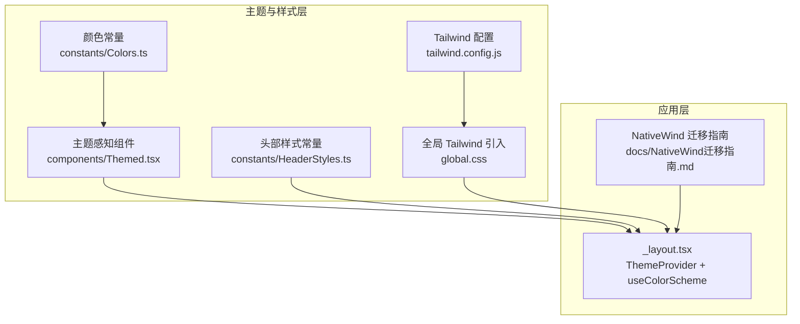
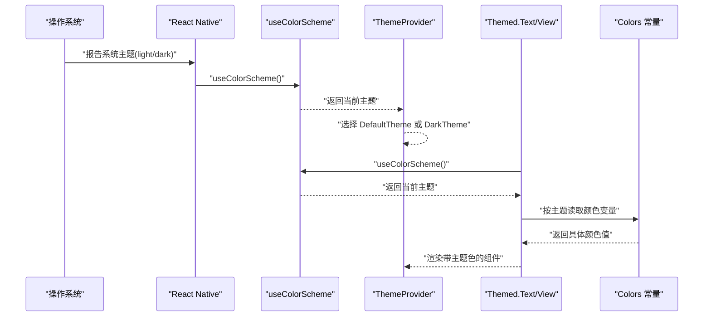
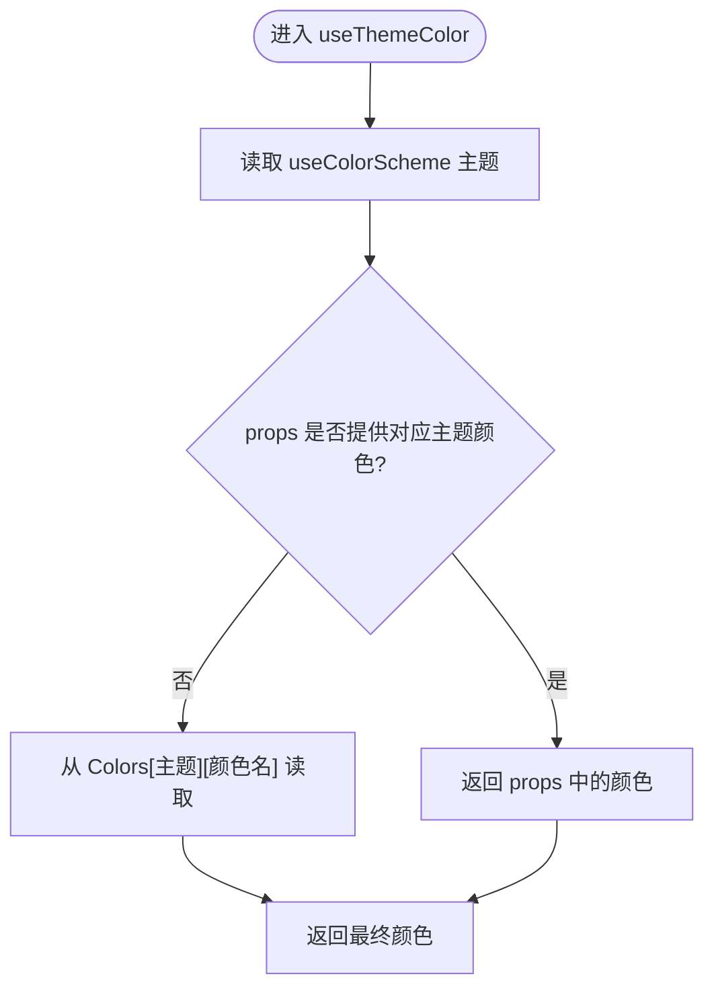
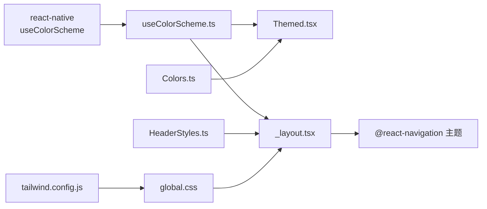

# 主题样式组件

<cite>
**本文引用的文件**
- [components/useColorScheme.ts](file://components/useColorScheme.ts)
- [components/Themed.tsx](file://components/Themed.tsx)
- [constants/Colors.ts](file://constants/Colors.ts)
- [constants/HeaderStyles.ts](file://constants/HeaderStyles.ts)
- [app/_layout.tsx](file://app/_layout.tsx)
- [tailwind.config.js](file://tailwind.config.js)
- [global.css](file://global.css)
- [docs/NativeWind迁移指南.md](file://docs/NativeWind迁移指南.md)
- [components/NoteListWithSelection.tsx](file://components/NoteListWithSelection.tsx)
</cite>

## 目录

1. [简介](#简介)
2. [项目结构](#项目结构)
3. [核心组件](#核心组件)
4. [架构总览](#架构总览)
5. [详细组件分析](#详细组件分析)
6. [依赖关系分析](#依赖关系分析)
7. [性能考虑](#性能考虑)
8. [故障排查指南](#故障排查指南)
9. [结论](#结论)
10. [附录](#附录)

## 简介

本文件围绕主题样式组件进行系统化文档整理，重点覆盖以下方面：

- 主题系统架构与颜色方案管理
- 深色/浅色模式实现与动态切换机制
- 颜色变量定义与样式继承策略
- useColorScheme 钩子的使用与主题感知组件
- 头部样式定制与导航栏主题适配
- 组件样式统一与 NativeWind 集成
- 主题扩展接口、自定义颜色方案与品牌色彩集成
- 主题缓存策略、性能优化与内存管理
- 跨平台主题适配与系统主题同步

## 项目结构

主题系统由“颜色常量定义 + 主题感知组件 + 导航主题提供 + NativeWind 支持”构成，配合全局 Tailwind 预设与渐进式迁移策略，确保在不破坏现有功能的前提下引入原子化样式。

图表来源

- [constants/Colors.ts](file://constants/Colors.ts#L1-L20)
- [components/Themed.tsx](file://components/Themed.tsx#L1-L65)
- [constants/HeaderStyles.ts](file://constants/HeaderStyles.ts#L1-L141)
- [tailwind.config.js](file://tailwind.config.js#L1-L9)
- [global.css](file://global.css#L1-L3)
- [app/\_layout.tsx](file://app/_layout.tsx#L1-L84)
- [docs/NativeWind迁移指南.md](file://docs/NativeWind迁移指南.md#L1-L133)

章节来源

- [app/\_layout.tsx](file://app/_layout.tsx#L1-L84)
- [tailwind.config.js](file://tailwind.config.js#L1-L9)
- [global.css](file://global.css#L1-L3)

## 核心组件

- 颜色常量：集中定义浅色/深色两套颜色方案，包括文本、背景、强调色与标签页图标等。
- 主题感知组件：封装 Text/View，基于 useColorScheme 与颜色常量动态选择颜色；同时兼容 NativeWind 的 className。
- useColorScheme 钩子：统一从 react-native 获取当前系统主题，并作为导航主题与组件主题的依据。
- 导航主题提供者：根据系统主题选择默认/暗色导航主题，保证整体视觉一致。
- 头部样式常量：提供标准、带边框、简化等头部容器样式与统一的内边距常量，便于快速复用。
- NativeWind 集成：通过 Tailwind 预设与全局样式引入，支持渐进式迁移与原子化样式。

章节来源

- [constants/Colors.ts](file://constants/Colors.ts#L1-L20)
- [components/Themed.tsx](file://components/Themed.tsx#L1-L65)
- [components/useColorScheme.ts](file://components/useColorScheme.ts#L1-L2)
- [app/\_layout.tsx](file://app/_layout.tsx#L67-L82)
- [constants/HeaderStyles.ts](file://constants/HeaderStyles.ts#L1-L141)
- [tailwind.config.js](file://tailwind.config.js#L1-L9)
- [global.css](file://global.css#L1-L3)

## 架构总览

主题系统采用“系统主题驱动 + 组件级主题感知 + 导航主题提供”的三层架构：

- 系统主题驱动：useColorScheme 提供当前系统主题（light/dark），作为一切主题决策的基础。
- 组件级主题感知：Themed 组件在渲染时读取系统主题并从 Colors 中选择对应颜色，支持 props 覆盖与 NativeWind 类名合并。
- 导航主题提供：\_layout.tsx 将系统主题映射为 @react-navigation 的默认/暗色主题，确保导航栏与页面风格一致。

图表来源

- [app/\_layout.tsx](file://app/_layout.tsx#L67-L82)
- [components/Themed.tsx](file://components/Themed.tsx#L23-L35)
- [constants/Colors.ts](file://constants/Colors.ts#L4-L19)

## 详细组件分析

### useColorScheme 钩子

- 作用：从 react-native 获取系统主题（light/dark），作为主题决策的唯一来源。
- 使用位置：\_layout.tsx 用于导航主题选择；Themed.tsx 用于颜色选择。
- 注意：当系统未返回主题时，默认回退为 light，保证稳定性。

章节来源

- [components/useColorScheme.ts](file://components/useColorScheme.ts#L1-L2)
- [app/\_layout.tsx](file://app/_layout.tsx#L67-L82)
- [components/Themed.tsx](file://components/Themed.tsx#L27-L27)

### useThemeColor 与主题感知组件

- useThemeColor：优先使用 props 中的 light/dark 覆盖，否则从 Colors 中按主题读取指定颜色名。
- Themed.Text/View：根据 useThemeColor 计算的颜色设置文本/背景色；当存在 className 时，将颜色作为内联样式注入，再合并到 NativeWind 类名中，实现传统样式与原子化样式的兼容。
- 颜色变量：Colors 提供 text/background/tint/tabIconDefault/tabIconSelected 等键，确保组件可按需取色。

图表来源

- [components/Themed.tsx](file://components/Themed.tsx#L23-L35)
- [constants/Colors.ts](file://constants/Colors.ts#L4-L19)

章节来源

- [components/Themed.tsx](file://components/Themed.tsx#L23-L64)
- [constants/Colors.ts](file://constants/Colors.ts#L1-L20)

### 导航主题提供与系统主题同步

- \_layout.tsx 中通过 ThemeProvider 将系统主题映射为 @react-navigation 的默认/暗色主题，实现导航栏与页面主题一致。
- 系统主题变化会触发重新渲染，从而更新导航与页面主题。

章节来源

- [app/\_layout.tsx](file://app/_layout.tsx#L67-L82)

### 头部样式定制与导航栏适配

- HeaderStyles.ts 提供标准、带边框、简化三种头部容器样式，统一内边距与背景色等属性，便于快速适配不同页面风格。
- 导航栏主题通过 ThemeProvider 与系统主题联动，头部样式与导航主题共同决定整体视觉一致性。

章节来源

- [constants/HeaderStyles.ts](file://constants/HeaderStyles.ts#L4-L128)
- [app/\_layout.tsx](file://app/_layout.tsx#L67-L82)

### NativeWind 集成与渐进式迁移

- Tailwind 预设与全局样式引入：tailwind.config.js 使用 nativewind/preset，global.css 引入基础、组件与工具类。
- 渐进式迁移：保留现有 Themed 组件与 StyleSheet.create，新增 NativeWind 组件逐步替换，迁移指南提供最佳实践与示例。

章节来源

- [tailwind.config.js](file://tailwind.config.js#L1-L9)
- [global.css](file://global.css#L1-L3)
- [docs/NativeWind迁移指南.md](file://docs/NativeWind迁移指南.md#L1-L133)

### 组件样式统一与示例

- NoteListWithSelection：展示组件样式统一实践，包括容器背景、工具栏、卡片、阴影与边框等，体现主题色彩与布局的一致性。

章节来源

- [components/NoteListWithSelection.tsx](file://components/NoteListWithSelection.tsx#L273-L395)

## 依赖关系分析

- 组件耦合与内聚
  - Themed 依赖 Colors 与 useColorScheme，内聚于颜色选择逻辑。
  - \_layout.tsx 依赖 useColorScheme 与 @react-navigation 主题，负责全局主题提供。
  - HeaderStyles 与页面组件解耦，通过样式常量统一规范。
- 外部依赖
  - react-native 的 useColorScheme 提供系统主题。
  - @react-navigation/native 的 ThemeProvider 提供导航主题。
  - nativewind/tailwindcss 提供原子化样式能力。

图表来源

- [components/useColorScheme.ts](file://components/useColorScheme.ts#L1-L2)
- [components/Themed.tsx](file://components/Themed.tsx#L6-L8)
- [constants/Colors.ts](file://constants/Colors.ts#L1-L20)
- [app/\_layout.tsx](file://app/_layout.tsx#L67-L82)
- [constants/HeaderStyles.ts](file://constants/HeaderStyles.ts#L1-L141)
- [tailwind.config.js](file://tailwind.config.js#L1-L9)
- [global.css](file://global.css#L1-L3)

## 性能考虑

- 主题切换性能
  - useColorScheme 为轻量钩子，建议在顶层布局中使用，减少重复计算。
  - 颜色选择逻辑简单，命中 props 则直接返回，避免不必要的对象创建。
- NativeWind 性能
  - 构建期预编译类名，运行时开销低；避免动态拼接大量不同类名组合。
- 样式复用
  - HeaderStyles 提供统一常量，减少重复样式定义，降低内存占用与渲染成本。
- 渐进式迁移
  - 保留现有 StyleSheet.create 与 Themed 组件，避免一次性大规模重构带来的性能波动。

章节来源

- [docs/NativeWind迁移指南.md](file://docs/NativeWind迁移指南.md#L122-L126)
- [constants/HeaderStyles.ts](file://constants/HeaderStyles.ts#L130-L140)

## 故障排查指南

- 主题未生效
  - 检查是否在顶层布局中使用 ThemeProvider 并传入正确的主题值。
  - 确认 useColorScheme 返回值是否符合预期（默认回退为 light）。
- 颜色异常
  - 确认 Colors 中是否存在目标颜色名；检查 props 是否正确传入 light/dark。
  - 若使用 NativeWind，确认 className 与内联样式合并逻辑是否正确。
- 导航栏主题不一致
  - 检查 \_layout.tsx 中 ThemeProvider 的主题选择逻辑是否与系统主题一致。
- 头部样式错位
  - 对照 HeaderStyles 常量，确认使用的样式键与期望一致；检查内边距与背景色是否被覆盖。

章节来源

- [app/\_layout.tsx](file://app/_layout.tsx#L67-L82)
- [components/Themed.tsx](file://components/Themed.tsx#L23-L64)
- [constants/Colors.ts](file://constants/Colors.ts#L4-L19)
- [constants/HeaderStyles.ts](file://constants/HeaderStyles.ts#L4-L128)

## 结论

该主题样式组件体系以系统主题为核心，结合颜色常量与主题感知组件，实现了稳定、可扩展且易于迁移的主题系统。通过 NativeWind 的渐进式集成，既保持了现有样式体系的完整性，又为未来原子化样式提供了基础。配合统一的头部样式与导航主题提供，整体视觉一致性得到保障。

## 附录

- 主题扩展接口建议
  - 在 Colors 中新增品牌色键，如 brandPrimary、brandSecondary，供业务组件按需取用。
  - 为常用组件（如按钮、卡片）提供主题化样式工厂，统一风格。
- 自定义颜色方案与品牌色彩集成
  - 通过扩展 Colors 的 light/dark 键值，实现品牌色彩的系统化管理。
  - 在 NativeWind 中通过自定义工具类或 Tailwind 扩展，将品牌色映射为原子化类名。
- 主题缓存策略与内存管理
  - 颜色选择逻辑简单，无需额外缓存；若业务复杂，可在上层组件缓存计算结果，避免重复渲染。
  - 控制样式对象数量，优先使用 HeaderStyles 常量与原子化类名，减少内存占用。
- 跨平台主题适配与系统主题同步
  - 依赖 useColorScheme 获取系统主题，确保 iOS 与 Android 行为一致。
  - 导航主题与页面主题保持一致，避免视觉割裂。
