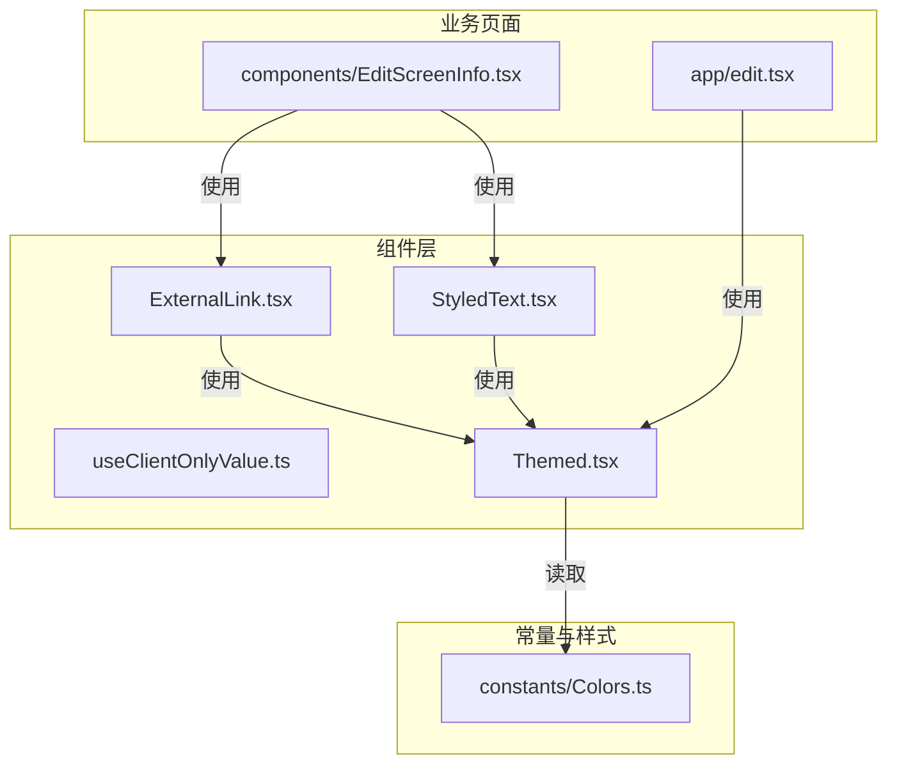
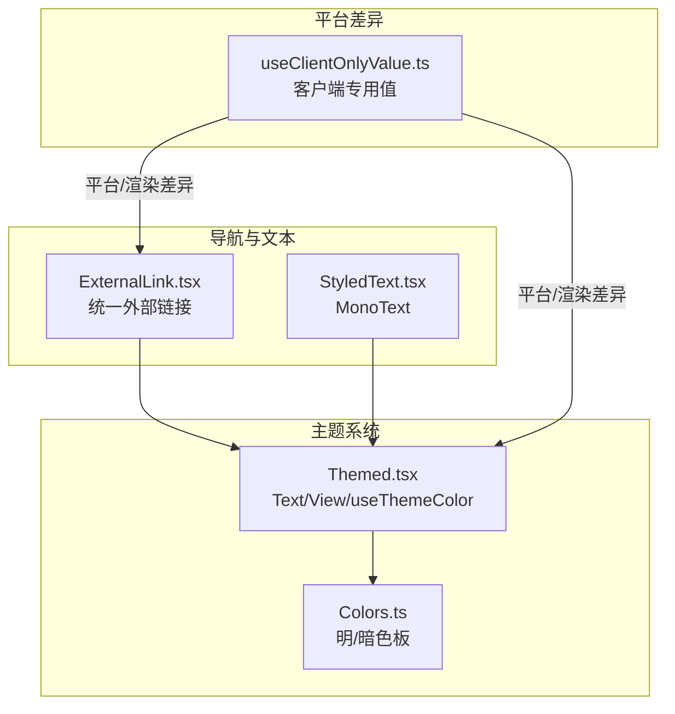
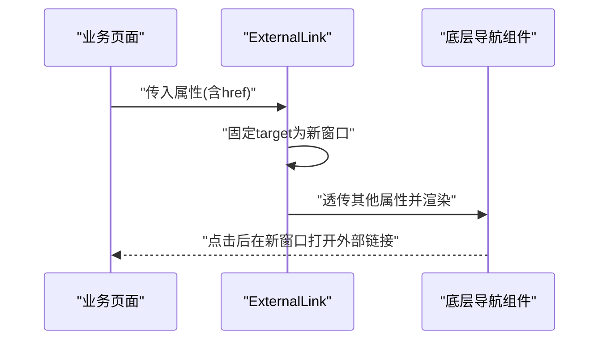
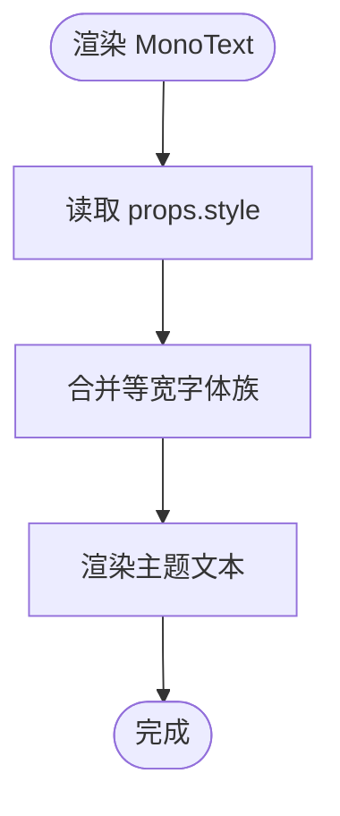
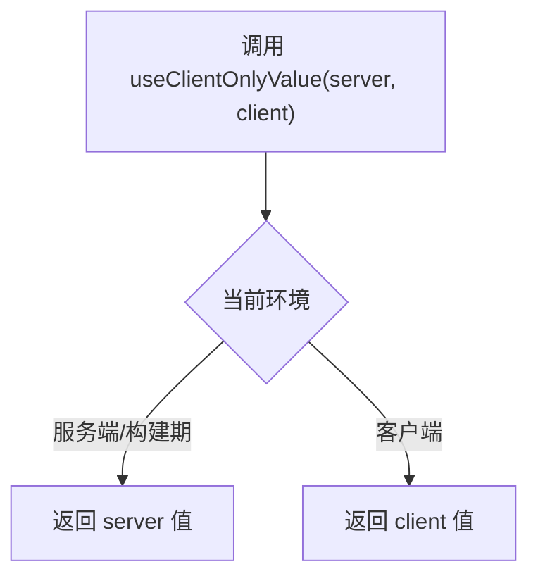
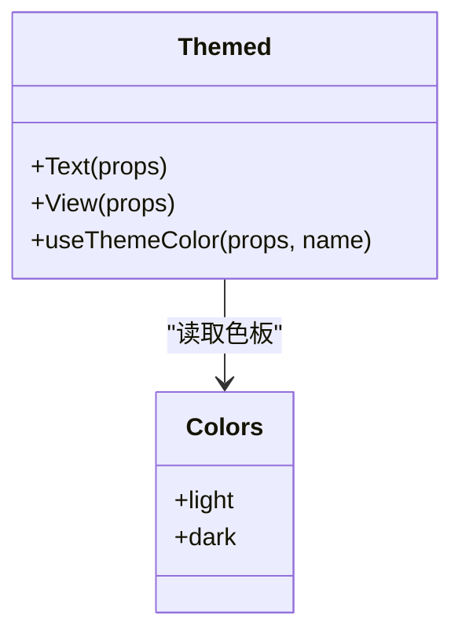
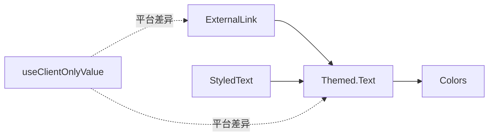

# 工具组件

<cite>
**本文档引用的文件**
- [components/ExternalLink.tsx](file://components/ExternalLink.tsx)
- [components/StyledText.tsx](file://components/StyledText.tsx)
- [components/useClientOnlyValue.ts](file://components/useClientOnlyValue.ts)
- [components/Themed.tsx](file://components/Themed.tsx)
- [components/EditScreenInfo.tsx](file://components/EditScreenInfo.tsx)
- [constants/Colors.ts](file://constants/Colors.ts)
- [app/edit.tsx](file://app/edit.tsx)
</cite>

## 目录

1. [简介](#简介)
2. [项目结构](#项目结构)
3. [核心组件](#核心组件)
4. [架构总览](#架构总览)
5. [详细组件分析](#详细组件分析)
6. [依赖关系分析](#依赖关系分析)
7. [性能考虑](#性能考虑)
8. [故障排查指南](#故障排查指南)
9. [结论](#结论)
10. [附录](#附录)

## 简介

本文件聚焦于工具组件的设计与实现，涵盖以下方面：

- 外部链接组件：安全处理、URL 行为与目标窗口控制
- 样式文本组件：字体管理、颜色继承与尺寸适配
- 客户端专用值处理：条件渲染与平台差异处理
- 可复用性与扩展性：通用设计原则与最佳实践
- 性能优化：缓存策略与内存管理
- 测试实践：单元测试与集成测试建议

## 项目结构

工具组件位于 components 目录，围绕主题系统、文本样式与客户端渲染差异提供基础能力，并在业务页面中被广泛复用。

图表来源

- [components/ExternalLink.tsx](file://components/ExternalLink.tsx#L1-L16)
- [components/StyledText.tsx](file://components/StyledText.tsx#L1-L6)
- [components/useClientOnlyValue.ts](file://components/useClientOnlyValue.ts#L1-L5)
- [components/Themed.tsx](file://components/Themed.tsx#L1-L46)
- [constants/Colors.ts](file://constants/Colors.ts#L1-L20)
- [components/EditScreenInfo.tsx](file://components/EditScreenInfo.tsx#L1-L82)
- [app/edit.tsx](file://app/edit.tsx#L1-L517)

章节来源

- [components/ExternalLink.tsx](file://components/ExternalLink.tsx#L1-L16)
- [components/StyledText.tsx](file://components/StyledText.tsx#L1-L6)
- [components/useClientOnlyValue.ts](file://components/useClientOnlyValue.ts#L1-L5)
- [components/Themed.tsx](file://components/Themed.tsx#L1-L46)
- [constants/Colors.ts](file://constants/Colors.ts#L1-L20)
- [components/EditScreenInfo.tsx](file://components/EditScreenInfo.tsx#L1-L82)
- [app/edit.tsx](file://app/edit.tsx#L1-L517)

## 核心组件

- 外部链接组件：封装导航组件，统一外部链接行为与目标窗口控制
- 样式文本组件：提供等宽字体文本，基于主题系统进行颜色继承
- 客户端专用值处理：在不同平台/渲染阶段选择合适的值
- 主题化文本与视图：根据系统主题自动选择颜色，支持显式覆盖

章节来源

- [components/ExternalLink.tsx](file://components/ExternalLink.tsx#L1-L16)
- [components/StyledText.tsx](file://components/StyledText.tsx#L1-L6)
- [components/useClientOnlyValue.ts](file://components/useClientOnlyValue.ts#L1-L5)
- [components/Themed.tsx](file://components/Themed.tsx#L1-L46)

## 架构总览

工具组件通过主题系统与导航组件协作，形成“主题感知 + 导航增强”的基础设施层，业务页面通过组合这些组件实现一致的外观与交互体验。

图表来源

- [components/Themed.tsx](file://components/Themed.tsx#L1-L46)
- [constants/Colors.ts](file://constants/Colors.ts#L1-L20)
- [components/ExternalLink.tsx](file://components/ExternalLink.tsx#L1-L16)
- [components/StyledText.tsx](file://components/StyledText.tsx#L1-L6)
- [components/useClientOnlyValue.ts](file://components/useClientOnlyValue.ts#L1-L5)

## 详细组件分析

### 外部链接组件（ExternalLink）

- 设计目标
  - 统一外部链接的打开行为，强制在新窗口打开，避免破坏应用内导航
  - 保留导航组件的其余属性，便于透传样式与事件
- 实现要点
  - 包装底层导航组件，固定目标窗口为新标签页
  - 透传所有非类型化属性，兼容样式与事件回调
  - 对外部 URL 进行类型降级处理，避免类型检查报错
- 安全与可用性
  - 强制新窗口打开，降低跳转风险
  - 通过业务页面组合主题文本，提升可读性与一致性
- 使用示例
  - 在业务页面中直接使用，配合主题文本与容器样式

图表来源

- [components/ExternalLink.tsx](file://components/ExternalLink.tsx#L1-L16)
- [components/EditScreenInfo.tsx](file://components/EditScreenInfo.tsx#L40-L47)

章节来源

- [components/ExternalLink.tsx](file://components/ExternalLink.tsx#L1-L16)
- [components/EditScreenInfo.tsx](file://components/EditScreenInfo.tsx#L40-L47)

### 样式文本组件（StyledText/MonoText）

- 设计目标
  - 提供等宽字体文本，满足代码高亮与路径展示等场景
  - 基于主题系统继承文本颜色，保证明暗主题一致性
- 实现要点
  - 在主题文本基础上叠加等宽字体族
  - 通过样式数组合并实现字体覆盖与颜色继承
- 尺寸适配
  - 字体大小由上层样式决定，组件不硬编码字号
  - 支持通过样式属性调整行高、对齐等布局属性

图表来源

- [components/StyledText.tsx](file://components/StyledText.tsx#L1-L6)
- [components/Themed.tsx](file://components/Themed.tsx#L33-L38)

章节来源

- [components/StyledText.tsx](file://components/StyledText.tsx#L1-L6)
- [components/Themed.tsx](file://components/Themed.tsx#L33-L38)

### 客户端专用值处理（useClientOnlyValue）

- 设计目标
  - 在服务端/构建期渲染不可用时，回退到客户端渲染值
  - 解决平台差异导致的渲染时机问题
- 实现要点
  - 接收服务端与客户端两套值，按当前环境返回合适值
  - 注释明确该函数为 Web 专用（原生暂不支持服务端渲染）
- 使用场景
  - 平台差异：Web 与原生在渲染阶段存在差异
  - 条件渲染：在特定平台启用特定 UI 或逻辑

图表来源

- [components/useClientOnlyValue.ts](file://components/useClientOnlyValue.ts#L1-L5)

章节来源

- [components/useClientOnlyValue.ts](file://components/useClientOnlyValue.ts#L1-L5)

### 主题系统（Themed/Colors）

- 设计目标
  - 提供明/暗主题下的颜色选择与继承机制
  - 通过主题钩子在组件层级自动应用颜色
- 实现要点
  - 主题钩子根据系统主题与显式属性选择最终颜色
  - 文本与视图组件自动注入颜色样式
- 颜色来源
  - 颜色常量集中管理，支持明/暗两套色板

图表来源

- [components/Themed.tsx](file://components/Themed.tsx#L1-L46)
- [constants/Colors.ts](file://constants/Colors.ts#L1-L20)

章节来源

- [components/Themed.tsx](file://components/Themed.tsx#L1-L46)
- [constants/Colors.ts](file://constants/Colors.ts#L1-L20)

## 依赖关系分析

- 组件耦合
  - ExternalLink 依赖导航组件与主题文本
  - StyledText 依赖主题文本
  - useClientOnlyValue 为平台/渲染差异提供抽象
  - Themed 依赖颜色常量与系统主题钩子
- 外部依赖
  - 导航组件来自路由库
  - 主题钩子来自原生运行时
- 耦合度评估
  - 组件职责清晰，耦合度低，易于替换与扩展

图表来源

- [components/ExternalLink.tsx](file://components/ExternalLink.tsx#L1-L16)
- [components/StyledText.tsx](file://components/StyledText.tsx#L1-L6)
- [components/Themed.tsx](file://components/Themed.tsx#L1-L46)
- [constants/Colors.ts](file://constants/Colors.ts#L1-L20)
- [components/useClientOnlyValue.ts](file://components/useClientOnlyValue.ts#L1-L5)

章节来源

- [components/ExternalLink.tsx](file://components/ExternalLink.tsx#L1-L16)
- [components/StyledText.tsx](file://components/StyledText.tsx#L1-L6)
- [components/Themed.tsx](file://components/Themed.tsx#L1-L46)
- [constants/Colors.ts](file://constants/Colors.ts#L1-L20)
- [components/useClientOnlyValue.ts](file://components/useClientOnlyValue.ts#L1-L5)

## 性能考虑

- 渲染性能
  - ExternalLink 与 StyledText 为轻量包装，开销极低
  - Themed 组件通过主题钩子按需计算颜色，避免重复渲染
- 缓存策略
  - 颜色常量集中管理，减少重复计算
  - 导航组件复用，避免重复创建
- 内存管理
  - 组件无长生命周期状态，卸载即释放
  - 平台差异处理通过简单函数返回值，无额外内存占用

## 故障排查指南

- 外部链接无法打开
  - 检查链接是否为外部地址，确认目标窗口是否正确设置
  - 确认业务页面未覆盖关键属性导致行为异常
- 文本颜色不符合预期
  - 检查主题钩子是否正确传入明/暗颜色属性
  - 确认颜色常量中是否存在对应键值
- 客户端渲染异常
  - 确认当前环境是否为客户端渲染
  - 如在服务端/构建期渲染，需提供服务端兼容方案

章节来源

- [components/ExternalLink.tsx](file://components/ExternalLink.tsx#L1-L16)
- [components/Themed.tsx](file://components/Themed.tsx#L19-L31)
- [constants/Colors.ts](file://constants/Colors.ts#L1-L20)
- [components/useClientOnlyValue.ts](file://components/useClientOnlyValue.ts#L1-L5)

## 结论

工具组件通过简洁的封装实现了跨平台的一致性与可复用性：

- ExternalLink 统一外部链接行为，提升安全性与可用性
- StyledText 提供字体与主题继承能力，满足多样化文本需求
- useClientOnlyValue 解决平台差异带来的渲染问题
- Themed/Colors 形成主题体系，保障明暗主题一致性

## 附录

- 使用建议
  - 在业务页面中优先使用 ExternalLink 与 StyledText，减少重复实现
  - 通过 Themed 组件统一颜色管理，避免硬编码颜色
  - 在需要平台差异处理时，使用 useClientOnlyValue 进行条件渲染
- 测试建议
  - 单元测试：针对主题颜色选择与客户端值返回进行断言
  - 集成测试：在业务页面中验证外部链接与文本样式的组合效果
  - 平台测试：分别在 Web 与原生环境下验证渲染差异处理
