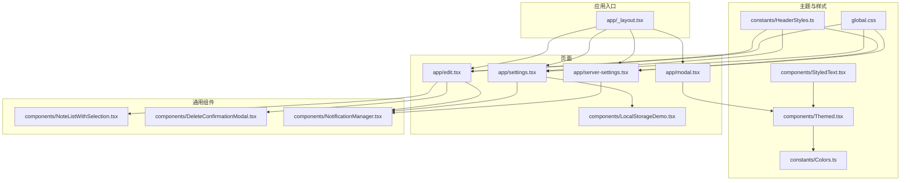
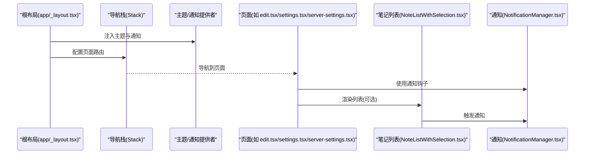
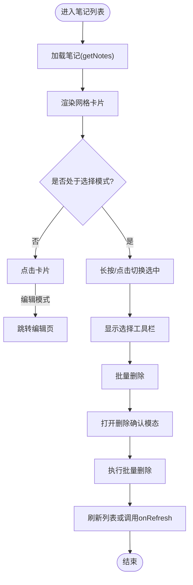
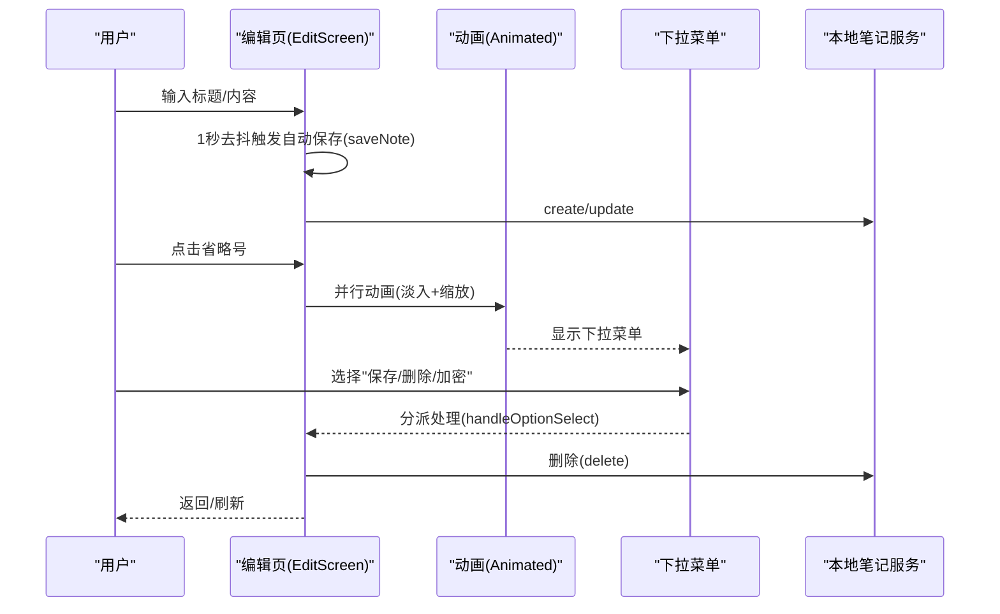
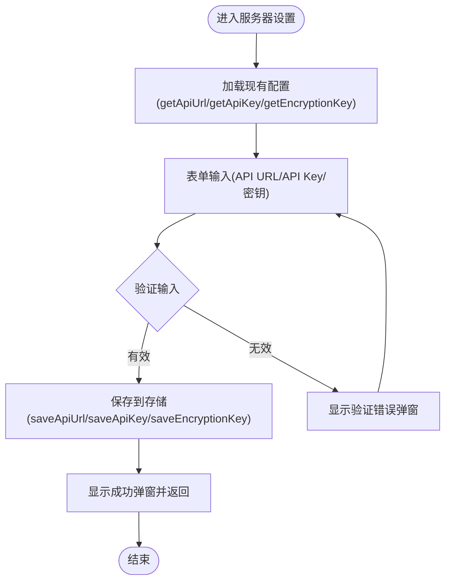
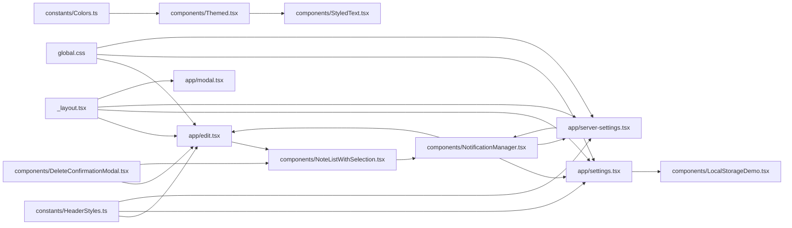

# 用户界面组件

<cite>
**本文档引用的文件**
- [app/_layout.tsx](file://app/_layout.tsx)
- [components/Themed.tsx](file://components/Themed.tsx)
- [components/StyledText.tsx](file://components/StyledText.tsx)
- [constants/Colors.ts](file://constants/Colors.ts)
- [constants/HeaderStyles.ts](file://constants/HeaderStyles.ts)
- [components/NoteListWithSelection.tsx](file://components/NoteListWithSelection.tsx)
- [components/DeleteConfirmationModal.tsx](file://components/DeleteConfirmationModal.tsx)
- [components/NotificationManager.tsx](file://components/NotificationManager.tsx)
- [app/edit.tsx](file://app/edit.tsx)
- [app/settings.tsx](file://app/settings.tsx)
- [app/server-settings.tsx](file://app/server-settings.tsx)
- [app/modal.tsx](file://app/modal.tsx)
- [components/LocalStorageDemo.tsx](file://components/LocalStorageDemo.tsx)
- [components/useColorScheme.ts](file://components/useColorScheme.ts)
- [components/useClientOnlyValue.ts](file://components/useClientOnlyValue.ts)
- [global.css](file://global.css)
</cite>

## 目录

1. [简介](#简介)
2. [项目结构](#项目结构)
3. [核心组件](#核心组件)
4. [架构总览](#架构总览)
5. [组件详解](#组件详解)
6. [依赖关系分析](#依赖关系分析)
7. [性能与响应式设计](#性能与响应式设计)
8. [可访问性与无障碍](#可访问性与无障碍)
9. [故障排查指南](#故障排查指南)
10. [结论](#结论)
11. [附录：使用示例与代码片段路径](#附录使用示例与代码片段路径)

## 简介

本文件聚焦 Notes 应用中的用户界面组件，系统性梳理组件的视觉外观、交互行为、状态管理、动画与过渡、样式与主题、响应式与无障碍、以及与导航、服务层的集成方式。文档同时覆盖移动端交互设计要点与跨平台兼容性建议，并提供可直接定位到源码的片段路径，便于快速查阅与二次开发。

**更新** 本次更新反映了应用的重大重构：新增服务器设置页面、重构设置页面、简化主题管理系统、更新本地存储演示组件等变更。

## 项目结构

应用采用基于 Expo Router 的页面级组织，UI 组件集中在 components 目录，主题与样式通过 Themed、StyledText、HeaderStyles 与 Tailwind 原子化 CSS 协同实现；页面入口与主题提供者位于 app/\_layout.tsx。



**图表来源**

- [app/\_layout.tsx](file://app/_layout.tsx#L64-L80)
- [components/Themed.tsx](file://components/Themed.tsx#L1-L46)
- [components/StyledText.tsx](file://components/StyledText.tsx#L1-L16)
- [constants/HeaderStyles.ts](file://constants/HeaderStyles.ts#L1-L131)
- [components/NoteListWithSelection.tsx](file://components/NoteListWithSelection.tsx#L1-L398)
- [components/DeleteConfirmationModal.tsx](file://components/DeleteConfirmationModal.tsx#L1-L130)
- [components/NotificationManager.tsx](file://components/NotificationManager.tsx#L1-L235)
- [app/edit.tsx](file://app/edit.tsx#L1-L517)
- [app/settings.tsx](file://app/settings.tsx#L1-L122)
- [app/server-settings.tsx](file://app/server-settings.tsx#L1-L657)
- [app/modal.tsx](file://app/modal.tsx#L1-L36)
- [components/LocalStorageDemo.tsx](file://components/LocalStorageDemo.tsx#L1-L322)
- [global.css](file://global.css#L1-L3)

**章节来源**

- [app/\_layout.tsx](file://app/_layout.tsx#L1-L81)
- [global.css](file://global.css#L1-L3)

## 核心组件

- 主题与文本视图：Themed 提供基于系统色系的文本与视图封装，支持 light/dark 颜色映射与 NativeWind className 融合。
- 文本字体：StyledText 提供等宽字体与 NativeWind 版本的 MonoText。
- 头部样式：HeaderStyles 提供统一的 header 容器与按钮样式常量。
- 笔记列表与选择：NoteListWithSelection 支持网格卡片、长按进入选择模式、批量删除、空状态与加载状态。
- 编辑页：EditScreen 提供标题/内容输入、自动保存、下拉菜单、删除确认、加密开关等。
- 通知系统：NotificationManager 提供模态通知与 Toast，支持不同通知类型与动画。
- 删除确认模态：DeleteConfirmationModal 通用确认对话框，支持加载状态与禁用交互。
- 设置页：SettingsScreen 展示设置项、同步笔记、本地存储演示等，现已重构并增加服务器设置导航。
- 服务器设置页：ServerSettingsScreen 提供 API URL、API Key 和加密密钥的配置界面，包含现代化弹窗和动画效果。
- 模态页：ModalScreen 作为演示页面，展示 Themed 文本组件。
- 本地存储演示：LocalStorageDemo 提供 SQLite 存储的完整 CRUD 操作演示，支持批量删除和搜索功能。

**更新** 新增了服务器设置页和本地存储演示组件的详细说明。

**章节来源**

- [components/Themed.tsx](file://components/Themed.tsx#L1-L46)
- [components/StyledText.tsx](file://components/StyledText.tsx#L1-L16)
- [constants/HeaderStyles.ts](file://constants/HeaderStyles.ts#L1-L131)
- [components/NoteListWithSelection.tsx](file://components/NoteListWithSelection.tsx#L1-L398)
- [app/edit.tsx](file://app/edit.tsx#L1-L517)
- [components/NotificationManager.tsx](file://components/NotificationManager.tsx#L1-L235)
- [components/DeleteConfirmationModal.tsx](file://components/DeleteConfirmationModal.tsx#L1-L130)
- [app/settings.tsx](file://app/settings.tsx#L1-L122)
- [app/server-settings.tsx](file://app/server-settings.tsx#L1-L657)
- [app/modal.tsx](file://app/modal.tsx#L1-L36)
- [components/LocalStorageDemo.tsx](file://components/LocalStorageDemo.tsx#L1-L322)

## 架构总览

应用通过根布局注入主题提供者与通知提供者，页面通过路由栈管理；编辑页与设置页分别消费通知与头部样式常量；笔记列表与编辑页共享通知与确认模态组件。新增的服务器设置页通过现代化弹窗和动画增强用户体验。



**图表来源**

- [app/\_layout.tsx](file://app/_layout.tsx#L64-L80)
- [app/edit.tsx](file://app/edit.tsx#L1-L517)
- [components/NotificationManager.tsx](file://components/NotificationManager.tsx#L1-L235)
- [components/NoteListWithSelection.tsx](file://components/NoteListWithSelection.tsx#L1-L398)

## 组件详解

### 主题与文本组件（Themed/StyledText）

- 视觉外观
  - 文本与视图根据系统色系(light/dark)动态选择颜色，支持通过 props 覆盖。
  - 支持 NativeWind 的 className 透传，便于与原子化样式协同。
- 行为与交互
  - Text/View 包装原生组件，自动合并主题色与传入样式。
- 属性（Props）
  - TextProps/ViewProps：继承原生组件属性，并扩展 lightColor/darkColor 与 className。
- 插槽与自定义
  - 通过 Colors 常量集中管理颜色，便于主题切换。
- 代码片段路径
  - [Themed 文本/视图实现](file://components/Themed.tsx#L19-L45)
  - [颜色常量](file://constants/Colors.ts#L1-L20)
  - [等宽文本封装](file://components/StyledText.tsx#L1-L16)

**更新** 主题系统得到简化，移除了复杂的 className 合并逻辑，直接使用 useThemeColor 函数。

**章节来源**

- [components/Themed.tsx](file://components/Themed.tsx#L1-L46)
- [components/StyledText.tsx](file://components/StyledText.tsx#L1-L16)
- [constants/Colors.ts](file://constants/Colors.ts#L1-L20)

### 头部样式常量（HeaderStyles）

- 视觉外观
  - 提供 standardHeader/borderedHeader/simpleHeader 三类容器样式，统一 header 的布局、间距与阴影。
  - 提供 back 按钮、返回文字、右侧图标容器与图标按钮的样式常量。
- 属性（Props）
  - 通过 StyleSheet.create 输出样式对象，供页面直接引用。
- 代码片段路径
  - [HeaderStyles 常量](file://constants/HeaderStyles.ts#L4-L118)
  - [编辑页使用 HeaderStyles](file://app/edit.tsx#L408-L425)
  - [设置页使用 HeaderStyles](file://app/settings.tsx#L80-L88)
  - [服务器设置页使用 HeaderStyles](file://app/server-settings.tsx#L424-L437)

**更新** 新增了 HeaderConstants 常量，提供统一的 header 高度计算。

**章节来源**

- [constants/HeaderStyles.ts](file://constants/HeaderStyles.ts#L1-L131)
- [app/edit.tsx](file://app/edit.tsx#L408-L425)
- [app/settings.tsx](file://app/settings.tsx#L80-L88)
- [app/server-settings.tsx](file://app/server-settings.tsx#L424-L437)

### 笔记列表与选择（NoteListWithSelection）

- 视觉外观
  - 网格卡片布局，支持 iOS/Android 阴影差异；选中态有边框与背景色变化。
  - 选择模式工具栏包含"全选/取消全选"、"已选数量"、"删除/完成"按钮。
  - 空状态与加载状态提示。
- 行为与交互
  - 点击卡片：非选择模式跳转编辑页；选择模式切换选中状态。
  - 长按卡片：进入选择模式并选中该卡片。
  - 选择模式下：工具栏右上角批量删除，确认后刷新列表或调用父回调。
- 状态与数据流
  - 状态：notes、selectedNotes、isSelectionMode、isLoading、showBatchDeleteModal、batchDeleteLoading。
  - 数据来源：LocalNoteService.getNotes，批量删除通过 LocalNoteService.batchDeleteNotes。
- 属性（Props）
  - searchQuery?: string；onRefresh?: () => void。
- 事件与回调
  - onRefresh：批量删除后可由父组件触发刷新。
- 代码片段路径
  - [笔记列表组件](file://components/NoteListWithSelection.tsx#L1-L398)
  - [删除确认模态](file://components/DeleteConfirmationModal.tsx#L1-L130)
  - [通知钩子使用](file://components/NoteListWithSelection.tsx#L40-L41)



**图表来源**

- [components/NoteListWithSelection.tsx](file://components/NoteListWithSelection.tsx#L35-L141)
- [components/DeleteConfirmationModal.tsx](file://components/DeleteConfirmationModal.tsx#L15-L61)

**章节来源**

- [components/NoteListWithSelection.tsx](file://components/NoteListWithSelection.tsx#L1-L398)
- [components/DeleteConfirmationModal.tsx](file://components/DeleteConfirmationModal.tsx#L1-L130)

### 编辑页（EditScreen）

- 视觉外观
  - 自定义 header：返回按钮与更多选项（省略号）。
  - 标题输入区与内容输入区，多行文本、顶部对齐。
  - 下拉菜单（悬浮窗）：保存、删除、加密三项，其中加密为带勾选框的选项。
- 行为与交互
  - 自动保存：内容或标题变更后 1 秒去抖保存，避免频繁写入。
  - 回退前保存：返回时强制保存当前修改。
  - 下拉菜单：打开/关闭使用并行动画（淡入/缩放），点击选项执行对应动作。
  - 删除流程：打开确认模态，确认后删除并返回。
- 状态与数据流
  - 状态：noteId、noteTitle、noteContent、optionsState、showDropdown、showSaveModal、showDeleteModal、isSaving、isDeleting。
  - 服务：LocalNoteService.create/update/delete/getNoteById。
- 属性（Props）
  - 通过路由参数接收 id/title/content。
- 事件与回调
  - handleBack、handleOptionSelect、handleEncryptToggle、handleSaveNote、handleDeleteNote、handleConfirmDelete、handleCancelDelete。
- 代码片段路径
  - [编辑页主组件](file://app/edit.tsx#L20-L406)
  - [自动保存与防抖](file://app/edit.tsx#L192-L227)
  - [下拉菜单动画](file://app/edit.tsx#L265-L299)
  - [删除确认模态](file://app/edit.tsx#L393-L403)



**图表来源**

- [app/edit.tsx](file://app/edit.tsx#L129-L190)
- [app/edit.tsx](file://app/edit.tsx#L265-L299)
- [app/edit.tsx](file://app/edit.tsx#L393-L403)

**章节来源**

- [app/edit.tsx](file://app/edit.tsx#L1-L517)

### 通知系统（NotificationManager）

- 视觉外观
  - 模态通知：带左侧色条的提示框，支持成功/错误/警告/信息四类颜色。
  - Toast：短时提示，Android 使用系统 Toast，iOS 使用自定义视图。
- 行为与交互
  - showSuccess/showError/showInfo/showWarning：对外暴露的通知方法。
  - 模态通知支持淡入淡出动画与点击遮罩关闭。
- 状态与数据流
  - 状态：modalVisible/notificationMessage/notificationType/fadeAnim/toastVisible/toastMessage。
- 事件与回调
  - hideAlert：关闭模态通知并触发动画回收。
- 代码片段路径
  - [通知提供者与上下文](file://components/NotificationManager.tsx#L34-L174)

```mermaid
sequenceDiagram
participant Comp as "组件"
participant Prov as "NotificationProvider"
participant ANI as "Animated"
participant MOD as "模态通知"
participant AND as "ToastAndroid(iOS为自定义)"
Comp->>Prov : useNotification()
Comp->>Prov : showSuccess/showError(...)
Prov->>MOD : setModalVisible(true)+淡入动画
MOD-->>Comp : 用户点击确定
Comp->>Prov : hideAlert()
Prov->>ANI : 淡出动画
ANI-->>Prov : 动画结束->setModalVisible(false)
Prov->>AND : Android Toast 或 iOS 自定义Toast
```

**图表来源**

- [components/NotificationManager.tsx](file://components/NotificationManager.tsx#L56-L101)

**章节来源**

- [components/NotificationManager.tsx](file://components/NotificationManager.tsx#L1-L235)

### 删除确认模态（DeleteConfirmationModal）

- 视觉外观
  - 居中卡片式模态，标题、消息、左右按钮布局清晰。
  - 删除按钮高亮红色，取消按钮灰色。
- 行为与交互
  - visible/onClose/onConfirm 三个必需属性控制显示与交互。
  - isLoading 状态下禁用按钮并显示加载指示器。
- 属性（Props）
  - visible、onClose、onConfirm、title、message、confirmText、cancelText、isLoading。
- 事件与回调
  - handleConfirm：在非加载状态下调用 onConfirm。
- 代码片段路径
  - [删除确认模态组件](file://components/DeleteConfirmationModal.tsx#L1-L130)

**章节来源**

- [components/DeleteConfirmationModal.tsx](file://components/DeleteConfirmationModal.tsx#L1-L130)

### 设置页（SettingsScreen）

- 视觉外观
  - 简洁列表项，带右侧箭头与图标。
  - 使用 HeaderStyles.simpleHeader 统一头部样式。
- 行为与交互
  - 同步笔记：调用 synchronizeNotes 并通过通知反馈结果。
  - 本地存储演示：打开滑入式模态展示 LocalStorageDemo。
  - 服务器设置：导航到新的服务器设置页面。
- 代码片段路径
  - [设置页组件](file://app/settings.tsx#L11-L73)

**更新** 设置页面已重构，增加了服务器设置导航和现代化的本地存储演示。

**章节来源**

- [app/settings.tsx](file://app/settings.tsx#L1-L122)

### 服务器设置页（ServerSettingsScreen）

- 视觉外观
  - 现代化卡片式布局，包含 API URL、API Key 和加密密钥输入框。
  - 支持输入框可见性切换、清空按钮、生成随机密钥功能。
  - 使用 Animated 库实现淡入淡出动画效果。
  - 现代化弹窗样式，支持确认和提示两种类型。
- 行为与交互
  - 加载现有配置：组件挂载时从存储中获取现有设置。
  - 表单验证：验证 API URL 格式和 API Key 有效性。
  - 保存设置：异步保存到存储，支持加载状态。
  - 生成密钥：生成随机加密密钥并支持覆盖确认。
  - 现代化弹窗：提供统一的确认和提示对话框。
- 状态与数据流
  - 状态：apiUrl、apiKey、password、showApiKey、showPassword、isSaving、showCustomModal。
  - 数据来源：AuthUtils 中的 getApiUrl/getApiKey/getEncryptionKey/saveApiUrl/saveApiKey/saveEncryptionKey。
- 属性（Props）
  - 无外部属性。
- 事件与回调
  - handleGenerateRandomKey、handleSave、closeModal。
- 代码片段路径
  - [服务器设置组件](file://app/server-settings.tsx#L31-L411)

**新增** 这是全新的服务器设置页面，提供完整的 API 配置和密钥管理功能。



**图表来源**

- [app/server-settings.tsx](file://app/server-settings.tsx#L41-L66)
- [app/server-settings.tsx](file://app/server-settings.tsx#L124-L194)

**章节来源**

- [app/server-settings.tsx](file://app/server-settings.tsx#L1-L657)

### 本地存储演示（LocalStorageDemo）

- 视觉外观
  - 简洁的卡片式布局，展示统计信息和操作按钮。
  - 支持创建、更新、删除、搜索、刷新和批量删除操作。
  - 列表显示笔记标题、内容预览和更新时间。
- 行为与交互
  - 加载笔记：首次进入时自动加载笔记列表和统计信息。
  - CRUD 操作：提供完整的笔记生命周期管理。
  - 搜索功能：支持按关键词搜索笔记。
  - 批量删除：示例删除前3个笔记。
  - 通知反馈：每个操作都提供相应的通知反馈。
- 状态与数据流
  - 状态：notes、loading、stats、searchTerm。
  - 数据来源：LocalNoteService 的 CRUD 方法和 getNotesStats。
- 属性（Props）
  - onBack：返回父组件的回调函数。
- 事件与回调
  - onBack：关闭演示并返回设置页。
- 代码片段路径
  - [本地存储演示组件](file://components/LocalStorageDemo.tsx#L18-L221)

**更新** 本地存储演示组件得到了大幅更新，增加了批量删除、搜索功能和更完善的 CRUD 操作演示。

**章节来源**

- [components/LocalStorageDemo.tsx](file://components/LocalStorageDemo.tsx#L1-L322)

### 模态页（ModalScreen）

- 视觉外观
  - 居中布局，展示标题与演示组件。
  - iOS 上调整状态栏样式以适配黑边空间。
- 代码片段路径
  - [模态页组件](file://app/modal.tsx#L1-L36)

**章节来源**

- [app/modal.tsx](file://app/modal.tsx#L1-L36)

## 依赖关系分析

- 主题与样式
  - Themed 依赖 Colors；StyledText 依赖 Themed；HeaderStyles 被 EditScreen、SettingsScreen、ServerSettingsScreen 引用。
- 页面与组件
  - EditScreen 依赖 HeaderStyles、NotificationManager、DeleteConfirmationModal；NoteListWithSelection 依赖 NotificationManager 与 DeleteConfirmationModal。
  - SettingsScreen 依赖 NotificationManager、LocalStorageDemo；ServerSettingsScreen 依赖 HeaderStyles、NotificationManager。
- 入口与提供者
  - app/\_layout.tsx 注入 ThemeProvider 与 NotificationProvider，为所有页面提供主题与通知能力。



**图表来源**

- [components/Themed.tsx](file://components/Themed.tsx#L1-L46)
- [components/StyledText.tsx](file://components/StyledText.tsx#L1-L16)
- [constants/Colors.ts](file://constants/Colors.ts#L1-L20)
- [constants/HeaderStyles.ts](file://constants/HeaderStyles.ts#L1-L131)
- [components/NotificationManager.tsx](file://components/NotificationManager.tsx#L1-L235)
- [components/DeleteConfirmationModal.tsx](file://components/DeleteConfirmationModal.tsx#L1-L130)
- [components/NoteListWithSelection.tsx](file://components/NoteListWithSelection.tsx#L1-L398)
- [app/edit.tsx](file://app/edit.tsx#L1-L517)
- [app/settings.tsx](file://app/settings.tsx#L1-L122)
- [app/server-settings.tsx](file://app/server-settings.tsx#L1-L657)
- [app/modal.tsx](file://app/modal.tsx#L1-L36)
- [components/LocalStorageDemo.tsx](file://components/LocalStorageDemo.tsx#L1-L322)
- [app/\_layout.tsx](file://app/_layout.tsx#L64-L80)
- [global.css](file://global.css#L1-L3)

**章节来源**

- [app/\_layout.tsx](file://app/_layout.tsx#L1-L81)
- [components/Themed.tsx](file://components/Themed.tsx#L1-L46)
- [components/NotificationManager.tsx](file://components/NotificationManager.tsx#L1-L235)
- [components/NoteListWithSelection.tsx](file://components/NoteListWithSelection.tsx#L1-L398)
- [app/edit.tsx](file://app/edit.tsx#L1-L517)
- [app/settings.tsx](file://app/settings.tsx#L1-L122)
- [app/server-settings.tsx](file://app/server-settings.tsx#L1-L657)
- [app/modal.tsx](file://app/modal.tsx#L1-L36)
- [components/LocalStorageDemo.tsx](file://components/LocalStorageDemo.tsx#L1-L322)
- [global.css](file://global.css#L1-L3)

## 性能与响应式设计

- 性能优化
  - 自动保存去抖：编辑页对输入变更进行 1 秒去抖，减少频繁写入。
  - 列表加载：NoteListWithSelection 限制单次加载数量，支持批量操作。
  - 动画驱动：通知与下拉菜单使用 useNativeDriver 的 Animated，提升流畅度。
  - 现代化弹窗：ServerSettingsScreen 使用 Animated 实现流畅的进入和退出动画。
- 响应式设计
  - 使用 Dimensions 与 StyleSheet 布局，卡片宽度随窗口宽度自适应。
  - iOS/Android 阴影与 elevation 差异处理，保证视觉一致性。
  - 键盘适配：ServerSettingsScreen 使用 KeyboardAvoidingView 适配键盘显示。
- 样式与主题
  - Tailwind 原子化样式通过 global.css 引入，与 Themed/StyledText 协同使用。
  - Colors 常量集中管理主题色，便于扩展与维护。
  - HeaderStyles 提供统一的头部样式规范。
- 跨浏览器/平台兼容
  - Android Toast 与 iOS 自定义 Toast 并存，确保一致的轻提示体验。
  - Animated 使用 useNativeDriver，避免 JS 线程阻塞。
  - Buffer polyfill 确保加密功能在 Web 环境正常工作。

**更新** 新增了服务器设置页的性能优化和响应式设计特性。

**章节来源**

- [app/edit.tsx](file://app/edit.tsx#L192-L227)
- [components/NoteListWithSelection.tsx](file://components/NoteListWithSelection.tsx#L19-L21)
- [components/NotificationManager.tsx](file://components/NotificationManager.tsx#L66-L70)
- [app/server-settings.tsx](file://app/server-settings.tsx#L203-L206)
- [global.css](file://global.css#L1-L3)
- [constants/Colors.ts](file://constants/Colors.ts#L1-L20)

## 可访问性与无障碍

- 触摸目标尺寸与间距
  - 按钮与列表项具备足够内边距与外边距，满足触摸可达性。
  - ServerSettingsScreen 的输入框具有足够的触摸目标尺寸。
- 屏幕阅读器支持
  - Modal 设置为可模态视图，避免屏幕阅读器误读背景内容。
  - 重要交互元素提供明确的文本标签与语义化结构。
  - ServerSettingsScreen 的现代化弹窗设置了 accessibilityViewIsModal。
- 颜色对比度
  - 主题色来自 Colors 常量，确保在明暗模式下具备良好对比度。
  - 通知系统的颜色对比度符合可访问性标准。
- 交互反馈
  - 选中态、按钮禁用态、加载态均提供视觉反馈，降低误操作风险。
  - ServerSettingsScreen 的输入框状态变化提供清晰的视觉反馈。

**更新** 新增了服务器设置页的可访问性考虑。

**章节来源**

- [components/NotificationManager.tsx](file://components/NotificationManager.tsx#L132-L162)
- [components/Themed.tsx](file://components/Themed.tsx#L23-L35)
- [constants/Colors.ts](file://constants/Colors.ts#L1-L20)
- [app/server-settings.tsx](file://app/server-settings.tsx#L355-L361)

## 故障排查指南

- 通知不显示
  - 检查 NotificationProvider 是否包裹在根布局中。
  - 确认 useNotification 钩子在组件树中正确使用。
- 自动保存无效
  - 检查去抖定时器是否被正确清理与重建。
  - 确认 isSaving 状态未阻塞再次保存。
- 下拉菜单动画异常
  - 确保 Animated.timing/parallel 正确初始化与回收。
- 删除确认未生效
  - 检查 isLoading 状态是否导致按钮禁用。
- 列表空白或加载卡住
  - 确认 getNotes 请求成功与数据回填。
  - 检查空状态与加载状态的条件渲染。
- 服务器设置保存失败
  - 检查 API URL 格式验证是否通过。
  - 确认存储权限和加密密钥生成是否成功。
- 现代化弹窗不显示
  - 检查 showCustomModal 状态是否正确更新。
  - 确认 Modal 组件的透明度和可见性设置。

**更新** 新增了服务器设置页相关的故障排查指南。

**章节来源**

- [components/NotificationManager.tsx](file://components/NotificationManager.tsx#L34-L174)
- [app/edit.tsx](file://app/edit.tsx#L192-L227)
- [components/DeleteConfirmationModal.tsx](file://components/DeleteConfirmationModal.tsx#L25-L29)
- [components/NoteListWithSelection.tsx](file://components/NoteListWithSelection.tsx#L49-L65)
- [app/server-settings.tsx](file://app/server-settings.tsx#L124-L194)

## 结论

本应用的 UI 组件围绕主题系统、统一头部样式与通知体系构建，编辑页与列表页通过服务层实现数据持久化与交互反馈。新增的服务器设置页提供了完整的 API 配置功能，本地存储演示组件增强了 CRUD 操作的可视化展示。组件具备良好的可扩展性与可维护性，配合 Tailwind 原子化样式与动画驱动，兼顾性能与体验。建议在新增组件时遵循现有主题与样式规范，确保一致的视觉与交互体验。

**更新** 本次更新反映了应用的重大重构，新增了服务器设置功能和现代化的用户界面设计。

## 附录：使用示例与代码片段路径

- 主题文本与视图
  - [Themed 文本/视图实现](file://components/Themed.tsx#L19-L45)
  - [颜色常量](file://constants/Colors.ts#L1-L20)
- 等宽文本
  - [等宽文本封装](file://components/StyledText.tsx#L5-L15)
- 头部样式
  - [HeaderStyles 常量](file://constants/HeaderStyles.ts#L4-L118)
  - [HeaderStyles 常量(HeaderConstants)](file://constants/HeaderStyles.ts#L121-L131)
  - [编辑页使用 HeaderStyles](file://app/edit.tsx#L413-L425)
  - [设置页使用 HeaderStyles](file://app/settings.tsx#L80-L88)
  - [服务器设置页使用 HeaderStyles](file://app/server-settings.tsx#L424-L437)
- 笔记列表与选择
  - [笔记列表组件](file://components/NoteListWithSelection.tsx#L35-L271)
  - [删除确认模态](file://components/DeleteConfirmationModal.tsx#L15-L61)
- 编辑页
  - [编辑页主组件](file://app/edit.tsx#L20-L406)
  - [自动保存与防抖](file://app/edit.tsx#L192-L227)
  - [下拉菜单动画](file://app/edit.tsx#L265-L299)
- 通知系统
  - [通知提供者与上下文](file://components/NotificationManager.tsx#L34-L174)
- 设置页
  - [设置页组件](file://app/settings.tsx#L11-L73)
- 服务器设置页
  - [服务器设置组件](file://app/server-settings.tsx#L31-L411)
  - [加载现有配置](file://app/server-settings.tsx#L41-L66)
  - [表单验证](file://app/server-settings.tsx#L124-L159)
  - [保存设置](file://app/server-settings.tsx#L161-L194)
  - [生成随机密钥](file://app/server-settings.tsx#L78-L122)
- 本地存储演示
  - [本地存储演示组件](file://components/LocalStorageDemo.tsx#L18-L221)
  - [加载笔记列表](file://components/LocalStorageDemo.tsx#L25-L40)
  - [创建示例笔记](file://components/LocalStorageDemo.tsx#L42-L58)
  - [更新第一个笔记](file://components/LocalStorageDemo.tsx#L60-L81)
  - [删除最后一个笔记](file://components/LocalStorageDemo.tsx#L83-L100)
  - [批量删除示例](file://components/LocalStorageDemo.tsx#L112-L129)
- 模态页
  - [模态页组件](file://app/modal.tsx#L7-L17)
- 主题与客户端工具
  - [useColorScheme](file://components/useColorScheme.ts#L1-L2)
  - [useClientOnlyValue](file://components/useClientOnlyValue.ts#L1-L5)
- Tailwind 原子化样式
  - [global.css](file://global.css#L1-L3)
