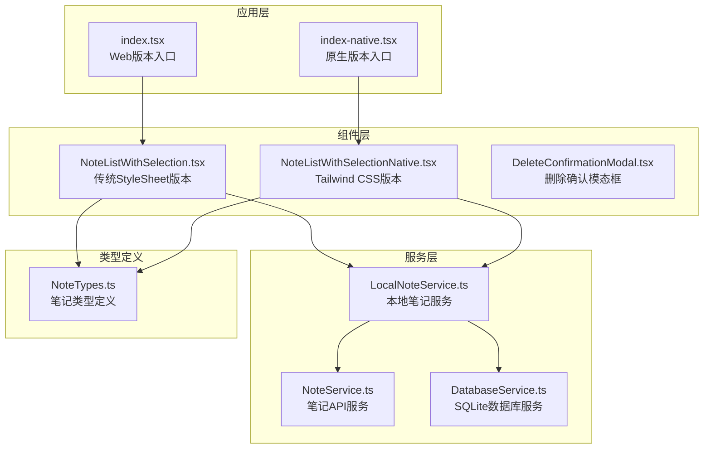
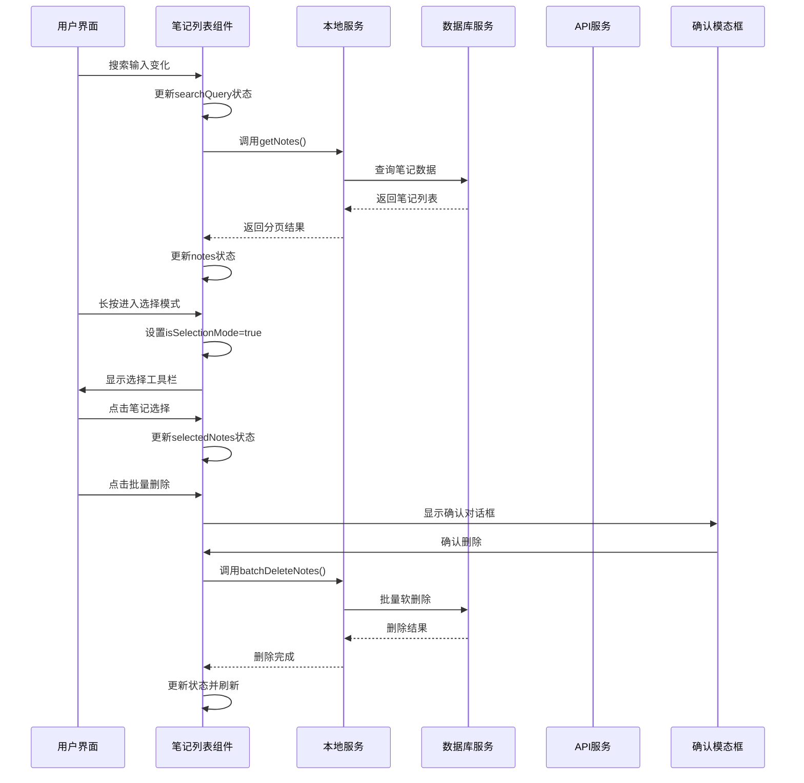
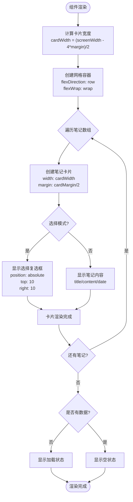
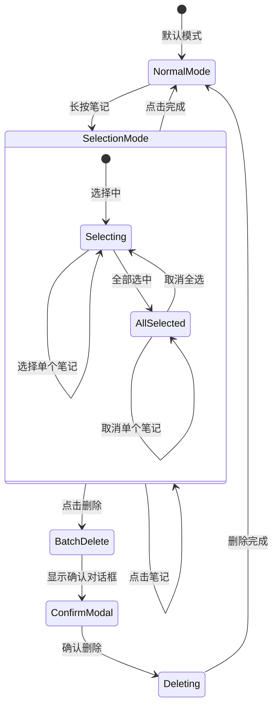
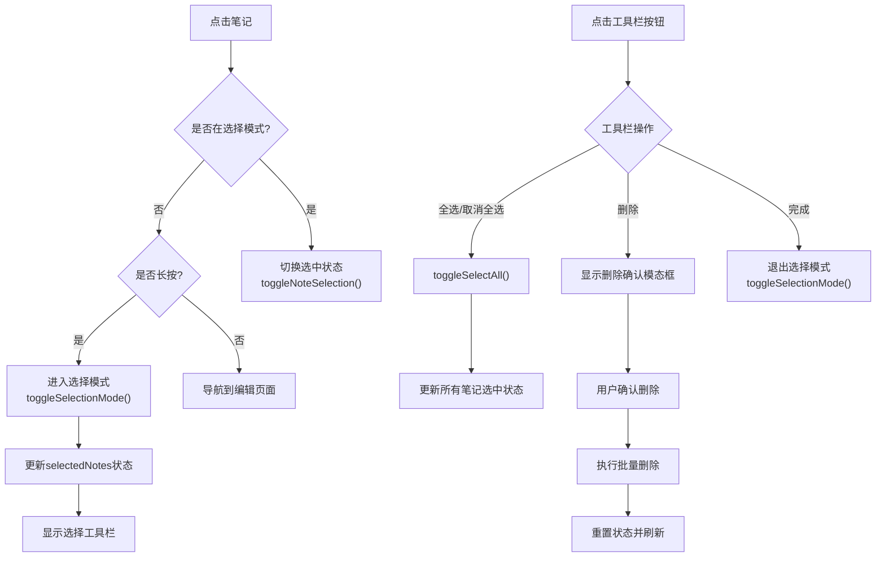
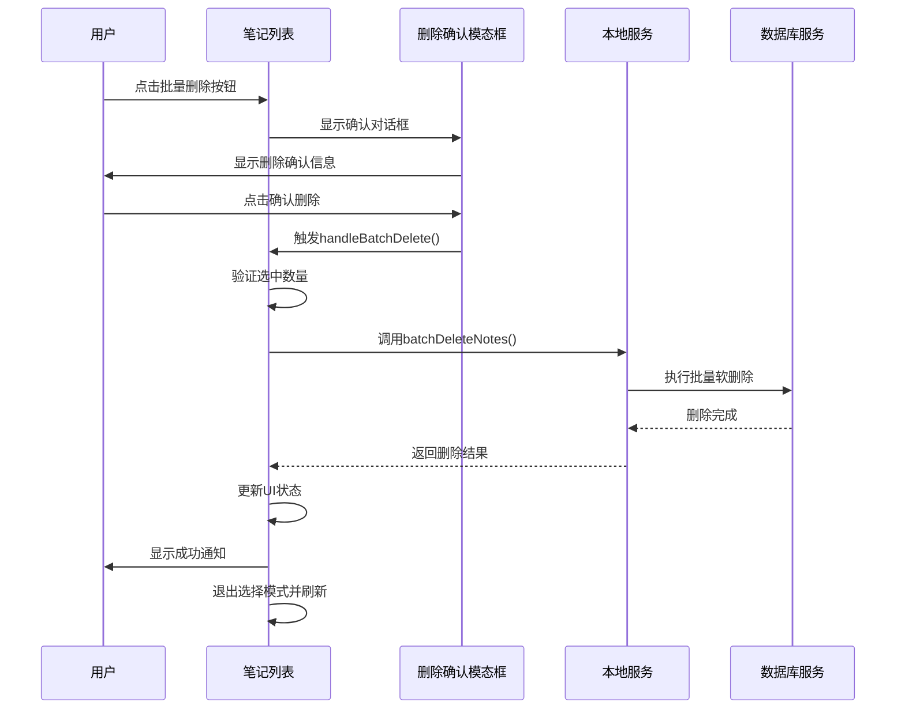
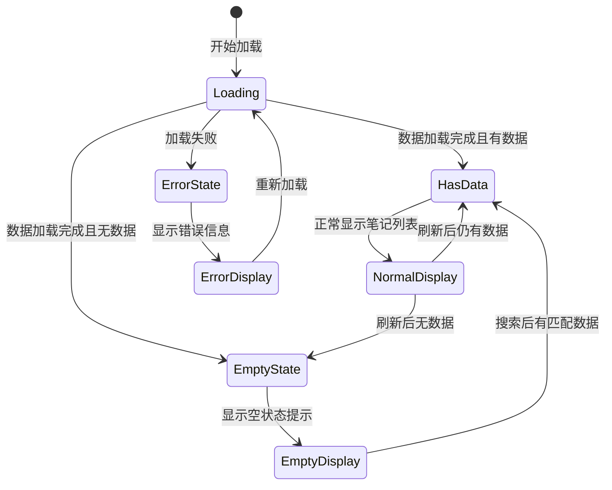
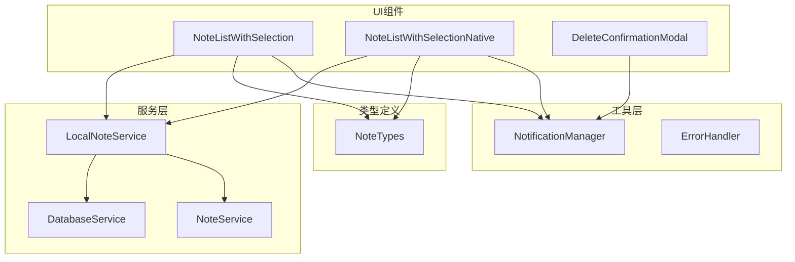
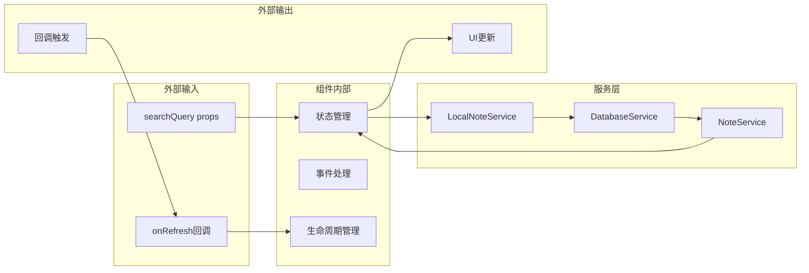

# 笔记列表组件

<cite>
**本文档引用的文件**
- [NoteListWithSelection.tsx](file://components/NoteListWithSelection.tsx)
- [NoteListWithSelectionNative.tsx](file://components/NoteListWithSelectionNative.tsx)
- [NoteTypes.ts](file://types/notes/NoteTypes.ts)
- [NoteService.ts](file://services/notes/NoteService.ts)
- [LocalNoteService.ts](file://services/local/LocalNoteService.ts)
- [DatabaseService.ts](file://services/database/DatabaseService.ts)
- [DeleteConfirmationModal.tsx](file://components/DeleteConfirmationModal.tsx)
- [NotificationManager.tsx](file://components/NotificationManager.tsx)
- [index.tsx](file://app/(tabs)/index.tsx)
- [index-native.tsx](file://app/(tabs)/index-native.tsx)
- [Colors.ts](file://constants/Colors.ts)
- [tailwind.config.js](file://tailwind.config.js)
</cite>

## 目录

1. [简介](#简介)
2. [项目结构](#项目结构)
3. [核心组件](#核心组件)
4. [架构概览](#架构概览)
5. [详细组件分析](#详细组件分析)
6. [依赖关系分析](#依赖关系分析)
7. [性能考虑](#性能考虑)
8. [故障排除指南](#故障排除指南)
9. [结论](#结论)
10. [附录](#附录)

## 简介

笔记列表组件是一个功能完整的React Native组件，提供网格布局的笔记展示、多选操作、批量删除和响应式设计。该组件支持两种实现方式：传统StyleSheet样式版本和Tailwind CSS版本，满足不同开发需求。

组件采用现代化的设计模式，包括：

- 网格布局设计，支持响应式卡片排列
- 多选操作实现，支持全选/取消全选
- 批量删除功能，带确认模态框
- 空状态处理和加载状态管理
- 移动端触摸交互优化
- 主题适配和样式定制

## 项目结构

笔记列表组件位于components目录下，包含两个版本的实现：

**图表来源**

- [NoteListWithSelection.tsx](file://components/NoteListWithSelection.tsx#L1-L398)
- [NoteListWithSelectionNative.tsx](file://components/NoteListWithSelectionNative.tsx#L1-L279)
- [LocalNoteService.ts](file://services/local/LocalNoteService.ts#L1-L601)

**章节来源**

- [NoteListWithSelection.tsx](file://components/NoteListWithSelection.tsx#L1-L398)
- [NoteListWithSelectionNative.tsx](file://components/NoteListWithSelectionNative.tsx#L1-L279)

## 核心组件

笔记列表组件提供以下核心功能：

### 组件特性

- **网格布局**：两列等宽卡片布局，支持响应式调整
- **多选模式**：长按进入选择模式，支持全选/取消全选
- **批量操作**：批量删除功能，带确认对话框
- **搜索集成**：支持实时搜索过滤
- **状态管理**：完整的加载、空状态和错误处理
- **主题适配**：支持浅色/深色主题切换

### Props参数

组件接受以下属性：

| 属性名      | 类型       | 必需 | 默认值    | 描述                           |
| ----------- | ---------- | ---- | --------- | ------------------------------ |
| searchQuery | string     | 否   | ''        | 搜索关键词，用于过滤笔记列表   |
| onRefresh   | () => void | 否   | undefined | 刷新回调函数，用于外部刷新触发 |

### 状态管理

组件内部维护以下状态：

- `notes`: 笔记数组，当前显示的笔记列表
- `selectedNotes`: 选择映射，跟踪选中的笔记ID
- `isSelectionMode`: 选择模式开关
- `isLoading`: 加载状态
- `showBatchDeleteModal`: 批量删除确认模态框显示状态
- `batchDeleteLoading`: 批量删除操作状态

**章节来源**

- [NoteListWithSelection.tsx](file://components/NoteListWithSelection.tsx#L23-L26)
- [NoteListWithSelection.tsx](file://components/NoteListWithSelection.tsx#L42-L47)

## 架构概览

组件采用分层架构设计，各层职责清晰分离：

**图表来源**

- [NoteListWithSelection.tsx](file://components/NoteListWithSelection.tsx#L50-L65)
- [LocalNoteService.ts](file://services/local/LocalNoteService.ts#L157-L211)
- [DatabaseService.ts](file://services/database/DatabaseService.ts#L314-L337)

## 详细组件分析

### 网格布局设计

组件采用Flexbox网格布局，实现响应式卡片排列：

**图表来源**

- [NoteListWithSelection.tsx](file://components/NoteListWithSelection.tsx#L19-L249)

### 多选操作实现

多选功能通过状态管理和事件处理实现：

**图表来源**

- [NoteListWithSelection.tsx](file://components/NoteListWithSelection.tsx#L67-L96)
- [NoteListWithSelection.tsx](file://components/NoteListWithSelection.tsx#L105-L141)

### 交互设计规范

组件遵循以下交互设计原则：

#### 触摸交互

- **点击操作**：正常点击进入编辑页面
- **长按操作**：进入选择模式并自动选择当前笔记
- **选择操作**：在选择模式下点击切换选中状态
- **批量操作**：通过工具栏按钮触发批量删除

#### 响应式设计

- **屏幕适配**：根据设备宽度动态计算卡片尺寸
- **间距调整**：使用统一的边距常量保证视觉一致性
- **平台差异**：针对iOS和Android平台优化阴影和投影效果

#### 无障碍设计

- **颜色对比**：确保文本与背景有足够的对比度
- **触摸目标**：按钮大小符合最小可触摸区域要求
- **状态反馈**：提供视觉和触觉反馈

**章节来源**

- [NoteListWithSelection.tsx](file://components/NoteListWithSelection.tsx#L193-L270)
- [NoteListWithSelectionNative.tsx](file://components/NoteListWithSelectionNative.tsx#L194-L275)

### 选择模式切换机制

选择模式的切换通过状态管理实现：

**图表来源**

- [NoteListWithSelection.tsx](file://components/NoteListWithSelection.tsx#L67-L141)

### 批量删除功能

批量删除功能包含完整的确认流程：

**图表来源**

- [NoteListWithSelection.tsx](file://components/NoteListWithSelection.tsx#L110-L141)
- [LocalNoteService.ts](file://services/local/LocalNoteService.ts#L157-L211)

### 空状态处理

组件提供完整的空状态和加载状态处理：

**图表来源**

- [NoteListWithSelection.tsx](file://components/NoteListWithSelection.tsx#L243-L256)

**章节来源**

- [NoteListWithSelection.tsx](file://components/NoteListWithSelection.tsx#L243-L256)
- [NoteListWithSelectionNative.tsx](file://components/NoteListWithSelectionNative.tsx#L258-L262)

### 响应式设计实现

组件采用多种技术实现响应式设计：

#### 动态尺寸计算

- **屏幕适配**：使用Dimensions API获取屏幕宽度
- **间距统一**：固定边距常量确保视觉一致性
- **比例计算**：基于屏幕宽度计算卡片尺寸

#### 平台差异化

- **iOS优化**：使用阴影效果增强层次感
- **Android优化**：使用elevation属性实现投影
- **平台检测**：通过Platform.select区分平台样式

#### Tailwind CSS版本

- **类名系统**：使用语义化类名简化样式编写
- **响应式工具**：利用Tailwind的响应式断点
- **主题变量**：支持自定义主题配置

**章节来源**

- [NoteListWithSelection.tsx](file://components/NoteListWithSelection.tsx#L19-L347)
- [NoteListWithSelectionNative.tsx](file://components/NoteListWithSelectionNative.tsx#L153-L275)

### 移动端触摸交互

组件针对移动端触摸交互进行了专门优化：

#### 触摸事件处理

- **长按检测**：通过onLongPress事件触发选择模式
- **点击反馈**：提供即时的视觉反馈
- **手势识别**：区分点击和长按操作

#### 触摸目标优化

- **最小尺寸**：确保触摸目标符合可访问性标准
- **间距设计**：避免相邻触摸目标过于接近
- **视觉指示**：提供明确的触摸状态指示

#### 性能优化

- **事件防抖**：避免频繁的状态更新
- **内存管理**：及时清理不必要的状态引用
- **渲染优化**：使用React.memo减少不必要的重渲染

**章节来源**

- [NoteListWithSelection.tsx](file://components/NoteListWithSelection.tsx#L202-L226)
- [NoteListWithSelectionNative.tsx](file://components/NoteListWithSelectionNative.tsx#L206-L225)

### 组件状态管理最佳实践

组件实现了完整的状态管理策略：

#### 状态组织

- **局部状态**：组件内部的状态管理
- **外部状态**：通过props传递的外部状态
- **全局状态**：通过上下文提供的全局状态

#### 状态更新策略

- **批量更新**：使用useState的批量更新机制
- **状态合并**：使用展开运算符合并状态
- **条件更新**：避免不必要的状态更新

#### 生命周期管理

- **初始化**：在useFocusEffect中处理组件挂载
- **清理**：正确清理定时器和订阅
- **依赖管理**：合理设置useCallback的依赖数组

**章节来源**

- [NoteListWithSelection.tsx](file://components/NoteListWithSelection.tsx#L147-L158)

### 加载状态和错误处理

组件提供了完善的加载和错误处理机制：

#### 加载状态管理

- **异步加载**：使用async/await处理异步操作
- **状态指示**：提供明确的加载状态指示
- **用户体验**：避免长时间无响应

#### 错误处理策略

- **错误捕获**：使用try/catch捕获异常
- **用户反馈**：通过通知系统提供错误信息
- **降级处理**：在网络错误时提供降级体验

#### 错误恢复机制

- **重试机制**：允许用户重新尝试操作
- **状态恢复**：错误后恢复到稳定状态
- **数据一致性**：确保数据的一致性和完整性

**章节来源**

- [NoteListWithSelection.tsx](file://components/NoteListWithSelection.tsx#L50-L65)
- [LocalNoteService.ts](file://services/local/LocalNoteService.ts#L157-L211)

### 样式定制选项和主题适配

组件支持灵活的样式定制和主题适配：

#### 主题系统

- **颜色方案**：支持浅色和深色主题
- **动态切换**：运行时切换主题模式
- **一致性**：确保主题切换时的视觉一致性

#### 样式定制

- **CSS-in-JS**：支持内联样式和StyleSheet
- **Tailwind集成**：支持类名驱动的样式系统
- **响应式设计**：支持不同屏幕尺寸的样式适配

#### 主题变量

- **颜色变量**：集中管理颜色定义
- **尺寸变量**：统一管理尺寸和间距
- **字体变量**：标准化字体使用

**章节来源**

- [Colors.ts](file://constants/Colors.ts#L1-L20)
- [tailwind.config.js](file://tailwind.config.js#L1-L9)

## 依赖关系分析

### 组件依赖图

**图表来源**

- [NoteListWithSelection.tsx](file://components/NoteListWithSelection.tsx#L1-L17)
- [LocalNoteService.ts](file://services/local/LocalNoteService.ts#L1-L17)

### 数据流分析

组件的数据流遵循单向数据流原则：

**图表来源**

- [NoteListWithSelection.tsx](file://components/NoteListWithSelection.tsx#L35-L65)
- [LocalNoteService.ts](file://services/local/LocalNoteService.ts#L33-L64)

**章节来源**

- [NoteListWithSelection.tsx](file://components/NoteListWithSelection.tsx#L1-L398)
- [LocalNoteService.ts](file://services/local/LocalNoteService.ts#L1-L601)

## 性能考虑

### 虚拟滚动优化

虽然当前实现使用ScrollView，但可以轻松扩展为虚拟滚动：

#### 当前实现特点

- **简单易用**：使用标准ScrollView组件
- **内存友好**：只渲染可见区域的笔记
- **性能稳定**：适合中小规模数据集

#### 虚拟滚动建议

- **FlatList替代**：使用FlatList实现真正的虚拟滚动
- **高度缓存**：预计算和缓存笔记卡片高度
- **窗口化渲染**：只渲染可视区域前后一定数量的元素

### 图片懒加载

组件目前主要处理文本内容，但可以扩展支持图片懒加载：

#### 图片优化策略

- **占位符**：使用占位符避免布局抖动
- **延迟加载**：滚动到可视区域时才加载图片
- **缓存机制**：实现图片缓存避免重复加载

#### 性能监控

- **渲染计时**：监控组件渲染性能
- **内存使用**：监控内存使用情况
- **滚动性能**：监控滚动流畅度

### 状态管理优化

组件的状态管理已经比较高效，但仍有一些优化空间：

#### 优化策略

- **状态拆分**：将大状态拆分为多个小状态
- **选择性更新**：使用useMemo和useCallback优化更新
- **批处理更新**：合并多个状态更新操作

#### 内存管理

- **清理定时器**：确保组件卸载时清理定时器
- **解绑事件**：移除事件监听器
- **释放资源**：及时释放数据库连接等资源

## 故障排除指南

### 常见问题诊断

组件可能遇到以下常见问题：

#### 加载问题

- **症状**：笔记列表长时间显示加载状态
- **原因**：数据库查询缓慢或网络请求超时
- **解决方案**：添加超时处理和进度指示

#### 选择模式问题

- **症状**：选择模式无法正常切换
- **原因**：状态更新逻辑错误或事件处理异常
- **解决方案**：检查状态更新和事件处理逻辑

#### 删除功能问题

- **症状**：批量删除失败或数据未更新
- **原因**：数据库事务失败或API调用异常
- **解决方案**：添加事务回滚和错误重试机制

### 调试技巧

- **状态检查**：使用React DevTools检查组件状态
- **日志记录**：添加详细的日志输出
- **性能分析**：使用性能分析工具识别瓶颈

### 错误处理最佳实践

- **优雅降级**：在网络错误时提供基本功能
- **用户反馈**：及时向用户提供错误信息
- **自动恢复**：实现自动重试和恢复机制

**章节来源**

- [NoteListWithSelection.tsx](file://components/NoteListWithSelection.tsx#L59-L64)
- [LocalNoteService.ts](file://services/local/LocalNoteService.ts#L157-L211)

## 结论

笔记列表组件是一个功能完整、设计合理的React Native组件，具有以下优势：

### 技术优势

- **架构清晰**：分层架构设计，职责分离明确
- **性能优化**：合理的状态管理和事件处理
- **用户体验**：丰富的交互设计和反馈机制
- **可扩展性**：支持主题定制和功能扩展

### 设计亮点

- **响应式布局**：适应不同屏幕尺寸的布局设计
- **移动端优化**：针对触摸交互的专门优化
- **主题适配**：支持浅色/深色主题切换
- **无障碍设计**：考虑了可访问性需求

### 改进建议

- **虚拟滚动**：对于大量数据场景，建议实现虚拟滚动
- **图片懒加载**：扩展支持图片内容的懒加载
- **性能监控**：添加更详细的性能监控和分析
- **测试覆盖**：增加单元测试和集成测试覆盖率

该组件为笔记应用提供了坚实的基础，可以根据具体需求进一步定制和优化。

## 附录

### 组件API参考

| 方法                | 参数       | 返回值        | 描述                   |
| ------------------- | ---------- | ------------- | ---------------------- |
| toggleSelectionMode | 无         | void          | 切换选择模式           |
| toggleNoteSelection | id: string | void          | 切换指定笔记的选择状态 |
| toggleSelectAll     | 无         | void          | 全选或取消全选所有笔记 |
| confirmBatchDelete  | 无         | void          | 显示批量删除确认对话框 |
| handleBatchDelete   | 无         | Promise<void> | 执行批量删除操作       |

### 样式定制选项

- **颜色定制**：通过主题变量定制主色调
- **尺寸调整**：调整卡片尺寸和间距
- **字体配置**：自定义字体大小和样式
- **动画效果**：调整过渡动画和交互反馈

### 主题配置

组件支持以下主题配置：

- **主色调**：蓝色系为主色调
- **强调色**：红色用于删除操作
- **背景色**：白色背景，支持深色模式
- **边框色**：灰色边框，提供层次感
