# 编辑界面组件

<cite>
**本文档引用的文件**
- [app/edit.tsx](file://app/edit.tsx)
- [services/local/LocalNoteService.ts](file://services/local/LocalNoteService.ts)
- [services/notes/NoteService.ts](file://services/notes/NoteService.ts)
- [services/notes/SyncService.ts](file://services/notes/SyncService.ts)
- [services/database/DatabaseService.ts](file://services/database/DatabaseService.ts)
- [components/DeleteConfirmationModal.tsx](file://components/DeleteConfirmationModal.tsx)
- [components/NotificationManager.tsx](file://components/NotificationManager.tsx)
- [utils/ErrorHandler.ts](file://utils/ErrorHandler.ts)
- [services/crypto/CryptoService.ts](file://services/crypto/CryptoService.ts)
- [types/notes/NoteTypes.ts](file://types/notes/NoteTypes.ts)
- [types/crypto/CryptoTypes.ts](file://types/crypto/CryptoTypes.ts)
</cite>

## 目录

1. [简介](#简介)
2. [项目结构](#项目结构)
3. [核心组件](#核心组件)
4. [架构概览](#架构概览)
5. [详细组件分析](#详细组件分析)
6. [依赖关系分析](#依赖关系分析)
7. [性能考虑](#性能考虑)
8. [故障排除指南](#故障排除指南)
9. [结论](#结论)

## 简介

编辑界面组件是本项目的核心功能模块，负责提供富文本编辑体验、实时保存机制和完整的用户交互流程。该组件实现了现代化的笔记编辑功能，包括标题和内容的双向数据绑定、智能防抖保存、加密状态管理、删除确认流程等特性。

组件采用React Native构建，结合SQLite本地存储和云端同步机制，提供了完整的离线编辑能力。通过精心设计的状态管理和异步操作处理，确保了良好的用户体验和数据一致性。

## 项目结构

编辑界面组件位于应用的主目录中，采用模块化的文件组织方式：

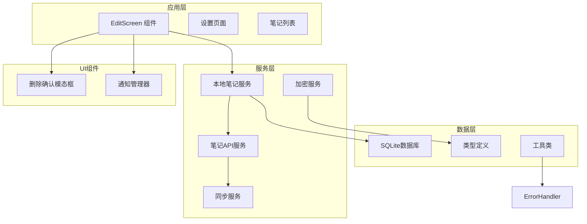

**图表来源**

- [app/edit.tsx](file://app/edit.tsx#L1-L517)
- [services/local/LocalNoteService.ts](file://services/local/LocalNoteService.ts#L1-L601)

**章节来源**

- [app/edit.tsx](file://app/edit.tsx#L1-L50)
- [services/local/LocalNoteService.ts](file://services/local/LocalNoteService.ts#L1-L30)

## 核心组件

编辑界面组件由多个相互协作的模块组成，每个模块都有明确的职责分工：

### 主要组件架构

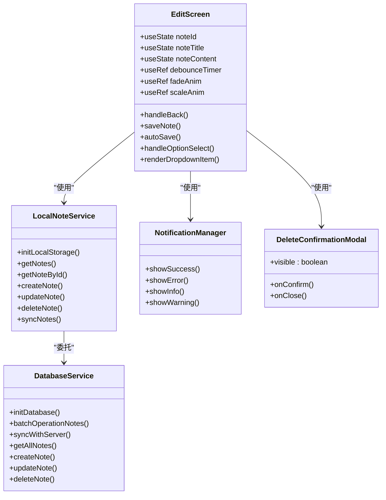

**图表来源**

- [app/edit.tsx](file://app/edit.tsx#L20-L406)
- [services/local/LocalNoteService.ts](file://services/local/LocalNoteService.ts#L85-L114)
- [services/database/DatabaseService.ts](file://services/database/DatabaseService.ts#L271-L301)

### 数据绑定机制

组件实现了完整的双向数据绑定系统：

| 绑定类型 | 数据源               | 目标      | 同步方式 |
| -------- | -------------------- | --------- | -------- |
| 标题绑定 | noteTitle            | TextInput | 受控组件 |
| 内容绑定 | noteContent          | TextInput | 受控组件 |
| ID绑定   | noteId               | 路由参数  | 状态同步 |
| 加密状态 | optionsState.encrypt | 复选框    | 状态管理 |

**章节来源**

- [app/edit.tsx](file://app/edit.tsx#L25-L28)
- [app/edit.tsx](file://app/edit.tsx#L342-L365)

## 架构概览

编辑界面组件采用了分层架构设计，确保了关注点分离和代码的可维护性：

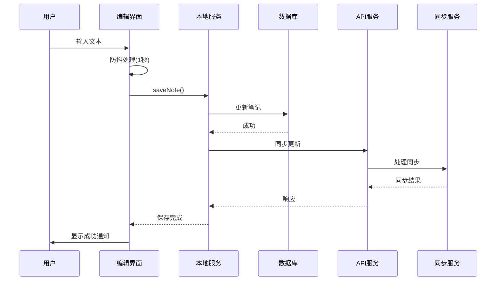

**图表来源**

- [app/edit.tsx](file://app/edit.tsx#L129-L190)
- [services/local/LocalNoteService.ts](file://services/local/LocalNoteService.ts#L101-L114)
- [services/database/DatabaseService.ts](file://services/database/DatabaseService.ts#L293-L301)

### 实时保存机制

组件实现了智能的防抖保存策略：

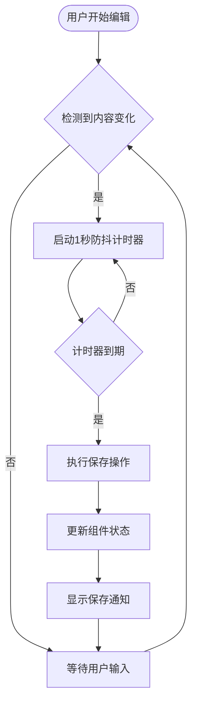

**图表来源**

- [app/edit.tsx](file://app/edit.tsx#L192-L205)
- [app/edit.tsx](file://app/edit.tsx#L207-L227)

**章节来源**

- [app/edit.tsx](file://app/edit.tsx#L129-L190)
- [app/edit.tsx](file://app/edit.tsx#L192-L227)

## 详细组件分析

### 编辑界面核心功能

#### 生命周期管理

编辑界面组件实现了完整的生命周期管理：

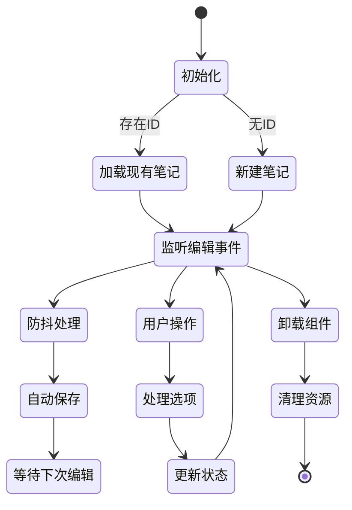

**图表来源**

- [app/edit.tsx](file://app/edit.tsx#L48-L75)
- [app/edit.tsx](file://app/edit.tsx#L221-L227)

#### 状态管理系统

组件使用了多层状态管理机制：

| 状态类型 | 描述         | 管理方式          | 示例                   |
| -------- | ------------ | ----------------- | ---------------------- |
| 本地状态 | 组件内部状态 | useState          | noteTitle, noteContent |
| 选项状态 | UI选项状态   | useState          | optionsState           |
| 动画状态 | 视觉反馈状态 | useRef + Animated | fadeAnim, scaleAnim    |
| 加载状态 | 异步操作状态 | useState          | isSaving, isDeleting   |

**章节来源**

- [app/edit.tsx](file://app/edit.tsx#L25-L46)
- [app/edit.tsx](file://app/edit.tsx#L31-L36)

### 数据持久化策略

#### 本地存储架构

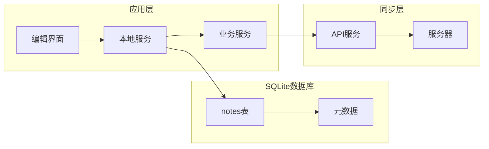

**图表来源**

- [services/database/DatabaseService.ts](file://services/database/DatabaseService.ts#L35-L46)
- [services/local/LocalNoteService.ts](file://services/local/LocalNoteService.ts#L101-L114)

#### 同步机制

组件实现了智能的同步策略：

| 同步类型 | 触发条件   | 行为描述         | 错误处理                     |
| -------- | ---------- | ---------------- | ---------------------------- |
| 即时同步 | 本地操作后 | 尝试同步到服务器 | 网络错误时保持待同步状态     |
| 批量同步 | 定期任务   | 同步待同步的笔记 | 逐个同步，失败不影响其他操作 |
| 强制同步 | 用户手动   | 同步所有本地变更 | 详细错误报告                 |

**章节来源**

- [services/local/LocalNoteService.ts](file://services/local/LocalNoteService.ts#L119-L152)
- [services/notes/SyncService.ts](file://services/notes/SyncService.ts#L13-L36)

### 用户交互模式

#### 悬浮菜单系统

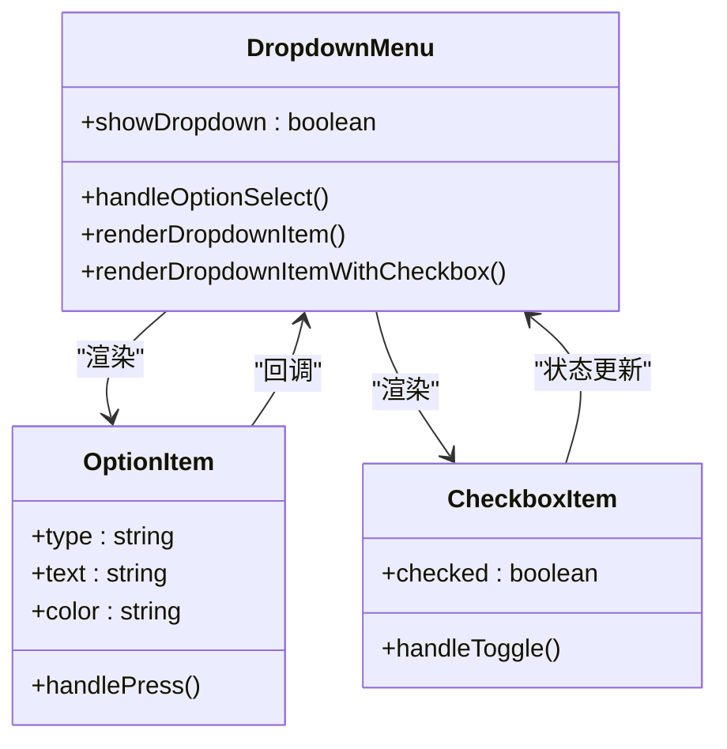

**图表来源**

- [app/edit.tsx](file://app/edit.tsx#L368-L403)
- [app/edit.tsx](file://app/edit.tsx#L301-L315)

#### 通知系统

组件集成了多层次的通知机制：

| 通知类型   | 平台支持    | 触发场景      | 显示方式   |
| ---------- | ----------- | ------------- | ---------- |
| Toast通知  | iOS/Android | 成功/警告     | 底部横幅   |
| 模态对话框 | iOS/Android | 错误/重要信息 | 居中弹窗   |
| 系统Toast  | Android     | 快速反馈      | 系统级提示 |
| 自定义动画 | iOS/Android | 重要操作      | 动画过渡   |

**章节来源**

- [components/NotificationManager.tsx](file://components/NotificationManager.tsx#L83-L101)
- [components/NotificationManager.tsx](file://components/NotificationManager.tsx#L131-L173)

### 编辑模式与输入验证

#### 输入验证机制

组件实现了多层次的输入验证：

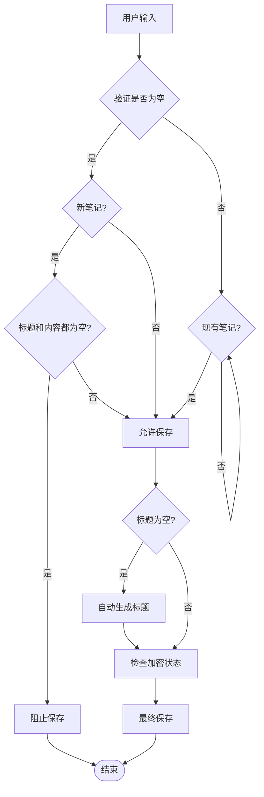

**图表来源**

- [app/edit.tsx](file://app/edit.tsx#L134-L147)
- [app/edit.tsx](file://app/edit.tsx#L149-L174)

#### 加密功能集成

组件支持笔记加密功能，通过复选框控制加密状态：

| 加密状态 | 存储值       | 行为         |
| -------- | ------------ | ------------ |
| 未加密   | 0            | 标准文本存储 |
| 已加密   | 1            | 加密文本存储 |
| 初始状态 | 从数据库读取 | 继承原有状态 |

**章节来源**

- [app/edit.tsx](file://app/edit.tsx#L112-L118)
- [app/edit.tsx](file://app/edit.tsx#L149-L156)

### 键盘适配与软键盘处理

#### 键盘交互优化

组件针对不同平台进行了键盘交互优化：

| 平台特性   | 适配方案     | 用户体验               |
| ---------- | ------------ | ---------------------- |
| iOS        | 原生键盘行为 | 自然的光标移动和选择   |
| Android    | 软键盘适配   | 避免布局遮挡和滚动问题 |
| 多行输入   | 自动高度调整 | 适应内容增长           |
| 软键盘显示 | 滚动视图适配 | 确保输入框可见         |

#### 键盘快捷键支持

组件支持基本的键盘快捷键操作：

- **回车键**: 新行插入
- **退格键**: 文本删除
- **方向键**: 光标移动
- **Tab键**: 缩进处理

### 屏幕旋转支持

组件实现了完整的屏幕旋转适配：

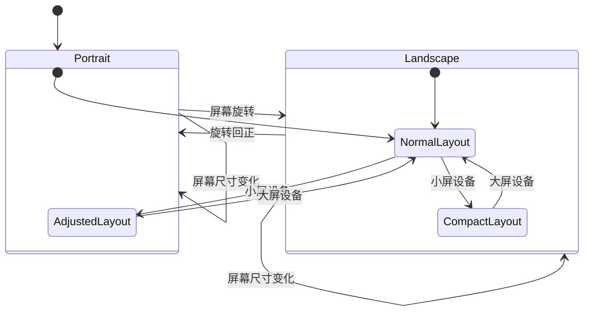

## 依赖关系分析

### 核心依赖链

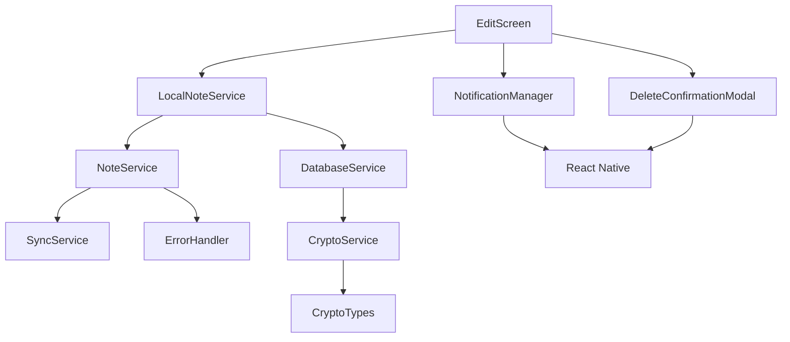

**图表来源**

- [app/edit.tsx](file://app/edit.tsx#L1-L18)
- [services/local/LocalNoteService.ts](file://services/local/LocalNoteService.ts#L1-L17)

### 数据流依赖

组件的数据流遵循单向数据流原则：

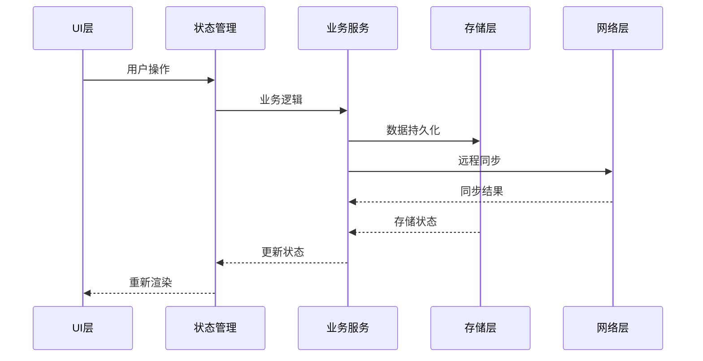

**图表来源**

- [app/edit.tsx](file://app/edit.tsx#L129-L190)
- [services/local/LocalNoteService.ts](file://services/local/LocalNoteService.ts#L101-L114)

**章节来源**

- [services/local/LocalNoteService.ts](file://services/local/LocalNoteService.ts#L1-L601)
- [services/database/DatabaseService.ts](file://services/database/DatabaseService.ts#L1-L513)

## 性能考虑

### 内存管理策略

组件采用了多项内存优化技术：

#### 防抖机制优化

- **防抖延迟**: 1秒延迟，平衡实时性和性能
- **定时器清理**: 组件卸载时自动清理定时器
- **重复保存防护**: `isSaving` 状态防止并发保存

#### 数据库连接管理

- **连接池**: 单例数据库连接，避免频繁创建销毁
- **事务处理**: 批量操作使用事务，提高性能
- **查询优化**: 使用索引和预编译语句

#### 内存泄漏防护

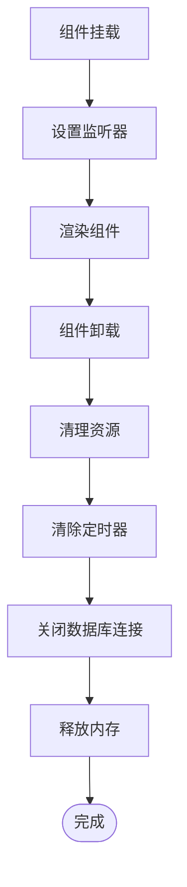

**图表来源**

- [app/edit.tsx](file://app/edit.tsx#L221-L227)
- [services/database/DatabaseService.ts](file://services/database/DatabaseService.ts#L473-L486)

### 性能监控指标

| 指标类型   | 目标值  | 监控方法 |
| ---------- | ------- | -------- |
| 保存延迟   | < 100ms | 性能测试 |
| 内存使用   | < 50MB  | 内存分析 |
| 数据库响应 | < 50ms  | 查询分析 |
| UI响应     | < 16ms  | 帧率监控 |

**章节来源**

- [app/edit.tsx](file://app/edit.tsx#L192-L205)
- [services/database/DatabaseService.ts](file://services/database/DatabaseService.ts#L62-L101)

## 故障排除指南

### 常见问题及解决方案

#### 保存失败问题

**问题症状**: 保存按钮点击无响应或显示错误

**可能原因**:

1. 网络连接异常
2. 数据库连接失败
3. 并发保存冲突

**解决方案**:

1. 检查网络连接状态
2. 重启应用重新建立数据库连接
3. 等待当前保存操作完成

#### 同步失败问题

**问题症状**: 笔记在不同设备间不同步

**可能原因**:

1. 服务器API不可用
2. 网络超时
3. 认证失败

**解决方案**:

1. 检查服务器状态
2. 增加超时时间
3. 重新登录认证

#### 数据库损坏问题

**问题症状**: 应用启动缓慢或崩溃

**可能原因**:

1. SQLite数据库文件损坏
2. 事务未正确提交
3. 并发访问冲突

**解决方案**:

1. 重建数据库文件
2. 检查事务完整性
3. 实施连接池管理

### 错误处理机制

组件实现了完善的错误处理体系：

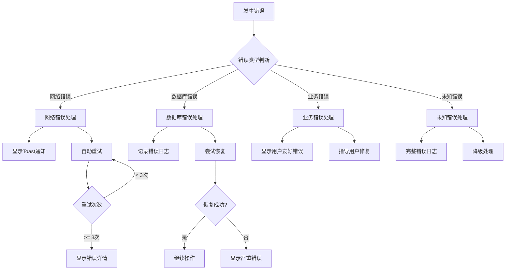

**图表来源**

- [utils/ErrorHandler.ts](file://utils/ErrorHandler.ts#L17-L42)
- [services/local/LocalNoteService.ts](file://services/local/LocalNoteService.ts#L124-L143)

**章节来源**

- [utils/ErrorHandler.ts](file://utils/ErrorHandler.ts#L1-L48)
- [services/local/LocalNoteService.ts](file://services/local/LocalNoteService.ts#L119-L152)

### 调试工具

组件提供了多种调试工具：

#### 日志系统

- **错误日志**: 详细的错误堆栈信息
- **操作日志**: 用户操作追踪
- **性能日志**: 性能指标监控

#### 开发者工具

- **状态检查**: 当前组件状态查看
- **数据库检查**: 数据库一致性验证
- **网络监控**: API调用状态监控

## 结论

编辑界面组件是一个功能完整、架构清晰的现代化笔记编辑器。通过精心设计的分层架构、智能的实时保存机制和完善的错误处理体系，为用户提供了流畅的编辑体验。

### 主要优势

1. **高性能**: 采用防抖机制和连接池管理，确保流畅的用户体验
2. **可靠性**: 完善的错误处理和数据恢复机制
3. **可扩展性**: 模块化设计便于功能扩展和维护
4. **跨平台**: 统一的代码基础支持iOS和Android平台

### 技术亮点

- **智能防抖保存**: 平衡实时性和性能的保存策略
- **离线编辑支持**: 完整的本地存储和同步机制
- **多层通知系统**: 丰富的用户反馈机制
- **健壮的错误处理**: 面向生产的错误处理策略

### 未来改进方向

1. **撤销重做功能**: 实现基于操作历史的撤销重做机制
2. **富文本编辑器**: 集成更强大的文本格式化功能
3. **云同步优化**: 改进同步算法和冲突解决策略
4. **无障碍支持**: 增强屏幕阅读器和辅助技术支持

该组件为整个笔记应用提供了坚实的基础，通过持续的优化和功能扩展，将成为一个更加完善和用户友好的编辑解决方案。
