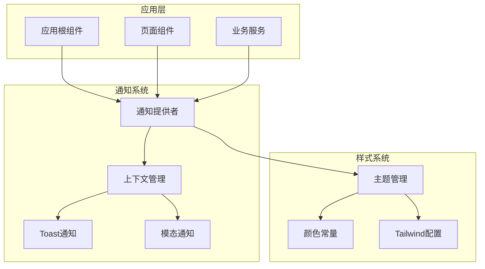
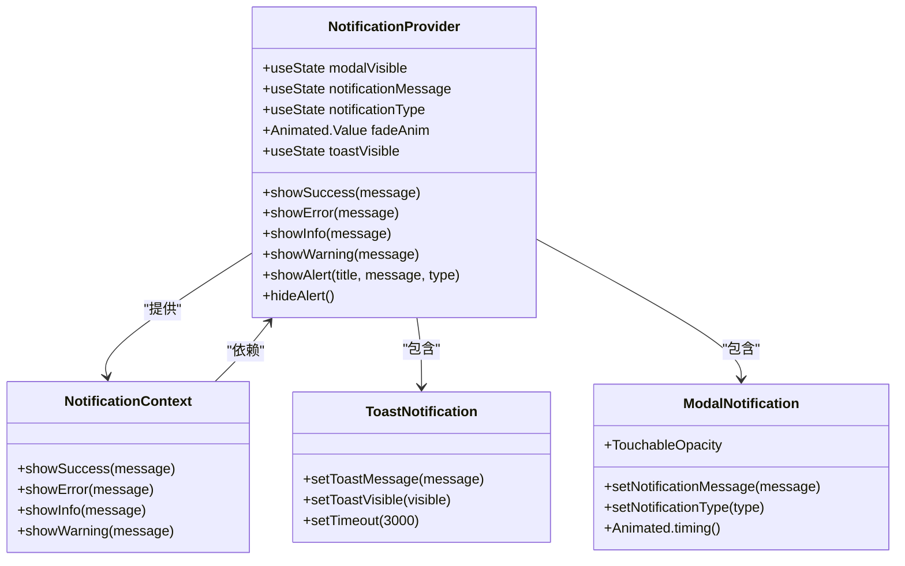
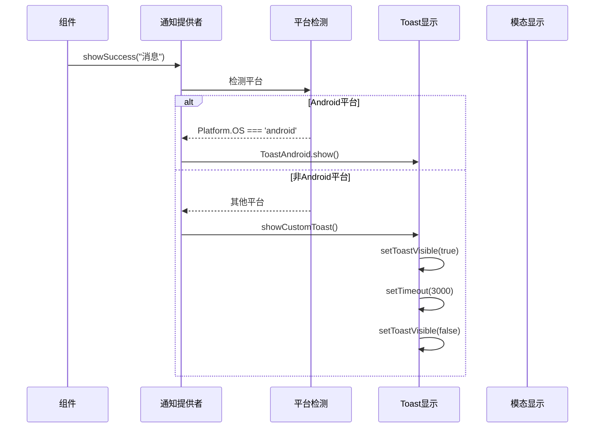
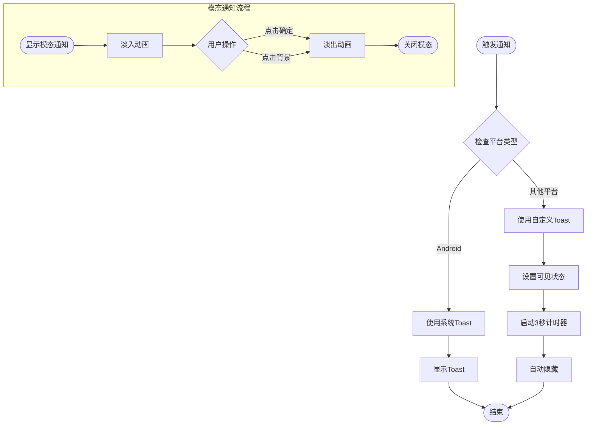
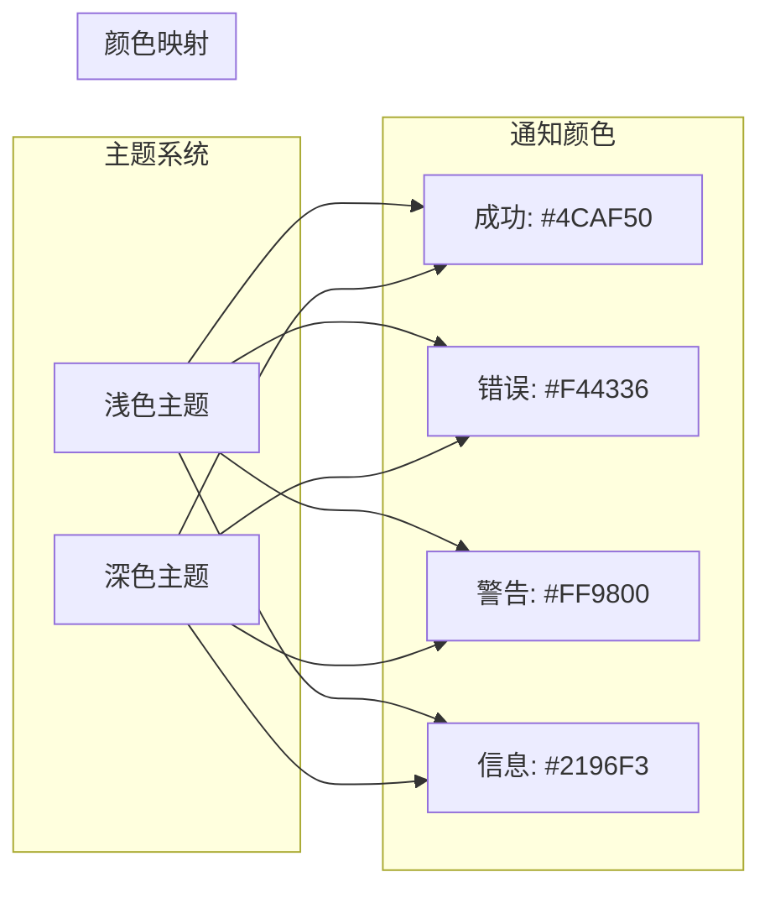
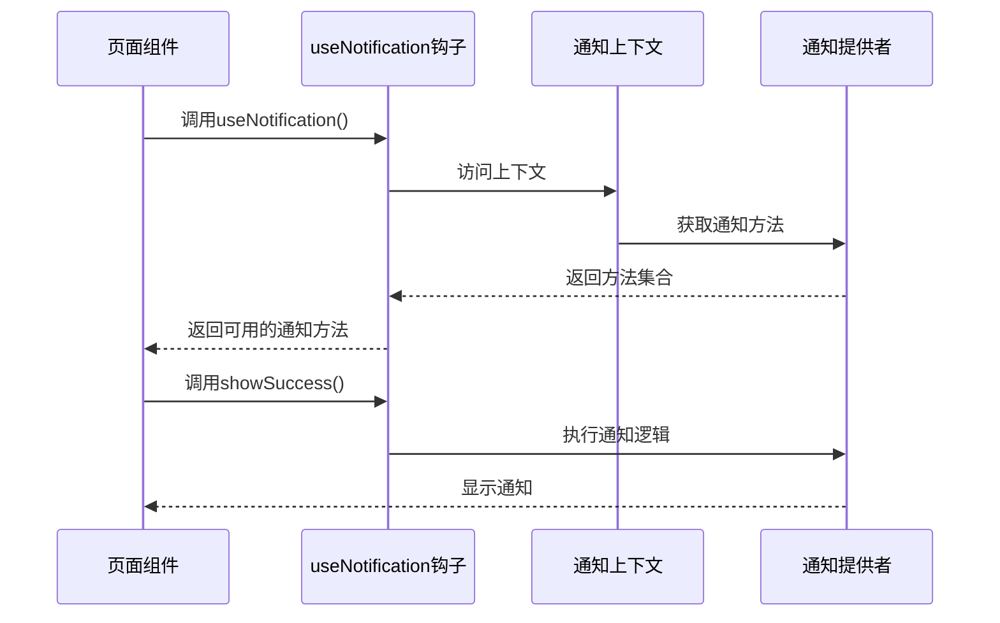
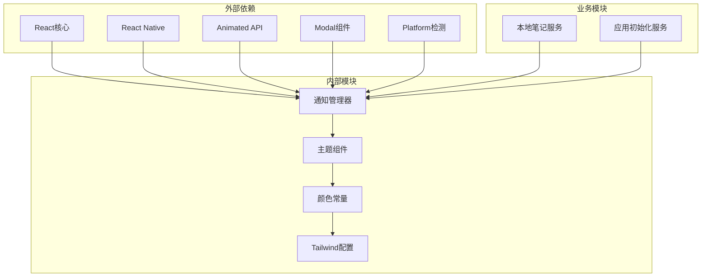

# 通知组件

<cite>
**本文档引用的文件**
- [NotificationManager.tsx](file://components/NotificationManager.tsx)
- [_layout.tsx](file://app/_layout.tsx)
- [index.tsx](file://app/(tabs)/index.tsx)
- [settings.tsx](file://app/settings.tsx)
- [LocalStorageDemo.tsx](file://components/LocalStorageDemo.tsx)
- [Themed.tsx](file://components/Themed.tsx)
- [Colors.ts](file://constants/Colors.ts)
- [tailwind.config.js](file://tailwind.config.js)
- [LocalNoteService.ts](file://services/local/LocalNoteService.ts)
- [AppInitializationService.ts](file://services/AppInitializationService.ts)
</cite>

## 目录

1. [简介](#简介)
2. [项目结构](#项目结构)
3. [核心组件](#核心组件)
4. [架构概览](#架构概览)
5. [详细组件分析](#详细组件分析)
6. [依赖关系分析](#依赖关系分析)
7. [性能考虑](#性能考虑)
8. [故障排除指南](#故障排除指南)
9. [结论](#结论)
10. [附录](#附录)

## 简介

通知组件是本项目中的核心用户体验模块，负责在应用中提供统一的通知管理和展示机制。该组件实现了多种通知类型、跨平台兼容性、主题适配和丰富的交互体验。

通知系统采用React Context模式构建，提供了完整的通知生命周期管理，包括自动消失、手动关闭、优先级控制等功能。系统支持成功、错误、警告和信息四种通知类型，并针对不同平台提供了最优的显示策略。

## 项目结构

通知组件在整个项目架构中扮演着重要的角色，位于应用的基础设施层，为其他业务组件提供统一的通知服务。



**图表来源**

- [NotificationManager.tsx](file://components/NotificationManager.tsx#L33-L190)
- [\_layout.tsx](file://app/_layout.tsx#L71-L82)

**章节来源**

- [NotificationManager.tsx](file://components/NotificationManager.tsx#L1-L190)
- [\_layout.tsx](file://app/_layout.tsx#L1-L84)

## 核心组件

通知系统的核心由三个主要部分组成：

### 1. 通知提供者 (NotificationProvider)

负责管理通知状态和提供通知接口，使用React Context实现全局状态共享。

### 2. 通知上下文 (NotificationContext)

定义了四个标准通知方法：`showSuccess`、`showError`、`showInfo`、`showWarning`。

### 3. 通知渲染器

包含两种通知显示方式：Toast通知和模态通知，分别适用于不同的使用场景。

**章节来源**

- [NotificationManager.tsx](file://components/NotificationManager.tsx#L12-L27)
- [NotificationManager.tsx](file://components/NotificationManager.tsx#L33-L190)

## 架构概览

通知系统的整体架构采用了分层设计模式，确保了良好的可维护性和扩展性。



**图表来源**

- [NotificationManager.tsx](file://components/NotificationManager.tsx#L19-L190)

## 详细组件分析

### 通知提供者实现

通知提供者是整个通知系统的核心，负责管理所有通知状态和行为逻辑。

#### 状态管理

- `modalVisible`: 控制模态通知的显示/隐藏
- `notificationMessage`: 存储当前显示的通知内容
- `notificationType`: 标识通知类型（success/error/info/warning）
- `fadeAnim`: 用于模态通知的动画控制
- `toastVisible`: 控制Toast通知的显示
- `toastMessage`: 存储Toast通知的内容

#### 通知方法实现



**图表来源**

- [NotificationManager.tsx](file://components/NotificationManager.tsx#L82-L100)

#### 类型系统设计

通知系统支持四种标准类型，每种类型都有对应的颜色方案和语义含义：

| 类型    | 颜色代码 | 语义用途     | 平台行为                                  |
| ------- | -------- | ------------ | ----------------------------------------- |
| success | #4CAF50  | 成功操作反馈 | Android使用系统Toast，其他平台自定义Toast |
| error   | #F44336  | 错误信息提示 | 模态对话框显示，需要用户确认              |
| warning | #FF9800  | 警告信息提醒 | 模态对话框显示，强调重要性                |
| info    | #2196F3  | 一般信息提示 | 模态对话框显示，提供背景信息              |

**章节来源**

- [NotificationManager.tsx](file://components/NotificationManager.tsx#L33-L190)

### 通知显示策略

#### Toast通知机制

Toast通知采用临时显示的方式，具有以下特点：

- 自动消失：3秒后自动隐藏
- 跨平台兼容：Android使用系统Toast，其他平台使用自定义实现
- 位置固定：屏幕顶部居中显示
- 无交互：用户无法手动关闭

#### 模态通知机制

模态通知提供完整的用户交互体验：

- 手动关闭：用户点击"确定"按钮或点击背景关闭
- 动画效果：淡入淡出动画，提升用户体验
- 标题区分：根据通知类型显示相应的标题
- 边框标识：左侧彩色边框标识通知类型



**图表来源**

- [NotificationManager.tsx](file://components/NotificationManager.tsx#L43-L100)

**章节来源**

- [NotificationManager.tsx](file://components/NotificationManager.tsx#L177-L187)

### 主题适配和样式定制

通知组件完全集成到应用的主题系统中，支持深色和浅色模式的自动切换。

#### 主题集成机制

- 使用`useColorScheme`钩子检测系统主题
- 通过`useThemeColor`函数获取当前主题下的颜色值
- Tailwind CSS类名与主题系统无缝结合

#### 颜色系统架构



**图表来源**

- [Themed.tsx](file://components/Themed.tsx#L23-L35)
- [Colors.ts](file://constants/Colors.ts#L4-L19)

**章节来源**

- [Themed.tsx](file://components/Themed.tsx#L1-L65)
- [Colors.ts](file://constants/Colors.ts#L1-L20)
- [tailwind.config.js](file://tailwind.config.js#L1-L9)

### 跨组件通信机制

通知系统通过React Context实现全局状态管理，确保在整个应用范围内的一致性。

#### Context模式实现

- 使用`createContext`创建通知上下文
- 通过`useContext`钩子在任意组件中访问通知功能
- 提供类型安全的接口定义

#### 使用示例



**图表来源**

- [NotificationManager.tsx](file://components/NotificationManager.tsx#L21-L27)

**章节来源**

- [NotificationManager.tsx](file://components/NotificationManager.tsx#L11-L27)

## 依赖关系分析

通知系统与其他模块的依赖关系体现了清晰的分层架构。



**图表来源**

- [NotificationManager.tsx](file://components/NotificationManager.tsx#L1-L10)
- [LocalNoteService.ts](file://services/local/LocalNoteService.ts#L1-L28)
- [AppInitializationService.ts](file://services/AppInitializationService.ts#L1-L63)

**章节来源**

- [NotificationManager.tsx](file://components/NotificationManager.tsx#L1-L10)
- [LocalNoteService.ts](file://services/local/LocalNoteService.ts#L1-L28)

## 性能考虑

通知系统在设计时充分考虑了性能优化，采用了多种策略确保流畅的用户体验。

### 内存管理

- 使用React状态管理避免不必要的重新渲染
- 及时清理定时器，防止内存泄漏
- 合理的组件卸载处理

### 渲染优化

- 使用`useMemo`和`useCallback`优化函数稳定性
- 条件渲染减少DOM节点数量
- 动画使用原生驱动提高性能

### 并发处理

- 避免多个通知同时显示造成UI阻塞
- 合理的队列管理机制
- 平台特定的优化策略

## 故障排除指南

### 常见问题及解决方案

#### 通知不显示问题

1. **检查Provider包裹**：确保应用根组件正确包裹`NotificationProvider`
2. **验证Hook使用**：确认在`NotificationProvider`作用域内使用`useNotification`
3. **平台兼容性**：检查目标平台是否支持相应通知类型

#### 样式异常问题

1. **主题配置**：确认`useColorScheme`正常工作
2. **Tailwind配置**：检查`tailwind.config.js`配置正确性
3. **颜色常量**：验证`Colors.ts`中颜色定义

#### 动画性能问题

1. **原生驱动**：确认使用`useNativeDriver: true`
2. **动画时长**：合理设置动画持续时间
3. **复杂度控制**：避免过度复杂的动画效果

**章节来源**

- [NotificationManager.tsx](file://components/NotificationManager.tsx#L21-L27)

## 结论

通知组件成功实现了跨平台、类型丰富、主题适配的现代化通知系统。通过合理的架构设计和性能优化，为用户提供了优秀的交互体验。

系统的主要优势包括：

- 完整的类型覆盖和语义明确的通知分类
- 跨平台兼容性和最佳实践的显示策略
- 深色/浅色主题的无缝适配
- 简洁易用的API接口
- 良好的性能表现和内存管理

未来可以考虑的功能扩展包括：通知优先级管理、批量通知处理、通知历史记录、用户偏好设置等高级特性。

## 附录

### API参考

#### 通知方法

- `showSuccess(message: string)`: 显示成功通知
- `showError(message: string)`: 显示错误通知
- `showInfo(message: string)`: 显示信息通知
- `showWarning(message: string)`: 显示警告通知

#### 使用示例

```typescript
const { showSuccess, showError, showInfo } = useNotification();

// 在异步操作中使用
try {
  await performOperation();
  showSuccess('操作成功！');
} catch (error) {
  showError('操作失败：' + error.message);
}
```

### 最佳实践

1. **及时清理**：在组件卸载时清理可能存在的通知状态
2. **错误处理**：始终在try-catch块中使用通知方法
3. **消息简洁**：保持通知消息简短明了
4. **时机恰当**：在合适的时机显示通知，避免频繁弹窗
5. **无障碍设计**：考虑屏幕阅读器等辅助技术的兼容性
