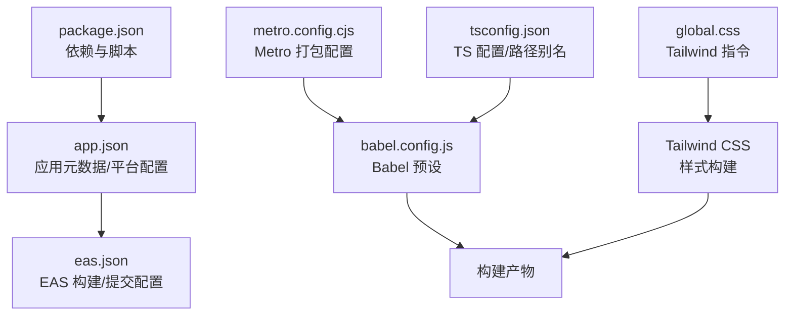
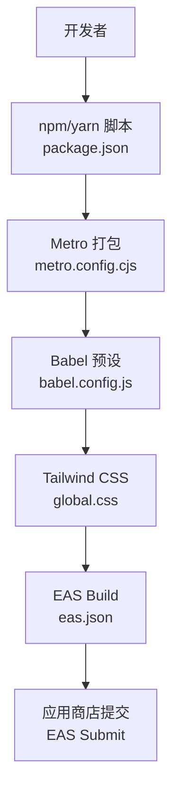
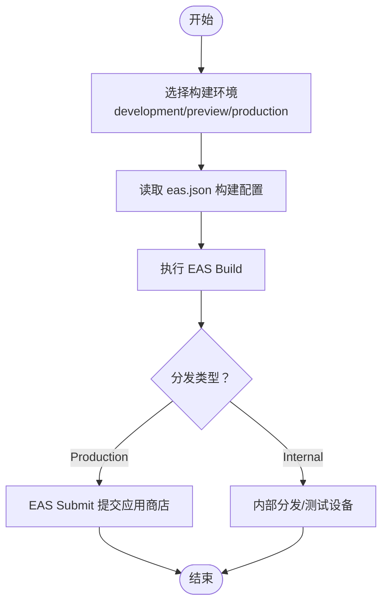
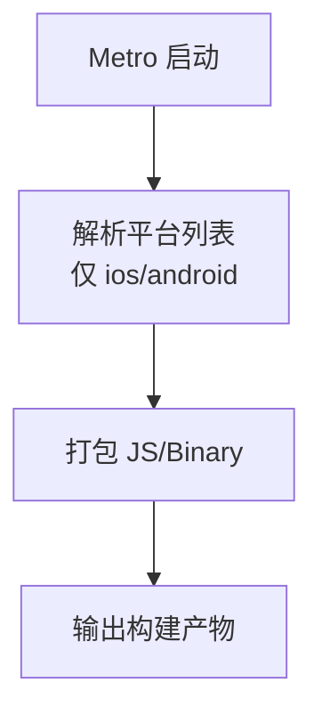
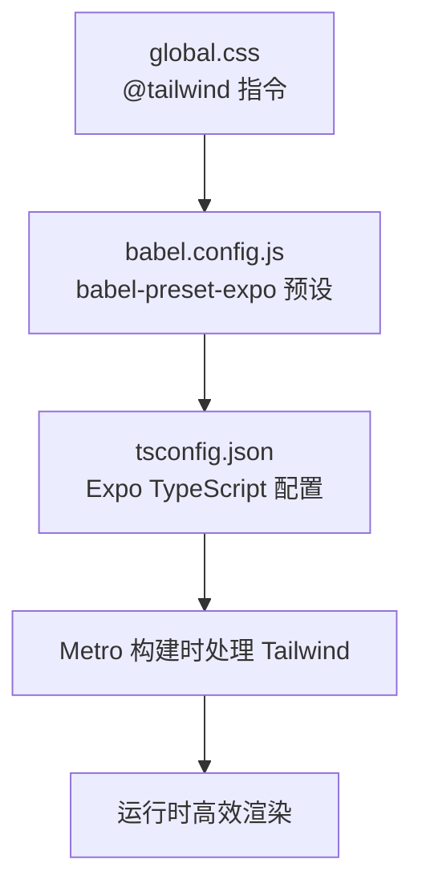
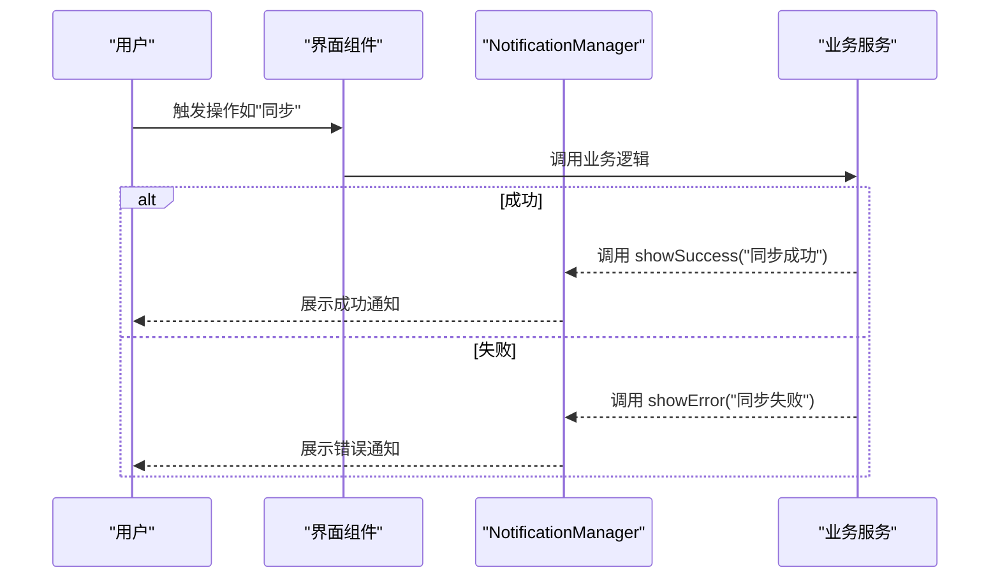
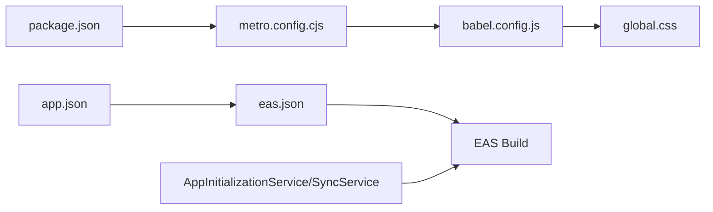

# 部署与发布

<cite>
**本文引用的文件**
- [package.json](file://package.json)
- [app.json](file://app.json)
- [eas.json](file://eas.json)
- [metro.config.cjs](file://metro.config.cjs)
- [babel.config.js](file://babel.config.js)
- [global.css](file://global.css)
- [tsconfig.json](file://tsconfig.json)
- [开发文档.md](file://docs/开发文档.md)
- [NativeWind迁移指南.md](file://docs/NativeWind迁移指南.md)
- [api-doc.md](file://api-doc.md)
- [AppInitializationService.ts](file://services/AppInitializationService.ts)
- [SyncService.ts](file://services/notes/SyncService.ts)
- [NotificationManager.tsx](file://components/NotificationManager.tsx)
</cite>

## 更新摘要

**所做更改**

- 移除了 NativeWind 相关的构建配置和依赖项说明
- 更新了 Tailwind CSS 构建流程，反映当前无 NativeWind 的配置状态
- 删除了与 NativeWind 迁移相关的章节内容
- 更新了构建链路图和配置关系图
- 移除了 NativeWind 相关的故障排查指南

## 目录

1. [简介](#简介)
2. [项目结构](#项目结构)
3. [核心组件](#核心组件)
4. [架构总览](#架构总览)
5. [详细组件分析](#详细组件分析)
6. [依赖关系分析](#依赖关系分析)
7. [性能考虑](#性能考虑)
8. [故障排查指南](#故障排查指南)
9. [结论](#结论)
10. [附录](#附录)

## 简介

本指南面向运维与发布团队，围绕 Notes 应用的部署与发布提供从构建配置、EAS Build 使用、Metro 打包优化、Tailwind CSS 构建到应用商店发布的全流程说明，并覆盖版本号管理、变更日志与用户通知策略，以及生产环境的监控、日志与性能优化建议。

## 项目结构

- 应用元数据与平台配置集中在 app.json；构建与提交配置集中在 eas.json；打包与平台剔除在 metro.config.cjs；样式体系通过 Tailwind 驱动，Babel 与 TS 配置确保构建链路正确。
- 关键目录与文件职责概览：
  - app/：页面路由（Expo Router 文件系统路由）
  - components/：UI 组件与通知管理
  - services/：服务层（数据库、加密、同步、调度等）
  - types/：类型定义
  - utils/：工具函数
  - docs/：开发与迁移文档
  - 配置文件：package.json、app.json、eas.json、metro.config.cjs、babel.config.js、tsconfig.json、global.css

图表来源

- [package.json](file://package.json#L1-L67)
- [app.json](file://app.json#L1-L40)
- [eas.json](file://eas.json#L1-L31)
- [metro.config.cjs](file://metro.config.cjs#L1-L10)
- [babel.config.js](file://babel.config.js#L1-L7)
- [global.css](file://global.css#L1-L3)
- [tsconfig.json](file://tsconfig.json#L1-L11)

章节来源

- [开发文档.md](file://docs/开发文档.md#L50-L114)

## 核心组件

- 构建与发布
  - EAS Build：在 eas.json 中定义 development/preview/production 三类构建配置，支持内部分发与自动递增版本号。
  - EAS Submit：在 production 阶段提交至应用商店。
- 打包与 Metro
  - 通过 metro.config.cjs 明确仅保留 ios/android 平台，禁用 web 平台，减少打包体积与复杂度。
- 样式与 Tailwind
  - global.css 引入 Tailwind 指令；babel.config.js 使用 babel-preset-expo 预设；tsconfig.json 启用 Expo TypeScript 配置。
- 应用元数据与图标/启动画面
  - app.json 中定义 icon、splash、iOS/Android 平台特定配置（如包名、自适应图标、边缘到边等）。

章节来源

- [eas.json](file://eas.json#L1-L31)
- [metro.config.cjs](file://metro.config.cjs#L1-L10)
- [babel.config.js](file://babel.config.js#L1-L7)
- [global.css](file://global.css#L1-L3)
- [tsconfig.json](file://tsconfig.json#L1-L11)
- [app.json](file://app.json#L1-L40)

## 架构总览

下图展示从本地构建到应用商店提交的关键流程与配置文件之间的关系。

图表来源

- [package.json](file://package.json#L5-L12)
- [metro.config.cjs](file://metro.config.cjs#L1-L10)
- [babel.config.js](file://babel.config.js#L1-L7)
- [global.css](file://global.css#L1-L3)
- [eas.json](file://eas.json#L1-L31)

## 详细组件分析

### EAS Build 配置与使用

- 构建类型与分发
  - development：启用 developmentClient，内部分发，Android 默认 APK。
  - preview：内部分发，Android 默认 APK。
  - production：开启 autoIncrement，自动递增版本号，Android 默认 APK。
- 应用版本来源
  - cli.appVersionSource 设为 remote，版本号由 EAS 服务端控制，便于统一管理。
- 提交流程
  - submit.production 留空表示使用默认行为，按需补充 store/target 以指定目标商店。

图表来源

- [eas.json](file://eas.json#L6-L29)

章节来源

- [eas.json](file://eas.json#L1-L31)

### Metro 打包配置与优化

- 平台剔除
  - resolver.platforms 仅保留 ios/android，禁用 web，降低打包复杂度与体积。
- 优化建议
  - 保持 Expo 默认配置，避免过度定制；如需自定义，优先通过 Metro 扩展而非全局替换。
  - 结合 EAS Build 的缓存与增量构建能力，提升 CI/CD 效率。

图表来源

- [metro.config.cjs](file://metro.config.cjs#L6-L8)

章节来源

- [metro.config.cjs](file://metro.config.cjs#L1-L10)

### Tailwind CSS 构建与优化

- 配置要点
  - global.css 中引入 @tailwind base、components、utilities 指令，确保基础/组件/工具类生效。
  - babel.config.js 使用 babel-preset-expo 预设，与 Expo 生态系统兼容。
  - tsconfig.json 继承 expo/tsconfig.base，启用严格模式和路径别名。
- 构建流程
  - Metro 在打包过程中自动处理 Tailwind CSS 指令，无需额外的构建步骤。
- 优化建议
  - 控制动态类名组合数量，避免生成过多变体导致包体膨胀。
  - 保持样式文件结构清晰，避免遗漏文件导致样式未生效。

图表来源

- [global.css](file://global.css#L1-L3)
- [babel.config.js](file://babel.config.js#L1-L7)
- [tsconfig.json](file://tsconfig.json#L1-L11)

章节来源

- [global.css](file://global.css#L1-L3)
- [babel.config.js](file://babel.config.js#L1-L7)
- [tsconfig.json](file://tsconfig.json#L1-L11)

### 应用图标、启动画面与平台特定配置

- 图标与启动画面
  - app.json 中 icon 与 splash.image 指向资源文件，backgroundColor 与 resizeMode 控制加载体验。
- 平台特定配置
  - iOS：supportsTablet 控制平板支持。
  - Android：adaptiveIcon.foregroundImage、edgeToEdgeEnabled、predictiveBackGestureEnabled、package 等。
- 建议
  - 确保资源尺寸符合各平台要求；在 app.json 中统一管理，避免硬编码。

章节来源

- [app.json](file://app.json#L7-L27)

### 版本号管理、变更日志与用户通知策略

- 版本号管理
  - app.json 与 package.json 的 version 字段作为应用版本的基础；eas.json production 开启 autoIncrement，结合 EAS 服务端版本来源，形成统一的版本控制。
- 变更日志
  - 开发文档维护版本历史，建议每次发布更新该表，明确改动点与影响面。
- 用户通知策略
  - NotificationManager 提供统一的通知入口（成功/错误/信息/警告），可在关键流程（如同步、导入导出、登录）中调用，确保用户感知。
  - 建议在重大版本更新时，通过通知或内嵌公告提醒用户变更摘要。

图表来源

- [NotificationManager.tsx](file://components/NotificationManager.tsx#L83-L101)
- [开发文档.md](file://docs/开发文档.md#L460-L466)

章节来源

- [app.json](file://app.json#L5)
- [package.json](file://package.json#L4)
- [eas.json](file://eas.json#L20-L25)
- [开发文档.md](file://docs/开发文档.md#L460-L466)
- [NotificationManager.tsx](file://components/NotificationManager.tsx#L1-L235)

### 生产环境监控、日志收集与性能优化

- 监控与日志
  - 建议接入应用性能监控（APM）与崩溃报告工具，收集关键指标（启动耗时、内存占用、网络请求时延）。
  - 在关键路径（如同步、加密、数据库写入）埋点，结合日志聚合平台进行追踪。
- 性能优化
  - 保持 Metro 平台剔除策略，减少无关平台的打包与运行时开销。
  - Tailwind CSS 预编译特性良好，注意避免动态类名爆炸；合理拆分组件，减少重复样式。
  - 与 EAS Build 的缓存与增量构建配合，缩短 CI/CD 时间。
- 安全与合规
  - 加密与同步流程遵循最小暴露原则；对敏感日志进行脱敏处理。

## 依赖关系分析

- 构建链路依赖
  - package.json 脚本驱动开发与构建；Metro 依赖 Babel/Expo 预设；EAS Build 读取 app.json/eas.json。
- 服务层与发布
  - AppInitializationService 与 SyncService 体现应用生命周期与数据同步，发布后仍需关注异常与重试策略。

图表来源

- [package.json](file://package.json#L5-L12)
- [metro.config.cjs](file://metro.config.cjs#L1-L10)
- [babel.config.js](file://babel.config.js#L1-L7)
- [global.css](file://global.css#L1-L3)
- [app.json](file://app.json#L1-L40)
- [eas.json](file://eas.json#L1-L31)
- [AppInitializationService.ts](file://services/AppInitializationService.ts#L1-L63)
- [SyncService.ts](file://services/notes/SyncService.ts#L1-L58)

章节来源

- [package.json](file://package.json#L1-L67)
- [app.json](file://app.json#L1-L40)
- [eas.json](file://eas.json#L1-L31)
- [metro.config.cjs](file://metro.config.cjs#L1-L10)
- [babel.config.js](file://babel.config.js#L1-L7)
- [global.css](file://global.css#L1-L3)
- [AppInitializationService.ts](file://services/AppInitializationService.ts#L1-L63)
- [SyncService.ts](file://services/notes/SyncService.ts#L1-L58)

## 性能考虑

- 构建阶段
  - 保持样式文件结构清晰，避免 Tailwind 指令遗漏；Metro 平台剔除减少打包体积。
- 运行阶段
  - Tailwind CSS 在构建时处理，运行时开销低；避免在循环中动态拼接大量不同类名。
- 发布阶段
  - 使用 EAS Build 的缓存与增量构建，减少重复编译；production 开启 autoIncrement，避免版本冲突。

## 故障排查指南

- EAS Build 失败
  - 检查 eas.json 构建配置与平台设置；确认 app.json 中的版本号与图标/启动画面资源存在且路径正确。
- 样式未生效
  - 确认 global.css 中 @tailwind 指令存在；babel.config.js 使用正确的预设；tsconfig.json 配置正确。
- Metro 打包异常
  - 检查 metro.config.cjs 平台剔除设置；避免在 Metro 配置中覆盖默认行为。
- 通知显示异常
  - 确认 NotificationManager 已在根组件中提供上下文；调用 showSuccess/showError 等方法时传入合法参数。

章节来源

- [eas.json](file://eas.json#L1-L31)
- [global.css](file://global.css#L1-L3)
- [babel.config.js](file://babel.config.js#L1-L7)
- [metro.config.cjs](file://metro.config.cjs#L1-L10)
- [NotificationManager.tsx](file://components/NotificationManager.tsx#L1-L235)

## 结论

通过统一的构建配置（Metro、Babel、Tailwind CSS）、清晰的版本与发布策略（EAS Build/Submit），以及完善的监控与通知机制，Notes 应用可实现稳定、高效的持续交付。建议在 CI/CD 中固化上述配置，确保每次发布的一致性与可追溯性。

## 附录

- API 文档参考：用于理解后端接口与同步流程，辅助发布前后端联调与回归测试。
- 开发文档：帮助团队理解项目结构与技术栈，保障发布质量。

章节来源

- [api-doc.md](file://api-doc.md#L1-L449)
- [开发文档.md](file://docs/开发文档.md#L1-L474)
