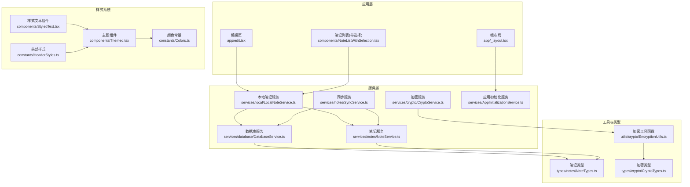
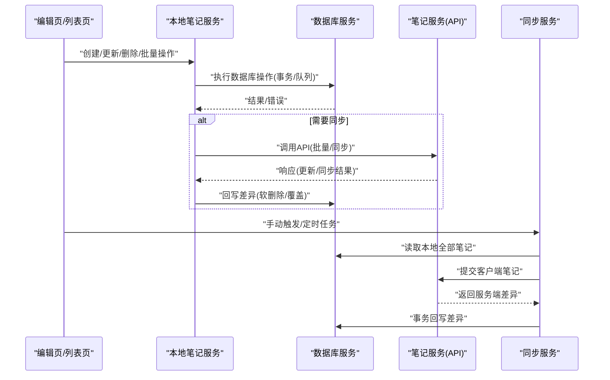
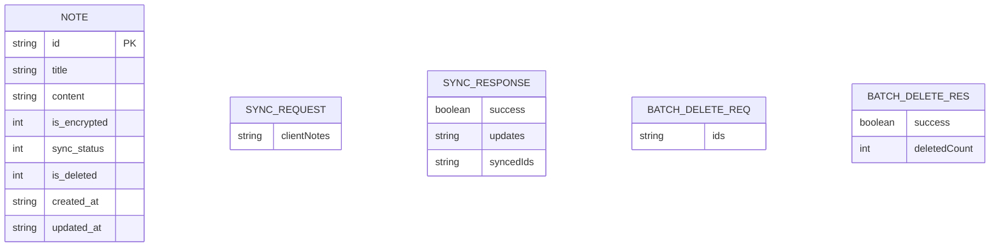
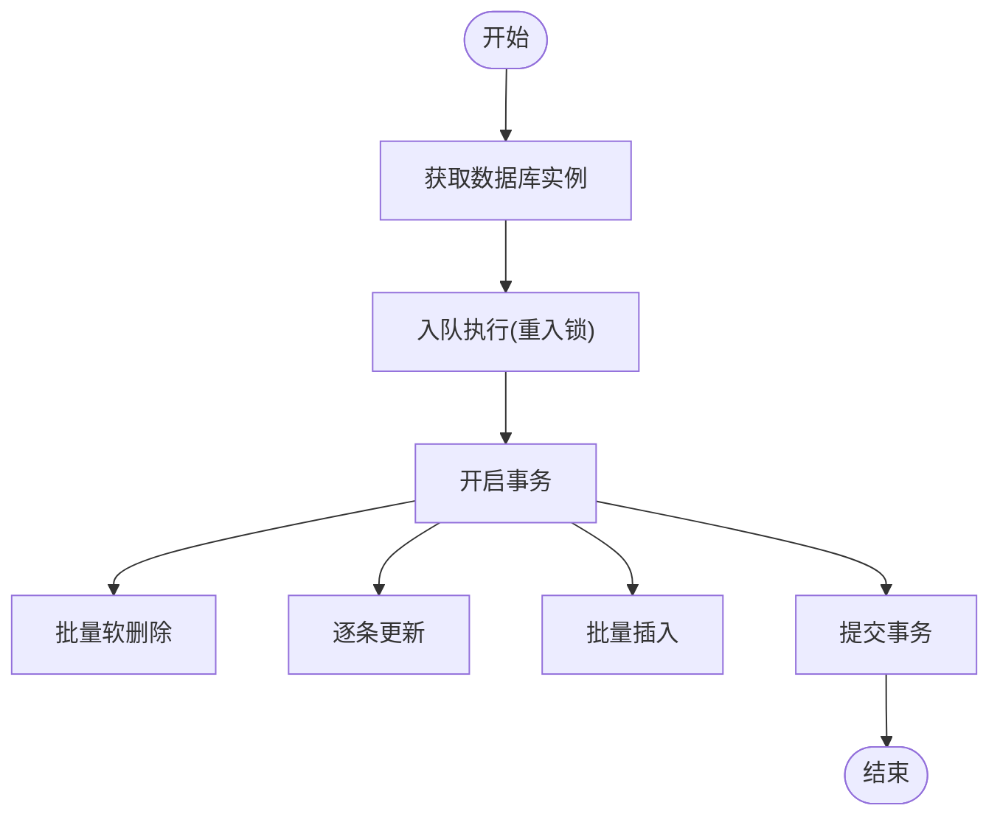
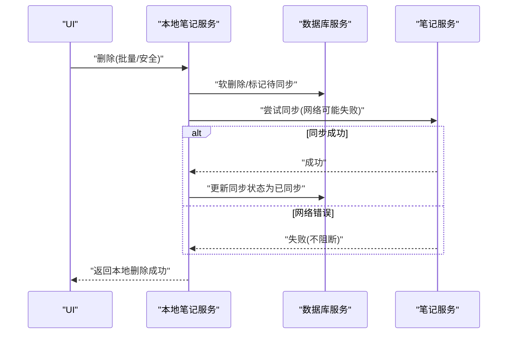
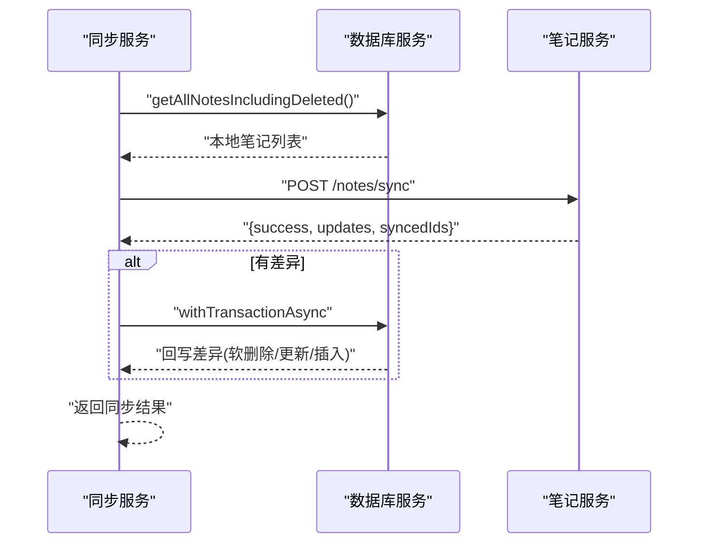
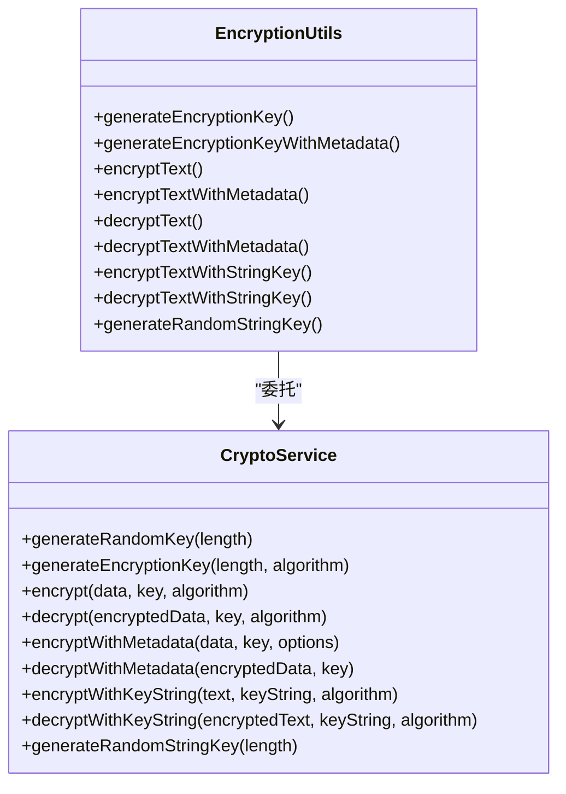
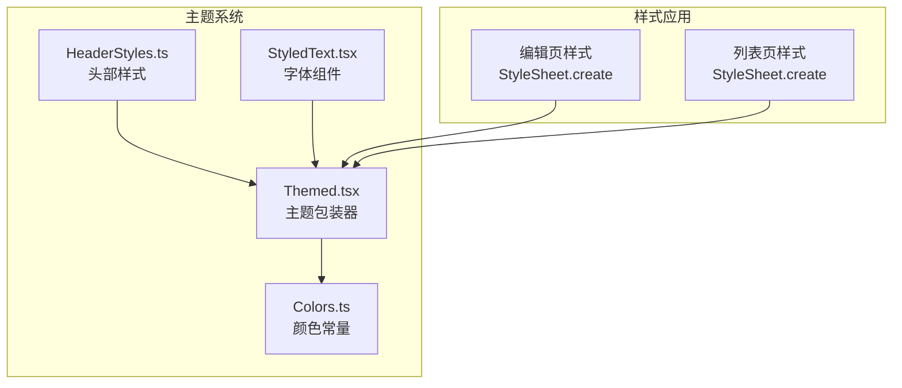
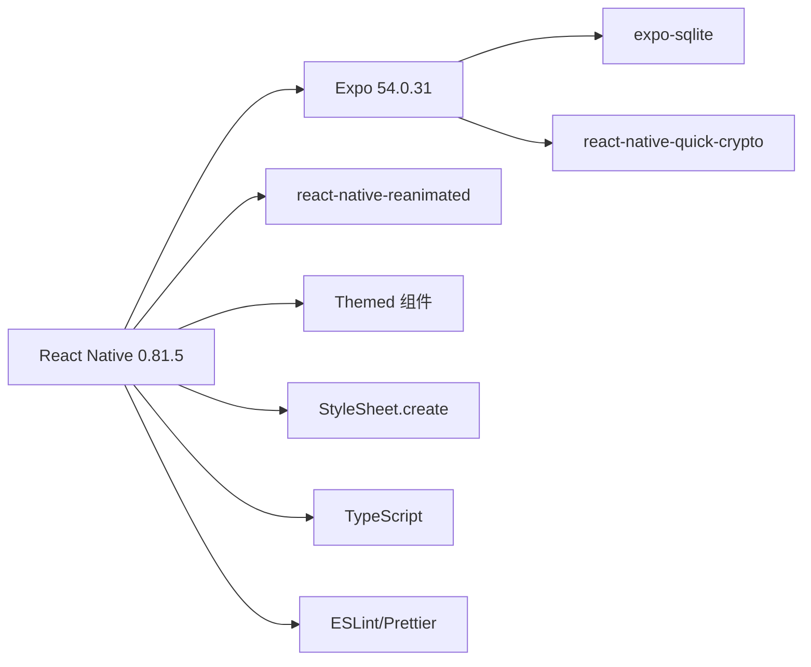

# 项目概述

<cite>
**本文档引用的文件**
- [package.json](file://package.json)
- [app.json](file://app.json)
- [app/_layout.tsx](file://app/_layout.tsx)
- [app/edit.tsx](file://app/edit.tsx)
- [services/index.ts](file://services/index.ts)
- [services/notes/NoteService.ts](file://services/notes/NoteService.ts)
- [services/notes/SyncService.ts](file://services/notes/SyncService.ts)
- [services/local/LocalNoteService.ts](file://services/local/LocalNoteService.ts)
- [services/database/DatabaseService.ts](file://services/database/DatabaseService.ts)
- [services/crypto/CryptoService.ts](file://services/crypto/CryptoService.ts)
- [utils/crypto/EncryptionUtils.ts](file://utils/crypto/EncryptionUtils.ts)
- [types/notes/NoteTypes.ts](file://types/notes/NoteTypes.ts)
- [types/crypto/CryptoTypes.ts](file://types/crypto/CryptoTypes.ts)
- [components/NoteListWithSelection.tsx](file://components/NoteListWithSelection.tsx)
- [services/AppInitializationService.ts](file://services/AppInitializationService.ts)
- [components/Themed.tsx](file://components/Themed.tsx)
- [components/StyledText.tsx](file://components/StyledText.tsx)
- [global.css](file://global.css)
- [babel.config.js](file://babel.config.js)
- [constants/Colors.ts](file://constants/Colors.ts)
- [constants/HeaderStyles.ts](file://constants/HeaderStyles.ts)
- [docs/NativeWind迁移指南.md](file://docs/NativeWind迁移指南.md)
</cite>

## 更新摘要

**所做更改**

- 更新了技术栈描述，反映从NativeWind原子CSS样式转向传统React Native样式方法
- 更新了项目结构说明，强调StyleSheet.create和Themed组件的使用
- 更新了样式系统章节，详细说明当前的样式架构和主题支持
- 更新了依赖关系分析，移除NativeWind相关依赖
- 更新了性能考量，反映传统样式的性能特点

## 目录

1. [简介](#简介)
2. [项目结构](#项目结构)
3. [核心组件](#核心组件)
4. [架构总览](#架构总览)
5. [详细组件分析](#详细组件分析)
6. [样式系统与主题](#样式系统与主题)
7. [依赖关系分析](#依赖关系分析)
8. [性能考量](#性能考量)
9. [故障排查指南](#故障排查指南)
10. [结论](#结论)
11. [附录](#附录)

## 简介

Notes 是一款基于 React Native 与 Expo 的跨平台移动笔记应用，专注于提供安全、高效的笔记管理体验。项目采用"离线优先 + 自动同步"的设计，结合本地 SQLite 数据库存储与 AES-256-CBC 加密，确保用户在弱网或无网环境下也能流畅使用，并在网络恢复后自动完成双向同步。

- 核心目标
  - 提供安全可靠的笔记存储与访问体验
  - 实现离线可用与自动同步
  - 支持批量操作与高效检索
  - 通过原生加密保障隐私数据安全

- 主要功能特性
  - 本地加密存储：基于 AES-256-CBC 的端到端加密
  - 离线优先设计：本地 SQLite 存储，无网也可写入、浏览、搜索
  - 自动同步机制：定时任务驱动的后台同步，支持双向合并
  - 批量操作支持：批量创建、更新、删除与安全删除
  - 用户界面：卡片网格列表、长按选择、浮动菜单、自动保存等

- 技术栈选择理由
  - React Native 0.81.5 + Expo 54.0.31：统一跨平台开发体验，热重载与调试友好，生态成熟
  - SQLite（expo-sqlite）：轻量可靠的关系型存储，适合移动端本地数据持久化
  - AES-256-CBC：业界标准对称加密，配合随机 IV 与元数据封装，兼顾安全性与可移植性
  - 原生加密库 react-native-quick-crypto：在原生层提供高性能加密能力
  - **传统React Native样式系统**：StyleSheet.create提供类型安全的样式定义，Themed组件支持主题切换

- 适用人群
  - 初学者：可从页面与服务的职责边界入手，理解"视图 -> 服务 -> 数据库/网络"的调用链
  - 进阶开发者：可深入并发控制、批处理事务、同步策略与加密实现细节

## 项目结构

项目采用按"功能域"划分的目录组织方式，清晰分离 UI、服务、数据库、加密与类型定义：

- app/：应用入口布局与页面（如编辑页、设置页、模态页）
- components/：通用 UI 组件（如列表、通知、确认模态）
- services/：业务服务层（API、笔记、同步、本地存储、加密、调度）
- types/：TypeScript 类型定义（笔记、加密）
- utils/：工具函数（加密工具、错误处理）
- docs/：开发文档与迁移指南
- constants/：全局常量定义（颜色、头部样式）
- 根目录配置：package.json、app.json、tsconfig.json、babel.config.js 等

**图表来源**

- [app/\_layout.tsx](file://app/_layout.tsx#L32-L81)
- [app/edit.tsx](file://app/edit.tsx#L20-L517)
- [components/NoteListWithSelection.tsx](file://components/NoteListWithSelection.tsx#L1-L398)
- [components/Themed.tsx](file://components/Themed.tsx#L1-L46)
- [components/StyledText.tsx](file://components/StyledText.tsx#L1-L6)
- [constants/HeaderStyles.ts](file://constants/HeaderStyles.ts#L1-L131)
- [constants/Colors.ts](file://constants/Colors.ts#L1-L20)

**章节来源**

- [package.json](file://package.json#L1-L67)
- [app.json](file://app.json#L1-L40)

## 核心组件

- 应用入口与初始化
  - 根布局负责字体加载、主题切换、通知提供者与应用初始化
  - 应用初始化服务启动定时任务（默认每 30 分钟同步、每 60 分钟清理）

- 页面与交互
  - 编辑页：标题/内容输入、自动保存、加密开关、删除确认、浮动菜单
  - 笔记列表：网格展示、长按进入选择模式、批量删除、刷新回调

- 服务与数据流
  - 本地笔记服务：封装 CRUD、批量操作、软删除/安全删除、导出/下载、统计与清理
  - 笔记服务：封装 API 请求（分页、搜索、批量、同步）
  - 同步服务：拉取本地全部笔记，提交至服务端，回写差异
  - 数据库服务：SQLite 封装、并发队列、事务批处理、内存 Map 对比、软删除与清理
  - 加密服务：AES-256-CBC 加密/解密、密钥生成、元数据封装、字符串密钥处理

**章节来源**

- [app/\_layout.tsx](file://app/_layout.tsx#L32-L81)
- [app/edit.tsx](file://app/edit.tsx#L20-L517)
- [components/NoteListWithSelection.tsx](file://components/NoteListWithSelection.tsx#L1-L398)
- [services/AppInitializationService.ts](file://services/AppInitializationService.ts#L16-L37)
- [services/local/LocalNoteService.ts](file://services/local/LocalNoteService.ts#L19-L40)
- [services/notes/NoteService.ts](file://services/notes/NoteService.ts#L32-L70)
- [services/notes/SyncService.ts](file://services/notes/SyncService.ts#L13-L36)
- [services/database/DatabaseService.ts](file://services/database/DatabaseService.ts#L18-L56)
- [services/crypto/CryptoService.ts](file://services/crypto/CryptoService.ts#L16-L38)

## 架构总览

应用采用"视图 -> 本地服务 -> 数据库/网络 -> 类型约束"的分层架构，强调：

- 视图层只负责交互与状态，不直接操作数据库或网络
- 本地服务聚合数据库与 API，提供幂等、容错的业务方法
- 数据库服务提供并发安全与事务保证
- 类型定义贯穿各层，确保接口一致性与可维护性

**图表来源**

- [app/edit.tsx](file://app/edit.tsx#L129-L190)
- [components/NoteListWithSelection.tsx](file://components/NoteListWithSelection.tsx#L110-L141)
- [services/local/LocalNoteService.ts](file://services/local/LocalNoteService.ts#L85-L152)
- [services/database/DatabaseService.ts](file://services/database/DatabaseService.ts#L164-L205)
- [services/notes/NoteService.ts](file://services/notes/NoteService.ts#L48-L70)
- [services/notes/SyncService.ts](file://services/notes/SyncService.ts#L13-L36)

## 详细组件分析

### 数据模型与类型

- 笔记实体包含标识、标题、内容、加密标志、同步状态、软删除标志与时间戳
- 分页响应、批量操作请求/响应、同步请求/响应均通过强类型约束
- 加密类型定义密钥、加密数据与配置项，便于扩展与演进

**图表来源**

- [types/notes/NoteTypes.ts](file://types/notes/NoteTypes.ts#L2-L11)
- [types/notes/NoteTypes.ts](file://types/notes/NoteTypes.ts#L98-L108)
- [types/notes/NoteTypes.ts](file://types/notes/NoteTypes.ts#L69-L72)
- [types/notes/NoteTypes.ts](file://types/notes/NoteTypes.ts#L45-L56)

**章节来源**

- [types/notes/NoteTypes.ts](file://types/notes/NoteTypes.ts#L1-L109)
- [types/crypto/CryptoTypes.ts](file://types/crypto/CryptoTypes.ts#L5-L44)

### 数据库服务（并发与批处理）

- 数据库实例获取与初始化竞争条件防护
- 重入锁与任务队列，避免高频操作导致的死锁与竞态
- 事务内批处理：先软删除、后更新、最后插入，保证原子性
- 内存 Map 对比服务端差异，减少多次查询与锁竞争
- 提供软删除清理、导出、统计、搜索等常用能力

**图表来源**

- [services/database/DatabaseService.ts](file://services/database/DatabaseService.ts#L18-L56)
- [services/database/DatabaseService.ts](file://services/database/DatabaseService.ts#L164-L205)
- [services/database/DatabaseService.ts](file://services/database/DatabaseService.ts#L211-L260)

**章节来源**

- [services/database/DatabaseService.ts](file://services/database/DatabaseService.ts#L18-L115)
- [services/database/DatabaseService.ts](file://services/database/DatabaseService.ts#L164-L260)

### 本地笔记服务（离线优先与容错）

- 初始化本地数据库，确保应用启动即可用
- CRUD 与批量操作均通过数据库服务执行，保证一致性
- 删除策略：软删除 + 待同步状态；网络错误不阻塞本地删除；支持"安全删除"先校验服务端
- 同步：本地先落库，再异步尝试同步，失败不阻断用户体验
- 导出/下载：支持导出 JSON 与下载 Blob

**图表来源**

- [services/local/LocalNoteService.ts](file://services/local/LocalNoteService.ts#L119-L152)
- [services/local/LocalNoteService.ts](file://services/local/LocalNoteService.ts#L157-L211)
- [services/local/LocalNoteService.ts](file://services/local/LocalNoteService.ts#L231-L292)

**章节来源**

- [services/local/LocalNoteService.ts](file://services/local/LocalNoteService.ts#L19-L40)
- [services/local/LocalNoteService.ts](file://services/local/LocalNoteService.ts#L119-L211)
- [services/local/LocalNoteService.ts](file://services/local/LocalNoteService.ts#L231-L292)

### 同步服务（双向合并与事务回写）

- 拉取本地全部笔记（含软删除），提交服务端
- 接收服务端差异，使用内存 Map 与事务回写
- 严格依据更新时间戳决定覆盖策略，避免冲突

**图表来源**

- [services/notes/SyncService.ts](file://services/notes/SyncService.ts#L13-L36)
- [services/database/DatabaseService.ts](file://services/database/DatabaseService.ts#L211-L260)
- [services/notes/NoteService.ts](file://services/notes/NoteService.ts#L69-L70)

**章节来源**

- [services/notes/SyncService.ts](file://services/notes/SyncService.ts#L1-L58)
- [services/database/DatabaseService.ts](file://services/database/DatabaseService.ts#L211-L260)

### 加密服务（AES-256-CBC 与密钥管理）

- 原生环境使用 react-native-quick-crypto 提供高性能加密
- 支持随机密钥生成、密钥 Base64 编解码、带元数据的加密/解密
- 字符串密钥自动哈希处理，适配 256 位要求
- 加密工具函数提供便捷 API，屏蔽底层实现细节

**图表来源**

- [services/crypto/CryptoService.ts](file://services/crypto/CryptoService.ts#L10-L204)
- [utils/crypto/EncryptionUtils.ts](file://utils/crypto/EncryptionUtils.ts#L14-L111)

**章节来源**

- [services/crypto/CryptoService.ts](file://services/crypto/CryptoService.ts#L10-L204)
- [utils/crypto/EncryptionUtils.ts](file://utils/crypto/EncryptionUtils.ts#L1-L112)
- [types/crypto/CryptoTypes.ts](file://types/crypto/CryptoTypes.ts#L5-L44)

### 应用初始化与定时任务

- 应用启动时初始化本地数据库与定时任务
- 默认每 30 分钟执行一次同步，每 60 分钟执行一次清理
- 可通过初始化服务参数调整周期

**章节来源**

- [app/\_layout.tsx](file://app/_layout.tsx#L38-L44)
- [services/AppInitializationService.ts](file://services/AppInitializationService.ts#L16-L37)

## 样式系统与主题

### 主题组件系统

项目采用传统的 React Native 主题组件系统，通过 Themed.tsx 提供主题支持：

- **Themed 组件**：Text 和 View 的主题包装器，支持明暗主题自动切换
- **颜色管理**：Colors.ts 定义明暗主题的颜色映射
- **样式常量**：HeaderStyles.ts 提供统一的头部样式配置
- **字体支持**：StyledText.tsx 提供等宽字体支持

**图表来源**

- [components/Themed.tsx](file://components/Themed.tsx#L1-L46)
- [components/StyledText.tsx](file://components/StyledText.tsx#L1-L6)
- [constants/Colors.ts](file://constants/Colors.ts#L1-L20)
- [constants/HeaderStyles.ts](file://constants/HeaderStyles.ts#L1-L131)
- [app/edit.tsx](file://app/edit.tsx#L408-L517)
- [components/NoteListWithSelection.tsx](file://components/NoteListWithSelection.tsx#L273-L395)

### 样式架构特点

- **类型安全**：StyleSheet.create 提供完整的 TypeScript 支持
- **主题支持**：useColorScheme hook 实现明暗主题自动切换
- **性能优化**：静态样式定义，运行时开销最小
- **向后兼容**：完全兼容现有代码，无需迁移成本

### 样式使用示例

- **编辑页样式**：包含容器、头部、内容区域、浮动菜单等完整样式定义
- **列表页样式**：网格布局、卡片样式、选择状态、加载状态等
- **头部样式**：统一的头部布局、按钮样式、图标样式

**章节来源**

- [components/Themed.tsx](file://components/Themed.tsx#L1-L46)
- [components/StyledText.tsx](file://components/StyledText.tsx#L1-L6)
- [constants/Colors.ts](file://constants/Colors.ts#L1-L20)
- [constants/HeaderStyles.ts](file://constants/HeaderStyles.ts#L1-L131)
- [app/edit.tsx](file://app/edit.tsx#L408-L517)
- [components/NoteListWithSelection.tsx](file://components/NoteListWithSelection.tsx#L273-L395)

## 依赖关系分析

- 运行时依赖
  - React Native 与 Expo：提供跨平台运行时与原生插件生态
  - expo-sqlite：本地数据库
  - react-native-quick-crypto：原生加密
  - react-native-reanimated：动画与交互
  - **传统样式系统**：StyleSheet.create 与 Themed 组件
- 开发依赖
  - TypeScript、ESLint、Prettier 等，保障代码质量与风格一致

**图表来源**

- [package.json](file://package.json#L14-L40)
- [package.json](file://package.json#L41-L67)

**章节来源**

- [package.json](file://package.json#L1-L67)
- [app.json](file://app.json#L28-L31)

## 性能考量

- 并发与锁
  - 数据库服务通过"重入锁 + 任务队列"避免高并发下的死锁与竞态
  - 事务批处理减少多次提交带来的开销
- 查询与对比
  - 同步阶段一次性拉取本地索引，使用内存 Map 对比，降低锁竞争与重复查询
- 网络与离线
  - 删除/批量删除在网络错误时不阻断本地操作，提升离线可用性
  - 自动保存与防抖降低频繁写入与网络请求
- UI 与交互
  - 列表网格与长按选择支持批量操作，减少重复点击成本
  - 动画与模态框优化交互反馈
- **样式性能**
  - 传统样式系统提供最佳运行时性能
  - 静态样式定义避免运行时计算开销
  - 主题切换通过单一 hook 实现，性能开销最小

**章节来源**

- [services/database/DatabaseService.ts](file://services/database/DatabaseService.ts#L62-L115)
- [services/database/DatabaseService.ts](file://services/database/DatabaseService.ts#L211-L260)
- [services/local/LocalNoteService.ts](file://services/local/LocalNoteService.ts#L119-L211)
- [app/edit.tsx](file://app/edit.tsx#L192-L227)
- [components/NoteListWithSelection.tsx](file://components/NoteListWithSelection.tsx#L67-L96)

## 故障排查指南

- 数据库连接问题
  - 现象：初始化失败、空指针、SQL 错误
  - 处理：数据库服务内置重置逻辑，捕获特定错误后关闭并重建连接
- 同步失败
  - 现象：网络错误、超时、服务端异常
  - 处理：同步服务与本地删除服务均采用"失败不阻断"，记录日志并保持本地一致性
- 加密异常
  - 现象：密钥格式错误、解密失败
  - 处理：检查密钥 Base64 编码与长度，必要时使用字符串密钥并自动哈希
- 定时任务未执行
  - 现象：未按时同步/清理
  - 处理：确认应用初始化服务已启动，检查日志输出
- **样式问题**
  - 现象：主题颜色不正确、样式不生效
  - 处理：检查 Themed 组件使用、颜色常量定义、StyleSheet.create 语法

**章节来源**

- [services/database/DatabaseService.ts](file://services/database/DatabaseService.ts#L80-L94)
- [services/local/LocalNoteService.ts](file://services/local/LocalNoteService.ts#L125-L143)
- [services/notes/SyncService.ts](file://services/notes/SyncService.ts#L32-L35)
- [services/crypto/CryptoService.ts](file://services/crypto/CryptoService.ts#L86-L88)
- [services/AppInitializationService.ts](file://services/AppInitializationService.ts#L28-L37)

## 结论

Notes 通过清晰的分层架构、严谨的并发控制与事务批处理、以及完善的离线与同步策略，实现了安全、稳定、高效的移动笔记体验。结合原生加密与原生加密库，既满足了性能需求，又保障了数据隐私。项目采用传统的 React Native 样式系统，通过 Themed 组件和 StyleSheet.create 提供了最佳的性能表现和类型安全。对于初学者，建议从页面与服务的职责边界入手；对于进阶开发者，可进一步优化同步策略、扩展加密算法与密钥轮换机制。

## 附录

- 实际使用场景示例
  - 新建笔记：编辑页自动保存，本地立即可见，后台异步同步
  - 批量删除：长按进入选择模式，批量删除后本地立即生效，网络恢复后回写
  - 离线编辑：无网状态下仍可创建/更新/删除，网络恢复后自动合并差异
  - 安全删除：先校验服务端状态，再进行本地软删除，避免误删
  - **主题切换**：应用根据系统主题自动切换明暗模式，提供一致的视觉体验
