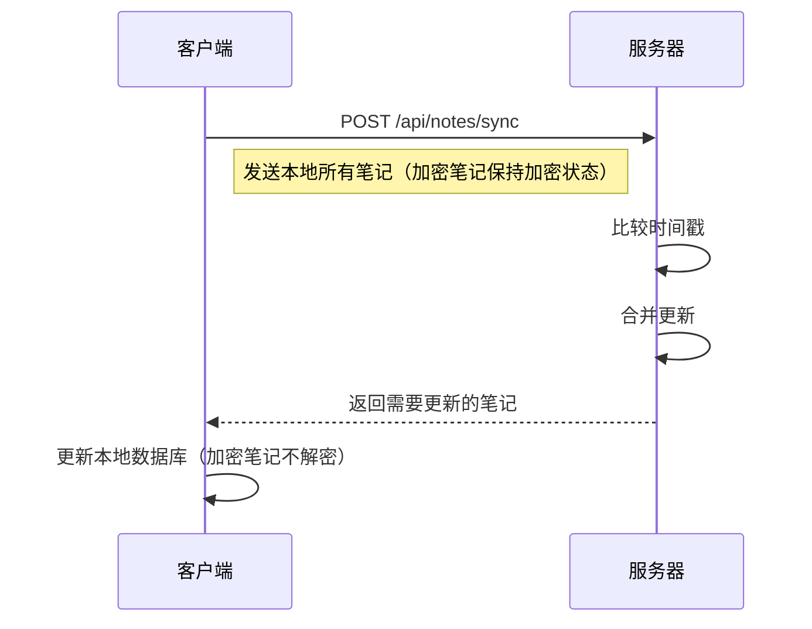

# Notes 笔记应用开发文档

## 目录

- [项目概述](#项目概述)
- [技术栈](#技术栈)
- [项目结构](#项目结构)
- [核心模块](#核心模块)
- [数据模型](#数据模型)
- [服务层架构](#服务层架构)
- [开发指南](#开发指南)
- [API 文档](#api-文档)

---

## 项目概述

**Notes** 是一款基于 Expo + React Native 构建的跨平台笔记应用，支持 iOS、Android 和 Web 平台。应用提供以下核心功能：

- 📝 **笔记管理** - 创建、编辑、删除、搜索笔记
- 🔐 **本地透明加密** - 使用 AES-256-CBC 算法实现内存明文、存储密文的安全方案
- ☁️ **云端同步** - 支持与远程服务器双向同步（加密笔记以密文形式同步）
- 💾 **本地存储** - 使用 SQLite 实现离线优先架构，本地只存储密文
- 🎨 **深色模式** - 自动跟随系统主题切换

---

## 技术栈

| 类别     | 技术                      | 版本     |
| -------- | ------------------------- | -------- |
| 框架     | Expo                      | ~54.0.31 |
| 运行时   | React Native              | 0.81.5   |
| 路由     | Expo Router               | ~6.0.21  |
| 数据库   | expo-sqlite               | ~16.0.10 |
| 加密     | react-native-quick-crypto | ^1.0.6   |
| HTTP     | Axios                     | ^1.13.2  |
| 日期处理 | Day.js                    | ^1.11.19 |
| 状态管理 | React Hooks               | -        |
| 语言     | TypeScript                | ~5.9.2   |

### 开发工具

- **代码规范**: ESLint + Prettier
- **Git Hooks**: Husky + lint-staged
- **字体**: SpaceMono + FontAwesome

---

## 项目结构

```
notes/
├── app/                          # 页面路由 (Expo Router)
│   ├── (tabs)/                   # Tab 导航页面
│   │   ├── _layout.tsx           # Tab 布局配置
│   │   └── index.tsx             # 首页 (笔记列表)
│   ├── _layout.tsx               # 根布局
│   ├── edit.tsx                  # 编辑笔记页
│   ├── settings.tsx              # 设置页
│   ├── server-settings.tsx       # 服务器配置页
│   └── modal.tsx                 # 模态页面
│
├── components/                   # UI 组件
│   ├── NoteListWithSelection.tsx # 笔记列表组件 (支持多选)
│   ├── DeleteConfirmationModal.tsx # 删除确认弹窗
│   ├── NotificationManager.tsx   # 全局通知管理
│   ├── EncryptionExample.tsx     # 加密示例组件
│   ├── LocalStorageDemo.tsx      # 本地存储演示
│   └── Themed.tsx                # 主题化组件
│
├── services/                     # 服务层
│   ├── index.ts                  # 服务导出入口
│   ├── api/
│   │   └── ApiClient.ts          # Axios HTTP 客户端
│   ├── notes/
│   │   ├── NoteService.ts        # 远程笔记 API 服务
│   │   ├── SyncService.ts        # 同步服务
│   │   └── __tests__/            # 测试文件
│   │       └── SyncService.test.ts
│   ├── local/
│   │   └── LocalNoteService.ts   # 本地笔记服务
│   ├── database/
│   │   └── DatabaseService.ts    # SQLite 数据库操作
│   ├── crypto/
│   │   ├── CryptoService.ts         # 加密服务类
│   │   ├── EncryptedNoteService.ts  # 加密笔记服务
│   │   ├── TransparentCryptoService.ts # 透明加密服务
│   │   └── __tests__/               # 测试文件
│   │       ├── CryptoService.test.ts
│   │       ├── EncryptedNoteService.test.ts
│   │       └── TransparentCryptoService.test.ts
│   └── scheduler/
│       └── SchedulerService.ts   # 定时任务服务
│
├── types/                        # TypeScript 类型定义
│   ├── notes/
│   │   └── NoteTypes.ts          # 笔记相关类型
│   └── crypto/
│       └── CryptoTypes.ts        # 加密相关类型
│
├── utils/                        # 工具函数
│   ├── ErrorHandler.ts           # 错误处理
│   ├── auth/
│   │   └── AuthUtils.ts          # API Key 管理
│   └── crypto/
│       ├── EncryptionUtils.ts    # 加密工具函数
│       ├── KeyStorage.ts         # 安全密钥存储
│       └── __tests__/            # 测试文件
│           └── EncryptionUtils.test.ts
│
├── constants/                    # 常量定义
│   ├── Colors.ts                 # 颜色常量
│   └── HeaderStyles.ts           # 标题栏样式
│
├── assets/                       # 静态资源
│   └── fonts/                    # 字体文件
│
├── config/                       # 配置文件
├── package.json                  # 项目依赖
├── app.json                      # Expo 配置
├── tsconfig.json                 # TypeScript 配置
└── api-doc.md                    # API 接口文档
```

---

## 核心模块

### 1. 路由系统 (Expo Router)

应用使用文件系统路由，主要页面：

| 路径               | 页面       | 描述                     |
| ------------------ | ---------- | ------------------------ |
| `/(tabs)`          | 首页       | 笔记列表，支持搜索和同步 |
| `/edit`            | 编辑页     | 创建/编辑笔记            |
| `/settings`        | 设置页     | 应用设置                 |
| `/server-settings` | 服务器设置 | API 配置                 |

### 2. 数据存储

#### 本地数据库 (SQLite)

使用 `expo-sqlite` 实现本地持久化存储：

```sql
CREATE TABLE notes (
  id           TEXT PRIMARY KEY NOT NULL,
  title        TEXT NOT NULL,
  content      TEXT NOT NULL,
  is_encrypted INTEGER DEFAULT 0,
  sync_status  INTEGER DEFAULT 0,
  is_deleted   INTEGER DEFAULT 0,
  created_at   TEXT NOT NULL,
  updated_at   TEXT NOT NULL
);
```

**字段说明：**

| 字段           | 类型    | 说明                          |
| -------------- | ------- | ----------------------------- |
| `id`           | TEXT    | UUID 主键                     |
| `title`        | TEXT    | 笔记标题                      |
| `content`      | TEXT    | 笔记内容                      |
| `is_encrypted` | INTEGER | 是否加密 (0/1)                |
| `sync_status`  | INTEGER | 同步状态 (0=已同步, 1=待同步) |
| `is_deleted`   | INTEGER | 软删除标记 (0/1)              |
| `created_at`   | TEXT    | 创建时间 (ISO 8601)           |
| `updated_at`   | TEXT    | 更新时间 (ISO 8601)           |

### 3. 加密服务

使用 `react-native-quick-crypto` 实现 AES-256-CBC 加密，提供完整的错误处理和边界情况处理。

#### CryptoService

核心加密服务，提供以下功能：

```typescript
// 加密示例
import { CryptoService, CryptoError, CryptoErrorCode } from '@/services';

try {
  // 生成密钥
  const key = CryptoService.generateRandomKey();
  const keyString = CryptoService.keyToBase64(key);

  // 加密
  const encrypted = CryptoService.encrypt('敏感数据', key);

  // 解密
  const decrypted = CryptoService.decrypt(encrypted, key);
} catch (error) {
  if (error instanceof CryptoError) {
    console.error(`加密错误 [${error.code}]:`, error.message);
  }
}
```

**支持的加密算法：**

- `aes-256-cbc` (默认，推荐)
- `aes-192-cbc`
- `aes-128-cbc`

**加密数据格式：**

```
{IV}:{加密内容}
```

**错误处理：**

| 错误代码                   | 说明               |
| -------------------------- | ------------------ |
| `INVALID_KEY`              | 密钥格式或长度无效 |
| `INVALID_DATA`             | 输入数据无效       |
| `INVALID_ALGORITHM`        | 不支持的加密算法   |
| `ENCRYPTION_FAILED`        | 加密过程失败       |
| `DECRYPTION_FAILED`        | 解密过程失败       |
| `INVALID_ENCRYPTED_FORMAT` | 加密数据格式错误   |
| `KEY_GENERATION_FAILED`    | 密钥生成失败       |

#### EncryptionUtils

便捷的加密工具函数：

```typescript
import {
  generateEncryptionKey,
  encryptText,
  decryptText,
  validateKeyFormat,
  validateEncryptedData,
  isValidBase64,
} from '@/utils/crypto/EncryptionUtils';

// 生成密钥
const key = generateEncryptionKey();

// 验证密钥格式
if (validateKeyFormat(key)) {
  // 加密
  const encrypted = encryptText('敏感数据', key);

  // 验证加密数据
  if (validateEncryptedData(encrypted)) {
    // 解密
    const decrypted = decryptText(encrypted, key);
  }
}
```

#### EncryptedNoteService

加密笔记服务，管理加密笔记的完整生命周期：

```typescript
import { EncryptedNoteService } from '@/services';

// 创建加密笔记
const note = await EncryptedNoteService.createEncryptedNote({
  title: '我的加密笔记',
  content: '这是加密内容',
  is_encrypted: 1,
  sync_status: 0,
  is_deleted: 0,
  created_at: new Date().toISOString(),
  updated_at: new Date().toISOString(),
});

// 获取并解密笔记
const decryptedNote = await EncryptedNoteService.getDecryptedNote(note.id);

// 更新加密笔记
const updated = await EncryptedNoteService.updateEncryptedNote(note.id, {
  content: '更新的加密内容',
});

// 删除加密笔记
await EncryptedNoteService.deleteEncryptedNote(note.id);

// 导出密钥（用于备份）
const key = await EncryptedNoteService.exportEncryptionKey();

// 导入密钥
await EncryptedNoteService.importEncryptionKey(key);
```

**密钥管理：**

- 自动生成和存储加密密钥
- 支持密钥导出/导入
- 密钥版本控制
- 自动备份机制

#### KeyStorage

安全的密钥存储服务，使用 Expo SecureStore：

```typescript
import { KeyStorage } from '@/utils/crypto/KeyStorage';

// 检查 SecureStore 是否可用
const available = await KeyStorage.isAvailable();

// 生成并存储密钥
const { key, metadata } = await KeyStorage.generateAndStoreKey('my-key', 32);

// 检索密钥
const { key, metadata } = await KeyStorage.retrieveKey('my-key');

// 备份密钥
const backupId = await KeyStorage.backupKey('my-key');

// 恢复密钥
await KeyStorage.restoreKey('my-key', backupId);

// 删除密钥
await KeyStorage.deleteKey('my-key');
```

**安全特性：**

- 使用设备安全存储（iOS Keychain / Android Keystore）
- 自动回退到 AsyncStorage（当 SecureStore 不可用时）
- 密钥访问控制
- 加密存储

#### TransparentCryptoService（透明加密服务）

**本地透明加密方案** - 实现内存明文、存储密文的安全架构：

```typescript
import { TransparentCryptoService } from '@/services';

// 初始化透明加密服务（应用启动时调用）
await TransparentCryptoService.initialize();

// 加密笔记（保存到数据库前调用）
const encryptedNote = await TransparentCryptoService.encryptNote({
  id: 'note-id',
  title: '笔记标题',
  content: '敏感内容',
  is_encrypted: 1, // 启用加密
  sync_status: 1,
  is_deleted: 0,
  created_at: new Date().toISOString(),
  updated_at: new Date().toISOString(),
});

// 解密笔记（从数据库读取后调用）
const plainNote = await TransparentCryptoService.decryptNote(encryptedNote);

// 批量解密（用于笔记列表）
const plainNotes = await TransparentCryptoService.decryptNotes(encryptedNotes);

// 切换加密状态
const updatedNote = await TransparentCryptoService.toggleEncryption(note, true);
```

**透明加密工作流程：**

```
┌─────────────────────────────────────────────────────────────┐
│                        用户界面层                            │
│  ┌──────────────┐    ┌──────────────┐    ┌──────────────┐  │
│  │   输入内容    │    │   显示内容    │    │  编辑操作    │  │
│  │   (明文)     │    │   (明文)     │    │  (明文)      │  │
│  └──────┬───────┘    └──────┬───────┘    └──────┬───────┘  │
└─────────┼───────────────────┼───────────────────┼──────────┘
          │                   │                   │
          ▼                   ▼                   ▼
┌─────────────────────────────────────────────────────────────┐
│                    透明加密服务层                            │
│  ┌──────────────────────────────────────────────────────┐  │
│  │  保存时: encryptNote()    读取时: decryptNote()      │  │
│  │  自动加密内容 → 密文存储   自动解密密文 → 明文显示    │  │
│  └──────────────────────────────────────────────────────┘  │
└─────────────────────────────────────────────────────────────┘
          │                                           ▲
          ▼                                           │
┌─────────────────────────────────────────────────────────────┐
│                      数据库存储层                            │
│  ┌──────────────────────────────────────────────────────┐  │
│  │  SQLite 数据库 (只存储密文)                           │  │
│  │  content: "U2FsdGVkX1+..." (加密内容)                 │  │
│  │  is_encrypted: 1 (加密标记)                          │  │
│  └──────────────────────────────────────────────────────┘  │
└─────────────────────────────────────────────────────────────┘
```

**透明加密特性：**

| 特性         | 说明                                         |
| ------------ | -------------------------------------------- |
| **内存安全** | UI 层始终处理明文，用户体验无感知            |
| **存储安全** | 数据库只存储密文，设备丢失不泄露             |
| **自动处理** | 加密/解密过程完全自动化，无需手动调用        |
| **搜索支持** | 在内存中解密后进行搜索，支持加密笔记内容搜索 |
| **同步安全** | 同步时传输密文，保护传输过程安全             |

**使用场景：**

- 用户勾选加密选项后，内容自动加密存储
- 打开加密笔记时，内容自动解密显示
- 笔记列表加载时，所有加密笔记自动解密以便搜索和预览
- 导出笔记时，可选择导出明文或密文

### 4. 同步机制

应用采用**冲突解决策略**：以更新时间戳较新的版本为准。

**同步流程：**



#### 加密笔记同步

加密笔记在同步过程中**始终保持加密状态**，不会在网络传输中暴露明文内容。

```typescript
import {
  synchronizeNotes,
  synchronizeEncryptedNotes,
  getSyncSummary,
} from '@/services/notes/SyncService';

// 同步所有笔记（包括加密笔记）
const syncResponse = await synchronizeNotes();

// 专门同步加密笔记
const { encryptedNotesCount, syncResponse } = await synchronizeEncryptedNotes();

// 获取同步摘要
const summary = getSyncSummary(syncResponse);
console.log(`更新了 ${summary.totalUpdates} 条笔记，其中 ${summary.encryptedUpdates} 条是加密笔记`);
```

**同步安全保证：**

- 加密笔记内容在同步过程中不解密
- 服务器只接收和存储加密后的数据
- 同步时保留 `is_encrypted` 标记
- 支持加密笔记的增量同步

// 专门同步加密笔记
const { encryptedNotesCount, syncResponse } = await synchronizeEncryptedNotes();

// 获取同步摘要
const summary = getSyncSummary(syncResponse);
console.log(`更新了 ${summary.totalUpdates} 条笔记，其中 ${summary.encryptedUpdates} 条是加密笔记`);

````

---

## 数据模型

### Note 笔记类型

```typescript
interface Note {
  id: string; // UUID 格式
  title: string; // 标题
  content: string; // 内容
  is_encrypted: number; // 0=未加密, 1=已加密
  sync_status: number; // 0=已同步, 1=待同步
  is_deleted: number; // 0=正常, 1=已删除
  created_at: string; // ISO 8601 时间戳
  updated_at: string; // ISO 8601 时间戳
}
````

### EncryptionKey 加密密钥

```typescript
interface EncryptionKey {
  key: string; // Base64 编码的密钥
  algorithm: string; // 算法 (如 'aes-256-cbc')
  length: number; // 密钥长度 (字节)
  createdAt: number; // 创建时间戳
}
```

### EncryptedData 加密数据

```typescript
interface EncryptedData {
  encrypted: string; // 加密后的数据
  iv: string; // 初始化向量
  algorithm: string; // 使用的算法
  timestamp: number; // 时间戳
}
```

---

## 服务层架构

### 服务分层

```
┌─────────────────────────────────────────────┐
│                  UI 层                       │
│         (React Native Components)           │
└─────────────────────┬───────────────────────┘
                      │
┌─────────────────────▼───────────────────────┐
│              LocalNoteService               │
│         (统一接口，协调本地与远程)            │
└───────────┬─────────────────┬───────────────┘
            │                 │
┌───────────▼─────────┐ ┌─────▼───────────────┐
│   DatabaseService   │ │    NoteService      │
│    (SQLite 操作)     │ │   (远程 API 调用)    │
└─────────────────────┘ └─────────────────────┘
```

### 主要服务说明

#### 1. NoteService (远程服务)

负责与后端 API 通信：

```typescript
import { noteService } from '@/services';

// 获取笔记列表
const { data, total } = await noteService.getNotes({ page: 1, limit: 20 });

// 创建笔记
await noteService.createNote({ title: '新笔记', content: '...' });

// 同步笔记
await noteService.syncNotes({ clientNotes: localNotes });
```

#### 2. LocalNoteService (本地服务)

提供本地优先的操作接口：

```typescript
import { initLocalStorage } from '@/services';

// 初始化
await initLocalStorage();

// 本地 CRUD 操作
await localNoteService.createNote(noteData);
await localNoteService.updateNote(id, updateData);
await localNoteService.deleteNote(id);
```

#### 3. DatabaseService (数据库服务)

封装 SQLite 操作：

```typescript
import * as DatabaseService from '@/services/database/DatabaseService';

// 获取所有笔记
const notes = await DatabaseService.getAllNotes();

// 批量操作
await DatabaseService.batchOperationNotes(createData, updateData, deleteIds);

// 同步数据
await DatabaseService.syncWithServer(serverNotes);
```

#### 4. CryptoService (加密服务)

提供加解密功能，包含完整的错误处理：

```typescript
import { CryptoService, CryptoError } from '@/services';

try {
  // 生成密钥
  const key = CryptoService.generateRandomKey(32);
  const keyString = CryptoService.keyToBase64(key);

  // 加密
  const encrypted = CryptoService.encrypt('明文', key);

  // 解密
  const decrypted = CryptoService.decrypt(encrypted, key);

  // 字符串密钥加密
  const encrypted2 = CryptoService.encryptWithKeyString('明文', 'my-secret-key');
} catch (error) {
  if (error instanceof CryptoError) {
    console.error(`加密错误 [${error.code}]:`, error.message);
  }
}
```

#### 5. EncryptedNoteService (加密笔记服务)

管理加密笔记的完整生命周期：

```typescript
import { EncryptedNoteService } from '@/services';

// 创建加密笔记
const note = await EncryptedNoteService.createEncryptedNote({
  title: '加密笔记',
  content: '敏感内容',
  is_encrypted: 1,
  sync_status: 0,
  is_deleted: 0,
  created_at: new Date().toISOString(),
  updated_at: new Date().toISOString(),
});

// 获取并解密笔记
const decrypted = await EncryptedNoteService.getDecryptedNote(note.id);

// 更新加密笔记
await EncryptedNoteService.updateEncryptedNote(note.id, { content: '新内容' });

// 导出/导入密钥
const key = await EncryptedNoteService.exportEncryptionKey();
await EncryptedNoteService.importEncryptionKey(key);
```

#### 6. KeyStorage (密钥存储服务)

使用设备安全存储管理密钥：

```typescript
import { KeyStorage } from '@/utils/crypto/KeyStorage';

// 生成并安全存储密钥
const { key, metadata } = await KeyStorage.generateAndStoreKey('my-key', 32);

// 检索密钥
const { key } = await KeyStorage.retrieveKey('my-key');

// 备份和恢复
const backupId = await KeyStorage.backupKey('my-key');
await KeyStorage.restoreKey('my-key', backupId);
```

#### 7. SyncService (同步服务)

负责本地与服务器数据同步，支持加密笔记安全同步：

```typescript
import { synchronizeNotes, getSyncSummary } from '@/services';

// 执行同步
const result = await synchronizeNotes();
console.log(`更新了 ${result.updates.length} 条笔记`);
```

---

## 开发指南

### 环境要求

- Node.js >= 18
- npm 或 yarn
- Expo CLI
- iOS 模拟器 / Android 模拟器 / 真机

### 安装依赖

```bash
npm install
```

### 启动开发服务器

```bash
# 启动 Expo 开发服务器
npm run start

# 启动 Android
npm run android

# 启动 iOS
npm run ios
```

### 代码规范

```bash
# ESLint 检查
npm run lint

# ESLint 自动修复
npm run lint:fix

# Prettier 格式化
npm run format
```

### 目录别名

项目配置了 `@/` 别名指向项目根目录：

```typescript
// 使用别名
import { noteService } from '@/services';
import { Note } from '@/types/notes/NoteTypes';
```

### 添加新页面

1. 在 `app/` 目录创建 `.tsx` 文件
2. Expo Router 会自动注册路由
3. 使用 `useRouter()` 进行导航

```typescript
import { useRouter } from 'expo-router';

const router = useRouter();
router.push('/new-page');
```

### 添加新服务

1. 在 `services/` 目录创建服务文件
2. 在 `services/index.ts` 导出
3. 在组件中导入使用

---

## API 文档

完整的 API 文档请参阅 [api-doc.md](../api-doc.md)。

### 主要接口概览

| 方法   | 接口                    | 描述                |
| ------ | ----------------------- | ------------------- |
| GET    | `/api/notes`            | 获取笔记列表 (分页) |
| GET    | `/api/notes/:id`        | 获取笔记详情        |
| POST   | `/api/notes`            | 创建笔记            |
| PATCH  | `/api/notes/:id`        | 更新笔记            |
| DELETE | `/api/notes/:id`        | 删除笔记            |
| DELETE | `/api/notes/batch`      | 批量删除            |
| POST   | `/api/notes/sync`       | 同步笔记            |
| POST   | `/api/notes/batch`      | 批量创建/更新       |
| GET    | `/api/notes/export/all` | 导出所有笔记        |

### 认证方式

使用 Bearer Token 认证：

```
Authorization: Bearer {API_KEY}
```

---

## 更新日志

| 版本  | 日期       | 描述     |
| ----- | ---------- | -------- |
| 1.0.0 | 2026-01-23 | 初始版本 |

---

## 参考资料

- [Expo Documentation](https://docs.expo.dev/)
- [React Native Documentation](https://reactnative.dev/)
- [Expo Router](https://docs.expo.dev/router/introduction/)
- [expo-sqlite](https://docs.expo.dev/versions/latest/sdk/sqlite/)
